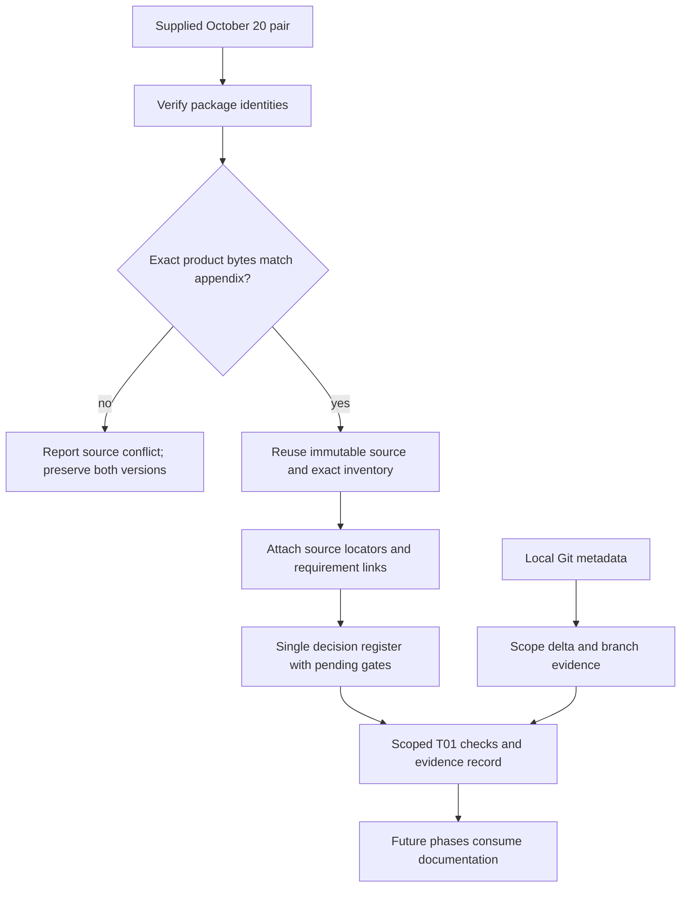

# Phase 1: Product authority, repository review and decision register - Research

**Researched:** 2026-10-20
**Domain:** Documentation provenance, exact source inventory, repository scope and approval gates
**Confidence:** LOW from the generic local-provider classifier; direct source observations and byte checks are separately identified below. This is a limitation of that classifier's provider vocabulary, not an unresolved product decision.

<user_constraints>
## User Constraints (from CONTEXT.md)

The following decision/discretion/deferred text is copied verbatim from the current context. It describes authorized scope, not implementation completion. [CITED: .planning/phases/01-product-authority-repository-review-and-decision-register/01-CONTEXT.md:16-34,57-60]

<!-- DATA_B7c93aF2_START -->
### Source authority (SRC-01)
- Use only SLL-xSPI-MC-Shop-Proposal-2026-10-20.md, SLL-xSPI-MC-Shop-Codex-Handoff-2026-10-20.md and their exact embedded product for new scope. Preserve the 23,969-byte product including its final newline and verify SHA-256 562dc4015c62f165df5df3e9ae1aab26b8102385d9dc76a556d5965ddc1a0263. Preserve the proposal/package hash records. Source hash proves provenance, not commercial approval.

### Complete inventory (SRC-02)
- Trace the exact ordered three vendors/thirteen families, term/band/access rules, thirteen logical configuration controls, nineteen business groups, two convenience helpers, four IP declarations and separate marketing control. Preserve observed specification versus provisional/unresolved status; this is no live-form audit. Existing SOURCE-MATRIX.md and extracted product are reusable evidence inputs.

### Decision register (SRC-03)
- docs/decisions.md is the single P-01–P-12 register. Track pending/approved status, responsible owner role, evidence and exact affected phase/operation. No business input or actual named owner has been supplied. Ask for missing input only when its operation needs it; continue unrelated preparation. Provisional prices, five-plus-five allowance, €50 and host mechanism do not become approved by entering a register.

### Repository scope and identity (SRC-04)
- Establish sll-xspi-mc, sll-xspi-mc-support-10h and sll-xspi-mc-v1; customer origin https://shop.xspi.pro, proposed staff origin https://shop-admin.xspi.pro. Record the scope/delta from the replaced planning, protect unrelated work and history, and grant no completion credit to older task numbers. Record current branch/worktree provenance. Planning does not switch branches; an execution-time isolated branch requirement must be resolved without fabricating evidence.

### Execution and evidence boundaries
- Current authorization covers planning/documentation only. No application code, production catalog, external operations, real SMTP, bank, cloud/DNS/TLS or live activation in this run. Plan future phase evidence explicitly; do not create completion summaries or mark requirements complete during planning. Keep source/specification evidence separate from synthetic, bank-sandbox, OVH and production proof.
- Preserve the ignored local .env without reading, sourcing, copying or publishing its values. No task needs credentials for T01. Protect supplied source bytes and existing user work.
- Retain established workflow preferences: independent agent roles, verification/source grounding, current model inheritance. Commit and push after each commit per explicit user instruction. The parent coordinates commits; child agents do not commit or push.

### the agent's Discretion
- Choose a small set of cohesive documentation/evidence plans and concrete artifact names within source-proposed paths. Reuse current inventories instead of redundant audits. Verification must be proportionate to document/provenance risk; no application framework, network research or broad dependency checks are needed for T01.

### Deferred Ideas

T02–T14 application/deployment work; live commercial approvals; exact dependency/version/provider research; automatic renewal, key generation, general organization portals, FPGA builds and marketing campaigns. No new features are added by Phase 1 planning.
<!-- DATA_B7c93aF2_END -->
</user_constraints>

## Summary

Plan a small documentation/evidence change that reuses the extracted product and existing source matrix. The handoff explicitly defines the initial task as source preservation, exact inventory, repository review and one pending-decision register; its next task creates the application skeleton. Quote: “Earlier task completion does not establish compliance with this task list.” [CITED: SLL-xSPI-MC-Shop-Codex-Handoff-2026-10-20.md:97-115] No application framework, catalog implementation or external qualification belongs here.

The named source files were opened and a read-only Python probe independently confirmed their byte counts/hashes, the product's final newline and exact equality with the proposal appendix. The matrix's inventory table rows match the proposal rows. The decision register needs a concrete repair: every decision row has six cells under seven headers, because the owner role is joined to the operation text. Quotes from the header/first row: “Operation actually blocked | Proposed owner | Status | Approval evidence” and “generic configurator work continues.  SLL engineering/product | Pending | None supplied”. [VERIFIED: docs/decisions.md:5-7; local table-width probe, 2026-10-20] Do not infer that the earlier replanning verification established correct table structure.

**Primary recommendation:** Create two dependent plans: first establish exact provenance plus repository/scope evidence and one real source-to-row tracer; then complete per-row traceability, repair the single decision register and record proportionate T01 verification. Recommendations below are proposed planning choices, not additional user decisions or existing implementation claims.

## Architectural Responsibility Map

This phase's capabilities belong to repository documentation and local evidence processing. The application/storage boundaries remain future responsibilities from the proposal; no running application is required for T01. [CITED: SLL-xSPI-MC-Shop-Codex-Handoff-2026-10-20.md:97-115]

| Capability | Primary Tier | Secondary Tier | Rationale |
|---|---|---|---|
| Preserve and identify supplied bytes | Repository documentation | Local verification process | Compare immutable source bytes before interpreting them. |
| Exact labels, order, fields and requirement links | Repository documentation | Local verification process | Preserve source meaning and distinguish proposal-derived identifiers. |
| Pending commercial/operating decisions | Documentation review | Future backend offer gates | Record status and affected operation; do not implement gates yet. |
| Repository/worktree identity and reset delta | Local Git metadata | Documentation review | Record the checkout actually observed and preserve unrelated work. |
| Approval, bank, cloud and production qualification | Future owning phases | External decision owners | Record boundaries only; source references do not establish qualification. |

<phase_requirements>
## Phase Requirements

Descriptions below are verbatim requirement text. [VERIFIED: .planning/REQUIREMENTS.md:13-16]

<!-- DATA_eC84d2A1_START -->
| ID | Description | Research Support |
|---|---|---|
| SRC-01 | Operators can verify the exact embedded product snapshot by filename, 23,969-byte length and SHA-256, using only the October 20 package as new product authority. | Reuse exact snapshot; retain all three package identities; assert appendix equality and final newline. |
| SRC-02 | Reviewers can trace all three ordered vendors, thirteen families, thirteen logical controls, nineteen checkout groups, two helpers, four IP declarations and separate marketing control to source locations. | Reuse exact matrix tables; add precise source locators and requirement/phase links with status distinctions. |
| SRC-03 | Operators can inspect one P-01–P-12 register with status, owner, evidence and the exact affected live operation; pending decisions do not block unrelated planning. | Repair malformed table boundaries, preserve pending status and role-only owners, add affected phase/operation. |
| SRC-04 | Reviewers can identify repository scope, new product/profile IDs, superseded assumptions and customer hostname without treating old task completion as new acceptance. | Add dated metadata/scope delta and exact identity record; resolve execution branch requirement honestly. |
<!-- DATA_eC84d2A1_END -->
</phase_requirements>

## Project Constraints (from AGENTS.md)

Apply all project directives to planning; future-system constraints below constrain downstream work rather than authorize it. [CITED: AGENTS.md:13-25,35-41,48-55,62,69-85]

- Use the GSD workflow before repository mutations; the parent has entered phase planning. Preserve generated profile content and coordinate commits/push through the parent.
- Retain static Astro Content Collections/React islands, Django LTS/Gunicorn, PostgreSQL and one leased outbox worker; Django owns the no-JavaScript purchase route. No runtime Astro/Node service or mandatory Redis/Celery/CMS/IdP.
- Keep the embedded product as sole product definition and one future Markdown/YAML catalog; protected approvals govern offers, and admin must not become another catalog authority.
- Preserve exactly three ordered vendors/thirteen families, one vendor and quantity one per IP line, separate positive support quantity, Altera-only RDP and higher-volume quotation. Keep unknown rights/prices/access/recurrence pending; the allowances/rate are provisional and host validation is manager-specific.
- Keep raw host data/keys, business/tax data and bearer links out of public output, URLs, ordinary logs and browser persistence. Future host records are encrypted/versioned and resource-authorized; every privileged staff route needs MFA.
- Preserve recoverable archive-before-effect boundaries, including actual support completion before final statements. An uncertain bank operation cannot permit blind retry.
- Preserve non-expiring support credit, reservation/correction/committed-revision rules and separation from IP rights. Exact source quote: “36,000 integer seconds once with no expiry.” [VERIFIED: AGENTS.md:19]
- Keep isolated OVH/NixOS/systemd preference, conditional Podman fallback, separate DB/object/recovery boundaries, distinct credentials, new per-host certificates, explicit Let's Encrypt, challenge order and conditional scoped DNS-01. Existing services/keys/DNS remain outside scope.
- Carry recovery values as proposed, measure safe reopening separately, and block restored effects/access until sessions/challenges/revocations/consumed MFA codes are reconciled.
- Label local/synthetic, selected-bank sandbox, actual OVH and production evidence separately. Use real PostgreSQL for later concurrency proof. Do not invent approvals, legal conclusions, compatibility or provider guarantees.
- Authorization currently covers planning/documentation. No application implementation, cloud billing/spend, DNS/TLS issuance, mail, bank operation or cutover follows from this research.
- Preserve supplied estimates as unverified dated inputs with exclusions. Exact dependency/support/licence checks belong to T02 and actual infrastructure qualification belongs to its later phases; do not promote baseline version assertions into verified releases.
- No coding conventions or project skills are established in the project guide; no configured researcher skills were emitted by the bootstrap query. [CITED: AGENTS.md:48,55,62; .planning/config.json:60; local agent-skills query, 2026-10-20]
- Never inspect, source, copy or publish the ignored environment file. Its exclusion was checked through metadata only. Quote from the ignore rule: “.env”. [VERIFIED: .gitignore:1]

## Standard Stack

No packages should be installed for this phase. The phase context explicitly excludes broad dependency research and application setup. [CITED: .planning/phases/01-product-authority-repository-review-and-decision-register/01-CONTEXT.md:29-34]

| Tool | Observed version | Use | Provenance |
|---|---|---|---|
| Python standard library | Python 3.13.13 | Byte hashes, narrow Markdown-table checks, deterministic in-memory failure probes | Local `python3 --version` and executed read-only probe, 2026-10-20. |
| Git | 2.54.0 | Status, HEAD, branch/worktree metadata, scoped diffs | Local `git --version` and metadata commands, 2026-10-20. |
| ripgrep | 15.2.0 | Explicit allowlisted document searches | Local `rg --version`, 2026-10-20. |
| GSD CLI | Installed; no release claim | Existing phase init/analysis workflow | Local phase-init/research-routing commands, 2026-10-20. |

The version observations are measurements, not support or compatibility certifications. No registry, package-legitimacy audit, publish-date lookup or new test framework is necessary because no external package is proposed. [CITED: phase context:34]

## Architecture Patterns

### System Architecture Diagram

Recommended documentation flow:



### Verified inputs versus proposed artifacts

The existing documentation ledger lists the two supplied sources and extracted product, and identifies the matrix/register as reusable planning inputs. Quotes: “SOURCE-MATRIX.md”, “docs/decisions.md” and “It is not yet populated with claimed implementation results.” [CITED: .planning/SOURCES.md:9-11,23] These are documentation observations; there is no source-generation script whose path creation can be verified in this phase. Do not present any proposed path below as a pre-existing generated artifact.

| Input responsibility | Existing input to reuse | What remains to plan |
|---|---|---|
| Package provenance | Source ledger and exact extracted product | Reproducible named-file checks, appendix equality and mutation rejection. |
| Inventory | Existing source-to-requirement matrix | Row-specific source locators; differentiate source labels from proposed IDs/handling. |
| Business decisions | Single current decision register | Correct cell structure, affected phase, owner role, pending status and approval-evidence requirements. |
| Scope/reset | Project scope and replanning verification | Fresh checkout metadata and explicit new-task/no-old-credit delta. |
| Task evidence | Source-proposed implementation-evidence responsibility | A T01 entry only after actual authorized execution/checks; do not claim later task results. |

Proposed future paths under the proposal's documentation responsibilities are `docs/product-source/verify_t01.py` and `docs/product-source/t01-scope.md`; proposed executable plan names are `01-01-PLAN.md` and `01-02-PLAN.md`. They are planning recommendations, not observed files. The proposal explicitly labels repository paths as proposed, and allocates source/evidence responsibilities to documentation. [CITED: SLL-xSPI-MC-Shop-Codex-Handoff-2026-10-20.md:30-32; SLL-xSPI-MC-Shop-Proposal-2026-10-20.md:1277-1289]

### Plan-level artifact/task map

Use two dependent plans with three cohesive tasks each. Avoid simultaneous edits to the shared checker or source matrix.

| Proposed plan/task | Requirements | Artifact responsibility | Concrete result and acceptance |
|---|---|---|---|
| 01-01 / 1: Source identity and tracer | SRC-01, SRC-02 tracer | Reuse source ledger/snapshot; create proposed docs-local checker | All three hashes, source length/newline and appendix equality pass; one real vendor/family record traces through source to matrix and requirement. No blank scaffold. |
| 01-01 / 2: Repository and reset delta | SRC-04 | Create proposed scope note | Fresh HEAD, branch, worktree/status, instructions, exact IDs/origins, old-to-new scope and unrelated-work protection; no source/secret contents in metadata. |
| 01-01 / 3: Provenance failure check | SRC-01, SRC-04 | Checker source/scope modes; scope evidence | Demonstrate rejection of a one-byte/newline change in memory; record actual branch state and how the future isolated-branch requirement will be resolved. |
| 01-02 / 1: Complete exact traceability | SRC-02 | Extend existing source matrix; extend checker inventory mode | Compare ordered labels/rows and requiredness across every inventory group; retain term/band/access/reset boundaries and statuses. |
| 01-02 / 2: Repair and scope decisions | SRC-03 | Repair existing register; extend checker decision mode | Exactly one row per current decision, aligned cells, role-only owner, pending/evidence status, explicit affected phase and operation. |
| 01-02 / 3: Final T01 evidence | SRC-01–SRC-04 | Source ledger links, proposed implementation-evidence entry, checker all/self-check modes | Actual commands/outcomes/environment/revisions and unresolved scoped gates; no T02+ completion or live-system claims. |

The first plan supplies a working source-to-record tracer before expanding the inventory. Do not create an application to satisfy tracer guidance. The second plan depends on the first and completes its small checker, rather than creating another audit system. [CITED: phase context:54]

### Pattern 1: Exact bytes before semantic interpretation

Do not round-trip the source through a Markdown formatter, newline normalization, YAML parser or `.strip()`. The source appendix explicitly preserves its final newline; intentional hard-break whitespace is part of the identity. [CITED: SLL-xSPI-MC-Shop-Proposal-2026-10-20.md:1329-1333; .planning/REPLAN-VERIFICATION.md:13]

Package identity values, verbatim from the opened authority/ledger:

<!-- DATA_19aF7eC3_START -->
- `SLL-xSPI-MC-Shop-Proposal-2026-10-20.md`: `d8db6b54e3e887ca940f0faff0949ca1a1fa2ce24c26075aabd78925f0f60356`.
- `SLL-xSPI-MC-Shop-Codex-Handoff-2026-10-20.md`: `60e6af0fce6db7412408e04eceb0283881585a295f45cbba0607c4bde9f4227e`.
- `SLL_xSPI_MC_Product_Page.md`: `23,969 UTF-8 bytes, including its final newline`; `562dc4015c62f165df5df3e9ae1aab26b8102385d9dc76a556d5965ddc1a0263`.
<!-- DATA_19aF7eC3_END -->
[VERIFIED: SLL-xSPI-MC-Shop-Codex-Handoff-2026-10-20.md:17-21; .planning/SOURCES.md:9-11; read-only byte/hash probe, 2026-10-20]

Observed probe outputs: proposal 201117 bytes/1783 newline characters; handoff 42140/264; extracted product 23969/449. All hashes matched, each ended in a newline, and extracted product bytes equalled the appendix bytes. These are source-preservation checks only. [VERIFIED: .planning/SOURCES.md:9-13; read-only byte equality probe, 2026-10-20]

### Pattern 2: Inventory comparison plus source locators

Use exact table/list extraction from bounded headings. Add source section/line references to a locator/coverage table adjacent to existing inventory, preserving original table rows. Compare ordered sequences and requiredness text; aggregate counts alone miss substitutions. Distinguish product-defined labels from proposal-derived stable IDs and proposed enforcement.

| Inventory responsibility | Precise authoritative locations | What the future check must compare |
|---|---|---|
| Vendor/family order | Product lines 15-51; proposal lines 97-117 | Three vendor labels, family groups in 8/3/2 order and exact labels/IDs. |
| Term/band/access | Product lines 62-66,80-85,95-154; proposal lines 123-155 | Availability, quotation branch, repeated host rows, provisional mechanisms. |
| Logical configuration controls | Proposal lines 165-179 | All thirteen definitions including two repeated fixed-host fields, not the number of rendered inputs. |
| Business groups/helpers | Product lines 223-243; proposal lines 187-209 | Nineteen rows, exact required/optional/conditional/unspecified distinctions, two separate helpers. |
| Declarations/marketing | Product lines 249-258; proposal lines 219-225 | Four declarations plus independent optional unticked marketing; privacy notice is separate. |
| Dependent resets | Proposal lines 247-264; existing matrix lines 166-183 | Clear/preserve behavior remains an intended specification, not an exercised UI. |

All row counts and locator ranges above come from the opened source, not a running form. [CITED: SLL-xSPI-MC-Shop-Proposal-2026-10-20.md:93-225,247-264; docs/product-source/SLL_xSPI_MC_Product_Page.md:15-154,223-258]

Exact vendor/family sequence to preserve:

<!-- DATA_5C82fbA9_START -->
- Altera / Intel FPGA: Cyclone 10 LP (C10LP); MAX 10; Cyclone 10; Cyclone 10 GX; Cyclone V; Stratix 10; Agilex 3; Agilex 5.
- AMD / Xilinx: Series 7; UltraScale; UltraScale+.
- Microchip: PolarFire; PolarFire SoC.
<!-- DATA_5C82fbA9_END -->
[VERIFIED: docs/product-source/SLL_xSPI_MC_Product_Page.md:17-51; SLL-xSPI-MC-Shop-Proposal-2026-10-20.md:99-117]

### Pattern 3: One decision register with operation-specific gates

Repair existing rows rather than writing a second approval register. Retain original decision meaning; add an explicit affected-phase column and keep the exact live-operation explanation. Role ownership is provisional; no person or approval evidence has been supplied. Source quote: “All entries are pending; proposed owners are responsible roles, not assigned named people.” [VERIFIED: docs/decisions.md:3]

Recommended phase mapping, inferred from the roadmap rather than an additional approval: coverage/rates/rights/access affect catalog and relevant quote/fulfilment activation; support affects paid support/work policy; merchant facts affect selected-bank qualification; legal/tax affects actual acceptance/collection; retention/custody affects production evidence/recovery; cloud/DNS/mail affect their actual activation. Use exact phase references when editing the existing register, and state which unrelated preparation proceeds. [CITED: .planning/ROADMAP.md:5-11,80-99; SLL-xSPI-MC-Shop-Codex-Handoff-2026-10-20.md:239-254]

### Anti-patterns to avoid

- Counting labels without comparing ordered content or declaring a live-form audit from written source. [CITED: proposal:159-163]
- Treating immutable source, editable catalog and approved offer as the same authority. [CITED: proposal:373-375]
- Copying a status table without checking cell structure. The current malformed register is a demonstrated counterexample. [VERIFIED: docs/decisions.md:5-18; local width probe]
- Requiring named business owners before documenting their pending roles or asking for decisions not needed by T01. [CITED: docs/decisions.md:3]
- Treating a current main branch as the handoff's isolated execution branch, or switching branches during this planning pass. [CITED: phase context:25-26]

## Don't Hand-Roll

| Problem | Don't build | Use instead | Basis |
|---|---|---|---|
| Source/approval authority | Another catalog or approval database | Immutable supplied source plus existing matrix/register | Proposal:373-375; handoff:239. |
| Documentation validation | App scaffold, pytest/npm framework, generic Markdown compliance engine | Small Python standard-library checks restricted to named evidence files | Phase context:34,54. |
| T01 evidence storage | A parallel task/evidence platform | Source-proposed implementation-evidence document, with only observed T01 results | Proposal:1289; handoff:95. |
| Unknown policy completion | Invented legal/host/tax defaults | Pending entry and exact affected operation | Handoff:239-254. |

These are planning recommendations grounded in the cited scope. Keep the checker narrowly tied to byte identity, exact inventory, register structure and metadata; do not write tests that merely mirror prose formatting.

## Runtime State Inventory

This is a documentation/superseded-scope review, not an application/data migration. The tracked-file metadata probe found 21 documentation/configuration files and no tracked implementation at research start. Quote supporting the documented baseline: “No application or deployed system exists in this checkout; source verification is documentation evidence only.” [CITED: .planning/PROJECT.md:22; local `git ls-files` probe, 2026-10-20]

| Category | Observation within authorized scope | Planned action |
|---|---|---|
| Stored data | No tracked database/datastore artifact in the inspected 21-file inventory. External datastores were not queried. | Scope note says no T01 data migration identified; preserve any historical business records. Do not infer external emptiness. |
| Live service config | No live service queried; source explicitly excludes existing services from the new project scope. | No external patch; carry qualification to its owning phase. |
| OS-registered state | No shop service configuration in the tracked inventory; system registries were not inspected. | No service re-registration; record this evidence boundary. |
| Secrets/env vars | Ignore rule checked by `git check-ignore`; environment contents were not opened. | Preserve ignored file; no secret/variable rename is required for documentation. |
| Build artifacts / installed packages | No application/package/build artifact in the tracked inventory; installed/global application state was not audited. | No rebuild, reinstall or registry operation in T01. |

Metadata observations are limited to the named checkout; source boundaries come from the handoff and ignore rule. [CITED: SLL-xSPI-MC-Shop-Codex-Handoff-2026-10-20.md:9-11,48; .gitignore:1; local path-only Git inventory, 2026-10-20]

## Common Pitfalls

1. **Whitespace destroys authority.** A formatter can leave readable text while changing the source hash. Compare raw bytes and final newline; restrict `git diff --check` to authored/generated documentation rather than reformatting supplied source. The earlier verification explicitly records intentional source hard-break spaces. [CITED: .planning/REPLAN-VERIFICATION.md:13]
2. **Correct counts hide wrong content.** Compare sequences, section-bounded rows and declarations, including repeated-row versus logical-control distinctions. Preserve separate Cyclone labels and unresolved overlap rather than deriving billable coverage from IDs. [CITED: proposal:119,159-163]
3. **Proposed handling becomes a false source requirement.** The intended-application row's source text does not assert mandatory requiredness, and country/tax lists are not supplied. Preserve that distinction; do not add enums or stronger legal assertions. [CITED: proposal:185-211]
4. **Approval columns silently shift.** Validate row width, unique decision IDs, owner/status/evidence cells and affected operations. All current decision rows fail the header-width check; fix alignment without changing approval status. [VERIFIED: docs/decisions.md:5-18; local width probe]
5. **Evidence inherits completion.** The old replanning note says detailed executable plans remain to be created. New plans and source checks do not complete T01, T02 or the system. Record observation time, environment and scope for every future executed check. [CITED: .planning/REPLAN-VERIFICATION.md:15; handoff:95,103]
6. **Branch requirement is silently erased.** Research observed one worktree on main; the handoff asks for isolated working-branch evidence. Preserve both facts. Plan a fresh execution-time branch/worktree check and applicable isolation step; do not fabricate an already isolated checkout or switch during planning. [CITED: handoff:105; phase context:26; local Git metadata probe]

## Code Examples

The following commands are executable today against existing named source files; they do not create the proposed checker. Paths are quoted as documented input names, not claimed generated output paths. Source identities appear verbatim above. [CITED: .planning/SOURCES.md:9-11]

```bash
sha256sum SLL-xSPI-MC-Shop-Proposal-2026-10-20.md SLL-xSPI-MC-Shop-Codex-Handoff-2026-10-20.md docs/product-source/SLL_xSPI_MC_Product_Page.md
git status --porcelain=v1
git rev-parse HEAD
git branch --show-current
git worktree list --porcelain
git check-ignore .env
```

Do not read the ignored file after checking its exclusion. For the future docs-local checker, use this algorithm: read only explicit allowlisted source/document paths, hash raw bytes, locate the source appendix after its heading, delimit its outer four-backtick fence, preserve the content's final newline, compare exact bytes, then compare bounded inventory rows. On mismatch exit nonzero and name the failing contract without dumping private/unrelated file contents. This is a proposed implementation pattern derived from the source appendix extraction instruction. [CITED: proposal:1327-1333]

## State of the Art

| Earlier state | Current source-defined state | Planning consequence |
|---|---|---|
| Superseded active planning | Fresh October 20 baseline; no old completion credit | Record reset delta; do not restore old assumptions as current authority. |
| Product draft with illustrative widgets | Exact preserved specification and reusable inventories | Trace source intent without claiming live runtime behavior. |
| Supplied software/tariff baselines | Dated inputs to later qualification | No version/provider research in T01. |

This is the project's documented transition, not a claim about industry trends. [CITED: .planning/PROJECT.md:38-44; .planning/SOURCES.md:15-27]

## Assumptions Log

| # | Claim | Section | Risk if wrong |
|---|---|---|---|
| — | No training-derived factual assumptions are used. Proposed paths, task division and checker interfaces are explicitly recommendations, not existing artifacts or locked commercial decisions. | Whole document | Validate the resulting plans against context and actual execution metadata. |

No user decision is needed to plan this documentation phase. External approval/policy gaps remain pending in the existing register and are requested only when their affected operation needs them. [CITED: phase context:22-34]

## Open Questions

1. **Execution checkout isolation:** Research observed branch `main`, one worktree and HEAD `35f3ee73e479a0d5eb616826b2d564ffaa1c5c82`, with clean status at the initial metadata probe. These values are time-bound command observations, not persistent guarantees. Recheck before execution; fulfill or explicitly resolve the handoff's isolated-branch evidence then. Current planning must not switch branches. [CITED: local Git metadata probe, 2026-10-20; handoff:105; phase context:26]
2. **Real owners/approvals:** None are supplied. Repair role/status structure and affected-phase mapping without requesting premature business decisions or assigning names. [CITED: docs/decisions.md:3]
3. **Future evidence paths/interface:** The source proposes responsibilities, not actual generated paths. The planner may adopt the two docs-local artifact recommendations above; no application path needs to be created. [CITED: handoff:32; proposal:1277-1289]

## Environment Availability

| Dependency | Required by | Available | Observed version | Fallback |
|---|---|---|---|---|
| Python standard library | Proposed source/table checker | Yes | 3.13.13 | None needed on inspected machine. |
| Git | Scope/provenance evidence | Yes | 2.54.0 | None needed. |
| ripgrep | Narrow document discovery | Yes | 15.2.0 | Python named-file reads. |
| sha256sum | Ad hoc digest display | Yes | Version not probed | Python hashlib, already exercised. |
| Network/bank/cloud credentials | No T01 operation | Not required or inspected | — | Keep future external gates pending. |

These are local command observations, not runtime support claims. Normal exec failed with `bwrap: Can't find source path /home/claude/project/014-Shop: Permission denied`; authorized read-only commands succeeded through the escalated tool path. Do not treat that wrapper failure as an application defect or reason to read credentials. Missing required dependencies with no fallback: none observed. [CITED: local tool/probe outputs, 2026-10-20]

## Validation Architecture

Validation is enabled in project configuration. Exact settings: `"nyquist_validation": true`, `"security_enforcement": true`, `"security_asvs_level": 1`. [VERIFIED: .planning/config.json:24,48-50] Use proportionate document/provenance checks; do not install a test framework or application dependencies for this phase.

### Test Framework

| Property | Proposed value |
|---|---|
| Framework | None; Python standard library and Git metadata only. |
| Existing input verification | Named-file hash/equality and table-width probes were run during research; they are not a reusable checker artifact. |
| Proposed checker | `docs/product-source/verify_t01.py`, created in 01-01 and extended in 01-02; does not exist by virtue of this research. |
| Quick command after 01-01 | `python3 docs/product-source/verify_t01.py source` |
| Complete command after 01-02 | `python3 docs/product-source/verify_t01.py all` |
| Negative command after implementation | `python3 docs/product-source/verify_t01.py self-check` |
| Authored-document whitespace | `git diff --check -- .planning/SOURCES.md .planning/SOURCE-MATRIX.md docs/decisions.md docs/product-source/t01-scope.md docs/product-source/verify_t01.py docs/implementation-evidence.md` |

The checker interface and added paths in this section are proposed plan artifacts. No command referring to them has been run or is claimed to pass now. The commands should complete in seconds on these small local documents; record actual duration/outcome at execution rather than invent a benchmark.

### Phase Requirements → Test Map

| Requirement | Behavior | Type | Proposed automated command | Current availability |
|---|---|---|---|---|
| SRC-01 | Exact package/source hashes, byte length, final newline and appendix equality | Local provenance | `python3 docs/product-source/verify_t01.py source` | Future checker; independent research probe passed. |
| SRC-02 | Ordered option/control/business/declaration inventories, requiredness and source locators | Local document conformance | `python3 docs/product-source/verify_t01.py inventory` | Future checker; existing inventory rows match proposal, row locators need work. |
| SRC-03 | Unique current decisions, aligned cells, pending owner/evidence and phase/operation scope | Local table conformance plus review | `python3 docs/product-source/verify_t01.py decisions` | Future checker; current table fails width contract. |
| SRC-04 | Source-defined product/profile/origin identities; nonempty fresh metadata and reset delta | Local scope conformance plus review | `python3 docs/product-source/verify_t01.py scope` | Future checker/scope note; metadata probed, branch issue documented. |

Manual review remains necessary for honesty of affected-operation mapping, branch/isolation outcome, preservation of unrelated work and distinction between intended source behavior and implementation evidence. A nonempty field or successful grep cannot establish those judgments.

### Explicit failing directions

Implement only focused checker self-checks with isolated in-memory inputs or temporary copies of allowlisted documents. Never mutate the canonical source or ignored environment file to demonstrate failure.

- Alter one source byte, remove the last newline, or change the appendix while preserving a stale ledger: source mode must fail and identify byte/hash/appendix identity.
- Swap two families while keeping counts, replace a label, omit a logical-control/business/helper/declaration row, or make marketing required: inventory mode must fail on the exact sequence/contract, not merely counts.
- Remove an owner delimiter, duplicate/omit a decision, shift status into another column, remove phase/operation scope, or claim approval without dated scoped evidence: decision mode must fail. The current six-cell rows provide a real failing direction without manufacturing a bug.
- Replace a source-defined identity/origin, omit reset/no-old-credit scope, omit checkout metadata, or claim isolation when recorded branch/worktree evidence does not support it: scope mode must fail or emit a clearly unresolved execution gate, never a false pass.
- Each self-check must assert that the mutated candidate is rejected. The `self-check` command itself succeeds only when all expected rejections occur; do not merely print simulated failure text.

Do not introduce a hard-coded list of legacy names from memory. Scope review may inspect narrowly named historical planning files through Git metadata/content commands while excluding credential paths, and record only genuinely evidenced superseded assumptions. Current source authority alone defines new scope. [CITED: handoff:9,103; phase context:26,30]

### Sampling Rate

- Per task: run only the relevant implemented checker mode and scoped whitespace check.
- At the second plan's gate: run `all` and `self-check`, review the changed-document diff and fresh Git metadata, then record actual T01 evidence.
- Do not repeat external/compatibility/application tests, generate completion summaries during planning or mark later phases complete. [CITED: phase context:29-34]

### Wave 0 Gaps

- Create the proposed small docs-local checker in the first plan; first deliver source checks plus one real mapped row.
- Create the proposed scope/delta note, including honest branch/worktree provenance and the execution-isolation resolution.
- Extend existing matrix with source locators and exact coverage checks, rather than replacing correct inventories.
- Fix decision-table alignment and add affected-phase mapping.
- Populate only observed T01 results in the source-proposed evidence document after execution.
- Framework install/config/shared fixtures: none required.

## Security Domain

Scope is documentation and local evidence processing, so no application security implementation or security-product installation belongs here. Preserve the explicit private-data boundary and do not inspect credentials. [CITED: AGENTS.md:17,24; phase context:29-30]

### Applicable ASVS Categories

The project configuration supplies a level but does not pin an ASVS edition. The following uses the workflow's category labels as a planning checklist, not a claim of current ASVS numbering or certification; no live standard lookup is needed for T01. [CITED: .planning/config.json:48-50]

| Workflow category | T01 applicability | Concrete control |
|---|---|---|
| V2 Authentication | No authentication routes implemented | Keep future staff MFA requirement in scope; no identity setup. |
| V3 Session Management | No sessions created or exercised | No browser state or live customer/staff access. |
| V4 Access Control | Local source/read boundary applies | Explicit allowlisted file reads; preserve ignored credentials; do not claim external authorization. |
| V5 Input Validation | Yes, documentation inputs | Raw-byte identity, bounded source sections, strict table widths and exact sequences; reject mismatches. |
| V6 Cryptography | Integrity checks only | Standard-library SHA-256; hashes prove identity, not business approval, confidentiality or authenticity of an approver. |

### Relevant threat patterns

| Pattern | STRIDE lens | Recommended mitigation |
|---|---|---|
| Source or inventory substitution | Tampering | Package hashes plus appendix equality and ordered row comparisons. |
| Approval inferred from documentation | Spoofing / repudiation | Pending register with owner role, dated exact-scope evidence required for any later approval. |
| Secret/unrelated data enters evidence | Information disclosure | Path allowlist; Git metadata only for ignored-file exclusion; no whole-directory content dumps. |
| Old task status becomes new evidence | Repudiation | Dated checkout/environment/revision observations; explicit no-old-credit scope. |

These are proportionate recommendations grounded in the source evidence/privacy boundaries, not claims of a passed ASVS assessment. [CITED: handoff:9-11,95,103; AGENTS.md:17,23-24]

## Sources

### Primary local authority and observations

- Current phase context: scope/locked decisions/discretion/deferrals and tracer instruction; copied above.
- October 20 handoff: lines 13-32 package identities/authority, 97-105 T01, 239-254 decision meaning, 95 evidence requirements.
- October 20 proposal: lines 63-83 status taxonomy; 93-225 exact inventories; 247-264 resets; 1277-1289 proposed responsibilities; 1327-1333 exact appendix extraction.
- Opened extracted product: source options, conditional access, checkout groups, declarations/marketing and provisional assumptions.
- Existing source ledger, source matrix, project/roadmap/requirements, decision register and replanning verification: reuse and concrete gaps.
- Local Python/Git probes, 2026-10-20: hashes/bytes/equality; matrix row comparison; malformed register width; branch/worktree/status; path-only tracked inventory; tools and ignore rule. No credential contents read.

### Provider routing and confidence limitations

The research-plan seam returned `{"items":[]}` for an empty external-question plan: all questions were answered from supplied local authorities and direct probes, as the phase context requires. No web lookup, dependency lookup or cached external digest was needed. Graph status reported disabled; no graph relationships were used. [CITED: local GSD command outputs, 2026-10-20]

The confidence seam returned `LOW` for `--provider local --verified`; its implementation recognizes official/scrape/web providers and returns its default for unrecognized local sources. This report retains that returned tier without pretending a Context7/ref fetch occurred. Directly observed local results remain attributable and reproducible; the limitation introduces no new user-choice checkpoint. [CITED: /root/.codex/gsd-core/bin/lib/research-provider.cjs:19-68; local classify-confidence output]

Secondary/tertiary external sources: none used. Source-supplied legal/provider/version assertions remain dated inputs to their own later phases; no current legal/provider guarantee is inferred. [CITED: .planning/SOURCES.md:15-19]

## Metadata

| Area | Classifier level | Evidence and limit |
|---|---|---|
| Standard stack | LOW | Local tools directly probed; no external package/support assertion or provider lookup. |
| Architecture | LOW | Prescriptive document plan derived from locked local scope; proposed artifacts clearly distinguished. |
| Pitfalls | LOW | Exact source comparison and real decision-table defect observed; generic local provider unsupported by classifier. |

**Research date:** 2026-10-20.
**Validity:** Recheck if source/context/requirements change. Checkout metadata is a dated observation and must be refreshed at execution; external software/provider facts were not researched.
**Commit ownership:** Parent coordinates documentation commits/push; this researcher writes only this research artifact and does not commit or push.
