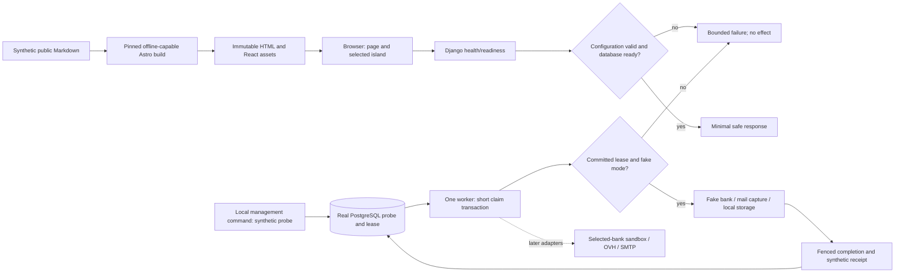

# Phase 2: Reproducible application and deployment skeleton - Research

**Researched:** 2026-10-20 UTC  
**Domain:** Reproducible static frontend, Django/PostgreSQL development, synthetic adapters and native deployment templates  
**Confidence:** MEDIUM — official documentation and registry metadata checked; nothing installed, built, booted or provisioned.

## User Constraints

No Phase 2 CONTEXT.md was supplied. Use the accepted project/source constraints below; do not infer personal decisions or manufacture commercial approvals. The init seam reported `has_context: false`; autonomous planning is recorded in the project. [VERIFIED: .planning/PROJECT.md:41-43] Source wording: DATA_7a9b30c2_START “Retain the existing authorized workflow preferences (autonomous planning, fine granularity, independent parallel work, documentation commits/sync and current-model inheritance).” DATA_7a9b30c2_END

The locked architecture is explicit. [VERIFIED: AGENTS.md:13-14] DATA_08fda5b3_START “**Architecture:** Static Astro Content Collections + selected React islands; Django LTS/Gunicorn + PostgreSQL and one leased database outbox worker; Django owns `/purchase/simple/`. No request-time Astro/Node service or mandatory Redis/Celery/CMS/IdP.” DATA_08fda5b3_END The catalog authority remains the embedded product source, with a single compiler and protected approvals; this phase supplies integration seams rather than a second product catalog. [VERIFIED: AGENTS.md:14] DATA_e8b2534f_START “One Markdown/YAML catalog compiles immutable public/private revisions; protected approvals govern offers. Admin cannot create a competing catalog.” DATA_e8b2534f_END

Authorization remains documentation/planning only until an implementation instruction is supplied. [VERIFIED: AGENTS.md:24] DATA_471eda63_START “**Authorization:** This reset authorizes reading and replacing planning/documentation only. Application implementation, cloud spending/billing, DNS/TLS issuance, real mail, bank operations and production cutover require their applicable scope.” DATA_471eda63_END No application files, credential files or external resources were changed during this research. [VERIFIED: session tool record, 2026-10-20]

## Summary

Plan a thin, production-quality tracer: one build-time synthetic Markdown collection, one static Astro page with one React island, Django liveness/readiness, and a management-command worker that claims one synthetic probe through real PostgreSQL before calling fake bank/mail/storage adapters. Keep live effects disabled and privileged routes unmounted. The tracer establishes installation, configuration, ownership, logging and failure boundaries; it must not claim the later commerce/outbox system is finished. This is a research recommendation derived from T02 and its later dependencies. [VERIFIED: SLL-xSPI-MC-Shop-Codex-Handoff-2026-10-20.md:111-115,141-145] Source wording: DATA_79b0c17a_START “Django/application/worker skeleton, PostgreSQL development service” and “durable outbox/inbox, idempotency records, bounded leases/retry rules” DATA_79b0c17a_END

The supplied release assertions can now be partly corroborated: official Django documentation lists 5.2.18, official PostgreSQL release notes list 18.6, and Astro publishes a v7 guide. These observations do not establish a tested compatible dependency graph. Registry metadata exposes a concrete conflict: TypeScript latest 7.0.2 does not satisfy `@astrojs/check` 0.9.11's declared `^5.0.0 || ^6.0.0` peer range. Start compatibility qualification with TypeScript 6.0.3, not an indiscriminate latest-version install. [CITED: https://docs.djangoproject.com/en/5.2/releases/5.2.18/] [CITED: https://www.postgresql.org/docs/18/release.html] [CITED: https://docs.astro.build/en/guides/upgrade-to/v7/] [CITED: https://registry.npmjs.org/@astrojs%2fcheck/0.9.11] [VERIFIED: npm registry — typescript, official identity https://www.typescriptlang.org/download/, legitimacy OK]

**Primary recommendation:** Separate runtime/framework locks, executable local synthetic proof and reviewable deployment templates into small plans; collect hashes, licence inventories and SBOMs from the actual execution artifacts. All paths and commands identified as **proposed** below are implementation targets, not claims that those files already exist.

## Architectural Responsibility Map

The following is the recommended responsibility split within the locked architecture. [CITED: https://docs.astro.build/en/reference/configuration-reference/#output] [CITED: https://gunicorn.org/quickstart/] [CITED: https://www.postgresql.org/docs/18/sql-select.html]

| Capability | Primary tier | Secondary tier | Rationale |
|---|---|---|---|
| Public collection compilation | Build/CI | Static storage | Read only synthetic/public inputs; emit prerendered HTML/assets. |
| Small interactive island | Browser | Build/CI | Hydrate an explicitly selected component; no private persistence. |
| API, readiness and future purchase fallback | Django/Gunicorn | PostgreSQL | Django owns dynamic requests; separate liveness from DB readiness. |
| Probe claims and lease ownership | PostgreSQL | One Django worker | Atomic row claim, persisted lease and fenced completion. |
| Bank/mail/storage boundary | Backend adapter interfaces | Local fakes | Fixed fake implementations in synthetic mode; no default live adapter. |
| Reproducibility, contracts and licence evidence | Build/CI | Review artifacts | Locks, SBOM, hashes and schema fixtures describe actual build inputs/outputs. |
| Runtime identities, secret injection and limits | NixOS/systemd | Operator custody | Separate app/worker/DB identities; runtime secret files outside build store. |
| Ingress/object publication/real image boot | T11 | T02 templates | Prepare boundaries here; deployed evidence belongs to authorized T11. |

<phase_requirements>
## Phase Requirements

Descriptions below are verbatim from the opened source; the enclosing block is source data. [VERIFIED: .planning/REQUIREMENTS.md:22-25]

DATA_e250fd36_START

| ID | Description | Research support |
|---|---|---|
| BUILD-01 | Developers can reproduce static frontend, Django/worker and real-PostgreSQL development builds from compatible pinned dependencies, hashes and CI commands. | Compatible candidate matrix; clean two-build comparison; native dev PostgreSQL; lock probe and worker smoke. |
| BUILD-02 | Reviewers can inspect component/transitive licences and SBOM for the actual locked artifacts; exact patches are verified when lockfiles are created. | Execution-time registry verification, lock integrity, actual-environment SBOM and licence files. |
| BUILD-03 | Developers can run isolated synthetic bank/mail/storage fixtures and versioned OpenAPI/schema contracts without production credentials or external provisioning. | Fake-only adapter registry; versioned contracts; offline reference resolution and negative fixtures. |
| BUILD-04 | Operators can review native hardened service, image/bootstrap, secret and environment templates for isolated B2-7 deployment and configurable B3-8 fallback. | Native service modules, runtime-secret boundaries, configurable profiles and bounded T11 qualification checklist. |

DATA_e250fd36_END
</phase_requirements>

## Project Constraints (from AGENTS.md)

These directives apply to planning and future execution; the quoted portions reproduce source values rather than inventing runtime constants. [VERIFIED: AGENTS.md:13-25,35-41,69-85]

- Preserve the architecture and catalog authority quoted above. Keep product IDs as source values: DATA_2dd917ba_START `sll-xspi-mc`, `sll-xspi-mc-support-10h`, `sll-xspi-mc-v1` DATA_2dd917ba_END. Do not implement their commercial rules in a skeleton fixture. [VERIFIED: AGENTS.md:15]
- Keep unknown money/rights/access/terms pending; do not convert provisional source values into enabled offers. [VERIFIED: AGENTS.md:16]
- Keep private identifiers, keys, business/tax data and bearer links out of static artifacts, URLs, ordinary logs and browser persistence. Require resource authorization and staff MFA before any privileged route becomes usable; no usable admin site in this phase. [VERIFIED: AGENTS.md:17]
- Preserve archive-before-effect and uncertain-bank reconciliation requirements in the adapter documentation; prepared evidence never means completed effect. Support ledger and entitlement behavior belongs to later phases. [VERIFIED: AGENTS.md:18-19]
- Deployment targets are source planning selections, not verified available resources: DATA_f1b63c9e_START “New isolated OVH B2-7 GRA11 monthly after quote/image/workload qualification; B3-8 hourly fallback. Native hardened NixOS/systemd preferred; one approved Podman alternative if necessary. Separate 50 GB DB volume, `gra` public/private objects and `sbg` recovery/evidence with distinct credentials.” DATA_f1b63c9e_END [VERIFIED: AGENTS.md:20]
- Customer and proposed staff origins are source values: DATA_d9f86140_START `https://shop.xspi.pro`; `https://shop-admin.xspi.pro`; `xspi.pro` DATA_d9f86140_END. Dedicated certificate/key per hostname, explicit Let's Encrypt, ordinary ACME challenge first; no existing keys/services/DNS changes. [VERIFIED: AGENTS.md:21]
- Preserve recovery gating and separately label local/synthetic, selected-bank sandbox, actual OVH and production evidence. Do not invent provider, legal, compatibility or approval guarantees; existing cost estimates are unverified account estimates. [VERIFIED: AGENTS.md:22-25]
- Verify exact compatible supported releases/hashes; pin services and Nixpkgs; qualify image/bootstrap later; do not run simultaneous native and container service managers. [VERIFIED: AGENTS.md:35-41]
- Stay inside GSD workflow; do not manually edit managed developer-profile content. No established coding conventions are declared yet; use the small explicit layout below rather than manufacturing an existing architecture. [VERIFIED: AGENTS.md:48,55,69-85]

## Standard Stack

### Core and compatibility candidates

All observations are dated **2026-10-20**. Package versions below are candidate inputs for execution, not approved lockfiles. `npm view` was used read-only; Python metadata came directly from the correct PyPI JSON API because this machine has no pip. Re-run registry checks and release/security review at execution. A declared version range is compatibility evidence; the absence of metadata is not. [VERIFIED: session registry/tool observations, 2026-10-20]

| Component | Observed candidate / publication | Planning instruction and provenance |
|---|---|---|
| Node/npm | Local Node 24.15.0, npm 11.12.1; Node download page reports 24.21.0 LTS | Use a currently supported exact Node 24 patch and npm version in the build environment; save signed release/checksum identity. Astro declares Node `>=22.22.0`. Local presence is not a security-current lock. [CITED: https://nodejs.org/en/download/] [CITED: https://docs.astro.build/en/install-and-setup/] |
| `astro` [WARNING: flagged as suspicious — verify before using.] | 7.4.1, 2026-10-19 | Static output, no adapter or server islands/actions/live loaders; build a real synthetic collection. [CITED: https://docs.astro.build/en/guides/upgrade-to/v7/] [CITED: https://registry.npmjs.org/astro/7.4.1] |
| `@astrojs/react` [WARNING: flagged as suspicious — verify before using.] | 7.1.0, 2026-10-15 | Official React rendering/hydration integration. Peer React and DOM ranges include 19. Inspect optional peers/transitives rather than installing every compiler extra. [CITED: https://docs.astro.build/en/guides/integrations-guide/react/] [CITED: https://registry.npmjs.org/@astrojs%2freact/7.1.0] |
| `react`, `react-dom` [WARNING: flagged as suspicious — verify before using.] | Both 19.3.1, 2026-10-14 | Keep matching exact versions; DOM declares React `^19.3.1`. [CITED: https://docs.astro.build/en/guides/integrations-guide/react/] [CITED: https://registry.npmjs.org/react-dom/19.3.1] |
| `Django` [WARNING: flagged as suspicious — verify before using.] | 5.2.18 LTS, 2026-10-06 | Stay on the LTS series; PyPI latest 6.1.2 is not the requested series. Official docs support Python 3.13 and PostgreSQL 14+. [CITED: https://www.djangoproject.com/download/] [CITED: https://docs.djangoproject.com/en/5.2/releases/5.2/] [CITED: https://docs.djangoproject.com/en/5.2/ref/databases/] |
| Python | Local CPython 3.13.13 | Select latest supported 3.13 patch at execution and pin runtime/build identity. This session checked Django's declared support; it did not build wheels or prove the complete interpreter/library set. [CITED: https://docs.djangoproject.com/en/5.2/releases/5.2/] [VERIFIED: session tool observation, 2026-10-20] |
| `gunicorn` [WARNING: flagged as suspicious — verify before using.] | 26.2.0, 2026-08-24 | Use ordinary bounded WSGI workers on loopback/socket under systemd, no daemonization. Current installation docs require Python 3.12+, whereas this release's registry metadata says `>=3.10`; Python 3.13 meets both, but preserve the discrepancy and test the exact artifact. [CITED: https://gunicorn.org/install/] [CITED: https://gunicorn.org/deploy/] [CITED: https://pypi.org/pypi/gunicorn/26.2.0/json] |
| `psycopg` [WARNING: flagged as suspicious — verify before using.] | 3.3.6, 2026-09-18 | Use Psycopg 3, not a similarly named package. Start with the pure Python distribution plus pinned system libpq to avoid an unqualified bundled library; record libpq/OpenSSL in runtime inventory. Current docs are headed development version 3.3.7.dev1, so execute smoke/locking tests on the chosen released artifact. [CITED: https://www.psycopg.org/psycopg3/docs/basic/install.html] [CITED: https://pypi.org/pypi/psycopg/3.3.6/json] |
| PostgreSQL | 18.6, 2026-08-13 | Official 18.6 notes corroborate supplied baseline; choose supported exact patched build at execution. Same major/build in local/CI integration and service-template checks; no SQLite fallback. [CITED: https://www.postgresql.org/docs/18/release.html] [CITED: https://www.postgresql.org/docs/current/release-18-6.html] |
| NixOS/Nixpkgs/systemd | Exact target release/revision intentionally unselected | Pin a supported Nixpkgs revision for the execution/dev check environment; deployment must requalify its supported OS/revision at T11. Installed Nix 2.34.7 and systemd 260 do not identify the future host. [CITED: https://nixos.org/manual/nixos/stable/] [VERIFIED: session tool observation, 2026-10-20] |

### Supporting development/build tools

| Tool | Registry observation / publication | Use and provenance |
|---|---|---|
| `typescript` | 6.0.3, 2026-04-16; registry latest is 7.0.2 | Use 6.0.3 as the compatibility candidate with the checker below. Official package identity and legitimacy OK; actual graph remains to be tested. [VERIFIED: npm registry] [CITED: https://www.typescriptlang.org/download/] |
| `@astrojs/check` [WARNING: flagged as suspicious — verify before using.] | 0.9.11, 2026-10-19 | Run Astro diagnostics, with TypeScript in declared peer range `^5.0.0 || ^6.0.0`; never suppress dependency conflict using legacy-peer flags. [CITED: https://docs.astro.build/en/reference/cli-reference/#astro-check] [CITED: https://registry.npmjs.org/@astrojs%2fcheck/0.9.11] |
| `@types/react`, `@types/react-dom` | Both 19.3.0, 2026-09-09 | Official integration lists these types; legitimacy OK. Keep DOM types compatible with React types. [VERIFIED: npm registry] [CITED: https://docs.astro.build/en/guides/integrations-guide/react/] |
| `pip-tools` [WARNING: flagged as suspicious — verify before using.] | 7.6.2, 2026-10-07 | Separate tool lock; compile complete target-specific transitive hash requirements. [CITED: https://pip-tools.readthedocs.io/en/latest/] [CITED: https://pypi.org/pypi/pip-tools/7.6.2/json] |
| `jsonschema` [WARNING: flagged as suspicious — verify before using.] | 4.26.0, 2026-01-07 | Draft 2020-12 fixture/metaschema checks, explicit format checking where needed; no live remote reference fetches. [CITED: https://python-jsonschema.readthedocs.io/en/stable/] [CITED: https://pypi.org/pypi/jsonschema/4.26.0/json] |
| `cyclonedx-bom` [WARNING: flagged as suspicious — verify before using.] | 7.5.0, 2026-09-29 | Generate Python SBOM from the actual isolated environment. npm's built-in SBOM command covers installed frontend dependencies; no extra npm SBOM package needed. [CITED: https://cyclonedx-bom-tool.readthedocs.io/en/latest/install.html] [CITED: https://docs.npmjs.com/cli/v11/commands/npm-sbom/] |
| Django test runner / Python unittest / Node test runner | Versions inherited from pinned runtimes | Prefer existing framework facilities and short Python/Node verification scripts; do not add a test framework merely for this skeleton. This is a research recommendation. |

**Installation contract — future execution only:** Commit frontend package manifest/lock, exact build-runtime identities, target-specific runtime/tool hashed requirements, and flake lock. Use `npm ci`; use `python -m pip install --require-hashes -r <locked-requirements>` after creating an isolated environment with pinned installer/tool bootstrap. Cache verified artifacts, then rebuild without external service access. `pip-compile --generate-hashes` generates pins, but its output can vary by interpreter/platform, so lock the target environment as well. [CITED: https://docs.npmjs.com/cli/v11/commands/npm-ci/] [CITED: https://pip.pypa.io/en/stable/topics/secure-installs/] [CITED: https://pip-tools.readthedocs.io/en/latest/]

**Alternatives:** Do not substitute SSR Astro, Celery/Redis, a hosted CMS/IdP or SQLite for locked tiers. Keep Podman a single approved deployment fallback, not a parallel production design. Use native PostgreSQL from the pinned development environment to avoid making Docker mandatory. These are scope recommendations enforcing the source architecture quoted above.

## Package Legitimacy Audit

Read-only seam executed for every named proposed package. **SUS is a heuristic result, not evidence of compromise.** Most npm flags are latest-release recency; PyPI counts are unknown to the seam. Official documentation independently establishes package identities; registry existence alone does not. The seam checked each package's default latest, not every candidate patch or transitive artifact. Recheck the selected exact artifact set and postinstall/build hooks during execution. [VERIFIED: session package-legitimacy and registry results, 2026-10-20]

Age means age of the seam's **latest release**, not age of the project. Downloads are the seam's reported weekly values, not a guarantee. [VERIFIED: session package-legitimacy results, 2026-10-20]

| Package | Registry | Latest-release age | Weekly downloads | Source repository | Verdict | Disposition |
|---|---|---|---|---|---|---|
| astro | npm | 1 day | 4,784,961 | withastro/astro | SUS: too-new | Retain official identity; review selected release. |
| @astrojs/react | npm | 5 days | 1,453,373 | withastro/astro | SUS: too-new | Retain official identity; review selected release. |
| react / react-dom | npm | 6 days | 116,163,376 / 109,429,915 | react/react | SUS: too-new | Retain matching candidates; review selected release. |
| @astrojs/check | npm | 1 day | 2,603,012 | withastro/astro | SUS: too-new | Retain; respect explicit TS peer range. |
| typescript | npm | 104 days | 184,429,796 | microsoft/TypeScript | OK | Latest is incompatible with checker; use compatible candidate. |
| @types/react / @types/react-dom | npm | 41 days | 106,037,731 / 91,313,350 | DefinitelyTyped/DefinitelyTyped | OK | Retain compatible types. |
| Django | PyPI | 14 days | Unknown | django/django | SUS: too-new, unknown-downloads | Select LTS 5.2 patch rather than default latest. |
| gunicorn | PyPI | 57 days | Unknown | benoitc/gunicorn | SUS: unknown-downloads | Official identity confirmed; review exact artifacts. |
| psycopg | PyPI | 32 days | Unknown | psycopg/psycopg | SUS: unknown-downloads | Official identity confirmed; review libpq/build path. |
| pip-tools | PyPI | 13 days | Unknown | jazzband/pip-tools | SUS: too-new, unknown-downloads, no-repository | Seam missed lowercase repository metadata; official docs/PyPI positively supply repository. |
| jsonschema | PyPI | 286 days | Unknown | python-jsonschema/jsonschema | SUS: unknown-downloads | Official identity confirmed. |
| cyclonedx-bom | PyPI | 21 days | Unknown | CycloneDX/cyclonedx-python | SUS: too-new, unknown-downloads | Official identity confirmed. |

**Packages removed for SLOP:** none. **Suspicious network/outside-project postinstall:** none observed in the queried direct npm metadata; this is not a statement about uninspected transitives. [VERIFIED: session package-legitimacy and npm metadata results, 2026-10-20]

**Research-agent protocol requirement:** The supplied `gsd-phase-researcher` developer instructions, `<package_legitimacy_protocol>`, say: DATA_68014e2c_START “The planner must add a `checkpoint:human-verify` task before installing this package.” DATA_68014e2c_END This is an explicit agent instruction, not a requirement discovered in a SKILL.md and not a conclusion that recency/download counts alone imply compromise. Bundle concrete exact-artifact identity, release, hooks and licence review into one pre-install execution checkpoint covering the SUS packages; do not stop planning, manufacture bank/cloud approvals, or ask for permission during this research. Implementation authorization and external operational authorization remain separate source scopes. [VERIFIED: supplied researcher instructions; AGENTS.md:24, quoted above]

## Architecture Patterns

### System Architecture Diagram

Recommended tracer data flow; dashed external nodes describe later integration seams, not services contacted by this phase.



### Recommended Project Structure and Component Responsibilities

Every filename in this table is **proposed**. Keep these mapped to the source's responsibilities; no path below is represented as an existing implementation.

| Proposed files | Responsibility / expansion boundary |
|---|---|
| `frontend/package.json`, `frontend/package-lock.json`, `frontend/astro.config.mjs`, `frontend/tsconfig.json` | Exact compatible build graph; explicit static output and canonical customer origin; strict TS. |
| `frontend/src/content.config.ts`, `frontend/src/content/probes/skeleton.md`, `frontend/src/pages/index.astro`, `frontend/src/components/BuildProbe.tsx` | Clearly synthetic collection/page/island; no real product catalog or checkout. |
| `backend/manage.py`, `backend/shop/config/{base,local,synthetic,production}.py`, `backend/shop/urls.py`, `backend/shop/wsgi.py` | Minimal Django project; validated configuration; loopback Gunicorn; production config fails safely if incomplete. |
| `backend/shop/core/{health,checks,logging}.py` | Minimal non-sensitive health, database readiness, startup checks and structured redaction. |
| `backend/shop/adapters/{ports,fake_bank,capture_mail,local_storage}.py` | Small typed boundaries; deterministic fixture faults, bounded payloads; no live adapter. |
| `backend/shop/worker/{models,services}.py`, `backend/shop/worker/management/commands/run_worker.py` | Synthetic probe model/migration; claim, lease/fence, once/loop mode and graceful stop; T05 expands domain persistence. |
| `backend/requirements/{runtime,tools}.in`, target-specific hashed `.txt` files | Runtime versus build tools; include all transitives and installer/bootstrap identity. |
| `schemas/v1/{probe,environment,artifact-manifest}.schema.json`, `api/v1/openapi.json`, `tests/fixtures/contracts/` | Closed schemas and health/error contracts, valid/invalid fixtures; T03 owns complete product schemas. |
| `ops/nixos/{flake.nix,flake.lock,modules/shop.nix,profiles/development.nix,profiles/ovh-template.nix}` | Pinned dev/runtime check environment, service module and reviewable provider template. |
| `ops/config/{local,synthetic,production}.example`, `ops/secrets/README.md`, `ops/qualification/ovh-image.md` | Non-secret placeholders, secret path contract, unexecuted image/account qualification. |
| `scripts/{check,dev_postgres,check_contracts,check_boundaries,check_reproducibility,inventory_artifacts}.py`, `.github/workflows/ci.yml` | Fail-closed verification entry points; isolated scratch DB; reproducible commands reused by CI. |
| `docs/build.md`, `docs/service-boundaries.md`, `docs/evidence/t02/` | Setup, failure modes, environment diagram and dated local/synthetic evidence manifests. |

### Pattern 1: Static compilation with explicit hydration

Use build-time Content Collections and a single hydrated React component. Astro documents both build-time and live collections; only the former fits this project. Explicit static output alone is insufficient if a route opts out of prerendering. Reject server adapters, server actions/islands, live loaders and `prerender = false` in this phase's boundary checker. [CITED: https://docs.astro.build/en/guides/content-collections/] [CITED: https://docs.astro.build/en/reference/configuration-reference/#output]

Only allowlisted public/synthetic files enter the frontend build context. Do not put private fixtures under the static public directory; Astro copies public assets into the build. CI must seed synthetic sensitive canaries outside the permitted context and assert they never reach HTML, JS, source maps or release archives. [CITED: https://docs.astro.build/en/guides/imports/]

### Pattern 2: Persisted worker probe with bounded ownership

Use a Django management command, a short atomic row claim ordered by stable identity, a finite lease, unique claim token and conditional completion update. Commit before adapter calls. Keep production worker count one; the two-session test probes ownership safety and is not authorization to run an unbounded fleet. PostgreSQL documents `SKIP LOCKED` for queue-like use, not a general consistent snapshot. Django warns that `TestCase` can mask locking misuse; use `TransactionTestCase` and genuinely independent connections. [CITED: https://www.postgresql.org/docs/18/sql-select.html] [CITED: https://docs.djangoproject.com/en/5.2/ref/models/querysets/#select-for-update]

Proposed tracer semantics: enqueue a synthetic probe by management command; worker claims it, calls fake adapters using stable effect identities, and commits completion only while its claim token still matches. A fake receipt journal survives worker restart in the isolated test DB; kill-after-receipt/before-completion tests must reuse the same fake effect identity. Failed/unknown fake responses leave an explicit recoverable result, never a claim of confirmed payment. Keep lease duration, polling and retry bounds explicit configuration with small test overrides. This is a recommended tracer design, not the T05/T08 domain state machine.

### Pattern 3: Fake-only environments and closed contracts

Recommend explicit local, synthetic, bank-sandbox and production environment profiles; only the first two can run the T02 tracer. Startup must reject unknown/missing mode, live provider selection, real external endpoints and missing required runtime-secret paths. A bank-sandbox profile may be a disabled template until T09; production is disabled until qualified. Fakes need no provider credentials. Test-time outbound denial must cause failure if a fake tries to dial SMTP, HTTPS, object storage or DNS outside its explicit local/DB allowance. The source requires isolated configurations and disabled live payments. [VERIFIED: SLL-xSPI-MC-Shop-Proposal-2026-10-20.md:1203-1205] Source wording: DATA_2f8dbb83_START “Prepare separate local development, synthetic staging, bank sandbox and production configuration.” and “Production configurations default to live payment disabled” DATA_2f8dbb83_END

Use OpenAPI **3.1.1** and JSON Schema **2020-12** as explicit, supported contract baselines, not as a claim that these are newest specifications. Supply complete validation for the tracer's tiny payloads and configuration; supply an inventory/index of future full product schemas with honest unimplemented markers. Unknown properties, unsupported versions, unresolved references and invalid payloads fail. Do not publish a permissive stub as complete T03 validation. Validate local `$ref` resolution without network; enable semantic/format checks intentionally rather than treating format annotations as full validation. [CITED: https://spec.openapis.org/oas/v3.1.1.html] [CITED: https://json-schema.org/draft/2020-12] [CITED: https://python-jsonschema.readthedocs.io/en/stable/]

### Pattern 4: Runtime secrets and native services

Recommend separate Unix users, local/private listeners, one worker service, immutable release inputs, explicitly writable runtime/state directories, `UMask=0077`, `NoNewPrivileges`, `PrivateTmp`, `ProtectSystem=strict`, `ProtectHome`, empty capability bounding set and bounded memory/tasks/restarts. Exact numerical production budgets must be measured later, not invented as proven capacity. Validate each directive against the pinned target systemd; latest online manual and installed host may differ. [CITED: https://www.freedesktop.org/software/systemd/man/latest/systemd.exec.html]

Use `LoadCredential` for runtime credential-file injection and a `_FILE` application configuration convention; ordinary environment templates hold only non-secrets and paths. Never interpolate secret content using Nix expressions, generated text, flake source, derivation arguments, image layers or build environment. A reference to an operator-managed runtime pathname is not secret content. NixOS documentation explicitly warns that literals can be stored world-readably; systemd's execution manual warns against environment variables for secrets. Use synthetic canaries to test these boundaries. [CITED: https://nixos.org/manual/nixos/stable/] [CITED: https://www.freedesktop.org/software/systemd/man/latest/systemd.exec.html]

Require the configured DB mount before PostgreSQL/app/worker activation; do not silently create a production cluster on the root filesystem if the separate volume is missing. Keep native app/worker/DB services in foreground under one supervisor, not under shell backgrounding plus another manager. Disable usable Django admin/customer-private routes until their authorization/MFA implementation exists. These are planning recommendations enforcing AGENTS.md's isolation/MFA requirements.

### Image/bootstrap qualification plan, without provisioning

OVH documents custom image creation through Horizon; upstream Nixpkgs contains an OpenStack image builder and metadata/SSH/network integration. Those documents establish a preparation route, not a guarantee that the selected account/flavor/region boots it. The inspected Nixpkgs pages track upstream master; re-open the exact pinned supported revision before using module names. [CITED: https://docs.ovhcloud.com/en/guides/public-cloud/compute/creation-launch-deletion-of-images-in-horizon] [CITED: https://github.com/NixOS/nixpkgs/blob/master/nixos/maintainers/scripts/openstack/openstack-image.nix] [CITED: https://github.com/NixOS/nixpkgs/blob/master/nixos/modules/virtualisation/openstack-config.nix]

Prepare an unexecuted checklist that records: current B2-7/GRA11 monthly quote and stock; B3-8 hourly configurable fallback; exact supported OS/Nixpkgs/image digest; firmware/virtio/metadata/key-injection/console/network/resize/guest-agent checks; approved operator access/recovery; separate DB-volume attachment/mount/boot failure; DB/app/worker resource measurements; and reinstall/rollback path. Keep flavor, region, tariff and volume identity as validated configuration inputs rather than duplicated constants. Leave actual upload/instance creation, billing conversion, DNS/TLS, bucket access proofs and workload qualification to authorized T11. The fallback must change the profile without changing application code; it must not silently switch tariff or provision anything. These are recommended acceptance steps, not provider guarantees.

### Anti-Patterns to Avoid

- Installing every registry latest together or suppressing peer dependency errors: the observed TypeScript/checker incompatibility is explicit evidence to qualify the graph first. [CITED: https://registry.npmjs.org/@astrojs%2fcheck/0.9.11]
- Treating a lease claim as exactly-once external execution: use stable fake effect identities and fenced completion; T05/T08 must establish domain guarantees.
- Using SQLite or one connection for a concurrency test; holding database locks across adapter calls. [CITED: https://docs.djangoproject.com/en/5.2/ref/models/querysets/#select-for-update]
- Building a commercial catalog/admin editor or payment route in a skeleton. Keep later product, approvals, authorization and bank proofs at their owning phases.
- Treating a successful Nix evaluation as a successful VM boot or actual OVH isolation test.
- Letting a schema TODO pass as a validator, or generating an SBOM solely from desired top-level packages.

## Don't Hand-Roll

| Problem | Do not build | Use instead | Why / provenance |
|---|---|---|---|
| Static rendering and islands | Ad hoc HTML bundler or Node request server | Astro plus official React integration | Existing build/hydration lifecycle. [CITED: https://docs.astro.build/en/guides/integrations-guide/react/] |
| Relational transactions/locking | Filesystem queue, Redis introduced by habit | PostgreSQL and Django transactions | Explicit database locking and tests; source architecture already chooses the DB worker. [CITED: https://www.postgresql.org/docs/18/sql-select.html] |
| Hash enforcement | Custom package installer/hash resolver | npm lock integrity; pip hash mode; target-specific pip-tools output | Installer-level frozen/dependency checks. [CITED: https://docs.npmjs.com/cli/v11/commands/npm-ci/] [CITED: https://pip.pypa.io/en/stable/topics/secure-installs/] |
| Schema validation | Regex/handwritten JSON Schema interpreter | Maintained jsonschema library | Explicit dialect/metaschema/reference validation. [CITED: https://python-jsonschema.readthedocs.io/en/stable/] |
| SBOM format | Bespoke SBOM JSON format | npm sbom and CycloneDX Python | Standard machine-readable component/dependency inventory. [CITED: https://docs.npmjs.com/cli/v11/commands/npm-sbom/] [CITED: https://cyclonedx-bom-tool.readthedocs.io/en/latest/] |
| Secret injection and process supervision | Secrets rendered into Nix; homemade daemon/watchdog | systemd credential files and service manager | Runtime credential and isolation mechanisms already exist. [CITED: https://www.freedesktop.org/software/systemd/man/latest/systemd.exec.html] |

Custom code is appropriate for the small domain adapter interfaces, fake scenarios and boundary checks. Keep those explicit rather than adding a generic framework or full S3/bank emulator before the real provider contracts are known.

## Common Pitfalls

| Pitfall | Failure / warning sign | Prevention / fail direction |
|---|---|---|
| Version observation mistaken for compatibility | Package exists but peer check, interpreter import or migration fails | Capture declared constraints plus clean actual install/check/build/migrate; incompatible graph fails before locks are accepted. |
| Non-reproducible release packaging | Build embeds wall clock, absolute temp paths, unpinned fonts or timestamps | Fixed source epoch/locale/timezone and target runtime; compare actual public/backend payload hashes from two isolated clean builds. Any unexplained byte difference fails. |
| SBOM confused with legal approval | Unknown licences disappear or only direct dependencies listed | Preserve actual transitive inventory, distribution hashes, licence texts/expressions and unresolved findings. Never invent a licence approval; block the release inventory check if coverage is incomplete. |
| Auto-install during a check | Astro/type tooling prompts to fetch missing dependencies | Explicit tool dependencies; frozen installation before network-denied build; no `npx` package auto-download in CI. |
| False concurrency proof | Transaction-wrapped test or SQLite run reports green | Independent PostgreSQL sessions and backend identity assertion; unavailable DB is a failing required lane, never a skip. [CITED: https://docs.djangoproject.com/en/5.2/ref/models/querysets/#select-for-update] |
| Probe becomes product logic | Synthetic fixtures contain enabling rates/rights or a bank adapter is called | Label fixtures synthetic; no live route/credential; T03/T05/T08/T09 own expansion. |
| Incomplete static-secret boundary | Private fixture/source map or environment value bundled into public bytes | Allowlisted frontend build context plus canary tests over all release outputs and logs. |
| Template proof overstated | “Deployed” evidence consists of local Nix evaluation | Record evidence class, command, versions, source revision and exact limits; leave OVH rows unexecuted. |

## Code Examples

Examples are **proposed implementation sketches**, not in-repository definitions. Exact imports/API signatures must be checked against the selected locked artifact. No product enum/status values are introduced here.

### Explicit static Astro configuration

The API pattern comes from Astro's configuration and React integration references. The customer origin is the source value quoted under Project Constraints. [CITED: https://docs.astro.build/en/reference/configuration-reference/#output] [CITED: https://docs.astro.build/en/guides/integrations-guide/react/]

```javascript
import { defineConfig } from 'astro/config';
import react from '@astrojs/react';

export default defineConfig({
  site: 'https://shop.xspi.pro',
  output: 'static',
  integrations: [react()],
});
```

### Real lock-test shape

Use the framework's transaction-test class; the helper and fixture names here are proposed. [CITED: https://docs.djangoproject.com/en/5.2/ref/models/querysets/#select-for-update]

```python
from django.db import connection
from django.test import TransactionTestCase

class ProbeClaimTests(TransactionTestCase):
    def test_two_independent_claimants(self):
        self.assertEqual(connection.vendor, 'postgresql')
        # Create one probe; A holds its claim transaction behind a barrier.
        # B opens its own connection, records a different backend PID,
        # and tries the SKIP LOCKED claim while A still holds the row lock.
        # Assert B obtains no lease; commit A, then assert one current owner.
        # Use events/barriers and bounded timeouts; propagate thread errors.
```

This is a test outline, not executable evidence. Add separate tests for autocommit misuse, expired-lease takeover, stale-token completion rejection and DB lock release before a deliberately stalled fake adapter.

### Frozen installations and SBOM commands

Run only after implementation authorization, concrete dependency review, tool bootstrap and lock generation. Paths are proposed. [CITED: https://docs.npmjs.com/cli/v11/commands/npm-ci/] [CITED: https://pip.pypa.io/en/stable/topics/secure-installs/] [CITED: https://docs.npmjs.com/cli/v11/commands/npm-sbom/] [CITED: https://cyclonedx-bom-tool.readthedocs.io/en/latest/usage.html]

```bash
npm --prefix frontend ci
npm --prefix frontend run check
npm --prefix frontend run build
python -m pip install --require-hashes -r backend/requirements/runtime-linux-py313.txt
python -m pip check
python backend/manage.py check
npm --prefix frontend sbom --sbom-format cyclonedx
cyclonedx-py environment --output-format JSON --output-file python-sbom.json
```

Capture tool/runtime versions, source revision, lock hashes, resolved package tree, exact wheel/tarball identities, system-library closure, generated SBOM and licence-text inventory. Preserve raw SBOM timestamps/serials as evidence; compare stable component inventories separately from release-payload byte reproducibility. Do not normalize away unexplained output differences merely to get a green reproducibility result.

## State of the Art

| Older/inapplicable pattern | Use here | Effect / provenance |
|---|---|---|
| Legacy collection examples or live-loader tutorial copied indiscriminately | Current build-time collection API against the actual locked Astro release | v7 docs distinguish build-time and request-time collections. [CITED: https://docs.astro.build/en/guides/content-collections/] |
| Newest version of every package | Supported mutually compatible graph | Explicit checker peer range excludes observed TS 7 latest. [CITED: https://registry.npmjs.org/@astrojs%2fcheck/0.9.11] |
| ASVS 4 chapter numbers applied to ASVS 5 | Explicit ASVS 5.0.0 category names below | Stable v5 release has authentication V6, sessions V7, authorization V8; old generic template labels would be wrong. [CITED: https://github.com/OWASP/ASVS/tree/v5.0.0/5.0/en] |

No unsupported/deprecated release claim is inferred from missing metadata. The supplied framework majors remain architecture inputs; exact patched artifacts and support status must be rechecked when executing and deploying.

## Environment Availability

Read-only observations on 2026-10-20; no `.env`, credential files, account APIs, service configuration, installed secret material or production endpoints were read. Version availability is not a functioning-service claim. [VERIFIED: session command results, 2026-10-20]

| Dependency | Available | Observed version | Required action/fallback |
|---|---|---|---|
| Node / npm | Yes | 24.15.0 / 11.12.1 | Qualify supported exact build patch and compatible package graph at execution. |
| Python | Yes | 3.13.13 | Provide isolated pinned interpreter environment. |
| pip module / pip3 / Django module | No | — | Supply pinned bootstrap/tool environment; no installation attempted. |
| PostgreSQL psql / server / pg_ctl | No | — | Required execution setup through pinned native dev environment/CI service; required DB lane cannot skip. |
| Nix | Yes | 2.34.7 | Evaluation/build daemon, cache access, sandbox/KVM availability untested; verify during implementation. |
| systemd CLI | Yes | 260 (260.1) | Presence does not prove this sandbox can start services or run NixOS VM tests. |
| Podman | Yes | 5.8.2 | Not required by preferred native design; no container/daemon probe performed. |
| Docker | No | — | No mandatory Docker dependency. |
| Git / curl / SHA-256 | Yes | 2.54.0 / 8.20.0 / coreutils 9.11 | Read-only checks available. |
| Context7 MCP / ctx7 CLI | Not exposed / not on PATH | — | Required research-plan seam selected Context7; fell back to official web docs without installing tooling. |
| GSD graph / agent skills | Disabled / none configured | — | Graph status explicitly disabled; skill query empty. No graph relationships assumed. |

**Missing required execution dependencies:** real PostgreSQL and pinned Python installer/runtime packages must be supplied in implementation setup; inability to create isolated local tooling is a genuine execution checkpoint. No bank, SMTP, object-storage or cloud credentials are needed for local/synthetic proof.

## Validation Architecture

Validation and security are enabled in the opened configuration. [VERIFIED: .planning/config.json:24,48-50] Source values: DATA_1075dbec_START `"nyquist_validation": true`, `"security_enforcement": true`, `"security_asvs_level": 1`, `"security_block_on": "high"` DATA_1075dbec_END

### Test Framework

| Property | Proposed contract |
|---|---|
| Framework | Django's pinned test runner/TransactionTestCase, Python unittest, Node built-in tests, Astro diagnostics, Nix module checks |
| Existing implementation infrastructure | This phase is a new skeleton; the inspected repository exposes the Phase 1 source-verification script, not application tests. [VERIFIED: session tracked-file discovery, 2026-10-20] |
| Config files | Proposed Django synthetic settings, frontend scripts, pinned dev flake and shared check runner |
| Quick run | `python3 scripts/check.py --quick --require-postgres` |
| Full suite | `python3 scripts/check.py --all --require-postgres --fake-only` |
| Reproducibility lane | `python3 scripts/check_reproducibility.py --clean-builds 2` |

Commands below are executable **future interfaces to implement**, not commands already run. Each fast test should use bounded waits and finish within 30 seconds once the pinned environment and DB are ready; record actual timing rather than claiming it now. Clean dependency/build/VM lanes may take longer and run as explicit required CI jobs.

### Phase Requirements → Test Map

| Req ID | Behavior | Test type | Proposed automated command | Exists? / failure direction |
|---|---|---|---|---|
| BUILD-01 | Static page and hydrated island build; no SSR/runtime Node dependency | Build/smoke | `python3 scripts/check_boundaries.py --static-only` | Wave 0; server adapter/runtime route or missing static bytes fails. |
| BUILD-01 | Django health, readiness and migration work on real PostgreSQL | Integration | `python backend/manage.py test shop.core.tests --settings=shop.config.synthetic` | Wave 0; DB outage gives readiness failure, no success claim. |
| BUILD-01 | Two independent connections cannot own one live probe lease | Transactional | `python backend/manage.py test shop.worker.tests.ProbeClaimTests --settings=shop.config.synthetic` | Wave 0; assert PostgreSQL backend and distinct backend PIDs; missing DB fails, never skips. |
| BUILD-01 | Adapter calls occur after claim transaction commits; stale completion fenced | Transactional/crash | `python backend/manage.py test shop.worker.tests.ProbeLeaseTests --settings=shop.config.synthetic` | Wave 0; use barriers/failpoints, expiry/takeover and stale token rejection. |
| BUILD-01 | Two fresh builds reproduce release payload bytes | Reproducibility | `python3 scripts/check_reproducibility.py --clean-builds 2` | Wave 0; compare path/content SHA-256 manifests; unexplained differences fail. |
| BUILD-02 | Every actual runtime/build transitive artifact has identity/licence/SBOM coverage | Inventory | `python3 scripts/inventory_artifacts.py --check --require-complete` | Wave 0; missing component, hash, licence evidence or unresolved inventory entry fails. |
| BUILD-02 | Lock mismatch/hash tampering rejected | Negative installer tests | `python3 scripts/check.py --lock-negative-tests` | Wave 0; altered lock/requirements/hash must cause nonzero install/check. Use disposable copy. |
| BUILD-03 | Fake bank/mail/storage repeat deterministically without real recipients or endpoints | Integration | `python backend/manage.py test shop.adapters.tests --settings=shop.config.synthetic` | Wave 0; attempted unauthorized outbound access fails and is asserted. |
| BUILD-03 | Tracer versioned contracts accept valid and reject invalid data/unknown fields/version | Contract | `python3 scripts/check_contracts.py --offline --negative-fixtures` | Wave 0; unresolved remote ref or permissive stub fails. |
| BUILD-03/04 | Secret canaries excluded from tracked/build/log outputs; incomplete production config rejected | Security | `python3 scripts/check_boundaries.py --secret-canaries --fake-only` | Wave 0; synthetic leak causes failure; never scan/read real credential files. |
| BUILD-04 | Nix modules evaluate, separate users/services and mount dependency enforced; no Node production unit | Template/VM | `python3 scripts/check.py --nixos-template` | Wave 0; invalid unit or missing hardening/volume dependency fails. VM/service proof requires functioning isolated test support; blocked must be reported. |
| BUILD-04 | Flavor switch changes only validated infrastructure profile; no provision command executes | Config contract | `python3 scripts/check.py --deployment-profiles --no-network` | Wave 0; both source target profiles render; unsafe live command or secret literal fails. |

### Sampling Rate

- Per implementation task: quick suite and affected contract/security/worker test; required PostgreSQL test on worker/config changes.
- Per wave: full synthetic suite, frontend diagnostics/build and template check.
- Phase gate: two clean builds, complete actual-artifact inventory, required PostgreSQL concurrency/crash checks, fake-only/secret negative cases and template evidence all pass before verification. Actual OVH/bank evidence remains explicitly absent.

### Wave 0 Gaps

- Implement proposed check scripts, Django tests/settings and a native isolated PostgreSQL lifecycle with unique scratch state, loopback/private access, bounded startup and cleanup restricted to the state it created.
- Add CI runtime locks, DB service readiness checks and shared commands; retain failing test stdout/stderr with synthetic-only redaction.
- Build fixtures for valid/invalid schemas, DB claim contention, expired leases, stale tokens, adapter timeout/unknown responses and deliberately leaked synthetic secret canaries.
- Supply exact locked framework/build tools, raw and stable-inventory SBOM outputs, licence capture and reproducibility manifest checker.
- Add isolated NixOS module/VM test or explicitly report runtime-test environment unavailability; a local evaluation-only result must not be described as service boot proof.

## Security Domain

Use **ASVS 5.0.0**, the official stable release, as a named reference. The categories below are verified against that version's index; this is a phase-specific applicability map, not an ASVS compliance claim. [CITED: https://github.com/OWASP/ASVS/tree/v5.0.0/5.0/en]

| ASVS category | Applies in T02 | Standard control / planned check |
|---|---|---|
| V1 Encoding and Sanitization; V2 Validation and Business Logic | Yes | Escaped templates, bounded closed tracer/config schemas, negative fixtures; no executable catalog/MDX. |
| V3 Web Frontend Security; V4 API and Web Service | Yes | No private browser storage, static-only boundary, narrow health/error contracts, correct content types and request bounds. |
| V5 File Handling | Limited | Local synthetic storage accepts generated safe object identities, rejects traversal and symlink escapes; no user upload feature. |
| V6 Authentication; V7 Session Management; V8 Authorization | Boundary only | Privileged/customer-private routes absent; protected future routes fail closed until T06. No synthetic fake MFA treated as authorization. |
| V9 Self-contained Tokens; V10 OAuth and OIDC | No feature in T02 | Do not introduce JWT/IdP merely for the skeleton. |
| V11 Cryptography; V12 Secure Communication | Runtime-secret handling / templates | Standard libraries/platform TLS and credential mechanisms; actual host encryption and TLS qualification are later work. |
| V13 Configuration; V14 Data Protection | Yes | Fake-only validated settings, runtime-file secrets, no debug production settings/public private artifacts; synthetic canary rejection. |
| V15 Secure Coding and Architecture; V16 Security Logging and Error Handling | Yes | Locked artifact inventory, least-privilege split, bounded failures and logs without secrets; fault tests. |
| V17 WebRTC | No | No WebRTC capability in this skeleton. |

### Threat Patterns

Recommended mitigations derived from project privacy/isolation constraints and ASVS configuration/data-protection guidance. [CITED: https://github.com/OWASP/ASVS/blob/v5.0.0/5.0/en/0x22-V13-Configuration.md] [CITED: https://github.com/OWASP/ASVS/blob/v5.0.0/5.0/en/0x23-V14-Data-Protection.md]

| Pattern | STRIDE | Mitigation / evidence |
|---|---|---|
| Private bytes copied into public bundle or logs | Information disclosure | Allowlisted inputs, safe logging fields, synthetic canary scan of every release payload. |
| “Synthetic” configuration invokes live provider | Tampering / elevation | Explicit adapter allowlist and fake-only mode checks; outbound-denied fixture lane. |
| Two workers or expired owner finalize one probe | Tampering | DB ownership, finite lease, unique claim token/fenced update and stable fake effect identity. |
| Leaked credentials through Nix build/store or environment | Information disclosure | Runtime credential paths; canary test; no secret value interpolation or service environment dump. |
| Publicly exposed admin/readiness details | Elevation / disclosure | Admin/private routes unmounted, readiness internal/minimal; no version/DSN/debug information. |
| Unbounded wait/retry or worker memory growth | Denial of service | Timeouts, finite retries, process/resource limits and bounded test waits. |

## Scope Boundaries and Planning Sequence

Recommended implementation plans, after implementation authorization:

1. **Build environment and exact-artifact qualification:** compatible runtime/tool selection; concrete SUS review; committed frozen locks; real PostgreSQL development/CI bootstrap; skeleton check command. Produce actual compatibility evidence rather than copying this candidate matrix.
2. **Static/API/worker tracer:** synthetic collection/island, Django health and safe configuration, fake adapters, minimal real-DB probe/lease and short concurrency/crash tests.
3. **Versioned contracts and evidence:** closed tracer/environment/artifact schemas, offline OpenAPI checks, fake fault fixtures, secrets/outbound negative tests, licence/SBOM inventory and two clean payload builds.
4. **Native service and image templates:** NixOS module/VM checks as available, runtime secret contract, configurable target/fallback templates and explicit unexecuted T11 qualification checklist. Complete full phase CI/evidence review.

Keep dependencies explicit: contracts for the tiny tracer can start with the skeleton, inventory/reproducibility need final artifacts, service templates need the real executable entry points. Do not force all work parallel merely because files differ.

| Later owner | Leave for that phase | T02 handoff |
|---|---|---|
| T03 | Full product/profile/offer/legal schemas; catalog compiler; public/private immutable revisions; approval and price rules | Schema/version/ref/fixture convention, synthetic collection and clear unimplemented schema inventory. |
| T04/T06 | Accessible complete product UI, purchase fallback behavior, verified access/staff MFA/private editing | Static/island/API boundary and Django-owned fallback route reservation, no usable private editor. |
| T05 | Business records, production durable outbox/inbox, unique domain identities, evidence/archive semantics | Small probe/lease tracer; DB/worker entry point, claim test pattern, adapter ports. |
| T08/T09 | Payment domain, fault-complete fake bank, actual bank protocol, callbacks and reconciliation | Generic fake-only boundary with basic deterministic faults; no asserted bank capability or payment endpoint. |
| T11 | Account quote/stock, supported image boot, deployment spend, DNS/TLS/buckets/publication/rollback/load proof | Reviewable native templates and dated qualification checklist; no provider actions. |
| T12 | Retained recovery/evidence, pgBackRest/WAL qualification and reopening tests | Runtime/volume/identity seams only; no claim that a backup or restore was proven. |

These ownership boundaries come from the opened handoff task outputs, not a change to their acceptance. [VERIFIED: SLL-xSPI-MC-Shop-Codex-Handoff-2026-10-20.md:121-125,141-145,181-185,201-205] Source excerpts: DATA_582d04f1_START “full strict schemas and cross-file integrity checks”; “durable outbox/inbox”; “One actual bank adapter”; “Qualified new-VM image and service configuration” DATA_582d04f1_END

## Assumptions Log

| # | Claim | Section | Risk if wrong / disposition |
|---|---|---|---|
| A1 | The candidate artifact graph will install and run successfully on the selected target. [ASSUMED] | Standard Stack | Explicit peer/range evidence is promising, but clean install/check/build/migration/locking execution must establish actual compatibility before locking. |
| A2 | The execution environment can run a native isolated PostgreSQL cluster and NixOS VM checks. [ASSUMED] | Environment / Validation | Tools are partly present; daemon/KVM/sandbox capability is untested. Establish setup or report a concrete missing execution capability; never substitute SQLite or call evaluation boot proof. |
| A3 | The chosen account can supply and boot the desired OVH target at the intended tariff. [ASSUMED] | Qualification | This is a supplied planning preference, not observed provider availability. Verify at authorized T11; retain configurable fallback. |

These are falsifiable execution/environment hypotheses, not personal/commercial decisions. Resolve them through the named compatibility/local/provider tests; do not convert them into invented user approvals or lock them as established facts.

## Open Questions

1. **Exact supported artifact set at implementation time.** Latest observations are dated above, with one explicit peer conflict and a Gunicorn docs/metadata difference. Resolve by supported-version/security review and clean target-environment execution. A lockfile created later must not silently inherit stale candidate versions.
2. **Local PostgreSQL and VM execution capability.** CLI absence/presence is known; usable isolated services/KVM are not. Add a setup/probe task under implementation scope. If VM support is missing, document exactly which service tests remain blocked while completing evaluation and all independent synthetic tests.
3. **Provider/account qualification.** Actual regional image support, resources, tariff and authority remain unknown. Prepare concrete configuration and acceptance evidence requests for T11; no effect on completing the local skeleton.
4. **Licence inventory findings.** No actual artifacts were installed, so component/transitive licence completeness or acceptability is unobserved. Inventory exact distributions/native closure and retain any unknown/restricted terms as explicit findings; do not invent a legal approval.

## Sources

### Primary documentation and registry observations

All observed 2026-10-20. Official docs were fetched after the required research-plan seam selected Context7 for library questions and web search for other questions. Context7/ctx7 were unavailable; official web sources were used. Confidence seam returned **MEDIUM** for `websearch --verified`; `webfetch` and an unrecognized `official` provider yielded LOW, so factual web findings use explicit CITED provenance rather than promoting them to HIGH based solely on fetch success. Digests were stored under the research-plan keys. [VERIFIED: session seam outputs, 2026-10-20]

- Astro: [configuration](https://docs.astro.build/en/reference/configuration-reference/), [content collections](https://docs.astro.build/en/guides/content-collections/), [React integration](https://docs.astro.build/en/guides/integrations-guide/react/), [v7 migration](https://docs.astro.build/en/guides/upgrade-to/v7/), [CLI checks](https://docs.astro.build/en/reference/cli-reference/), [imports/public copying](https://docs.astro.build/en/guides/imports/).
- Django: [LTS/support table](https://www.djangoproject.com/download/), [5.2 compatibility](https://docs.djangoproject.com/en/5.2/releases/5.2/), [5.2.18 release dated 2026-10-06](https://docs.djangoproject.com/en/5.2/releases/5.2.18/), [database backend](https://docs.djangoproject.com/en/5.2/ref/databases/), [locking/test caveats](https://docs.djangoproject.com/en/5.2/ref/models/querysets/#select-for-update), [deployment checklist](https://docs.djangoproject.com/en/5.2/howto/deployment/checklist/).
- [PostgreSQL 18 release notes](https://www.postgresql.org/docs/18/release.html) and [row-locking SELECT](https://www.postgresql.org/docs/18/sql-select.html); [Psycopg installation](https://www.psycopg.org/psycopg3/docs/basic/install.html); [Gunicorn installation](https://gunicorn.org/install/) and [deployment](https://gunicorn.org/deploy/).
- [Node releases/downloads](https://nodejs.org/en/download/); [TypeScript official package identity](https://www.typescriptlang.org/download/); direct npm `view` and PyPI JSON version metadata, with dates and explicit bounds recorded above. PyPI checks did not use npm as a proxy for Python package existence.
- [npm ci](https://docs.npmjs.com/cli/v11/commands/npm-ci/), [npm SBOM](https://docs.npmjs.com/cli/v11/commands/npm-sbom/), [pip secure/hash installs](https://pip.pypa.io/en/stable/topics/secure-installs/), [pip-tools](https://pip-tools.readthedocs.io/en/latest/), [CycloneDX Python](https://cyclonedx-bom-tool.readthedocs.io/en/latest/), [jsonschema](https://python-jsonschema.readthedocs.io/en/stable/).
- [OpenAPI 3.1.1, published 2024-10-24](https://spec.openapis.org/oas/v3.1.1.html), [JSON Schema 2020-12 publication/specification](https://json-schema.org/draft/2020-12).
- [NixOS stable manual](https://nixos.org/manual/nixos/stable/), [systemd execution/credential reference](https://www.freedesktop.org/software/systemd/man/latest/systemd.exec.html), [upstream Nixpkgs OpenStack image](https://github.com/NixOS/nixpkgs/blob/master/nixos/maintainers/scripts/openstack/openstack-image.nix), [OVH custom-image guide](https://docs.ovhcloud.com/en/guides/public-cloud/compute/creation-launch-deletion-of-images-in-horizon).
- [ASVS stable 5.0.0 index](https://github.com/OWASP/ASVS/tree/v5.0.0/5.0/en), [configuration](https://github.com/OWASP/ASVS/blob/v5.0.0/5.0/en/0x22-V13-Configuration.md), [data protection](https://github.com/OWASP/ASVS/blob/v5.0.0/5.0/en/0x23-V14-Data-Protection.md).

### Repository/source authority

Opened during this session: AGENTS.md, project/state/config/requirements/roadmap, the October 20 handoff T02 and later-phase boundaries, and proposal environment/security/deployment/repository sections. Source assertions are tagged as source constraints, not independent provider guarantees. No project agent skills were configured; graph was explicitly disabled. [VERIFIED: session read and init/graph/skill results, 2026-10-20]

## Metadata

| Area | Confidence | Reason |
|---|---|---|
| Standard stack | MEDIUM | Official docs and registry observations; compatibility candidates remain uninstalled. |
| Architecture | MEDIUM | Strong source constraints plus official API patterns; tracer/service modules are proposed implementation. |
| Pitfalls/validation | MEDIUM | Explicit documented lock/test/install caveats and concrete falsification tests; no executed application proof. |
| Provider behavior/cost/capacity | LOW | Account-specific qualification intentionally deferred; no provider/account operation performed. |

**Research date:** 2026-10-20. **Refresh:** version/security/registry observations before any lock generation; refresh provider/release support at T11. **Evidence class:** documentation plus read-only local tool/registry observations; no application, selected-bank, OVH or production acceptance claimed.
