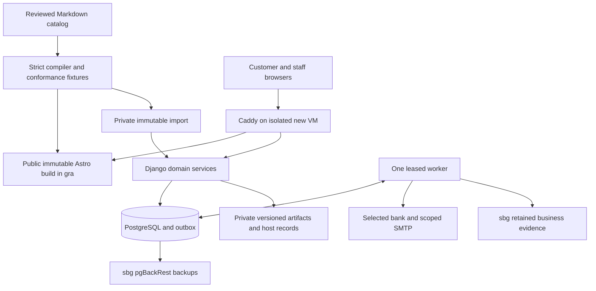

# Architecture: source-derived contract

The October 20 proposal is the architecture authority. These are planned responsibilities, not implemented services.

Route 53 handles xspi.pro DNS. Caddy terminates independent TLS and maps only manifest-listed public objects over verified HTTPS Host/SNI; static origin receives no cookies, Authorization, query or client metadata. Dynamic routes retain legitimate session/CSRF controls. `/purchase/simple/` belongs to Django. Customer/staff cookies are host-only; staff paths are denied on customer host.

Order receipt/acceptance, financial observations, licence rights, delivery and support balances are distinct state machines. Archive recoverable effect identities before external action, then archive actual completion separately. Public manifests never contain raw host instances or customer/business state. The source snapshot is provenance, not a second editable catalog.

Build order: authority → reproducibility → rules → UI and transactional primitives → private identity → checkout → fake payments → bank qualification; delivery/support and hosting proceed independently after their prerequisites → recovery → integrated release → controlled activation. The single VM/Caddy remains a shared failure domain for browsing and transactions.
