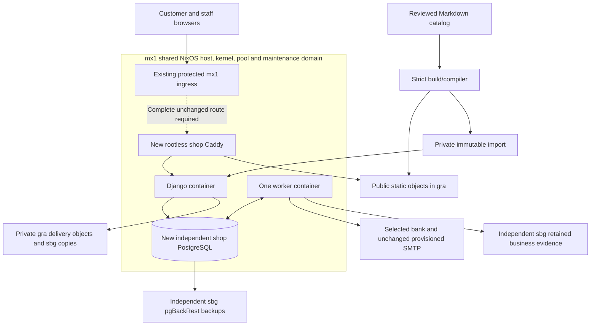

# Architecture — October 21 source contract

These are planned responsibilities, not deployed findings. The complete October 21 proposal/handoff governs.

Dedicated proposed shopsvc runs directly on mx1, outside claude-dev and other service accounts. NixOS-declared Quadlet/user-systemd owns one lifecycle per new rootless container. Private network and unused loopback gateway mappings; no privileged/host-network/host-PID/management-socket/unrelated mounts. A backend named podman is not proof of rootlessness.

The host-controlled shop ancestor covers payloads, conmon, network helpers and backup jobs under proposed 200% CPU / 6 GiB high / 8 GiB max and bounded tasks/concurrency. New ZFS shop parent caps aggregate 80 GiB including descendants/snapshots; 50 GiB PG subtree includes indexes/WAL. GraphRoot/images/volumes/temp/logs/gateway state/spool stay accounted. Existing allocations, reserves, disks and shared journal remain unchanged.

Before any mx1 write: all-owner/state/runtime/native/VM read-only inventory, exact new-shop identity/mutation/database allowlist and complete evaluated NixOS activation/dependency/restart/reload impact. Every pre-existing/unknown resource is protected. Separate PGDATA/roles/passwords/socket/network/backup namespace; positively check database destination before mutation. No blanket activation/protected reload/repair; rollback only owned shop additions while preserving records.

Ingress is conditional. Existing proxy/certificates/firewall stay unchanged. Profile A needs a complete existing TCP path and new-shop issuer; B needs existing correct TLS termination/renewal and HTTP-only gateway. No route is established by supplied capacity data. No DNS A/AAAA until complete authorized path proof; DNS-01 cannot create routing. Only later explicit service/action authorization can permit a protected change. Host-only customer/staff sessions, MFA, Django /purchase/simple/, static manifest routing and fixed verified HTTPS Host/SNI with metadata stripping remain required.

Host/pool/ingress/gateway failure removes custom-domain browsing and checkout. A Django-only failure may leave static browsing. Rootless containers share kernel/hardware; no VM isolation or high availability is claimed. Full-pool-loss restoration and fault/exhaustion/restart/capacity qualification run independently off-host. mx1 allows bounded shop smoke and read-only baseline comparisons.

Order/acceptance, bank facts, rights/delivery and support are separate state machines. Recoverable snapshots precede effects; actual completion is separate. Restore reconciles external money, keys, documents, support work and revoked access before safe reopening.
