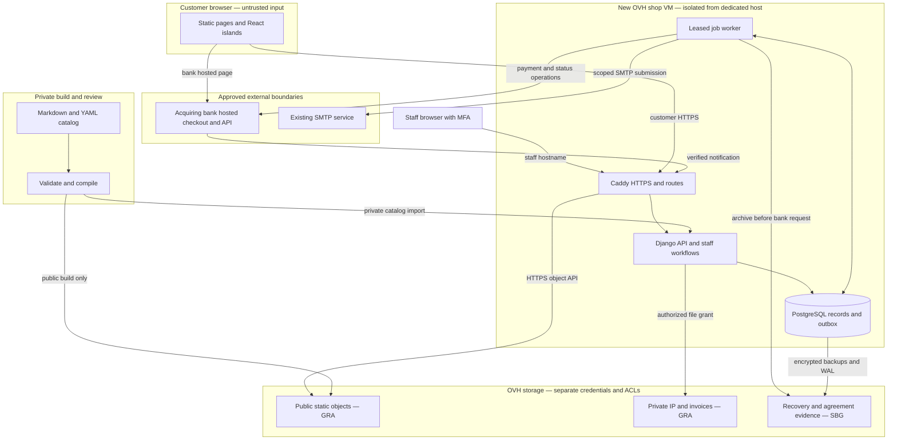

# Synaptic Laboratories IP shop — researched proposal

**Prepared:** 19 October 2026 · **Status:** proposal for review; no implementation or live changes · **Companion:** `SLL-IP-Shop-Codex-Handoff-2026-10-19.md`

## Contents

- [1. Executive recommendation, assumptions and first release](#1-executive-recommendation-assumptions-and-first-release)
- [2. Existing form audit and migration decisions](#2-existing-form-audit-and-migration-decisions)
- [3. Customer journeys and purchase eligibility](#3-customer-journeys-and-purchase-eligibility)
- [4. Architecture recommendation and technology decision](#4-architecture-recommendation-and-technology-decision)
- [5. Static/build boundary and customer API](#5-staticbuild-boundary-and-customer-api)
- [6. Markdown catalog and configuration authority](#6-markdown-catalog-and-configuration-authority)
- [7. Core data model and application boundaries](#7-core-data-model-and-application-boundaries)
- [8. Administration and repository layout](#8-administration-and-repository-layout)
- [9. Payments, licensing and durable processing](#9-payments-licensing-and-durable-processing)
- [10. Bank-adapter contract and qualification](#10-bank-adapter-contract-and-qualification)
- [11. OVH hosting, publication, recovery and operating cost](#11-ovh-hosting-publication-recovery-and-operating-cost)
- [12. Deployment, security and operating procedures](#12-deployment-security-and-operating-procedures)
- [13. Implementation sequence, effort and acceptance](#13-implementation-sequence-effort-and-acceptance)
- [Appendix A. Complete source-field matrix](#appendix-a-complete-source-field-matrix)
- [Appendix B. Exact observed option lists](#appendix-b-exact-observed-option-lists)
- [Appendix C. Country and work-mobile dialing options](#appendix-c-country-and-work-mobile-dialing-options)
- [14. Unresolved decision register](#14-unresolved-decision-register)

## 1. Executive recommendation, assumptions and first release

Build a static Astro storefront with selected React islands, backed by a small **Django + PostgreSQL** application on a new, isolated OVH Public Cloud instance. Keep ordinary Markdown and readable YAML frontmatter as the single catalog authority. Use an acquiring bank's hosted checkout, a PostgreSQL outbox worker, Django-based browser administration with enforced MFA, and tracked manual provisioning of licensed IP.

Recommend **payment against a sales-approved quote in the first release**, alongside the capability to buy explicitly approved, priced configurations directly. This is a practical fit for configurable IP: the difficult work is establishing the licensed entity, engineering scope, rights, deliverables and commercial offer. A retail commerce engine would still need those domain-specific extensions. A valid request with unknown compatibility or price remains awaiting review. Product options, requested recommendations and certification requirements are never converted into facts about what SLL sells without an approved offer.

The requested Object Storage origin is retained. OVH's website endpoint is HTTP-only, so the smallest proposed HTTPS adjustment is to use Caddy on the planned backend VM and fetch the generated static objects through the separate **HTTPS S3 object API**. That requires generated route/index/error handling and couples custom-domain storefront availability to the VM. It does not introduce request-time Astro rendering. [OVH website hosting](https://docs.ovhcloud.com/en/guides/storage-and-backup/object-storage/s3-website) · [OVH custom-domain HTTPS](https://docs.ovhcloud.com/en/guides/storage-and-backup/object-storage/s3-website-https)

The researched production footprint is approximately **£42.32/month excluding VAT** on OVH's published UK hourly tariff. Allow approximately **£50–60/month** for this footprint with modest staging/headroom, plus maintenance labour and the eventual merchant/payment/compliance charges. This is a sizing and tariff calculation, not a merchant quote or high-availability service. The full implementation is estimated at **40–65 engineer-days**, excluding external waiting and legal work. The hosting and execution sections expose the assumptions behind both figures.

### Assumptions that make the proposal actionable

| Area | Planning assumption and consequence |
|---|---|
| Launch catalog | One English-language configurable memory-controller IP offer is the working example. SLL must identify the actual SKU, IP release and approved scope; the example name is not a verified product promise. Other source-form services stay inquiry interests. |
| Commercial model | One licensed entity/project scope per line, quantity 1, one activated currency, no automated renewal or licence generation. Public offers and negotiated quotes use the same order/payment/fulfilment services. |
| Workload | Modest inquiry/order volumes and fewer than ten concurrent interactive customers. Sizing is validated with representative staging traffic before launch. |
| Commercial facts | Seller jurisdiction, tax, customer markets, acquiring bank and settlement currency are unknown. Residence in Georgia establishes none of them. Unknown live values are explicit null/pending states. |
| Existing environment | No access to, modification of, or restart of the dedicated host is necessary for the proposed shop. SMTP submission and DNS are narrow, separately scoped integrations. Existing monitoring integration is optional and separately scoped. |
| Operations | A named operator handles security updates, uncertain payments and manual delivery during agreed coverage hours. A four-hour staffed restore target starts when recovery work begins; no 24-hour response SLA is assumed. |
| Current evidence | The live form and primary documentation were reviewed on 19 October 2026. Form submission, bank credentials, actual OVH deployment, performance and restore behavior were not tested. Those are future implementation evidence, identified in the handoff. |

### Included in the first release

The release includes product discovery/documentation, the audited configuration and inquiry information, evaluation requests, technical/quote requests, tracked quotation approval and issue, quote acceptance/payment, approved direct purchase, editable cart/review, payment status, receipt/invoice access, manual delivery status, private downloads, and practical staff workflows. Routine descriptions, labels, help, options and approved catalog pricing change through Markdown review and publication. Operational quotes, orders and entitlements change through the backend.

Automated licence generation, subscriptions or automatic renewals, saved cards, multiple currencies/FX, complex promotions, customer organization accounts, marketing analytics, additional purchasable services, and a full WordPress migration are separate scope decisions. Manual bank transfer can be added as an explicitly distinct reconciled payment method; it is not required by this proposal.

### Reading guide and evidence standard

The main sections explain the decision, customer journeys, trust boundaries, content/API contracts, financial and licensing workflows, hosting and operations. Appendices A–C preserve all 53 audited fields, every observed business dropdown and both 242-entry country selectors. The final decision register collects only inputs that remain unresolved. The companion handoff expands the ordered tasks, acceptance criteria and completion evidence.

Primary links sit beside sourced capability, licence, price and security facts. Proposed policies, architecture choices, sizing, effort and recovery targets are expressly recommendations or estimates. Where only the live form can establish a source property, a second generic source would not corroborate it; the audit records the observed interface and its limits instead. The proposal does not present local mocks, published documentation, sandbox behavior and production proof as interchangeable evidence.

## 2. Existing form audit and migration decisions

### Evidence and method

The audit baseline is SLL's supplied project brief (`Pasted text(20261019-101827).txt`), the [SLL trial-IP request page](https://synaptic-labs.com/trial-ip-request/), and its [embedded Confidential Trial IP Request Form](https://forms.monday.com/forms/embed/9ddd6f8c852b1c67107849bb1af1e1d3?r=use1). The live form was inspected on **19 October 2026**. The inspection identified **53 distinct source fields across the exercised branches**; Appendix A inventories those fields, Appendix B preserves dropdown options in their observed order, and Appendix C records the complete observed country/dialling-code list.

The inspection opened selectors and exercised nonpersonal branch choices. No form was submitted, no real person's information was entered, and neither agreement was accepted. The supplied brief says submissions notify SLL's sales mailbox; that delivery path was not tested. This audit describes observed customer-interface behaviour. It does not establish Monday's server-side validation, submission schema, workflow configuration, delivery guarantees, or every possible combination of selections.

Exact source labels, help text and displayed option values are preserved below after removing layout-only whitespace and zero-width characters. Spelling, punctuation, case, apostrophes and duplicate-looking option entries are retained. The normalization is a textual transcription of the rendered interface, not a byte-for-byte export of Monday's configuration. The source identifiers are observed control/question identifiers, useful for traceability; they are **not a promise of permanent public API identifiers**. Internal Monday option value IDs were not exposed. Runtime `downshift-*` identifiers are ephemeral and must not become shop identifiers.

Requiredness means an observed **Required** marker in the interface. A blank initial source value is the observed default; later nonpersonal selections were made to expose branches and are not source defaults. Multiple selection is reported where the open listbox exposed `aria-multiselectable="true"`; single-selection controls were also checked by their observed behaviour. Input type and selection cardinality are reported separately. The company website remains a source **text** input: the audit does not silently convert it to a URL control.

DOM attributes were inspected where available. A missing attribute is reported as absent, not as proof that no application-side validation exists. Three long-text fields displayed a counter referencing 2000 characters without a DOM `maxlength`; the counter does not establish an enforced maximum. Inspected date/numeric controls exposed no `min`, `max` or `step`. For eleven fields observed through the accessibility representation only, HTML validation attributes remain individually marked **unverified**. The audit does not extrapolate another field's limits to them.

### Conditions and retained hidden state

The nine baseline conditions in the brief were directly exercised: selecting the memory-controller service; the FPGA and ASIC project branches; and the six conditional “other” responses for memory type, clock speed, memory access, FPGA family, ownership and licensing. Appendix A spells out their individual predicates. These observations verify those branches, not every combination of nested or concurrent choices.

The FPGA → ASIC → FPGA sequence restored the previously selected “Other, please specify.” FPGA family, demonstrating retained hidden interface state. Removing the memory-controller service hid its section. Retention of memory selections after re-adding that service remains **unverified**, because the observed timing did not establish a reliable conclusion. The proposed shop must use an explicit policy for stale hidden values: warn when a change discards dependent selections, exclude inapplicable values from the active configuration, and enforce the same rule in the backend.

### Proposed customer flow

Separate the source fields into **contact**, **company**, **product configuration**, **project qualification**, and **consent**. Preserve the source's information while asking it at the appropriate point. Product discovery and initial configuration should not require personal information. The first product's page can select its own product context; the other listed services remain related-service interests for an inquiry unless SLL separately approves them as products. A trial, a technical-review request and a commercial checkout share relevant configuration facts but have distinct completion and acceptance steps.

Source choices are statements of customer intent or project facts. They do not establish technical compatibility, certification, licence rights, price, or immediate purchase eligibility. A request for a recommendation is not a resolved configuration. End-product ownership and requested licence model belong to project/commercial qualification until SLL confirms the applicable offer.

### Explicit change register

The source inventory remains immutable audit evidence. These are proposed changes for the shop, subject to the proposal's business decision register; none is presented as an existing source property. Labels not listed here retain their source wording in the initial migration.

| Change | Source behaviour or wording | Proposed shop behaviour or wording | Reason and boundary |
|---|---|---|---|
| F-01 | `Multi select` | **Safety and certification requirements** | Makes the source question intelligible. Preserve every option; store it as a requested requirement, never an automatic certification or suitability claim. |
| F-02 | `Pease` at the start of the `Multi select` help text | Correct that occurrence to **Please** | Spelling-only edit; preserve the substantive question. |
| F-03 | `Ownership` | **End-product ownership** | Clarifies that the source question concerns the customer's product; it does not transfer SLL's IP ownership. |
| F-04 | Source voltage help recommends 1.8 V | Preserve the source text in the audit; replace shop guidance only with **engineering-reviewed, conditional guidance** | Do not publish the source recommendation as a universal compatibility, performance or implementation rule. Exact replacement wording awaits engineering approval. |
| F-05 | `SLL IP cores and services` allows inquiry interests | Select the approved launch product from its product-page context; retain other interests in the inquiry workflow | Avoid duplicate product selection and avoid inventing purchasable products, SKUs or prices for every listed service. |
| F-06 | Required `R&D start date`, `Prototype date`, `Start production date`, `Annual production volume`, and `Number of years manufacturing` | Require a response when qualifying an inquiry/offer; allow a known value or **Unknown — with reason** | Preserve an honest answer when dates/volumes are undecided. This changes the accepted response model; it does not invent dates, zeros or manufacturing years. `Start mass production date` and `First year production volume` remain optional. |
| F-07 | `FPGA device used for ASIC prototyping` and `FPGA board used for ASIC prototyping` | Require a response: an actual device/board, **Not applicable**, or **Unknown — with reason** | Records ASIC projects with no FPGA prototype or an undecided prototype without fabricating an FPGA part or board. |
| F-08 | Required `FPGA development board` description | Accept the applicable proprietary-board description, commercial-board identity, or **Unknown — with reason** | Retains the requested implementation context without making an off-the-shelf development board a prerequisite. |
| F-09 | `Company - Name` and the address fields are optional; `Company - Country` is required | Require the licensed legal entity's name and applicable legal/billing address at commercial checkout; confirm whether these are the same as the contact's employer details | This changes requiredness for buying, not for every exploratory inquiry. Address lines 2/3 remain optional. Suburb, region, postcode and tax identifiers depend on the applicable country and invoicing rules; no universal postcode/tax-ID requirement is proposed. Specific activated requirements await seller/tax decisions. |
| F-10 | `SLL Trial IP usage` | Retain its evaluation-only role; add separately versioned commercial-licence acceptance for purchases | Do not reuse trial-only language as a commercial licence. Preserve who accepted which terms, for which organization and transaction, and when. |
| F-11 | `GDPR agreement` | Review the applicable privacy notice and lawful basis; separate necessary processing from any optional consent | Do not mechanically copy the source agreement control or merge privacy and commercial acceptance. Exact approved wording and requiredness depend on the reviewed basis. |
| F-12 | Switching FPGA → ASIC → FPGA restored a hidden FPGA-family selection; memory removal hid its fields | **Clear newly inapplicable dependent answers with a notice**, while retaining unrelated valid answers | This deliberately changes the observed retained-hidden-state behavior. The backend rejects stale hidden values; no cleared answer silently changes a payable scope. Memory re-add retention remains unverified source behavior. |
| F-13 | Text controls had no observed HTML length enforcement; three long-text controls displayed a 2000 counter | Proposed initial shop limits: **500 Unicode characters for ordinary text fields, 2000 for the three multiline fields, and field-specific validated email/phone handling** | These are proposed input-safety limits, not observed Monday limits. Exact typed limits, including treatment of unusually long part lists, need approval in the shop profile. Preserve website and bandwidth as text controls; do not silently add URL/bandwidth-unit validation. |
| F-14 | Numeric/date controls exposed no `min`, `max` or `step`; server behavior was not tested | Known production counts must be nonnegative whole numbers; known manufacturing duration a finite positive decimal; known dates valid ISO calendar dates. Explicit approved unknown/not-applicable response states remain distinct from values. | New shop validation must be recorded in the profile. No automatic schedule ordering, future-only date constraint, maximum production quantity, compatibility rule or price is inferred from the source. Parser precision/length bounds are technical limits stated in the schema. |

No additional wording or requiredness change is silently authorized by the example Markdown or UI sketches. The proposed validation in F-13/F-14 and any later numerical bounds, date constraints, engineering compatibility rules or commercial eligibility rules must be explicitly approved in the versioned shop profile. The observed numeric/date control types alone do not establish those rules. Approval resolves these choices once; it is not a repeated permission gate for ordinary implementation of the approved profile.


## 3. Customer journeys and purchase eligibility

### A coherent flow for engineers and buyers

| Stage | Customer experience | Backend decision or durable record |
|---|---|---|
| Discover | Read product overview, public specifications, release/support summary and documentation. See a price only where an approved public offer exists. | Static content contains the catalog revision; no personal information is needed to browse. |
| Configure | Choose target implementation and requested memory support, with dependent fields and contextual help. Review an engineering summary before sharing contact information. | Validate field IDs, types, visibility and required responses; save a configuration snapshot when the customer requests a next action. |
| Evaluate | Reuse the configuration, add contact/project details and review the applicable evaluation terms. Acknowledge the inquiry reference and expected review process. | Persist inquiry and notification work. Trial acceptance is associated with evaluation; technical/NDA approval precedes any evaluation package when required. |
| Request a quote or review | Explain unresolved needs or requested recommendations. Provide known project data or the approved explicit unknown response. | Record assigned owner, review status and questions. Staff clarify scope, approve a quote revision and issue it to a verified recipient. |
| Accept an approved quote | Open secure quote access, review exact licensed entity, configuration, release, rights, price, tax, expiry and terms. Changes go back to sales for a revised quote. | Freeze acceptance evidence and convert one accepted revision to at most one order. No editable quoted scope is carried into payment under its old price. |
| Buy an approved offer | Add the approved scoped offer to the cart, confirm the licensed entity/billing details and terms, review authoritative totals and continue to bank checkout. | Revalidate the current offer/configuration and every prerequisite; create the order and attempt before contacting the bank. |
| Return from payment | See “Confirming payment” until bank evidence confirms the outcome. Closing the bank tab or arriving at a success URL does not lose the order. | Poll authorized order status and reconcile the attempt. Unknown outcomes prevent a second charge until resolved. |
| Receive and revisit | See the order, financial document and delivery state. Receive a notification when an approved package is ready, then authenticate to download it. | Staff provision and release a versioned package only after all prerequisites; entitlement checks protect every file and invoice. |

Use four form stages: **Configuration → Project and contact → Review → Requested action**. Commercial checkout adds licensed-entity/billing confirmation and commercial acceptance; it does not make a customer repeat information already confirmed for that quote. Details saved in a quote are shown for confirmation, with corrections producing a new quote where scope changes.

Keep an inquiry lifecycle of `received → assigned → reviewing → waiting_for_customer → resolved`, with explicit `closed`/`spam` outcomes and linked quotes where appropriate. Give each open inquiry/quote a staff owner and next-action date. Evaluation, quotation and commercial delivery are distinct records linked to the same reviewed configuration. A customer's requested delivery date is not an SLL service promise.

### Eligibility is separate from valid input

| Outcome | Evidence required | Customer action |
|---|---|---|
| `awaiting_review` | The request is well formed, but technical support, licence scope, price, tax or another prerequisite is unresolved. This is the initial safe default. | Request evaluation, quotation or technical review; preserve selections and show what needs confirmation. |
| `quote_only` | SLL has explicitly approved a quotation route for that scope; a customer-specific offer, engineering work or contract is needed. | Request a quote; pay an issued approved quote when its prerequisites are satisfied. |
| `unsupported` | An explicit, current SLL-approved exclusion applies. An unknown option combination alone is insufficient. | Explain the approved reason and offer technical contact or a supported alternative only where verified. |
| `purchasable` | An active approved offer or unexpired issued quote matches the configuration, entity/scope and release; currency, non-null price, tax treatment, terms and all required approvals are resolved. | Review authoritative totals/terms and proceed to payment. |

Invalid input is a validation error, not a fifth commercial status. Return errors at stable field paths; do not discard valid unrelated answers. If independent rules conflict, fail catalog compilation or send the request to review; never let rule ordering accidentally select a price. Safety requirements and end-product ownership can affect review, but do not grant certification or SLL IP ownership.

An approved quote can bind an exact scope even when the general catalog is quote-only. Direct purchase is a narrower convenience for explicitly approved combinations. The backend checks a complete offer matcher and all prerequisites at the point of order creation. It cannot infer an offer by adding together options that merely happen to appear in the source form.

### Licence quantity, cart editing and secure access

The initial cart has quantity fixed at **1 per defined licence scope**. Manufacturing volume, projected devices and years of production remain separate project facts. If a customer needs another project/entity licence, sales creates another scoped line or quote. A source licensing preference such as a per-device or royalty arrangement does not activate such billing automatically.

A cart is a mutable draft; an issued quote is a controlled commercial offer. Editing an ordinary cart line revalidates dependent options, eligibility and authoritative price, increments the cart version and returns a reviewable difference. Editing a quoted line requests a revised quote. Validate duplicate lines and simultaneous checkouts under database constraints so a double click cannot create concurrent unresolved attempts for the same obligation. The source quantity of production is never substituted for cart quantity.

Recommend **guest access through email verification and a scoped session**. It serves occasional B2B purchasing without password, account recovery and organization membership features. Each verified session gets explicitly associated quotes/orders; sharing an email domain confers no organization-wide access. An alternate purchaser, engineer receiving confidential IP, or changed contact email needs an approved grant/verification action. Repeated customers and managed organization membership can justify accounts later, using the same underlying authorization model.

### Mobile, keyboard, errors and unavailable services

Use visible labels and help associated with controls, `fieldset`/`legend` for grouped choices, semantic buttons, keyboard-operable searchable lists, touch-friendly spacing and an error summary that moves focus to the first relevant error. Announce newly visible fields and discarded dependent answers without unexpectedly moving focus. Preserve entered valid values after server validation or a transient failure. A saved server draft requires an authorized session; avoid persisting contact data or confidential project free text in browser local storage by default. Offer an explicit “clear this device's draft” action.

Public pages and technical documents remain readable without JavaScript. Provide an explicit **simple evaluation/quote form served by Django at `/inquiry/simple/`**, using the same field definitions and server validation with page reloads for dependencies. This is the separately deployed backend, not Astro SSR. The interactive checkout needs JavaScript in v1; direct the customer to the simple inquiry route for assistance instead of leaving inert controls. The fallback has the same reviewed source mapping and acceptance rules.

When Django is unavailable but Caddy and storage are healthy, product discovery remains available. Transaction sections show a clear retry message and the confirmed sales-contact route; they must not show a successful inquiry/payment or a working Pay button. Submitted inquiries return success only after the business record commits. Browser-memory configuration selections can survive a retry; expired secure sessions require verification again. VM failure also takes down the proxy, as addressed in the hosting section.

### Website coexistence and cutover boundary

Use `shop.synaptic-labs.com` for customers and `shop-admin.synaptic-labs.com` for staff, subject to DNS approval. Existing WordPress pages remain in place. The eventual cutover can add one navigation link and replace the old trial page's embed with a link or an explicitly approved HTTP redirect to the new evaluation journey. Define the old URL's destination and analytics-free referral behavior in that scoped change; do not silently redirect every existing page or migrate old Monday records.

Historical Monday inquiries are outside v1 migration unless SLL supplies an authorized export and retention/mapping scope. Removing Monday from the new workflow does not itself delete historical data or terminate the old form. Those are separate business/data-lifecycle actions.

## 4. Architecture recommendation and technology decision

**Recommendation:** use a small Django application with PostgreSQL, a database-backed worker and a tailored internal administration interface. Keep the customer storefront as an Astro static build with React islands only where interaction needs them. The requested Object Storage origin remains the source of public HTML and assets; Caddy on the proposed GRA11 B3-8 instance terminates HTTPS and proxies either to that origin or the application. The hosting section specifies that boundary in detail.

This choice follows from the work this shop actually requires. Configuration qualification, approved offers, technical review, licence scope, contract acceptance, bank reconciliation and protected IP delivery are substantial custom domains. A commerce engine supplies useful retail order machinery, but it does not establish SLL's engineering or commercial rules. Django supplies authentication, permissions, forms, transactions and an internal administration foundation. SLL still owns the bounded commerce implementation and its security maintenance. Django's own documentation treats its admin as an internal record-management tool and recommends custom views when workflows need a more focused interface. [Django admin](https://docs.djangoproject.com/en/5.2/ref/contrib/admin/) · [Django authentication and permissions](https://docs.djangoproject.com/en/5.2/topics/auth/default/)

### Component flow and trust boundaries



Only approved public build output reaches the public bucket. Bank operations and SMTP submission use fixed configured endpoints and scoped secrets. Static proxy requests strip customer credentials. Staff routes are exposed only on the staff hostname and require verified MFA; a hostname alone grants no authority. The diagram's storage groups contain distinct buckets for artifacts, mutable backups and retained agreement evidence. The VM's operating administrator remains a privileged trust boundary; application roles and storage retention reduce mistakes and routine tampering, not all power of infrastructure owners.

### Comparison against two self-hosted engines

The following assessment concerns the actual proposed SLL integration. Effort judgments are architectural estimates, not vendor benchmarks.

| Criterion | Django application — recommended | Vendure Core 3.8.0 | Medusa 2.21.2 |
|---|---|---|---|
| Free software boundary | BSD-licensed framework; native admin, auth and permissions | GPL-3.0-or-later, with a plugin exception; core dashboard and roles/permissions included | MIT core with identified Enterprise Materials under separate commercial terms |
| Administration | Build focused sales/technical/finance/fulfilment screens around model admin | Existing commerce dashboard; add IP, inquiry, quote and entitlement views | Existing commerce admin; add IP, inquiry, quote and entitlement views |
| Permissions and authentication | Native permission groups plus the selected open-source MFA components | Core RBAC is free; official Platform SSO, audit and row-level access features are commercial | MFA now exists in the Auth Module; packaged RBAC and SSO are Enterprise features |
| Runtime footprint | Python app, worker and PostgreSQL | Node application, worker and PostgreSQL; SQL job queue avoids Redis | Documented production deployment uses Node, PostgreSQL and Redis |
| Markdown authority | Import immutable catalog revisions directly | Add an importer and prevent independent catalog edits in the dashboard | Add an importer and prevent independent catalog edits in the admin |
| Configurable IP | Domain-specific models and shared declarative rules | Custom fields/plugins and configuration logic | Custom modules/workflows and configuration logic |
| Bank integration | One bounded custom adapter | Custom handler unless the chosen bank has a suitable maintained integration | Custom provider unless the chosen bank has a suitable maintained integration |
| Digital licensing | Custom licence scope, acceptance, entitlements and delivery | Digital-delivery guide still requires custom components | Digital-products guide still requires custom components |
| Continuing cost | Maintain SLL's bounded business domain and dependencies | Maintain SLL extensions against engine APIs and migrations | Maintain SLL extensions, infrastructure modules and feature-licensing boundaries |

Vendure is the strongest alternative if ordinary retail features—larger catalogs, promotions or multiple commercial channels—become dominant. Its SQL job queue is a useful way to keep infrastructure small. The published Core licence includes the “or later” option and a plugin exception; it should not be inaccurately labelled GPL-3.0-only. [Vendure licence](https://github.com/vendurehq/vendure/blob/master/LICENSE.md) · [Core permissions](https://docs.vendure.io/current/core/core-concepts/permissions) · [SQL job queue](https://docs.vendure.io/current/core/reference/typescript-api/job-queue/default-job-queue-plugin)

Vendure's official SSO, audit and row-level governance bundle is a commercial Platform addition. Medusa similarly identifies RBAC and SSO as Enterprise Materials. These are material limitations under SLL's requirement that required features remain free and open source. They do not mean that every custom authentication integration is prohibited, but such an integration brings additional work. [Vendure governance boundary](https://vendure.io/product/platform/governance-compliance) · [Medusa licence boundary](https://github.com/medusajs/medusa/blob/develop/ENTERPRISE-LICENSE.md)

Medusa's current MFA documentation is an improvement over earlier versions; it would be incorrect to claim that it lacks MFA. Its production guide nevertheless specifies PostgreSQL and Redis, and its digital-product guide calls for a custom module and associated flows. Vendure's digital guide also requires a custom fulfilment handler. Neither guide supplies SLL's contractual licence model. [Medusa MFA](https://docs.medusajs.com/resources/commerce-modules/auth/mfa) · [Medusa deployment](https://docs.medusajs.com/learn/deployment/general) · [Medusa digital products](https://docs.medusajs.com/resources/recipes/digital-products) · [Vendure digital products](https://github.com/vendurehq/vendure/blob/master/docs/docs/guides/how-to/digital-products/index.mdx)

### Version and licence baseline

These are researched stable versions for the proposal dated 19 October 2026. Codex must resolve any newer security patches, verify compatibility and record hashes for the actual locked artifacts before implementation. “Latest” must not remain an unbounded production dependency.

| Component | Baseline | Licence | Role |
|---|---|---|---|
| Astro | 7.4.0 | MIT | Static pages and build-time collections |
| React / React DOM | 19.3.1 | MIT | Selected customer interface islands |
| Node.js | 24.22.0 LTS | MIT, with incorporated notices | Build and preview only |
| Python | 3.13.16 | PSF License Version 2, with incorporated notices | Backend and worker runtime |
| Django | 5.2.18 LTS | BSD-3-Clause | API, sessions, domain services and admin |
| PostgreSQL | 18.6 | PostgreSQL License | Durable transactional data and jobs |
| Gunicorn | 26.2.0 | MIT | Application server behind Caddy |
| Psycopg | 3.3.6 | LGPL-3.0-only | PostgreSQL driver |
| django-two-factor-auth | 1.18.1 | MIT | Staff TOTP enrolment/login/recovery interface |
| django-otp | 1.7.5 | Unlicense | OTP verification integration |
| Caddy | 2.11.7 | Apache-2.0 | HTTPS and reverse proxy |
| pgBackRest | 2.60.0 | MIT | PostgreSQL-consistent backups and WAL recovery |

Version/licence evidence: [Astro release](https://astro.build/blog/astro-740/) and [licence](https://github.com/withastro/astro/blob/main/LICENSE); [React releases](https://github.com/react/react/releases) and [package licence](https://github.com/react/react/blob/main/packages/react/package.json); [Node LTS](https://nodejs.org/en/download) and [licence notices](https://github.com/nodejs/node/blob/main/LICENSE); [Python release schedule](https://peps.python.org/pep-0719/) and [3.13 licence](https://docs.python.org/3.13/license.html); [Django release/support](https://www.djangoproject.com/download/) and [licence](https://github.com/django/django/blob/main/LICENSE); [PostgreSQL versions](https://www.postgresql.org/support/versioning/) and [licence](https://www.postgresql.org/about/licence/); [Gunicorn](https://pypi.org/project/gunicorn/); [Psycopg](https://www.psycopg.org/download/); [two-factor package](https://pypi.org/project/django-two-factor-auth/); [OTP package](https://pypi.org/project/django-otp/); [Caddy releases](https://github.com/caddyserver/caddy/releases) and [licence](https://github.com/caddyserver/caddy); [pgBackRest release](https://pgbackrest.org/release.html) and [licence](https://github.com/pgbackrest/pgbackrest/blob/main/LICENSE).

Django 5.2 LTS remains supported through April 2028; the database line has a longer support horizon. These choices reduce immediate major-version churn, but require a scheduled LTS upgrade. The OTP project's maintainer describes limited ongoing investment, so its releases and vulnerabilities warrant explicit dependency monitoring. Some exact tagged licence files were unavailable through the research interface: the proposal establishes official release identity and project/package licence, while the implementation must inspect the actual distributions and transitive dependencies. [Django support](https://www.djangoproject.com/download/) · [PostgreSQL support](https://www.postgresql.org/support/versioning/) · [OTP maintenance status](https://pypi.org/project/django-otp/)

## 5. Static/build boundary and customer API

**Recommendation:** the customer origin is provisionally `https://shop.synaptic-labs.com`. Astro builds the public pages, documentation, collection data and browser assets before publication. The origin bucket runs no application code. Set static output and use local build-time collection loaders; React islands call `/api/v1/...` through Caddy to Django. There are no request-time Astro endpoints, SSR routes, server islands, live-collection runtime or production Node service hidden behind the bucket. Astro documents build-time collection loaders and separately describes islands; using selected capabilities is essential here. [Content Collections](https://docs.astro.build/en/guides/content-collections/) · [Astro islands](https://docs.astro.build/en/concepts/islands/)

Public catalog HTML contains public prices only when approved, and never contains customer/order data. The cart, configuration state, validation, quotation access, checkout and entitlement views use the backend. A backend outage therefore leaves product discovery available only to the extent that the hosting proxy remains available; transaction interfaces show an accurate retry message and preserve non-sensitive valid draft selections. The hosting section addresses the proxy's availability coupling.

Use same-origin `/api` for customers so browser API calls need no cross-origin exception. Django issues host-only cookies named, for example, `__Host-sll_session` and `__Host-sll_csrf`, each with `Secure`, `Path=/` and no `Domain`; the session is also `HttpOnly`. Use `SameSite=Lax` with explicit CSRF protection, including origin checks. This permits an ordinary top-level return from a hosted checkout without turning that return into financial evidence. Django documents CSRF middleware, masked tokens and cookie/session security settings. [Django CSRF](https://docs.djangoproject.com/en/5.2/ref/csrf/) · [Django settings](https://docs.djangoproject.com/en/5.2/ref/settings/)

The initial `GET /api/v1/session` returns a masked CSRF token, establishes the required cookie and sends `Cache-Control: no-store`. The island includes `X-CSRFToken` on state-changing requests. Do not cache session/CSRF responses, authenticated APIs or HTML containing private state. Do not add a service worker to v1. Anonymous inquiry submissions also receive appropriate CSRF and anti-spam handling. The gateway callback route is a narrow separately authenticated endpoint; it is not a reason to disable CSRF elsewhere. CORS is closed unless a separately reviewed integration requires it.

For staff, recommend the separate proposed hostname `shop-admin.synaptic-labs.com` routed to the same application instance, with no additional VM or identity provider. Its host-only cookies remain distinct from customer cookies. Caddy exposes `/admin/`, custom staff workflow views and staff action endpoints only on that hostname. On the customer hostname, reserved staff paths return `404` before static routing and never fall through to Object Storage. Use `AdminSiteOTPRequired` for the admin and the equivalent mandatory verified-session check on every privileged staff view/API, followed by its specific role/resource permission check. Login, enrolment and recovery have narrowly defined pre-authentication access but grant no business privileges. This small origin separation reduces cross-origin exposure of an existing staff session; it does not replace MFA or authorization.

Without JavaScript, product pages and documentation remain readable. Provide an explicit evaluation/quote route to a simple backend-rendered form at `/inquiry/simple/`, using page reloads for dependent fields. The confirmed sales contact is also available for assistance. The fallback is served by the separately deployed backend; it does not change Astro's static architecture. Reuse the same definitions and server validation. Do not pretend a static no-JavaScript page can complete the dependent configurator unaided. Email should not be used to collect raw card data or transmit paid IP attachments.

## 6. Markdown catalog and configuration authority

**Recommendation:** ordinary Markdown in one private, version-controlled repository is the authoritative source for public product descriptions, option labels/help, dependencies, legal references and approved public offers. Put confidential offers/approval definitions in a separate private subtree of that repository. Operational records—customers, quotes, payments, entitlements and live activation state—belong in PostgreSQL.

An explicit compiler allowlist produces two artifacts with a common content revision: a public manifest for Astro and a private manifest for Django. The backend imports complete immutable revisions, verifies their hash and records the active revision. The browser receives only public fields. A second mutable product catalog in Django admin is prohibited: staff can inspect the imported data, while routine catalog changes pass through Markdown review/publication. Quoted negotiated prices remain versioned quote data, rather than modifying the public catalog.

Keep the source evidence profile `sll-trial-form-2026-10-19` separate from the proposed shop field profile `sll-shop-form-v1`. The latter applies an explicitly versioned source-to-shop change set, initially pending SLL review, so source wording/requiredness and proposed workflow changes cannot be confused. Production compilation requires approval of the shop profile/change set; previews can display the pending proposal. Preserve the exact observed country and phone-country lists in the source profile, including all 242 labels/order. Do not regenerate them from a generic ISO list.

### Product Markdown example

This example is structurally complete for one proposed product record, with shared definitions referenced by stable ID. It is **not the full form inventory**. The source profile carries observed input types, requiredness, limits and help; the shop profile carries those properties after the expressly reviewed changes. Neither profile may be guessed from this abbreviated example. The exact launch SKU, release and approved offer remain SLL decisions. The visibility predicates below model observed branch triggers; the reset policy is a proposed change, and none of these rules asserts technical compatibility.

```markdown
---
schema_version: 1
id: sll-xspi-memory-controller
slug: xspi-memory-controller
title: xSPI memory-controller licence
identity_status: awaiting_sll_approval
summary: Configure your memory interface and request evaluation or a quotation.
source_mapping:
  field_label: SLL IP cores and services
  selected_value: "01 - Memory controller IP's"
  selected_value_id: memory_controller
release_ref: null
form:
  source_profile_ref: sll-trial-form-2026-10-19
  field_profile_ref: sll-shop-form-v1
  change_set:
    ref: sll-source-to-shop-v1
    approval_state: pending
  fixed_selections:
    ip_interests: [memory_controller]
  groups:
    - id: target_implementation
      label: Target implementation
      fields:
        - project_type
        - fpga_device_family
        - other_fpga_device_family
        - fpga_product_order_code
        - fpga_development_board
        - asic_process_foundry
        - asic_prototype_fpga
        - asic_prototype_board
    - id: memory_configuration
      label: Memory configuration
      fields:
        - memory_device_protocols
        - memory_device_type
        - other_memory_device_support
        - memory_channel_top_clock_speed
        - other_memory_channel_top_clock_speed
  option_set_overrides:
    memory_device_protocols: memory-protocols
    project_type: project-types
  visibility:
    memory_configuration:
      selected: {field: ip_interests, value: memory_controller}
    fpga_device_family:
      selected: {field: project_type, value: fpga}
    fpga_product_order_code:
      selected: {field: project_type, value: fpga}
    fpga_development_board:
      selected: {field: project_type, value: fpga}
    asic_process_foundry:
      selected: {field: project_type, value: asic}
    asic_prototype_fpga:
      selected: {field: project_type, value: asic}
    asic_prototype_board:
      selected: {field: project_type, value: asic}
    other_memory_device_support:
      all:
        - selected: {field: ip_interests, value: memory_controller}
        - selected: {field: memory_device_type, value: other}
    other_memory_channel_top_clock_speed:
      all:
        - selected: {field: ip_interests, value: memory_controller}
        - selected: {field: memory_channel_top_clock_speed, value: other}
    other_fpga_device_family:
      all:
        - selected: {field: project_type, value: fpga}
        - selected: {field: fpga_device_family, value: other}
  hidden_value_policy: clear_with_notice
commercial:
  default_eligibility: awaiting_review
  public_price: null
  offer_policy_ref: sll-xspi-offers-v1
  quantity_policy: one_per_licence_scope
  commercial_terms_ref: null
  evaluation_terms_ref: null
  live_purchase_enabled: false
documentation:
  public_datasheet_ref: null
  support_summary: Support and maintenance rights are specified in the offer.
---

# xSPI memory-controller licence

Describe the memory interface required by your project. Your configuration
summary accompanies the evaluation or quotation request for SLL review.

## What the offer will identify

The approved offer identifies the licensed organization, project scope,
applicable IP release, deliverables, documentation and support entitlement.

## Engineering review

Protocol selections describe requested support. SLL confirms the supported
implementation and any device, toolchain or licence restrictions in its offer.
```

The compiler stores the exact source literal separately from the stable identifier. Thus the two distinct source values `Other` for memory device type and lowercase `other` for clock speed can both use the local ID `other` **within different field namespaces**, without losing their original spelling. Similarly, the FPGA-other definition retains `Other, please specify.`. Changing a display label must not silently change the stored identifier or historical order wording.

### Shared option-set Markdown examples

The protocol example is a **representative excerpt** of verified source labels. It must not replace the complete audited list or its exact ordering. `completeness: excerpt` deliberately prevents production compilation until the full reviewed set is present. Protocol labels may be edited for future shop presentation only with an explicit recorded mapping; `source_label` retains the audit text.

```markdown
---
schema_version: 1
id: memory-protocols
source_field_label: Memory device protocols
completeness: excerpt
options:
  - {id: hyperflash_1, label: "HyperFlash 1.0", source_label: "HyperFlash 1.0"}
  - {id: hyperram_1, label: "HyperRAM 1.0", source_label: "HyperRAM 1.0"}
  - id: hyperram_2_hyperbus
    label: HyperRAM 2.0 with HyperBus interface
    source_label: HyperRAM 2.0 with HyperBus interface
  - id: hyperram_2_xspi_p1
    label: HyperRAM 2.0 with xSPI Profile 1.0 interface
    source_label: HyperRAM 2.0 with xSPI Profile 1.0 interface
  - id: hyperram_3_16bit
    label: HyperRAM 3.0 with 16-bit data path
    source_label: HyperRAM 3.0 with 16-bit data path
  - id: xspi_p1_nor
    label: JEDEC xSPI Profile 1.0 NOR Flash
    source_label: JEDEC xSPI Profile 1.0 NOR Flash
  - id: xspi_p1_stt_mram
    label: JEDEC xSPI Profile 1.0 STT-MRAM
    source_label: JEDEC xSPI Profile 1.0 STT-MRAM
  - id: xspi_p2_nor
    label: JEDEC xSPI Profile 2.0 NOR Flash
    source_label: JEDEC xSPI Profile 2.0 NOR Flash
  - id: xspi_p2_psram
    label: JEDEC xSPI Profile 2.0 PSRAM
    source_label: JEDEC xSPI Profile 2.0 PSRAM
---

Select the protocols required for the proposed memory channel.
Availability is confirmed by SLL's technical review and approved offer.
```

```markdown
---
schema_version: 1
id: project-types
source_field_label: Project type
completeness: complete
options:
  - {id: asic, label: ASIC, source_label: ASIC}
  - {id: fpga, label: FPGA, source_label: FPGA}
---

Choose the implementation environment for this project.
```

Selection cardinality belongs to the referenced field definition, not the option set: reusing the same choices must not accidentally turn a source single-select into a multi-select. The source Project type order is preserved as ASIC then FPGA. Customer contact, project qualification and acceptance fields belong to their own reusable profiles and journey stages, not to the licence's purchasable variant identity.

### Private sandbox offer example

The live default is `public_price: null` and `awaiting_review`. To test price calculation, use a separate private **sandbox fixture** whose configuration is an explicit complete test fixture. The example amount is not an SLL price, and USD is not a selected settlement currency.

```yaml
# Frontmatter of catalog/private/offers/sandbox-fixture.md
schema_version: 1
id: sandbox-xspi-fixture
product_id: sll-xspi-memory-controller
purpose: automated_test_only
allowed_payment_mode: sandbox
configuration_fixture_ref: complete-fpga-test-case-v1
price:
  currency: USD
  minor_unit_exponent: 2
  amount_minor: 100000
tax_fixture_ref: synthetic-no-tax-v1
terms_ref: synthetic-commercial-test-terms-v1
artifact_ref: dummy-text-package-v1
live_eligible: false
```

Production builds/imports reject test offers, synthetic terms and fixture artifacts. Live purchase additionally requires approved active backend offer records and live activation configuration; editing a public Markdown boolean cannot activate the acquirer. No confidential rule, negotiated price, private package key or activation secret enters the public manifest.

### Schema and rule contract

The schema uses strict objects, stable IDs and versioned references. Its implementation should be one checked-in JSON Schema contract plus generated language types. Astro collection validation invokes that contract through a thin adapter; it must not recreate a second handwritten field schema. The following contract identifies the important constraints; the machine-readable fragment below shows how they are represented. The complete strict schema remains a Codex implementation output.

| Object | Required invariants |
|---|---|
| Product | Schema version; unique stable ID/slug; known field/option/terms references; valid publication and review status |
| Field definition | ID, exact source label, input type, audited cardinality/requiredness, help, limits/defaults, display label and mapping history |
| Option set | Unique option IDs, explicit array ordering, exact source literals, completeness marker; production requires a reviewed complete set |
| Selected values | Known IDs; no duplicates; field-appropriate selection count; explicit handling of missing versus empty |
| Numeric/date values | Bounded decimal/integer or ISO calendar date; no implicit locale conversion; source dates retained without invented schedule ordering |
| Visibility expression | Only documented operators with typed operands; known field/value references; bounded size/depth; no dependency cycle |
| Offer | Approved configuration matcher, release/scope, currency exponent, integer minor-unit price, tax basis, validity and authority to sell |
| Legal reference | Journey-specific immutable version/content hash; unresolved references prohibit the relevant acceptance/purchase flow |

Use exactly these initial operators: `all`, `any`, `not`, `selected`, `equals`, `in` and `is_present`. `selected` is the canonical operator for membership in a normalized selection array; a single-select still has at most one item. Do not implement a second `contains` spelling or substring-based interpretation. `equals` performs strict scalar equality and `in` checks a scalar against an explicit literal list. Never run JavaScript/Python expressions, dynamic imports or executable content supplied in frontmatter. Reject contradictory rule outcomes at compile time rather than depending on author order.

Use three-valued results for value predicates: `true`, `false` and `unknown`. For a tagged answer, a value-consuming predicate projects `known.value` only after field validation; `unknown` and `not_applicable` supply no known scalar/selection value. Reject predicates whose declared operand types do not fit. A missing or explicitly unresolved value is not a known mismatch; `not unknown` stays unknown. `all` is false if any child is false and true only if all are true; `any` is true if any child is true and false only if all are false; otherwise the result is unknown. An approval/offer matches only a definite true result. `is_present` checks a fully validated response under the field profile, not the existence of arbitrary JSON; satisfying requiredness alone is never proof of purchase eligibility. Visibility rules show a dependent branch only on definite true, while unresolved prerequisites remain visible as validation/review needs. The shared corpus must prove these semantics across both runtimes.

The following **proposed JSON Schema fragment** covers product identity, profile/fixed-selection references, commercial defaults and all initial recursive rule operators. It intentionally omits the full specification of presentation/groups/source metadata; therefore it is not a complete production validator. T03 must extend it to every frontmatter property, close the remaining product/form/commercial objects with `additionalProperties: false`, enforce bounded recursion and cross-file integrity, and reject pending/excerpt/test-only inputs for their prohibited publication modes. The fragment's already complete expression objects reject unknown keys.

```json
{
  "$schema": "https://json-schema.org/draft/2020-12/schema",
  "title": "Proposed SLL product frontmatter fragment",
  "type": "object",
  "required": ["schema_version", "id", "slug", "title", "form", "commercial"],
  "properties": {
    "schema_version": {"const": 1},
    "id": {"$ref": "#/$defs/id"},
    "slug": {"$ref": "#/$defs/id"},
    "title": {"type": "string", "minLength": 1},
    "release_ref": {"type": ["string", "null"]},
    "form": {
      "type": "object",
      "required": ["source_profile_ref", "field_profile_ref", "change_set"],
      "properties": {
        "source_profile_ref": {"$ref": "#/$defs/id"},
        "field_profile_ref": {"$ref": "#/$defs/id"},
        "change_set": {
          "type": "object", "additionalProperties": false,
          "required": ["ref", "approval_state"],
          "properties": {
            "ref": {"$ref": "#/$defs/id"},
            "approval_state": {"enum": ["pending", "approved", "rejected"]}
          }
        },
        "fixed_selections": {
          "type": "object", "propertyNames": {"$ref": "#/$defs/id"},
          "additionalProperties": {
            "type": "array", "uniqueItems": true,
            "items": {"$ref": "#/$defs/id"}
          }
        },
        "visibility": {
          "type": "object", "propertyNames": {"$ref": "#/$defs/id"},
          "additionalProperties": {"$ref": "#/$defs/rule"}
        },
        "hidden_value_policy": {"const": "clear_with_notice"}
      }
    },
    "commercial": {
      "type": "object",
      "required": ["default_eligibility", "public_price", "offer_policy_ref", "quantity_policy", "live_purchase_enabled"],
      "properties": {
        "default_eligibility": {"const": "awaiting_review"},
        "public_price": {"anyOf": [{"type": "null"}, {"$ref": "#/$defs/price"}]},
        "offer_policy_ref": {"$ref": "#/$defs/id"},
        "quantity_policy": {"const": "one_per_licence_scope"},
        "commercial_terms_ref": {"type": ["string", "null"]},
        "evaluation_terms_ref": {"type": ["string", "null"]},
        "live_purchase_enabled": {"type": "boolean"}
      }
    }
  },
  "$defs": {
    "id": {"type": "string", "pattern": "^[a-z][a-z0-9_-]*$"},
    "scalar": {"type": ["string", "number", "boolean", "null"]},
    "price": {
      "type": "object", "additionalProperties": false,
      "required": ["currency", "minor_unit_exponent", "amount_minor"],
      "properties": {
        "currency": {"type": "string", "pattern": "^[A-Z]{3}$"},
        "minor_unit_exponent": {"type": "integer", "minimum": 0},
        "amount_minor": {"type": "integer", "minimum": 0, "maximum": 9007199254740991}
      }
    },
    "selection": {
      "type": "object", "additionalProperties": false,
      "required": ["field", "value"],
      "properties": {"field": {"$ref": "#/$defs/id"}, "value": {"$ref": "#/$defs/id"}}
    },
    "comparison": {
      "type": "object", "additionalProperties": false,
      "required": ["field", "value"],
      "properties": {"field": {"$ref": "#/$defs/id"}, "value": {"$ref": "#/$defs/scalar"}}
    },
    "membership": {
      "type": "object", "additionalProperties": false,
      "required": ["field", "values"],
      "properties": {
        "field": {"$ref": "#/$defs/id"},
        "values": {"type": "array", "minItems": 1, "uniqueItems": true, "items": {"$ref": "#/$defs/scalar"}}
      }
    },
    "rules": {"type": "array", "minItems": 1, "items": {"$ref": "#/$defs/rule"}},
    "rule": {
      "type": "object", "minProperties": 1, "maxProperties": 1,
      "additionalProperties": false,
      "properties": {
        "all": {"$ref": "#/$defs/rules"},
        "any": {"$ref": "#/$defs/rules"},
        "not": {"$ref": "#/$defs/rule"},
        "selected": {"$ref": "#/$defs/selection"},
        "equals": {"$ref": "#/$defs/comparison"},
        "in": {"$ref": "#/$defs/membership"},
        "is_present": {"$ref": "#/$defs/id"}
      }
    }
  }
}
```

Passing this schema fragment is only structural validation. The compiler also verifies that referenced profiles/fields/values exist; the backend verifies that the currency/exponent is an approved pairing and that any intentionally free offer has explicit approval and a separate non-payment completion path. An unknown price is never represented as zero. The live flag cannot override missing approvals, terms, tax configuration or backend merchant activation. Approval state in frontmatter must agree with the protected change-set approval record; merely editing the word `approved` is not an approval event.

Python and TypeScript are different runtimes. The product rules are shared data; two small generic interpreters consume that data. A common conformance corpus proves matching behavior for missing/empty values, strict types, nested rules, field visibility and error locations. There must be no separate hand-written product compatibility or pricing logic in React. Django enforces all public rules and the private approval/offer policy, irrespective of what the browser displays.

The read-only source audit observed FPGA → ASIC → FPGA restoring the earlier FPGA-family “Other” selection and its required text field. **The proposed shop policy deliberately changes that behavior:** when a parent answer changes, it clears dependent values that became hidden and informs the customer. Record this reset change in `sll-source-to-shop-v1` for approval; do not count it as unchanged source parity. The backend recomputes the branch and rejects stale hidden selections or returns a normalized draft for explicit review. It must not price hidden stale data or silently charge for a meaningfully changed scope. Unrelated valid selections survive errors. Validation and purchase eligibility are separate: a perfectly valid request may still require technical review.

### Publication and catalog change behavior

Human workflow: edit Markdown → validate references/rules/content → preview → review the content diff and affected offer decisions → compile → stage → publish → retain the prior complete release for rollback. Ordinary edits need no React/application-code changes, but do require this build/publication step. A frontend rollback does not rewind orders or database history.

Every saved cart and validation request carries its catalog revision. A cached storefront can continue showing its snapshot, but the backend checks whether that revision remains acceptable. If changed, return a precise option/price/terms difference and require review; preserve still-valid answers. Removed options cannot silently map to different ones. Existing issued quotes retain their frozen terms and price until expiry or explicit revocation under approved policy. A quote linked to withdrawn deliverables needs a recorded review decision rather than blind repricing.

## 7. Core data model and application boundaries

**Recommendation:** relational tables hold business relationships and enforce uniqueness; JSON snapshots preserve the exact versioned configuration and commercial evidence. Avoid a single unstructured order JSON document as the whole system.

| Entities | Relationships and important rules |
|---|---|
| Organization, Contact, optional CustomerIdentity | A person and a licensed legal entity are distinct. Email-domain similarity does not confer organizational access. |
| CatalogRevision, Product, ProductRelease | Immutable imported catalog and release references; current activation is a separate pointer/state. |
| ApprovedOffer, PriceVersion | Imported and reviewed configuration/licence-scope eligibility with immutable amount, currency/exponent, tax basis, validity and approval evidence; no independent mutable admin catalog. |
| ConfigurationSnapshot, Inquiry | Normalized selections plus display/source snapshot; qualification/contact data separated from product identity; inquiry records survive email failure. |
| Cart, CartLine | Session/access owner, optimistic cart version and one licence-scope unit per configured line; each line references a configuration/offer revision. |
| Quote, QuoteRevision, QuoteLine | One quote has immutable issued revisions with expiry, selected scope, price/tax/currency and prerequisite snapshots. |
| Order, OrderLine | References accepted quote/offer and freezes organization, configuration, catalogue/IP release and commercial totals. Quantity means licence-scope units. |
| TermsVersion, AgreementAcceptance | Exact terms/hash plus accepting person, licensed organization, authority acknowledgement, UTC time and associated quote/order. |
| PaymentAttempt, ProviderTransaction, PaymentEvent | Order-linked attempts and unique merchant/provider/reference keys; financial evidence separate from browser navigation. |
| Refund, Dispute | Separate order/payment-linked financial cases, amounts/currency, provider references, evidence, state and authorized action history. |
| ArchiveEvidenceRef | Object namespace/key/version, content hash, encryption/key-recovery reference, retention evidence and verified acknowledgement for the actual archived order/attempt/acceptance bundle. |
| FulfilmentTask, Artifact, Entitlement | Manual action/owner and prerequisite checks; artifact release/hash/private location; unique grant for the relevant order-line/scope. |
| AccessGrant, DownloadGrant, BillingDocument, DocumentNumberReservation | Scoped and expiring customer authorization; private documents and downloads require entitlement checks. |
| OutboxJob, IdempotencyRecord, AuditEvent | Durable side effects, same-request replay protection, actor/reason/event history. |

Each relevant quote/order retains the content revision, normalized selections and human-readable labels, IP release, offered rights, licensed entity, prices/totals/currency exponent, tax treatment, validity period and terms versions. Accepted records are read-only through routine APIs/admin; corrections create a new revision or documented adjustment. Do not describe ordinary database immutability as proof against a database superuser.

Guest checkout is adequate for v1 if order access uses short-lived verified-email access grants exchanged for a secure server session. An order number, UUID or an email address supplied in a request is not authorization. A one-time emailed code avoids link-scanner consumption; if links are used, GET alone must not consume the credential. Keep contact verification separate from SLL's decision about authority to obtain confidential IP. Accounts and delegated organization membership can be added when repeated access makes their lifecycle cost worthwhile.

### Representative API contracts

These are proposed contracts, with fictitious IDs and abbreviated configurations. Error codes, field paths and capability expiry belong in a versioned OpenAPI contract. Never accept client-submitted prices as authority.

`POST /api/v1/configurations/validate` accepts a catalog revision and typed field values:

```json
{
  "product_id": "sll-xspi-memory-controller",
  "catalog_revision": "cat_7f31",
  "values": {
    "project_type": ["fpga"],
    "memory_device_protocols": ["hyperram_1"]
  }
}
```

An incomplete example receives field errors for the omitted required fields. A complete valid request can return:

```json
{
  "valid": true,
  "catalog_revision": "cat_7f31",
  "configuration_id": "cfg_b012",
  "configuration_hash": "sha256:example",
  "eligibility": "awaiting_review",
  "price": null,
  "next_actions": ["request_evaluation", "request_quote"],
  "validation_capability": "opaque-session-bound-value",
  "expires_at": "2026-10-19T15:00:00Z",
  "errors": []
}
```

The capability is an opaque server record bound to the requesting session, configuration hash, product, catalog/rule revision and expiry. Where an approved offer exists, its identity, price and terms revision are included in that binding. It is a reference to validated state, not a bearer permission to access arbitrary orders. Recheck applicable revisions/prerequisites on conversion to an order.

`POST /api/v1/carts/{id}/review` supplies the last seen cart version and validation references. A material change returns `409`:

```json
{
  "code": "CATALOG_REVIEW_REQUIRED",
  "cart_version": 4,
  "current_catalog_revision": "cat_8a10",
  "changes": [
    {"field": "memory_device_protocols", "code": "OPTION_WITHDRAWN"}
  ],
  "payment_allowed": false,
  "action": "review_configuration"
}
```

For a price change, return old/new authoritative amounts and terms differences where applicable; the customer reviews them before a new capability is issued. Unknown price remains null. Client-submitted totals are ignored or rejected as unexpected fields.

**Recommendation: issued-quote payment belongs in v1.** Sales prepares and approves the scope and price manually; the customer then reviews the issued quotation, accepts its exact terms and pays through the same controlled checkout used for direct offers. This avoids a second untracked payment-to-contract process. An approved, unexpired quote uses `POST /api/v1/quotes/{id}/payment-attempts` after access and acceptance checks:

```http
POST /api/v1/quotes/q_204/payment-attempts
Idempotency-Key: 28917736-461b-4d5e-93b9-a1200eac4b1e
X-CSRFToken: masked-token
Content-Type: application/json

{
  "quote_revision": 2,
  "acceptance_id": "acc_example",
  "quote_acceptance_capability": "opaque-session-bound-value"
}
```

The separate quote-accept endpoint records the accepting person/organization, exact terms and authority attestation once. This payment endpoint consumes that existing `acceptance_id` and its session-bound capability, verifies that they match the reviewed quote revision, and commits the order/attempt snapshots using server totals; it does not manufacture a second acceptance. A database uniqueness constraint maps an accepted quote revision to at most one order across sessions and idempotency keys. The server obtains a verified off-instance evidence-archive acknowledgement before any bank creation call. `ArchiveEvidenceRef` records the actual stored bundle/version; a hash without the snapshots is insufficient. If archiving is unavailable, the customer sees payment preparation pending and no bank request is made. Before dispatch after a wait, lock the order and recheck cancellation, the approved acceptance/payment deadline, activation and required approval state; archived evidence alone is not permission to charge indefinitely. Claim one dispatch operation under that lock, so concurrent cancellation is resolved as an in-flight operation instead of erasing financial history. A successful hosted-session creation returns the order/attempt references and bank checkout URL; uncertain creation returns `202` with a status endpoint rather than creating a second attempt. Expired acceptance/payment eligibility returns a reviewable `409`, using `QUOTE_EXPIRED` when the acceptance deadline was missed. The idempotency record binds the key to actor/session, route and request-body hash; reuse with a different request is rejected.

Other bounded endpoints cover inquiry creation, quote viewing/acceptance, cart edits, authorized order status, access-code exchange and entitled download authorization. Staff endpoints call the same domain services as customer routes. The bank adapter exposes normalized capabilities and operations to those services; bank-specific signatures, status mapping, idempotency, refunds and sandbox fixtures are specified in the payment section. No payment provider is chosen by these examples.

### Additional API and response-state contracts

All paths below are proposed v1 contracts. The shared OpenAPI document defines strict request schemas, errors, pagination and permissions. Mutable resources use a version/`If-Match` check; retries carry an idempotency key bound to the operation, actor and canonical request. Reads of private state send `Cache-Control: no-store`.

| Method and route | Authorization/input | Result and important failure |
|---|---|---|
| `GET /api/v1/session` | Anonymous or existing host-only session | Masked CSRF token and minimal session status; never cached. |
| `POST /api/v1/access/challenges` | CSRF and abuse limits; requested email/resource context | Uniform `202`; deliver a short-lived verification code only where appropriate. No order/quote enumeration. |
| `POST /api/v1/access/exchange` | Challenge ID and code; atomic attempt/use checks | Rotate session, attach only verified resource grants; expired/invalid challenge gives a neutral authentication error. |
| `POST /api/v1/inquiries` | Session/CSRF, configuration revision, journey, contact/qualification and applicable acceptance | `201` with inquiry reference only after inquiry/outbox commit; `422` field errors or `409` revision change. |
| `POST /api/v1/carts` and `PATCH /api/v1/carts/{id}/lines/{line_id}` | Owning session, configuration/offer reference, expected version; quantity fixed at 1 | Return revised cart and eligibility; `409` concurrent/stale edit, `422` invalid scope. Client prices are not accepted. |
| `GET /api/v1/quotes/{id}` | Explicit verified quote grant | Issued revision, totals, terms and expiry; no access by order number or email alone. |
| `POST /api/v1/quotes/{id}/accept` | Verified quote grant, exact revision/terms hashes, authority attestation and idempotency key | Record acceptance once and return its `acceptance_id` plus a session-bound capability; expired/superseded offer requires a new review. Payment consumes that record rather than accepting again. |
| `POST /api/v1/carts/{id}/checkout` | Owning verified session, cart version, reviewed licensed entity, applicable terms/authority, idempotency key | Create/reuse the order and attempt from server state. Same preparation and bank path as quote payment. |
| `GET /api/v1/orders/{id}` | Explicit verified order grant | Separate order/payment/fulfilment summaries, sanitized pending actions and authorized document links. No bank secrets/raw callback payload. |
| `POST /api/v1/orders/{id}/payment-attempts` | Authorized order session, no unresolved attempt, current payment eligibility | Resume/create only when safe; `202` preparation/uncertainty or confirmed hosted URL; cannot bypass original order terms. |
| `POST /api/v1/entitlements/{id}/downloads` | Active entitlement plus recipient, artifact version and release scope | Short-lived version-bound URL, expiry and checksum; deny wrong organization/user, expired or suspended entitlement. Log grant metadata, not the URL. |
| `GET /api/v1/billing-documents/{id}` | Explicit order/document authorization | Private approved invoice/receipt/credit document or a brief authorized file grant; no public object path. |
| `POST /api/v1/payments/callbacks/{adapter}` | Selected bank's actual documented verification; fixed merchant configuration | Durable event/hint receipt and required acknowledgement; untrusted or incomplete callbacks never confirm paid. |
| Staff workflow actions on `shop-admin.synaptic-labs.com` | MFA-verified staff session, permission, object version and reason | Transactional issue-quote/approve/reconcile/refund/provision/release actions with an audit event; denied on customer origin. |

A payment response distinguishes waiting before any bank request from an ambiguous request that may already have reached the bank:

```json
{
  "order_id": "ord_example",
  "payment_attempt_id": "pay_example",
  "state": "preparing",
  "checkout_url": null,
  "status_url": "/api/v1/orders/ord_example",
  "retry_after_seconds": 3
}
```

Only after the evidence archive is acknowledged does the worker invoke the bank. A lost bank response changes the state to `uncertain`; it does not ask the browser to create another attempt. When a bank session is confirmed, the status response includes the allowlisted hosted checkout URL and its documented expiry. Session IDs, URLs and internal references in these examples are fictitious.

The approved shop profile needs an explicit answer union for F-06–F-08, rather than coercing unknown data into zeros or dates:

```json
{
  "r_and_d_start_date": {"status": "unknown", "reason": "Budget approval is pending"},
  "annual_production_volume": {"status": "known", "value": 10000},
  "asic_prototype_fpga": {"status": "not_applicable"}
}
```

Each field definition states which statuses are allowed and validates the known value using its own type. The union is strict: `known` requires a valid non-null `value` and forbids a reason; `unknown` requires a nonempty bounded `reason` and forbids a value; `not_applicable` is allowed only for approved fields and forbids both. Reject extra keys and incomplete branch payloads. This is a proposed shop extension, subject to change-set approval, not the source submission format. `is_present` can satisfy an approved required-response rule only after that validation; value predicates use the three-valued semantics described with the rule schema. An unknown value can never become an approved offer through negation. A known date uses `YYYY-MM-DD`; counts remain numeric integers, and exact decimals use a documented precision-safe representation. Routine free-text fields—including memory bandwidth—remain text unless an explicit later change is approved.

Quote acceptance and conversion check the quote's recorded validity. Conversion freezes a separate `payment_start_deadline` for the unique order under the approved commercial policy; the bank's checkout-session lifetime is another recorded limit. All quote/cart/order payment routes call the same guarded domain service. A customer who misses one of these boundaries receives an explicit review/resume decision; the system does not silently reprice an accepted scope or ignore late money.

## 8. Administration and repository layout

**Recommendation:** build focused browser screens for the daily work: inquiry assignment, technical review, quote preparation/approval, customer/organization records, uncertain payments, invoices, paid orders awaiting delivery, entitlement assignment and failed notifications. Display a sanitized timeline and clear next actions. Imported catalog data, accepted terms and financial evidence are read-only. Actions such as quote approval, reconciliation and delivery call transactional domain services with explicit staff permissions and an audit reason; avoid editable status flags that bypass the workflow.

Use Django permission groups proportionate to the actual team—sales, technical approval, fulfilment, finance and administrators—allowing one person to hold several roles. Require TOTP plus recovery codes on the proposed `shop-admin.synaptic-labs.com` staff origin, enforce `AdminSiteOTPRequired` for the admin and equivalent verified-session enforcement for every privileged custom view and action API, then check the specific role/resource permission. Direct endpoint calls must satisfy the same checks. The package documentation warns that patching the login page alone can leave bypasses. Recovery must revoke old sessions/factors and record the authorized recovery action. No SMS or external identity service is required. [Django permissions](https://docs.djangoproject.com/en/5.2/topics/auth/default/) · [MFA enforcement](https://django-two-factor-auth.readthedocs.io/en/1.18.1/implementing.html)

Use one worker from the same backend artifact with PostgreSQL outbox records. The business transaction creates durable jobs; a worker claims due work, performs bounded external activity, and records success/retry/review-needed outcomes. No Redis or Celery is required for the assumed initial workload. PostgreSQL explicitly supports queue-like consumers through `SKIP LOCKED`; Django's post-commit callbacks alone are not durable jobs. The payment/recovery section supplies the full processing rules. [PostgreSQL locking](https://www.postgresql.org/docs/18/sql-select.html) · [Django transactions](https://docs.djangoproject.com/en/5.2/topics/db/transactions/)

Proposed repository areas:

```text
catalog/public/products/*.md
catalog/public/fields/*.md
catalog/public/option-sets/*.md
catalog/public/legal/*.md
catalog/private/offers/*.md
catalog/private/approvals/*.md
contracts/catalog.schema.json
contracts/openapi.yaml
contracts/rule-conformance/*.json
tools/catalog-compiler/
storefront/src/content.config.ts
storefront/src/pages/
storefront/src/components/
storefront/src/islands/
backend/config/
backend/apps/catalog/
backend/apps/inquiries/
backend/apps/commerce/
backend/apps/payments/adapters/
backend/apps/fulfilment/
backend/apps/operations/
backend/templates/admin_workflows/
tests/contract/
tests/payment-fixtures/
tests/e2e/
infra/
docs/runbooks/
```

Keep secrets, personal customer records and commercial IP packages outside the repository and frontend build context. Use isolated deployment definitions for the new shop instance. The existence of `infra/` does not authorize changes to SLL's dedicated server, existing services, Matrix/MAS or VPN infrastructure.

## 9. Payments, licensing and durable processing

Research checked 19 October 2026. The state and operating design below is a recommendation. SLL's actual bank, approved offers, licence terms, prices, tax treatment and customer markets remain activation inputs; residence in Georgia establishes none of them.

### Payment policy and a proportionate first release

Use the acquiring bank's hosted payment page so raw card numbers and CVV do not enter the shop. The storefront sends selected identifiers and customer information to Django; Django validates the configuration, resolves an approved offer or issued quote, and computes authoritative totals. Final monetary amounts use integer minor units with an explicit currency; intermediate tax/price calculations use exact decimal arithmetic and an approved rounding policy. An absent price or unknown tax treatment prevents paid checkout. It never becomes zero.

Hosted checkout does not remove every merchant obligation. PCI SSC's FAQ 1439 explains that systems controlling payment redirection can remain in scope. FAQ 1604, updated June 2026, explicitly includes ASV external scanning for SAQ A e-commerce redirect/iframe merchants. The selected acquirer must confirm the applicable assessment, scanning and onboarding requirements and costs; these cannot be budgeted as zero. [PCI FAQ 1439](https://www.pcisecuritystandards.org/faqs/1439/) · [PCI FAQ 1604](https://www.pcisecuritystandards.org/faqs/1604/)

Recommend payment against an approved sales quote in v1: staff issue a frozen quote revision, the customer reviews and accepts it, and the application converts it to the same order/checkout pathway as a directly priced offer. This suits technical negotiation without adding a second payment process. Direct purchase activates only for an explicitly approved configuration/licence offer. Initially, valid unapproved requests go to `awaiting_review`. Known quote routes use `quote_only`; `unsupported` requires an explicit SLL-approved exclusion.

One configured cart line initially means one defined licence grant, with quantity fixed at 1. Manufacturing volume remains separate. Licence generation and preparation of IP packages remain manual tracked work. Saved cards, automatic renewals, multiple currencies and complex discounts stay outside v1. If offered, manual bank transfer has its own payment record and staff reconciliation against received funds; a customer's transfer screenshot is insufficient.

### Separate states preserve financial and contractual truth

| Record | Proposed states or facts |
|---|---|
| Quote revision | Draft, approved, issued, accepted, converted, expired, declined, withdrawn or superseded. Editing an issued quote creates a new revision. |
| Order | Placed, on hold, completed or cancelled, with separate financial and delivery summaries. |
| Payment attempt | Initiation pending, customer action required, pending, uncertain, authorized, captured, failed, cancelled or expired, mapped to actual gateway behavior. |
| Refund | Requested, pending, uncertain, succeeded, rejected or cancelled, as supported. Aggregate partial/full-refunded amounts without rewriting capture history. |
| Dispute | Open, under review, won or lost, with provider-specific evidence and any approved entitlement hold. A dispute is not automatically a refund. |
| Fulfilment | Blocked, awaiting provisioning, provisioning, ready, delivered, failed or cancelled. Ready means the package is available; delivered records the approved release/notification step. Neither proves that the customer read or retained the files. Record download-grant issuance separately. |
| Entitlement | Pending, active, suspended, expired or revoked as permitted by the approved contract/policy. |

Each issued quote and order freezes the catalog revision, selected values and display summary, IP release, licensed entity, scope, amount/currency/tax, terms bundle and expiry. A customer cannot alter a quoted line while retaining its price. One accepted quote revision creates at most one order.

A payment authorization is distinct from capture. A browser return URL never confirms payment. Capture, refunds and disputes remain separate financial facts; a simplistic ranking of status names cannot represent them correctly. Quote acceptance deadline and payment lifetime also differ: money received after expiry remains a reconciliation event, even if fulfilment must wait for review.

Idempotency keys bind the customer's session and request content; different content under the same key conflicts. Lock the cart/order so double clicks with different keys still cannot create concurrent unresolved attempts. A timeout becomes **uncertain**, with a clear customer status. Do not initiate another charge merely because a response was lost. Two successful payments for one order become an overpayment exception and one licence grant.

### Bank verification and durable processing

The adapter must implement the eventual bank's documented authentication, raw-body/signature rules, status mapping, key rotation and retry guarantees. Do not specify a universal HMAC function or assume the existence of a callback event ID. Server verification matches the stored attempt/order, merchant context, provider reference, amount and currency. Status lookups use a fixed configured bank endpoint; never fetch an arbitrary callback-supplied URL. These controls follow OWASP's server-side payment-validation guidance. [OWASP payment integration](https://cheatsheetseries.owasp.org/cheatsheets/Third_Party_Payment_Gateway_Integration_Cheat_Sheet.html)

Persist each order, acceptance, payment attempt and intended operation reference before contacting the bank. Save accepted callbacks/reconciliation jobs durably before acknowledging them under the bank's protocol. Duplicate, delayed, reordered and missing notifications converge through guarded transitions and authenticated status reconciliation. Verified unknown transactions enter a finance queue; they must not disappear because the local order is absent. Capture/refund timeouts receive the same uncertainty treatment as payment creation.

Use one PostgreSQL outbox/job worker. The business change and its outgoing jobs commit in one transaction; the worker claims short leases, releases database locks before network calls, retries bounded failures, and exposes unresolved/dead jobs in admin. PostgreSQL documents `SKIP LOCKED` for queue-like consumers. Django's `on_commit()` may wake a worker but does not replace a persisted outbox. [PostgreSQL locking](https://www.postgresql.org/docs/18/sql-select.html) · [Django transactions](https://docs.djangoproject.com/en/5.2/topics/db/transactions/)

Persist inquiries before sending sales/customer mail through supplied Stalwart SMTP settings. Use the approved sender and real sales destination, not a guessed address. Outages leave retryable notification jobs and accessible business records. Email can duplicate after ambiguous SMTP acceptance; stable message identifiers aid diagnosis but do not guarantee exactly-once delivery. Repeated callbacks/workers/mail must never duplicate entitlements. Provide visible permanent-failure/bounce handling through a narrowly scoped mailbox process. [SMTP standard §6.1](https://www.rfc-editor.org/rfc/rfc5321.html#section-6.1)

### Licence acceptance and protected fulfilment

SLL must define what each offer grants: licensed organization/project, permitted implementation/device/toolchain scope where relevant, IP release, RTL/netlist or other deliverables, licence files, documentation/reference designs, duration, manufacturing/royalty obligations and support/update rights. No source-form preference proves these rights. Safety/certification selections remain customer requirements; Ownership concerns the customer's end product.

Keep trial and commercial agreements separate. Each acceptance records the verified accepting identity, asserted name, licensed organization, authority acknowledgement, server timestamp, exact displayed terms bundle/version/hash, and associated quote/order/configuration. Store incorporated schedules as part of the frozen bundle. A saved terms document alone does not show who accepted it or when; mailbox verification alone does not establish authority to bind a company.

Acceptance records are append-only through application permissions, with protected copies outside the instance. Corrections append a new agreement rather than rewriting history. A hash in the same editable database is not absolute immutability: a privileged administrator can replace both. Any storage retention/WORM promise must be supported by actual product-mode and permission tests. [OWASP logging protection](https://cheatsheetseries.owasp.org/cheatsheets/Logging_Cheat_Sheet.html)

Staff release files only after technical/NDA/contract/payment prerequisites pass. The fulfilment manifest names object versions/checksums, release, licence files and entitlement scope. Commercial IP and invoices stay private. Set their response metadata to `Cache-Control: private, no-store`, correct MIME and safe attachment filenames. Test the actual OVH expiry/resume behavior for the expected package sizes; a fresh authorized grant can be needed for a later resumed request. An authenticated resource check may issue a roughly 60-second object/version-specific download URL; this is a proposed bearer-link window, not a one-use guarantee. Revocation stops future grants according to policy but cannot retrieve previously downloaded bytes. Keep licence validity, maintenance expiry and permitted update releases separate.

### Customer access and browser administration

Recommend guest checkout with short-lived email verification exchanged for a scoped server session. Customers can revisit their quotes, orders, invoices and permitted downloads without a password/account lifecycle. Tokens expire, are stored as hashes and consumed atomically; uniform responses and request limits reduce enumeration and email abuse. A GET from an email scanner must not accept terms or consume the only access opportunity. Email outages delay new verification without weakening authorization.

Check permission for every private resource. Knowing an order number/email or sharing a company domain grants no access to another person's records. Changes of purchaser, email or organization access need an explicit verified process. Use host-only Secure/HttpOnly cookies and CSRF protection on state-changing requests; do not share a parent-domain session cookie with WordPress. [OWASP authorization](https://cheatsheetseries.owasp.org/cheatsheets/Authorization_Cheat_Sheet.html) · [OWASP session management](https://cheatsheetseries.owasp.org/cheatsheets/Session_Management_Cheat_Sheet.html)

Django admin needs workflow screens for inquiry assignment, quote approval/issue, payment uncertainty/overpayment, fulfilment, licence release, notification failure and refunds. Sensitive snapshots are read-only; named actions invoke guarded domain services. There is no freely editable “paid” checkbox. Sales, technical approval, fulfilment, finance and administrator permissions can be combined for actual staff while retaining attribution.

Enforce TOTP with offline recovery codes through `django-two-factor-auth`/`django-otp`. Its documentation warns that login patching alone does not protect every admin view: use `AdminSiteOTPRequired` and equivalent verified-session enforcement for custom views. Test alternate login/API paths. Register spare factors and independent recovery material; admin recovery must work during a shop/email outage without Matrix or VPN. Factor reset revokes sessions and records the verified operator/reason; mailbox-only reset must not bypass MFA. [MFA implementation](https://django-two-factor-auth.readthedocs.io/en/1.18.1/implementing.html) · [OWASP MFA](https://cheatsheetseries.owasp.org/cheatsheets/Multifactor_Authentication_Cheat_Sheet.html)

### Recovery and operating discipline

Propose a 15-minute database RPO and four-hour recovery target after an operator starts recovery, measured in staging. Safe reopening may take longer if the bank or another required external service is unavailable. Use encrypted off-instance/off-location base backups and continuous WAL with monitored archive age. `pg_dump` alone cannot supply a WAL replay base, and configuration/secrets need independent backup. [PostgreSQL PITR](https://www.postgresql.org/docs/18/continuous-archiving.html)

Before real charging, also archive a small order/acceptance/attempt evidence bundle in protected recovery storage. Protect capture/refund operation intents before their bank calls as well. Before issuing a financial document or activating a delivery, archive its number reservation and immutable document/version or release/grant manifest and copy the private artifact off-region; restoration can then discover side effects missing from the database. Archived events explicitly distinguish `prepared` from subsequently recorded `completed` evidence. A prepared-only manifest proves intent and preserves identity/snapshots; it does not prove that a file was delivered, a document issued or a bank operation completed. Recovery checks available completion evidence and safely finishes or holds the same deterministic operation; it never creates a new number/grant because acknowledgement is missing. Reserved financial-document numbers remain reserved even if issuance is uncertain. Archive failure leaves checkout waiting with its order retained. This adds a storage dependency but preserves the contract snapshot if the database loses an attempt within its RPO. Without it, acknowledge bounded evidence loss and a manual hold/reacceptance procedure instead of promising zero lost contractual records.

A restore must include financial reconciliation:

1. Pause new checkout, external capture/refund retries and confidential downloads; retain incoming events where possible.
2. Restore database, configuration, keys and artefact versions; invalidate recovered sessions/challenges. Reconcile archived financial-document numbers and delivery manifests before issuing new documents or grants.
3. Reconcile the bank's complete transaction/statement window, including transactions absent locally and older unresolved attempts.
4. Recover orphan/duplicate payments, already completed refunds and fulfilment changes. Retrieve archived acceptance; missing agreement evidence remains a hold, never a fabricated acceptance.
5. Resume only resolved operations, checking unique grant/reference identities before replaying work. Record measured recovery time and remaining exceptions.

Monitoring should expose unresolved payments, overpayments/orphans, oldest jobs, failed mail/bounces, overdue manual fulfilment, certificate expiry, backup/WAL age and storage growth. Supply a separately scoped monitoring endpoint; existing Prometheus/Grafana, Stalwart and dedicated-host services need no implicit restart or reconfiguration. Keep development, synthetic test, bank sandbox and production credentials/data isolated.

Acceptance evidence must exercise payment timeouts after provider success, replay/reordering/loss, wrong amount/currency/reference, worker failure after capture, duplicate fulfilment, cross-customer access, admin recovery, interrupted publication and **database restore followed by complete bank reconciliation**. Fake-bank fault injection can proceed immediately; actual protocol and OVH permission/routing behavior require their respective authorized environments. Routine tests remain tied to these failure risks instead of repeated microscopic gates.

## 10. Bank-adapter contract and qualification

### Concrete bank-adapter boundary

This is a proposed internal contract, not implemented bank code. Select no provider by default. The application owns orders, money calculations, approvals, acceptance, evidence archival and entitlements; the adapter translates already authorized operations into the eventual bank's documented protocol.

| Method | Input and result | Required behavior |
|---|---|---|
| `describe_capabilities()` | Reviewed, versioned capability record for one merchant configuration and environment | Explicitly distinguish supported, unsupported and unverified behavior; no optimistic defaults. |
| `create_hosted_payment(command)` | Stored `PaymentCreateCommand` → `PaymentCreateResult` below | Use the stored reference/key, authoritative total and approved endpoint identifiers. Return a hosted HTTPS URL only from the documented bank host set. |
| `receive_callback(raw_request)` | Bounded original bytes/headers → `CallbackResult` below | Perform the actual bank's authentication and parsing rules. This method alone grants no entitlement and trusts no browser redirect. |
| `get_payment_status(provider_ref)` | Stored provider reference → authenticated normalized observation | Call a fixed configured bank API; return financial evidence, not an inferred status from checkout navigation. |
| `find_by_merchant_reference(reference)` | Stored reference → zero, one, multiple or uncertain matches | Optional and only when documented. A merchant-reference field does not itself prove lookup support or idempotency. |
| `capture`, `void`, `refund` | Persisted operation ID/reference and applicable exact amount → confirmed, rejected or uncertain result | Expose only supported operations; preserve original financial history. Never blindly repeat an uncertain operation. |
| `reconcile_window(window, cursor)` | Complete bank transaction/statement window → normalized records and continuation/completeness evidence | API when available, otherwise an audited merchant-export import through a separate reconciliation service. It must discover payments/refunds absent from the shop database. |

The following type sketches define application semantics; provider payload field names are not assumed:

```text
Money = {currency, minor_unit_exponent, amount_minor: exact_integer}

PaymentCreateCommand = {
  attempt_id, order_id, merchant_config_id, environment,
  merchant_reference, total: Money, capture_mode,
  archived_evidence: {object_version, content_hash},
  bank_idempotency_key_if_supported,
  approved_return_route_id, approved_callback_route_id
}

PaymentCreateResult =
  Created {provider_ref, hosted_https_url, expires_at_if_known}
  | Rejected {safe_reason_code, provider_ref_if_known}
  | Uncertain {provider_ref_if_known, permitted_recovery_method}

CallbackResult =
  AuthenticatedEvent {
    provider_ref, provider_event_id_if_present,
    event_kind, normalized_observation, protected_evidence_ref
  }
  | NotificationOnly {provider_ref, authenticated_lookup_required: true}
  | Rejected {safe_reason_code}

PaymentObservation = {
  provider_ref, merchant_context, merchant_reference_if_returned,
  documented_state, authorizations, captures, refunds, disputes,
  currency, provider_time_if_present, checked_at, protected_evidence_ref
}
```

An optional field remains absent when the provider does not supply it. Unreported financial details mean unknown, not proof of zero capture or no refund. Merchant context can include the authenticated merchant credential/account used for retrieval; do not fabricate a bank-returned merchant field. Match all required context against the stored attempt before applying an observation. Store capture/refund amounts as financial facts, with duplicate provider references constrained in PostgreSQL. Callback event IDs are optional: deduplicating local receipt records or body hashes is useful but cannot replace idempotent financial/grant transitions.

`NotificationOnly` supports banks whose callback is a status-check hint rather than cryptographic proof of payment. It may trigger a rate-limited authenticated lookup for a known attempt; its contents cannot set paid state. Unknown hints do not justify arbitrary API fetches. Full-window reconciliation independently finds genuine orphan transactions. An authenticated event still follows the application's bank-specific status-verification and matching policy.

**Creation ordering:** commit order/existing-acceptance reference/attempt → archive the recoverable snapshot bundle and verify its version/hash/retention → recheck current payment eligibility and claim one dispatch under an order lock → call `create_hosted_payment` → persist the result. A queued preparation cannot bypass cancellation, the applicable payment deadline, an approval hold or disabled live activation. If preparation/archiving has not completed, the customer API can return `202` with **preparing payment**. Reserve **uncertain payment** for an operation that may already have reached the bank. Both provide a status endpoint, and neither opens a second attempt automatically. A `Rejected` result requires affirmative documented failure; a transport timeout is not rejection.

### Capability evidence required for selection and activation

| Capability/question | Required evidence and timing | If absent |
|---|---|---|
| Merchant and product eligibility | Before selecting the acquirer: actual seller entity, approved product category, merchant/customer countries and settlement arrangements | Do not infer eligibility from residence, a public API or supported card logos. |
| Hosted checkout and methods | Before adapter commitment: supported customer flow, currencies/exponents, payment methods, 3DS behavior and merchant fees | Restrict launch methods or select a suitable acquirer; no raw-card fallback. |
| Callback authentication | Before activating adapter: exact signature/authentication, raw-body/canonicalization, key source/rotation, acknowledgment/retry rules, sandbox fixtures | Do not invent a verifier; use only a documented authenticated status-lookup design if the bank supports it. |
| Payment state and matching | Before activation: status meanings, authorization/capture distinction, expected amount/currency and merchant-reference correlation | Do not mark confirmed-paid until the required evidence is obtainable. |
| Creation retry safety | Before activation: idempotency scope/key lifetime and payload behavior, or reliable reference lookup | Hold ambiguous attempts for documented manual reconciliation; never auto-retry with a new key. |
| Refund/capture/void recovery | Before enabling each operation: supported operation states, references, limits, idempotency/status lookup | Disable unsupported in-app operations and document any approved bank-portal process with shop audit records. |
| Complete-window reconciliation | Before live charging: transaction-list API or usable merchant statement/export, including refund/dispute identifiers and completeness/cutoff conventions | Live charging remains blocked until lost-local-record recovery has a credible route. |
| Sandbox/production controls | Before activation: distinct credentials/endpoints, approved domains, rate limits, credential rotation, acquirer PCI/ASV requirements and actual fees | Continue isolated fake-bank development; do not label it production readiness. |

Protocol examples illustrate why this evidence matters: BOG documents raw-body SHA256withRSA callbacks and creation idempotency, while TBC documents a PaymentId notification followed by payment-details lookup. Neither is chosen here, and TBC's merchant reference does not establish creation idempotency. [BOG callback](https://api.bog.ge/docs/en/payments/standard-process/callback) · [BOG creation](https://api.bog.ge/docs/en/payments/standard-process/create-order) · [TBC creation](https://developers.tbcbank.ge/docs/checkout-create-checkout-payment)

If SLL offers **manual bank transfer**, keep it outside the hosted-card adapter: record expected money/reference, then a separately authorized finance action matches an actual bank-statement credit to the order. Store statement transaction ID, value date, amount/currency, reviewer and evidence; deduplicate the credit. Customer receipts/screenshots cannot confirm receipt, and bank-transfer reversals/refunds are not card-gateway refund events. The same order and fulfilment prerequisites still apply.

## 11. OVH hosting, publication, recovery and operating cost

### Recommended deployment

Use one new **Gravelines `GRA11` B3-8 instance**, with **2 vCPU, 8 GB RAM**, its 50 GB local disk, one public IPv4 address and a separate 50 GB High Speed block volume. Run Caddy, Django/Gunicorn, PostgreSQL and one database-backed worker as separate services with resource limits. Keep the operating system, images and expendable caches on local disk; put PostgreSQL and durable application state on the block volume. The block volume must match the instance’s region. This is an initial sizing assumption for one product, modest orders and fewer than ten concurrent interactive customers; representative load testing must confirm it. [OVH instance specifications and prices](https://www.ovhcloud.com/en-gb/public-cloud/prices/) · [Block volume regional placement](https://docs.ovhcloud.com/en/guides/public-cloud/compute/create-and-configure-an-additional-disk-on-an-instance)

Use **S3-compatible Object Storage, Standard class**, with public storefront objects and private commercial files in separate buckets in **`gra`**. Use **`sbg`** for encrypted recovery storage. `GRA11` identifies a compute region; `gra` identifies the S3 region and signing location. OVH lists Standard storage in Gravelines and Strasbourg as 1-AZ deployments, with HTTPS/SigV4 endpoints. Paris `eu-west-par` is 3-AZ. Choosing Paris storage would not remove this proposal’s single proxy/database failure point. [OVH endpoint and class matrix](https://docs.ovhcloud.com/en/guides/storage-and-backup/object-storage/s3-location)

Published availability supports the proposed service families in Gravelines; it does not establish live B3-8 capacity, project quotas, every volume variant or the account’s final quotation. Confirm those before provisioning. [Regional availability](https://www.ovhcloud.com/en-gb/public-cloud/regions-availability/) · [B3/GRA11 family listing](https://docs.ovhcloud.com/en/guides/public-cloud/containers-orchestration/managed-kubernetes/datacenters-nodes-storage-flavors)

The new instance is independent of the existing dedicated NixOS host. Shop deployment needs no restart, package change or administrative credentials for existing production workloads. The only proposed existing-service dependencies are separately configured DNS and a narrowly scoped SMTP submission account. No Redis, Kubernetes, managed database, gateway, CDN or additional identity service is needed for this deployment.

### Custom HTTPS with the requested Object Storage origin

OVH distinguishes the HTTPS object API, `https://<bucket>.s3.gra.io.cloud.ovh.net`, from the website endpoint, `http://<bucket>.s3-website.gra.io.cloud.ovh.net`. Its website endpoint is HTTP-only; a DNS alias alone cannot provide custom-domain HTTPS. The documented managed solution terminates TLS on a load balancer. [Website behavior](https://docs.ovhcloud.com/en/guides/storage-and-backup/object-storage/s3-website) · [OVH custom-domain HTTPS guide](https://docs.ovhcloud.com/en/guides/storage-and-backup/object-storage/s3-website-https)

Recommend **Caddy 2.11.7**, the current stable release reviewed for this proposal, using the project’s Apache-2.0 licence. Caddy serves `https://shop.synaptic-labs.com`, sends dynamic routes to Django and fetches static bytes from the **HTTPS object API**. The generated site remains in Object Storage; the VM holds routing metadata and an emergency error response. Caddy must implement the directory and error behavior that the website endpoint would otherwise supply. [Caddy release](https://github.com/caddyserver/caddy/releases/tag/v2.11.7) · [Licence](https://github.com/caddyserver/caddy/blob/master/LICENSE)

Use a constant upstream hostname, for example `sll-shop-public-prod.s3.gra.io.cloud.ovh.net`, as both upstream **Host** and TLS **SNI**, with certificate verification enabled and DNS resolution retained. Never copy an example origin IP from documentation. Before contacting this origin, remove Cookie, Authorization, CSRF, Forwarded/client-IP headers, Referer and unnecessary query parameters; use an explicit header allowlist. Public asset URLs must carry no order references, email addresses or access tokens. Preserve only representation-related request headers needed for conditional requests and compression. [Caddy HTTPS upstream and header controls](https://caddyserver.com/docs/caddyfile/directives/reverse_proxy)

Configure Let’s Encrypt explicitly as the only ACME issuer: Caddy’s default issuer selection also includes ZeroSSL. Use a dedicated shop certificate and persisted ACME state, without importing existing wildcard keys or granting broad DNS-write access. [Caddy certificate automation](https://caddyserver.com/docs/automatic-https)

This arrangement couples the custom-domain storefront to the VM. A Django outage can leave static browsing available while Caddy runs; a VM or proxy outage interrupts both. The instance’s published public bandwidth is **500 Mbit/s**, shared by shop traffic and other instance activity; browser caching reduces repeated transfers but is not a CDN or an availability guarantee. Do not add a proxy-cache plugin initially.

### Proposed HTTP contract and staged publication

Generate an exact route manifest from the Astro output. The following is a proposed contract, **not a deployment test result**; `r42` and product paths are examples.

| Incoming request | Required behavior |
|---|---|
| HTTP public page | Actual `308` redirect to the canonical HTTPS shop URL. |
| `GET /` or `HEAD /` | Fetch `releases/r42/index.html`; return `200`, with no body for HEAD. |
| `/products/memory-controller` | `308` to `/products/memory-controller/`, only because this route exists in the manifest. |
| `/products/memory-controller/` | Fetch `releases/r42/products/memory-controller/index.html`; `200`. |
| An explicit built `/index.html` alias | `308` to its canonical directory URL. |
| `/assets/<content-hash>/<file>` | Fetch that exact immutable key, independent of the active HTML release. |
| `/api`, `/api/*`, `/inquiry/simple/` and designated customer-authenticated routes on the customer hostname | Handle as dynamic routes before static matching; never fall through to S3, including errors. |
| `/admin`, `/admin/*` and staff APIs on the customer hostname | Return `404`; expose these routes only on `shop-admin.synaptic-labs.com` with staff authentication/MFA and separate host-only cookies. The staff hostname never acts as a public S3 catch-all. |
| Unknown public route | Branded HTML **with status `404`**, using the current release’s error page or a local emergency response. |
| Manifest-listed object unexpectedly returns `403`/`404`, or origin fails | `502`/`503` plus an operational alert. Do not disguise publication or permission failure as a missing page. |
| Unsafe path or unsupported static method | Reject with the appropriate `400`/`405`; never expose bucket listing, uploads or arbitrary upstream URLs. |

Store correct MIME types when uploading HTML, CSS, JavaScript, images, fonts and documents. Set HTML to `Cache-Control: no-cache` for revalidation; set content-addressed assets to `public, max-age=31536000, immutable`. Give error responses a short or zero cache lifetime. Caddy’s standard encoder can provide gzip/zstd with the appropriate `Vary` behavior; acceptance tests must check `GET`, `HEAD`, conditional `304`, ETag behavior and encoded representations together. [Caddy encoding](https://caddyserver.com/docs/caddyfile/directives/encode)

Publication is a controlled sequence: edit Markdown; validate the common catalogue and legal references; build and scan the public output; preview; obtain review; upload a new immutable release prefix and content-addressed assets; verify every manifest object’s presence, checksum and MIME type; then load one complete proxy configuration containing the new route manifest. OVH supports conditional single-object writes, but those are not a whole-site transaction. Caddy’s configuration-load API retains the previous configuration when loading fails. [Conditional writes](https://docs.ovhcloud.com/en/guides/storage-and-backup/object-storage/s3-conditional-writes) · [Caddy configuration loading](https://caddyserver.com/docs/api)

All asset references in retained HTML—including lazy JavaScript chunks, CSS imports, fonts and island dependencies—must use permanent content-addressed keys. Do **not** rewrite every asset request beneath the currently active release: a browser holding yesterday’s HTML would then request yesterday’s assets from today’s prefix. Keep reachable assets for at least their advertised cache lifetime and the rollback window. A release-pinned asset path is an acceptable alternative if it preserves this same property.

Never update the live root with `sync --delete`. Roll back by reloading the previous validated manifest, without deleting newer objects or restoring the database. Enable object versioning as an additional recovery aid, with retention-aware lifecycle cleanup; versioning alone does not coordinate a site release. Publicly readable staged objects are already public, so confidential previews require an authenticated preview environment before public upload. [OVH versioning](https://docs.ovhcloud.com/en/guides/storage-and-backup/object-storage/s3-versioning)

Deploy backend support for both old and new catalogue/API versions before switching HTML. The backend remains authoritative for changed prices, withdrawn options and quote expiry. Destructive schema changes wait until the compatibility window closes.

### Storage permissions and recoverable payment evidence

Keep the storefront bucket ACL private and grant anonymous read only to approved public objects. Separate private buckets hold paid IP, invoices and customer documents; backup and evidence buckets have distinct credentials. OVH documents public-object access without granting public listing. Its September 2026 IAM guide explicitly says **S3 bucket policies are not yet available**, and explains policy fallback to ACLs, including the owner’s `FULL_CONTROL`. Consequently, use tested user policies, narrow ACLs and separate operational identities; do not assume an AWS bucket-policy design or an omitted Allow prevents every owner action. [Public objects](https://docs.ovhcloud.com/en/guides/storage-and-backup/object-storage/s3-share-object-externally) · [OVH IAM limitations](https://docs.ovhcloud.com/en/guides/storage-and-backup/object-storage/s3-identity-and-access-management)

Before requesting payment, commit the prepared attempt in PostgreSQL, then archive a recoverable order/attempt/acceptance snapshot bundle in a separate private evidence bucket; confirm the stored version, integrity and retention before allowing the bank call. A checksum without the underlying snapshots is insufficient. Use a unique attempt key and conditional creation; record its version ID. This extra acknowledgement closes the gap in which a bank payment survives a database restore but its recent order record does not. Payment initiation fails closed when evidence archiving is unavailable.

Propose Standard storage in `sbg` for this archive. OVH’s regional creation documentation describes Object Lock, and its official provider supplies an explicit **GRA** example; a live SBG/account-specific check remains an activation gate. Do not present regional compatibility as tested. [Object Lock creation](https://docs.ovhcloud.com/en/guides/storage-and-backup/object-storage/s3-getting-started-with-object-storage) · [OVH provider example](https://registry.terraform.io/providers/ovh/ovh/latest/docs/resources/cloud_project_storage)

Enable Object Lock when creating the evidence bucket. Start with Governance mode and an approved retention period, keeping bypass/deletion administration outside runtime credentials; Compliance mode needs a deliberate decision because even administrators cannot remove protected versions. Recovery must enumerate and verify stored versions: a delete marker can hide a retained version. Encrypt sensitive evidence, retain recovery keys separately and verify that runtime credentials cannot change ACLs, retention or protected versions. [Object Lock semantics](https://docs.ovhcloud.com/en/guides/storage-and-backup/object-storage/s3-managing-object-lock)

### Backups, restoration and operational ownership

Use **pgBackRest 2.60.0**, released 18 October 2026 and MIT licensed, for PostgreSQL backups and WAL archiving. It supports encrypted S3 repositories and point-in-time recovery. Configure a separate private SBG repository through the documented custom endpoint/region options with TLS verification. Keep the mutable pgBackRest repository separate from the evidence bucket’s retention rules. [Release](https://pgbackrest.org/release.html) · [Licence](https://github.com/pgbackrest/pgbackrest/blob/main/LICENSE) · [Backup capabilities](https://pgbackrest.org/user-guide.html) · [S3 configuration](https://pgbackrest.org/configuration.html)

Propose weekly full and daily differential backups, continuous WAL archiving and an initial 35-day recovery window. Aim for **15-minute database RPO** and **four-hour technical restore target after an operator starts recovery**; these are acceptance targets, not guarantees. Set PostgreSQL `archive_timeout` initially to five minutes, alert on outstanding WAL lag/activity-aware archive health and failed backups, and measure compressed retained usage. The full outage duration also includes detection, operator response and financial clearance; D-09 must agree that end-to-end RTO rather than treating the four-hour technical restore target as a complete service guarantee. Forced segment switches still produce full-length WAL files, so archive volume cannot be inferred from database size alone. Ordinary restic/file copying over live PostgreSQL files is not a valid substitute for a PostgreSQL-consistent backup. [WAL timing](https://www.postgresql.org/docs/current/runtime-config-wal.html) · [Filesystem-backup requirements](https://www.postgresql.org/docs/current/backup-file.html)

Versioned source, reproducible build instructions and release manifests reconstruct the application. Separately retain encrypted secret-recovery material, SMTP configuration, bank-adapter configuration, private IP releases and licence/invoice artifacts. Back up each new private deliverable off-region before enabling entitlement to it. Never keep the only recovery keys on the instance being protected. The 100 GiB estimate below includes compressed backups, retained versions, evidence and copied artifacts; measure it and expand when necessary.

Rehearse restoration into an isolated new instance: set recovery mode, stop side-effect workers and block live bank/SMTP egress before the restored database is exposed to any application or automatically starting service; restore the selected database backup and WAL and required files/secrets; deliberately permit read-only bank reconciliation while keeping mutating operations and SMTP blocked; enumerate the bank's complete transaction/statement window, including transactions absent from both the restored database and its known-attempt list; compare that inventory with archived attempts and older unresolved operations; recover orphaned records using exact archived snapshots; quarantine duplicate/ambiguous payments, completed refunds and disputes; verify entitlement uniqueness; then enable workers and reopen checkout. Reconciliation also inspects off-region delivery manifests to avoid repeating a release absent from the restored database. Rebuild financial-document numbering and high-water marks from archived invoice/credit reservations and immutable documents before any new document is issued; never reuse a number merely because its row is absent after PITR. Use a separate archive namespace during rehearsal so the restored database cannot contaminate production WAL. A bank outage may extend safe recovery beyond the infrastructure target.

Assign an operator for security updates, certificate health, capacity, backup results, oldest pending job, mail failures, uncertain payments and restore exercises. Use local service metrics and existing SMTP alerting; any integration with the existing Prometheus/Grafana deployment requires its own agreed change. An independent uptime check is an unresolved operational integration, not a hidden new SaaS or permission to modify the dedicated host. Test restoration before live payments and quarterly thereafter.

### Monthly infrastructure model

**GBP excluding VAT, 730 hours/month, no commitment or promotional credit**, using the published UK tariff reviewed on 19 October 2026. This is a budgeting currency, not an inference about SLL’s legal domicile or OVH contracting entity. Storage quantities are planning assumptions; preserve the tariff’s GB/GiB distinction. [OVH UK prices](https://www.ovhcloud.com/en-gb/public-cloud/prices/)

| Line item | Quantity and calculation | Monthly |
|---|---:|---:|
| B3-8 compute | 730 h × £0.0441 | £32.1930 |
| Local NVMe | 50 GB × 730 h × £0.0001254 | £4.5771 |
| Public IPv4 | 730 h × £0.00232 | £1.6936 |
| High Speed block volume | 50 GB × 730 h × £0.000084 | £3.0660 |
| GRA Standard public releases/assets | 10 GiB × 730 h × £0.00000833 | £0.0608 |
| GRA Standard private artifacts | 20 GiB × 730 h × £0.00000833 | £0.1216 |
| SBG Standard recovery/evidence | 100 GiB × 730 h × £0.00000833 | £0.6081 |
| Standard S3 transfer / requests | Usage assumptions below; published free rates | £0.00 |
| European instance public traffic | Included | £0.00 |
| **Production subtotal** | Rounded after summing unrounded values | **£42.32** |
| Caddy licence / Let’s Encrypt certificate | No licence/certificate charge | £0.00 |
| Managed LB / gateway / CDN / managed database | Not selected | £0.00 |

**October correction:** OVH’s change effective **1 October 2026** separates Gen3 local storage and instance IPv4 billing. The older generic “includes IPv4” sentence still visible on the pricing page must not be used to omit these lines. The displayed £27.36 B3-8 monthly figure is a 12-month Savings Plan; this estimate instead uses 730 hourly charges. [Effective-date announcement](https://blog.ovhcloud.com/en/posts/public-cloud-pricing-update-october-2026/) · [Pricing-model explanation](https://blog.ovhcloud.com/en/posts/public-cloud-pricing-model-update-2026/)

For an assumed 100 GiB storefront transfer, 50 GiB private downloads, 100,000 reads and 10,000 writes monthly, Standard storage requests and incoming/outgoing transfer add **£0** under the published tariff; European instance public traffic is included. Capacity and request abuse still consume resources. [Object Storage pricing explanation](https://www.ovhcloud.com/en-gb/public-cloud/object-storage/)

Synthetic staging on D2-4 (2 shared vCPU, 4 GB RAM, 50 GB included root disk) for 100 hours adds £1.78 compute, £0.232 IPv4 and approximately £0.0304 for 5 GiB retained fixtures: **£2.04**, or **£44.36 combined**. A 730-hour staging instance makes the combined estimate **£57.04**. Destroy temporary compute and release its IPv4 when finished; stopping it is not a complete cleanup plan. Budget **£50–60/month ex VAT** for this modest footprint plus testing, while treating maintenance labour and merchant costs separately. Bank onboarding, transaction, refund, dispute, FX and compliance charges require the eventual merchant quotation; existing DNS/SMTP costs and actual tax treatment remain unprovided.

### Managed alternative and implementation gates

OVH’s website HTTPS tutorial uses the **classic Network Load Balancer**: Pack 1 is **£15.99/month ex VAT**, includes 2 TB traffic, and charges £0.0089/GB beyond that allowance. Its documented origin connection is HTTP with a rewritten website Host. Pack 1’s two frontends and routing limits require checking against the complete same-origin design. [Classic LB tariff](https://www.ovhcloud.com/en-gb/network/load-balancer/)

The separate **Public Cloud/Octavia** S product is £0.0073/hour, or £5.329 for 730 hours, before required public-network components. OVH describes public-to-public routing, HTTPS pools and L7 policies, with a private subnet, Gateway and Floating IP for public exposure. Those capabilities do not verify a DNS-backed S3 origin, Host/SNI rewriting or regional feature availability. Do not substitute this cheaper number into the classic website tutorial. [Octavia concepts and dependencies](https://docs.ovhcloud.com/en/guides/public-cloud/network-services/load-balancer-concepts)

Neither alternative is justified for launch. If VM-independent static availability becomes necessary, reassess a complete managed-origin configuration and its routing, encrypted upstream, availability and cost together.

**No shop infrastructure was provisioned or tested.** Future implementation must verify the exact HTTP table, asset survival across two releases, interrupted-upload safety, failed-config rollback, private ACL denial, selected-region Object Lock behavior, certificate renewal, representative load, real storage consumption and a complete restore/reconciliation rehearsal before merchant activation.

## 12. Deployment, security and operating procedures

### Deployment model and environments

Prefer **declarative NixOS on the new shop VM**, with pinned builds and hardened native systemd services for Caddy, PostgreSQL, pgBackRest, the unprivileged web application and its worker. This uses SLL's existing operational knowledge without attaching the shop to the dedicated server. Qualify the new VM's image import/bootstrap, network, volume mounting and recovery-console path before choosing an installation method. This proposal does not assert that OVH supplies a suitable preinstalled NixOS image or that the new VM currently exists.

The current official stable manual is **NixOS 26.05**; its announcement states support through **31 December 2026**. A 40–65-day implementation may cross that boundary, so select the then-supported stable branch at deployment and pin its exact Nixpkgs revision. Nixpkgs' packaging licence does not replace each installed component's licence. The lock/SBOM task records kernel, service and dependency licences as well as the application baseline. [NixOS stable manual](https://nixos.org/manual/nixos/stable/) · [NixOS release announcements](https://nixos.org/blog/announcements/)

An alternative is rootless Podman with systemd/Quadlet on an approved supported Linux image, using the same immutable application artifacts. This is useful if the operator prefers portable OCI images or the NixOS image path is not practical. It adds container-network, UID/volume, cgroup and secret-mount details; it does not provide another VM security boundary. Quadlet has documented rootless unit paths: merely adding `User=` to a rootful unit is not the rootless setup. Do not choose both native and container service managers for the same workload. [NixOS OCI module](https://github.com/NixOS/nixpkgs/blob/master/nixos/modules/virtualisation/oci-containers.nix) · [Podman Quadlet](https://docs.podman.io/en/latest/markdown/podman-systemd.unit.5.html)

Expose only customer/staff HTTPS and the required HTTP ACME/redirect path publicly; restrict administrative SSH to named operator keys and the approved access policy. PostgreSQL, the application listener, the Caddy administration endpoint and metrics remain local/private. Keep secrets out of Git, Nix store paths, image layers and build logs; inject narrowly readable runtime credential files. Use distinct database migration/runtime/backup roles and object publication/delivery/evidence identities. A deployment identity need not hold bank credentials or existing-host administrator access.

| Environment | Data, credentials and permitted activity |
|---|---|
| Local development | Synthetic contacts, dummy IP, fake bank and mail capture; one-command reproducible setup. No cloud or SMTP send is needed. |
| Automated tests | Disposable real PostgreSQL for locking/transaction tests, deterministic bank faults and rule corpus; no production secrets. |
| Staging | Separate database, buckets, hostnames and credentials; synthetic data, restricted staff access, sandbox bank only. Public static fixtures contain no secrets even if their URLs are obscure. |
| Production | Only approved offers/legal text, selected live merchant configuration and actual integration endpoints. A distinct activation state prevents test fixtures or sandbox adapters from enabling payments. |

Database migrations use expand/contract sequencing: add compatible schema, deploy code that handles the transition, backfill with recorded progress, switch clients, and remove old structures only after the compatibility window. Retain the prior application artifact and catalog release. A binary rollback is permissible only while the schema remains compatible; use forward repair for irreversible data changes. Website rollback never means restoring an old financial database. Test backup/restore before major database upgrades.

### Practical security controls

These are implementation requirements for the proposed application; they do not assert that the source form already enforces them. Django supplies authentication/CSRF/escaping foundations, but authorization, payment verification, safe file access and workflow checks still need application-specific enforcement. [Django deployment checklist](https://docs.djangoproject.com/en/5.2/howto/deployment/checklist/) · [OWASP authorization](https://cheatsheetseries.owasp.org/cheatsheets/Authorization_Cheat_Sheet.html)

| Risk | Proposed control and operational behavior |
|---|---|
| Unauthorized customer records | Check the verified session and explicit resource grant on every quote/order/invoice/download request. Use non-enumerating responses where appropriate. Opaque IDs are useful references, not authorization. |
| Guest access abuse | Use framework sessions and standard cryptographic randomness/hashing for short-lived, purpose-bound verification challenges, with atomic use and attempt/send limits. Do not invent a cryptographic protocol. A reasonable starting policy is 10-minute code validity and five attempts per challenge, tuned in staging; verify again for sensitive contact changes. |
| Staff compromise | Enforce MFA on every staff route; apply least-privilege groups, recent verification for refunds/contact recovery/entitlement release, and documented recovery using independently held factors/codes. Set proposed 15-minute idle and 8-hour absolute staff sessions, adjustable to the approved operator workflow. |
| Injection and content execution | Strict typed schemas and parameterized ORM access; template escaping; no customer-supplied HTML, mail headers or recipients. Render catalog Markdown through an approved safe subset with raw HTML and executable MDX disabled; author-supplied URLs require scheme checks. |
| Static output exposure | Compile by public allowlist, restrict build context, inspect output/maps/bundles, and deny public access to all private buckets. Do not place customer state or private offers into Astro serialized island props. |
| Browser attacks | Explicit CSRF/origin checks; host-only secure cookies; narrowly configured CSP based on built scripts and the chosen bank navigation; `frame-ancestors`, `nosniff` and a conservative referrer policy. Set HSTS only for the new shop hosts; no parent-domain `includeSubDomains` or preload change without separate scope. |
| Spam and resource exhaustion | Per-session/IP/contact limits at the application, maximum request size, bounded parser/rule depth and bounded work queues. Add an accessible honeypot and deduplication; no proprietary CAPTCHA is required. Backpressure yields a truthful retry response without losing a committed inquiry. |
| File risks | v1 accepts no customer uploads. Staff uploads have size/type limits and expected artifact manifests. Never extract an untrusted archive into executable/service paths. Store and deliver exact version/checksum identifiers. |
| Financial workflow misuse | Named actions with permission/recent-authentication/reason checks; no editable paid/refunded flags. Separate refunds from capture history; reconcile ambiguous operations before retry. |
| Secret leakage and SSRF | Fixed bank/SMTP/object endpoints; allowlisted checkout URL hosts; no arbitrary callback URLs or catalog fetch targets. Redact credentials, access codes, signed URLs and unnecessary personal data from logs. |
| Untraceable changes | Append application audit events with actor, action, object, time and reason; keep sensitive snapshots read-only. Protect off-instance evidence under the approved retention policy and record privileged recovery separately. |

Operational payload/length limits and proposed numeric rules must be explicit in the approved shop field profile and change register. Do not mistake generic security bounds for engineering compatibility or licence rules. Calendar validation verifies real dates; chronology constraints need an approved rule rather than an assumption that all projects start in the future.

### Notifications and narrowly scoped email integration

Use the existing Stalwart submission service with supplied host/port, verified TLS, a shop-only submission credential, approved sender/reply-to and the **actual supplied sales mailbox**. Reusing the service does not authorize changing its configuration or restarting it. No new email-delivery SaaS is proposed.

Notification templates cover inquiry receipt, sales assignment, quote issue/expiry, secure access, payment pending/confirmed/exception, delivery ready, refund outcome and failed fulfilment. The committed database record remains authoritative if email fails. Keep email content minimal; link to authenticated order/quote access instead of exposing confidential configurations, signed file URLs or paid IP attachments. Delivery errors appear in the staff queue. Permanent bounces need a monitored return mailbox or a separately approved mail-status integration; ordinary SMTP acceptance alone cannot prove inbox delivery.

### Monitoring, routine work and incidents

| Signal | Proposed initial trigger | Action/owner |
|---|---|---|
| Uncertain payment or unknown bank reference | Immediate queue entry; alert after 15 minutes unresolved, tuned to bank behavior | Finance checks provider status/statement; no blind repeat charge/refund. |
| Duplicate/overpayment or dispute | Immediate exception | Finance applies approved policy and records reconciliation. |
| Oldest outbox job / failed mail | Age over 10 minutes or permanent failure | Operator checks dependency, retries bounded work or routes to review. |
| Paid order blocked / fulfilment overdue | Beyond the agreed manual-delivery target | Assigned sales/technical/fulfilment owner resolves the blocking prerequisite. |
| Backup or WAL archive delay | Oldest outstanding WAL over 10 minutes threatens the 15-minute target when the database is active; any failed scheduled backup. Use an activity-aware check or heartbeat, since an idle database need not create a fresh archive file. | Operator restores archive health and assesses actual exposure. |
| Certificate health | Renewal failure or fewer than 21 days remaining | Operator checks DNS/network/ACME state before expiry. |
| Capacity | Data volume above 75% warning / 85% urgent, plus growth forecast | Expand/reclaim according to retention policy; protect PostgreSQL and WAL first. |
| Website/API health | Failed synthetic checks from an approved independent location | Operator diagnoses VM/proxy/storage/application; local metrics alone cannot detect a dead VM. |

These are proposed starting thresholds, not contractual service guarantees. Existing Prometheus/Grafana can receive a narrowly scoped shop metrics target only through an agreed integration change. Without an independent checker, acknowledge the VM-outage detection gap; appoint a manual checking routine until an authorized existing monitoring location is available. Alert through the existing email path and account for its possible simultaneous outage in the incident contact procedure.

Review unresolved payments, failed messages and fulfilment queues each operating day. Review security advisories and prepare compatible patches at least monthly, with urgent handling based on actual vulnerability exposure. Rehearse restoration quarterly and after material backup changes. Revalidate the dependency/licence inventory on upgrades; budget approximately **0.5–1.5 engineer-days per month** for ordinary maintenance as a planning estimate, with major upgrades/incidents and customer fulfilment effort additional.

### Privacy, invoices and commercial review boundaries

Collect only information needed for the chosen journey; preserve source fields without forcing optional personal details into every purchase. Separate operational records, invoice/contract retention, transient sessions, notifications/logs and abandoned drafts. Draft automatic deletion schedules only after the seller's required record retention and recovery constraints are established. Backups, locked evidence and deletion requests need an explicit compatible policy; a blanket “delete everywhere immediately” promise would conflict with retained financial evidence.

Receipt, invoice and credit/refund documents have distinct purposes and versioned identities. Finance must approve legal entity/address/tax fields, numbering, timing and adjustment treatment before issuing live documents; a bank payment receipt alone is not a presumed compliant invoice. Configure supported countries and any actual export/end-use review from the seller, product classification/deliverables and customer markets with qualified advice. A Defence/Military or safety option can request manual review but is not, by itself, a legal prohibition or certification. No country-specific tax/privacy/export conclusion is inferred from living in Georgia.

## 13. Implementation sequence, effort and acceptance

The companion Codex handoff is the executable work plan: fourteen dependency-ordered tasks, each with expected output, acceptance criteria and evidence. This proposal remains sufficient to assess scope without opening that file.

| Task | Main output | Depends on | Engineer-days |
|---|---|---|---:|
| T01 | Reuse/verify the dated form evidence, approve mapping, maintain one decision register | An implementation instruction | 2–3 |
| T02 | Reproducible isolated skeleton, dependency/licence locks, API/schema contracts | T01 | 3–5 |
| T03 | Markdown compiler, full strict schema, rule interpreters and conformance corpus | T01–T02 | 3–4 |
| T04 | Static discovery/docs, accessible configurator, cart and inquiry journeys | T03 | 4–6 |
| T05 | PostgreSQL models/API and durable inquiry/notification records | T02–T03 | 2–4 |
| T06 | Guest access, staff MFA/recovery, permissions and workflow administration | T05 | 3–5 |
| T07 | Quotes, order authority, money/tax contract and acceptance snapshots | T03,T05–T06 | 3–5 |
| T08 | Database worker, payment state machine, fake bank and pre-payment evidence archive | T07 | 4–6 |
| T09 | Actual selected-bank sandbox adapter and complete reconciliation | T08 + bank inputs | 4–6 |
| T10 | Manual fulfilment, private artifacts, entitlements and finance workflows | T06–T08 | 3–5 |
| T11 | Isolated deployment, object-origin routing, publication/rollback | T02–T04; deployed proof needs cloud scope | 2–4 |
| T12 | Backups, recovery mode, monitoring and restore/reconciliation drill | T08,T10–T11; T09 for bank proof | 3–5 |
| T13 | Focused integrated acceptance and closure of remaining risks | Prior relevant tasks | 2–4 |
| T14 | Concrete release/cutover package and separately authorized activation | Prior tasks + activation inputs | 2–3 |
| **Total** | **One-product launch, scoped tests included** | External waiting excluded | **40–65** |

These are architectural estimates for an engineer familiar with the stack, one language/currency, a documented hosted-checkout bank, manual provisioning and timely SLL review. They are not measured vendor delivery promises. The range is approximately 8–13 full-time engineering weeks before external waiting. A comparable Vendure implementation is estimated at 40–70 days and Medusa at 45–75 days because the IP-specific work remains and importer/admin/integration boundaries add work; a team already expert in an engine can change that result. Do not select an engine from licence price alone.

Local work can build the complete static/configuration experience, draft schema, inquiry/order data model, staff access, fake-bank fault handling, synthetic quotes/invoices, entitlement checks, deployment configuration and runbooks before live bank/pricing/legal inputs arrive. Mark fixtures as test-only and fail production activation if any remain. Actual bank protocol proof needs the selected bank's sandbox; actual OVH endpoint/ACL/lock behavior needs an authorized test deployment. Neither dependency blocks unrelated local development.

### High-value acceptance evidence

| Risk cluster | Evidence required before the corresponding live feature |
|---|---|
| Source information loss | All 53 fields and approved mappings; every option in its order/cardinality; required/default/limits contract; all nine baseline branches, proposed clear/reset behavior and representative nested combinations. Use the supplied audit as a fixture, with targeted live delta checks. |
| Incorrect eligibility or price | Unknown IDs, malformed values, explicit incompatible rules, missing recommendations, hidden stale values, client price tampering, old revisions, withdrawn options and expired quotes. Verify unknown amounts never become zero/purchasable. |
| Financial ambiguity | Bank-hosted success/failure/cancel, spoofed return, amount/currency/merchant mismatch, callback forgery/replay/reordering/loss, return before confirmation, timeouts after bank success, different-key double clicks and duplicate success. |
| Lost work after payment | Capture followed by app/worker/mail crash; durable record/outbox recovery; no duplicate licence grant; ambiguous email duplication acknowledged. |
| Private delivery and staff access | A-versus-B quote/order/invoice/IP authorization, expired/revoked grants, valid version/checksum, admin MFA bypass/recovery, role enforcement and audited refund/entitlement policy. |
| Browser usability and exposure | Mobile/keyboard path, meaningful errors and retained valid values, no-JavaScript/backend-down behavior, no secrets/private IP/customer data in static output, maps, bundles, public objects or logs. |
| Hosting/release integrity | Actual HTTPS Host/SNI, clean URLs, 308/404/error status, MIME/cache/compression/HEAD, ACL negative checks, two-release asset survival, interrupted upload and complete rollback. |
| Recovery and preservation | Restore from a point preceding later payment/refund/delivery; discover external transactions absent locally; recover agreement evidence or hold the case; reconcile before reopening. Verify no existing production service change. |

Tests should target genuine failure risks and component boundaries. Use real PostgreSQL for transactions/locks; fake-bank controls for deterministic failures; the selected bank sandbox and actual OVH test deployment for their own semantics. Do not rerun a broad gate merely to repeat evidence already obtained unless a change or remaining integration risk warrants it.

Implementation readiness is a reproducible, reviewed release candidate with concrete deployment/rollback and measured evidence. Live activation additionally requires approved offers/terms/tax, merchant setup, recipients/operators, infrastructure scope and explicit authorization for production cutover and any real test transaction. This proposal does not authorize those actions.

## Appendix A. Complete source-field matrix

**Source:** [Confidential Trial IP Request Form](https://forms.monday.com/forms/embed/9ddd6f8c852b1c67107849bb1af1e1d3?r=use1), embedded by the [SLL request page](https://synaptic-labs.com/trial-ip-request/); inspected 19 October 2026. **Coverage:** 53 fields with 53 unique observed source identifiers. The six groups below follow the supplied brief's logical order; row numbers are audit references, not source IDs or evidence of a single global display order. The proposed mapping paths identify logical shop data domains, not Monday API keys or a second catalog. The shared field definitions supply the corresponding stable field identifiers.

The **UI required / default** column preserves source requiredness. All source field values began blank before inspection selections. “No” means no required marker was observed; it does not assert server acceptance. “—” in help means no help text was observed. Exact dropdown values and ordering are in Appendix B; the country and phone pickers are combined in Appendix C. Single-select agreement controls are deliberately recorded as selectors, not silently retyped as checkboxes. Source website, bandwidth and “other” responses remain text controls.

Validation notes distinguish DOM evidence from accessibility-only (**AX**) evidence. In every row, JavaScript and server-side validation remain unverified. An absent HTML attribute does not establish absence of a rule, nor does an input type establish business constraints. The eleven AX rows are explicitly marked; `text631` was inspected in the DOM.

### Visibility predicates

| Code | Directly observed condition |
|---|---|
| Base | Visible in the baseline form; no additional visibility condition was established. |
| M | `SLL IP cores and services` includes `01 - Memory controller IP's`. |
| F | `Project type` equals `FPGA`. |
| A | `Project type` equals `ASIC`. |
| MT | M, and `Memory device type` includes `Other`. |
| MS | M, and `Memory channel top clock speed` equals lowercase `other`. |
| MA | M, and `Memory access use cases` includes `Other`. |
| FF | F, and `FPGA device family` includes `Other, please specify.`. |
| O | `Ownership` equals `Some other arrangement.`. |
| L | `IP licensing models` includes `04 - Other? Please indicate.`. |

These nine conditional predicates were exercised individually in their applicable parent branches. They do not imply that all simultaneous selections, transitions or business combinations were tested.

### A.1 Contact and company

| # | Exact source label / observed ID | Source control / options | UI required / default | Visibility | Exact source help | Validation evidence | Proposed shop mapping |
|---|---|---|---|---|---|---|---|
| 1 | `First name`<br>`text0` | Text | Yes / blank | Base | — | DOM: `type=text`; no `maxlength` or `pattern`. | Contact<br>`contact.first_name` |
| 2 | `Last name`<br>`text4` | Text | Yes / blank | Base | — | DOM: `type=text`; no `maxlength` or `pattern`. | Contact<br>`contact.last_name` |
| 3 | `Job title`<br>`text55` | Text | No / blank | Base | — | DOM: `type=text`; no `maxlength` or `pattern`. | Contact<br>`contact.job_title` |
| 4 | `Email`<br>`email` | Email input | Yes / blank | Base | `Please use your work email address hosted by your company / organization when possible` | DOM: `type=email`; no `maxlength` or `pattern`; work-domain restriction not established. | Contact<br>`contact.email` |
| 5 | `Work mobile`<br>`phone` | Country-code selector (single) + text; C | No / blank | Base | `Your work mobile number` | DOM: text entry; no `maxlength` or `pattern`; dial-code options in C. | Contact<br>`contact.work_mobile` |
| 6 | `Company - Name`<br>`text` | Text | No / blank | Base | `Please provide the name of the company / organization you are employed by` | DOM: `type=text`; no `maxlength` or `pattern`. | Company<br>`company.name` |
| 7 | `Company - Website`<br>`link` | Text | No / blank | Base | — | DOM: `type=text`; no `maxlength` or `pattern`. | Company<br>`company.website` |
| 8 | `Company - Address line 1`<br>`text86` | Text | No / blank | Base | — | DOM: `type=text`; no `maxlength` or `pattern`. | Company<br>`company.address_line_1` |
| 9 | `Company - Address line 2`<br>`text88` | Text | No / blank | Base | — | DOM: `type=text`; no `maxlength` or `pattern`. | Company<br>`company.address_line_2` |
| 10 | `Company - Address line 3`<br>`text60` | Text | No / blank | Base | — | DOM: `type=text`; no `maxlength` or `pattern`. | Company<br>`company.address_line_3` |
| 11 | `Company - Suburb`<br>`text9` | Text | No / blank | Base | — | DOM: `type=text`; no `maxlength` or `pattern`. | Company<br>`company.suburb` |
| 12 | `Company - Post code`<br>`text39` | Text | No / blank | Base | — | DOM: `type=text`; no `maxlength` or `pattern`. | Company<br>`company.post_code` |
| 13 | `Company - State / Region`<br>`text8` | Text | No / blank | Base | — | DOM: `type=text`; no `maxlength` or `pattern`. | Company<br>`company.state_region` |
| 14 | `Company - Country`<br>`country` | Select one; C | Yes / blank | Base | — | DOM selector; cardinality observed; application/server validation unverified. | Company<br>`company.country` |
| 15 | `Personal contact details`<br>`long_text8` | Multiline text | No / blank | Base | `If you cannot supply work contact details above, then please provide your personal contact details here. Please also explain why you cannot provide company/organization contact information.` | DOM: 2000-character counter; no `maxlength`; enforced length unverified. | Contact<br>`contact.personal_alternative` |

### A.2 Use case and product

| # | Exact source label / observed ID | Source control / options | UI required / default | Visibility | Exact source help | Validation evidence | Proposed shop mapping |
|---|---|---|---|---|---|---|---|
| 16 | `Use case environment`<br>`multi_select__1` | Select multiple; B.1 | Yes / blank | Base | `Please indicate the environment SLL's IP will be used in` | DOM selector; cardinality observed; application/server validation unverified. | Project qualification<br>`qualification.use_case_environment` |
| 17 | `Multi select`<br>`multi_select8__1` | Select multiple; B.2 | Yes / blank | Base | `Pease indicate the safety / certification environment SLL's IP will be used in.` | DOM selector; cardinality observed; application/server validation unverified. | Project qualification<br>`qualification.assurance_requirements` |
| 18 | `Use case`<br>`long_text1` | Multiline text | Yes / blank | Base | `Please briefly describe your project use case for SLL's IP in your project/s. For example, frame buffer application.` | DOM: 2000-character counter; no `maxlength`; enforced length unverified. | Project qualification<br>`qualification.use_case` |
| 19 | `SLL IP cores and services`<br>`dropdown61` | Select multiple; B.3 | Yes / blank | Base | `Which of SLL's IP cores and/or services are you interested in?` | DOM selector; cardinality observed; application/server validation unverified. | Product configuration<br>`configuration.ip_interests` |

### A.3 Memory-controller configuration

| # | Exact source label / observed ID | Source control / options | UI required / default | Visibility | Exact source help | Validation evidence | Proposed shop mapping |
|---|---|---|---|---|---|---|---|
| 20 | `Memory device protocols`<br>`dropdown0` | Select multiple; B.4 | Yes / blank | M | `What are your preferred memory device protocols?` | DOM selector; cardinality observed; application/server validation unverified. | Product configuration<br>`configuration.memory.protocols` |
| 21 | `Memory device vendors`<br>`dropdown81` | Select multiple; B.5 | Yes / blank | M | `What are your preferred memory device vendors?` | DOM selector; cardinality observed; application/server validation unverified. | Product configuration<br>`configuration.memory.vendors` |
| 22 | `Memory device type`<br>`dropdown5` | Select multiple; B.6 | No / blank | M | `What are your preferred memory devices?` | DOM selector; cardinality observed; application/server validation unverified. | Product configuration<br>`configuration.memory.device_types` |
| 23 | `Other memory device support`<br>`text631` | Text | Yes / blank | MT | `Other, please specify:` | DOM: `type=text`; no `maxlength` or `pattern`. | Product configuration<br>`configuration.memory.other_device_support` |
| 24 | `Memory channel top clock speed`<br>`status4` | Select one; B.7 | Yes / blank | M | `What is the approximate top clock speed required for your memory channel(s)?` | DOM selector; cardinality observed; application/server validation unverified. | Product configuration<br>`configuration.memory.top_clock_speed` |
| 25 | `Other memory channel top clock speed`<br>`text3` | Text | Yes / blank | MS | — | **AX only: HTML validation attributes unverified.** | Product configuration<br>`configuration.memory.other_top_clock_speed` |
| 26 | `Memory device voltage`<br>`dropdown46` | Select multiple; B.8 | Yes / blank | M | `What are the preferred voltages for the memory device(s) in your project? (Please note that 1.8V is typically the best option on Intel and Xilinx FPGA devices)` | DOM selector; cardinality observed; application/server validation unverified. | Product configuration<br>`configuration.memory.voltages` |
| 27 | `Memory device package`<br>`dropdown52` | Select multiple; B.9 | No / blank | M | `What are the preferred packages for the memory device(s) in your project?` | DOM selector; cardinality observed; application/server validation unverified. | Product configuration<br>`configuration.memory.packages` |
| 28 | `Memory product order code(s)`<br>`text07` | Text | No / blank | M | `If you know already, then please specify the _exact_ product order code/s for the memory devices in your first project.` | DOM: `type=text`; no `maxlength` or `pattern`. | Product configuration<br>`configuration.memory.product_order_codes` |
| 29 | `Memory access use cases`<br>`dropdown` | Select multiple; B.10 | Yes / blank | M | `What are the memory access cases for the memory controller IP?` | DOM selector; cardinality observed; application/server validation unverified. | Product configuration<br>`configuration.memory.access_use_cases` |
| 30 | `Other memory access use case`<br>`text99` | Text | Yes / blank | MA | `Do you have other memory access use cases you need supported?` | **AX only: HTML validation attributes unverified.** | Product configuration<br>`configuration.memory.other_access_use_case` |
| 31 | `Memory channel bandwidth`<br>`text02` | Text | No / blank | M | `What is the effective/actual memory bandwidth requirement of your project?` | DOM: `type=text`; no `maxlength` or `pattern`. | Product configuration<br>`configuration.memory.bandwidth` |

### A.4 Target implementation

| # | Exact source label / observed ID | Source control / options | UI required / default | Visibility | Exact source help | Validation evidence | Proposed shop mapping |
|---|---|---|---|---|---|---|---|
| 32 | `Project type`<br>`status6` | Select one; B.11 | Yes / blank | Base | `Select your project type:` | DOM selector; cardinality observed; application/server validation unverified. | Product configuration<br>`configuration.target.project_type` |
| 33 | `FPGA device family`<br>`dropdown4` | Select multiple; B.12 | Yes / blank | F | `What FPGA device families are you targeting?` | **AX only: HTML validation attributes unverified.** Multi-select listbox observed. | Product configuration<br>`configuration.target.fpga_families` |
| 34 | `Other FPGA device family`<br>`text10` | Text | Yes / blank | FF | `Other, please specify:` | **AX only: HTML validation attributes unverified.** | Product configuration<br>`configuration.target.other_fpga_family` |
| 35 | `FPGA product order code`<br>`text12` | Text | No / blank | F | `Please specify the exact FPGA product order code if you know it` | **AX only: HTML validation attributes unverified.** | Product configuration<br>`configuration.target.fpga_product_order_code` |
| 36 | `FPGA development board`<br>`text21` | Text | Yes / blank | F | `Please let us know if you are using a proprietary board? If you are using a specific commercial off the shelf board, please provide us the exact product order code for that COTS board.` | **AX only: HTML validation attributes unverified.** | Product configuration<br>`configuration.target.fpga_development_board` |
| 37 | `ASIC process/foundry`<br>`text6` | Text | Yes / blank | A | `What is the ASIC process node / foundry you are targeting?` | **AX only: HTML validation attributes unverified.** | Product configuration<br>`configuration.target.asic_process_foundry` |
| 38 | `FPGA device used for ASIC prototyping`<br>`text19` | Text | Yes / blank | A | `What FPGA device product order code do use for R&D?` | **AX only: HTML validation attributes unverified.** | Product configuration<br>`configuration.target.asic_prototype_fpga` |
| 39 | `FPGA board used for ASIC prototyping`<br>`text22` | Text | Yes / blank | A | `What FPGA board(s) do you use for R&D?` | **AX only: HTML validation attributes unverified.** | Product configuration<br>`configuration.target.asic_prototype_board` |

### A.5 Project schedule and production

| # | Exact source label / observed ID | Source control / options | UI required / default | Visibility | Exact source help | Validation evidence | Proposed shop mapping |
|---|---|---|---|---|---|---|---|
| 40 | `R&D start date`<br>`date` | Date input | Yes / blank | Base | `What date does your first project start Research & Development?` | DOM: `type=date`; no `min`, `max` or `step` attribute. | Project qualification<br>`qualification.schedule.rd_start_date` |
| 41 | `Prototype date`<br>`date3` | Date input | Yes / blank | Base | `What date do you expect to have your first hardware prototype?` | DOM: `type=date`; no `min`, `max` or `step` attribute. | Project qualification<br>`qualification.schedule.prototype_date` |
| 42 | `Start production date`<br>`date0` | Date input | Yes / blank | Base | `What date does your first project start production?` | DOM: `type=date`; no `min`, `max` or `step` attribute. | Project qualification<br>`qualification.schedule.production_start_date` |
| 43 | `Start mass production date`<br>`date9` | Date input | No / blank | Base | `What date does your first project start mass production?` | DOM: `type=date`; no `min`, `max` or `step` attribute. | Project qualification<br>`qualification.schedule.mass_production_start_date` |
| 44 | `First year production volume`<br>`numbers3` | Number input | No / blank | Base | `What is the anticipated first year production volume?` | DOM: `type=number`; no `min`, `max` or `step` attribute. | Project qualification<br>`qualification.production.first_year_volume` |
| 45 | `Annual production volume`<br>`numbers` | Number input | Yes / blank | Base | `What is the anticipated on-going annual production volume?` | DOM: `type=number`; no `min`, `max` or `step` attribute. | Project qualification<br>`qualification.production.annual_volume` |
| 46 | `Number of years manufacturing`<br>`numbers6` | Number input | Yes / blank | Base | `How many years do you anticipate production will run for?` | DOM: `type=number`; no `min`, `max` or `step` attribute. | Project qualification<br>`qualification.production.manufacturing_years` |

### A.6 Ownership, licensing and inquiry completion

| # | Exact source label / observed ID | Source control / options | UI required / default | Visibility | Exact source help | Validation evidence | Proposed shop mapping |
|---|---|---|---|---|---|---|---|
| 47 | `Ownership`<br>`status` | Select one; B.13 | Yes / blank | Base | `With regard to ownership of the end product that will employ SLL's IP:` | DOM selector; cardinality observed; application/server validation unverified. | Project qualification<br>`qualification.end_product_ownership` |
| 48 | `Other arrangement`<br>`text81` | Text | Yes / blank | O | `Please provide more information below:` | **AX only: HTML validation attributes unverified.** | Project qualification<br>`qualification.other_ownership_arrangement` |
| 49 | `IP licensing models`<br>`dropdown8` | Select multiple; B.14 | Yes / blank | Base | `What are your preferred licensing models?` | DOM selector; cardinality observed; application/server validation unverified. | Project qualification<br>`qualification.licensing_preferences` |
| 50 | `Other licensing model`<br>`text08` | Text | Yes / blank | L | `Please indicate here:` | **AX only: HTML validation attributes unverified.** | Project qualification<br>`qualification.other_licensing_model` |
| 51 | `Your questions:`<br>`long_text83` | Multiline text | No / blank | Base | `Ask your questions and/or provide further information about your project requirements here.` | DOM: 2000-character counter; no `maxlength`; enforced length unverified. | Project qualification<br>`qualification.customer_questions` |
| 52 | `SLL Trial IP usage`<br>`status0` | Select one; B.15 | Yes / blank | Base | — | DOM selector; cardinality observed; application/server validation unverified. | Consent<br>`consent.evaluation_use` |
| 53 | `GDPR agreement`<br>`status3` | Select one; B.16 | Yes / blank | Base | — | DOM selector; cardinality observed; application/server validation unverified. | Consent<br>`consent.source_privacy_agreement` |

**Mapping totals:** 6 contact, 9 company, 21 product configuration, 15 project qualification, 2 consent = 53. Company details describe the contact's company in the source; commercial checkout must confirm the licensed legal entity instead of assuming the employer is the licensee. The selected licensing models remain preferences until reflected in an approved offer.

## Appendix B. Exact observed option lists

The following **16 lists contain 127 displayed option values**. Each list preserves the source order and displayed wording. The ordinal is an audit position only; internal Monday option IDs were not exposed. Multiple-selection menus exposed `aria-multiselectable="true"`; the single-selection status controls behaved as single choice and did not declare that attribute as true. Country selection is also single; its 242 values are in Appendix C.

Closely related entries remain distinct. In particular, the three `8-bit HyperRAM 2.0` variants in the memory-device-type list must not be deduplicated or treated as interchangeable. The taxonomy, vendor names and country names are preserved as source evidence; a future reviewed catalog may map them to stable shop IDs without erasing their original literals.

### B.1. Use case environment

Observed source ID: `multi_select__1`. Selection: **multiple**. Values: **6**.

| Order | Exact displayed option value |
|---|---|
| 1 | `Commercial` |
| 2 | `Automotive` |
| 3 | `Industrial` |
| 4 | `Medical` |
| 5 | `Government` |
| 6 | `Defence / Military` |

### B.2. Multi select

Observed source ID: `multi_select8__1`. Selection: **multiple**. Values: **6**.

| Order | Exact displayed option value |
|---|---|
| 1 | `No assurance level` |
| 2 | `SIL 1 / ASIL A / ..` |
| 3 | `SIL 2 / ASIL B / ...` |
| 4 | `SIL3 / ASIL C / ...` |
| 5 | `SIL4 / ASIL D / .. (highest)` |
| 6 | `Other, please describe in the use-case field below` |

### B.3. SLL IP cores and services

Observed source ID: `dropdown61`. Selection: **multiple**. Values: **7**.

| Order | Exact displayed option value |
|---|---|
| 1 | `01 - Memory controller IP's` |
| 2 | `02 - OCTOSPI Target IP - Bidirectional Channel over xSPI` |
| 3 | `03 - Tiny cache solutions` |
| 4 | `04 - Embedded MMU/MPU solutions` |
| 5 | `05 - Safe and Secure Real Time (SSRT) computing architecture` |
| 6 | `06 - Design shrink and performance optimisation of Intel Platform Designer projects` |
| 7 | `07 - Other` |

### B.4. Memory device protocols

Observed source ID: `dropdown0`. Selection: **multiple**. Values: **18**.

| Order | Exact displayed option value |
|---|---|
| 1 | `HyperFlash 1.0` |
| 2 | `HyperRAM 1.0` |
| 3 | `HyperRAM 2.0 with HyperBus interface` |
| 4 | `HyperRAM 2.0 with xSPI Profile 1.0 interface` |
| 5 | `HyperRAM 3.0 with 16-bit data path` |
| 6 | `JEDEC xSPI Profile 1.0 NOR Flash` |
| 7 | `JEDEC xSPI Profile 1.0 STT-MRAM` |
| 8 | `JEDEC xSPI Profile 2.0 NOR Flash` |
| 9 | `JEDEC xSPI Profile 2.0 PSRAM` |
| 10 | `Multi-vendor plug and play for NOR Flash` |
| 11 | `Multi-vendor plug and play for PSRAM` |
| 12 | `OctaFlash (Macronix)` |
| 13 | `Octal Flash (ISSI)` |
| 14 | `OctaRAM / Octal RAM` |
| 15 | `Semper Flash with HyperBus interface` |
| 16 | `Semper Flash with xSPI Profile 1.0 interface` |
| 17 | `Xccela Flash` |
| 18 | `Xccela PSRAM` |

### B.5. Memory device vendors

Observed source ID: `dropdown81`. Selection: **multiple**. Values: **10**.

| Order | Exact displayed option value |
|---|---|
| 1 | `Please recommend vendors suitable for my project` |
| 2 | `AP Memory` |
| 3 | `Everspin` |
| 4 | `Gigadevice` |
| 5 | `Infineon` |
| 6 | `ISSI` |
| 7 | `JSC` |
| 8 | `Macronix` |
| 9 | `Micron` |
| 10 | `Winbond` |

### B.6. Memory device type

Observed source ID: `dropdown5`. Selection: **multiple**. Values: **25**.

| Order | Exact displayed option value |
|---|---|
| 1 | `4-bit PSRAM with read strobe` |
| 2 | `4-bit QSPI NOR Flash` |
| 3 | `4-bit SPI/QSPI NOR Flash` |
| 4 | `8-bit HyperFlash 1.0` |
| 5 | `8-bit HyperMCP 1.0` |
| 6 | `8-bit HyperRAM 1.0` |
| 7 | `8-bit HyperRAM 1.0 with inbuilt ECC` |
| 8 | `8-bit HyperRAM 2.0` |
| 9 | `8-bit HyperRAM 2.0 with HyperBus interface` |
| 10 | `8-bit HyperRAM 2.0 with xSPI Profile 1.0 interface` |
| 11 | `8-bit JEDEC xSPI Profile 1.0 NOR Flash` |
| 12 | `8-bit JEDEC xSPI Profile 1.0 STT-MRAM` |
| 13 | `8-bit OctaFlash` |
| 14 | `8-bit Octal Flash` |
| 15 | `8-bit OctaRAM/Octal RAM` |
| 16 | `8-bit Semper Flash with HyperBus interface` |
| 17 | `8-bit Semper Flash with xSPI Profile 1.0 interface` |
| 18 | `8-bit Semper MCP with HyperBus interface` |
| 19 | `8-bit Semper MCP with xSPI Profile 1.0 interface` |
| 20 | `8-bit Semper Secure Flash` |
| 21 | `8-bit STT-MRAM in PSRAM mode` |
| 22 | `8-bit Xccela PSRAM` |
| 23 | `16-bit HyperRAM 3.0` |
| 24 | `16-bit Xccela PSRAM` |
| 25 | `Other` |

### B.7. Memory channel top clock speed

Observed source ID: `status4`. Selection: **single**. Values: **6**.

| Order | Exact displayed option value |
|---|---|
| 1 | `100 MHz DDR` |
| 2 | `133 MHz DDR` |
| 3 | `166 MHz DDR` |
| 4 | `200 MHz DDR` |
| 5 | `250 MHz DDR` |
| 6 | `other` |

### B.8. Memory device voltage

Observed source ID: `dropdown46`. Selection: **multiple**. Values: **4**.

| Order | Exact displayed option value |
|---|---|
| 1 | `1.2V` |
| 2 | `1.8V` |
| 3 | `2.5V` |
| 4 | `3.3V` |

### B.9. Memory device package

Observed source ID: `dropdown52`. Selection: **multiple**. Values: **5**.

| Order | Exact displayed option value |
|---|---|
| 1 | `BGA24 6mm x 8mm` |
| 2 | `BGA24 8mm x 8mm` |
| 3 | `BGA24 8mm x 8mm Multiple Chip Package (MCP)` |
| 4 | `BGA49 4mm x 4mm` |
| 5 | `WLCSP (smallest possible package footprint)` |

### B.10. Memory access use cases

Observed source ID: `dropdown`. Selection: **multiple**. Values: **6**.

| Order | Exact displayed option value |
|---|---|
| 1 | `DMA / frame buffer type of application with long burst memory transfer requests ( e.g. 128 bytes or higher)` |
| 2 | `Execution of software from soft core with medium length burst memory transfer requests (e.g. 32 to 64 bytes)` |
| 3 | `Other` |
| 4 | `Random lookup with short burst memory transfer requests (e.g. less than 16 bytes)` |
| 5 | `Two or more independent memory channels` |
| 6 | `Use xSPI to boot FPGA in SPI mode then access in 8D-8D-8D` |

### B.11. Project type

Observed source ID: `status6`. Selection: **single**. Values: **2**.

| Order | Exact displayed option value |
|---|---|
| 1 | `ASIC` |
| 2 | `FPGA` |

### B.12. FPGA device family

Observed source ID: `dropdown4`. Selection: **multiple**. Values: **23**.

| Order | Exact displayed option value |
|---|---|
| 1 | `Intel Agilex` |
| 2 | `Intel Arria 10` |
| 3 | `Intel Arria 10 SoC` |
| 4 | `Intel Cyclone 10 GX` |
| 5 | `Intel Cyclone 10 LP` |
| 6 | `Intel Cyclone IV` |
| 7 | `Intel Cyclone V` |
| 8 | `Intel Cyclone V SoC` |
| 9 | `Intel MAX 10` |
| 10 | `Intel Stratix 10` |
| 11 | `Intel Stratix 10 SoC` |
| 12 | `Lattice Certus-NX` |
| 13 | `Lattice CertusPro-NX` |
| 14 | `Microchip PolarFire` |
| 15 | `Microchip PolarFire SoC` |
| 16 | `Xilinx Artix-7` |
| 17 | `Xilinx Kintex UltraScale+` |
| 18 | `Xilinx Kintex-7` |
| 19 | `Xilinx Virtex UltraScale+` |
| 20 | `Xilinx Virtex-7` |
| 21 | `Xilinx Zynq UltraScale+` |
| 22 | `Xilinx Zynq-7000` |
| 23 | `Other, please specify.` |

### B.13. Ownership

Observed source ID: `status`. Selection: **single**. Values: **3**.

| Order | Exact displayed option value |
|---|---|
| 1 | `Our company owns the end product using SLL's IP. Our company also sells that end product in the market.` |
| 2 | `Our company does not own the end product using SLL's IP. Another company owns the end product and sells that end product in the market.` |
| 3 | `Some other arrangement.` |

### B.14. IP licensing models

Observed source ID: `dropdown8`. Selection: **multiple**. Values: **4**.

| Order | Exact displayed option value |
|---|---|
| 1 | `01 - Annual licence` |
| 2 | `02 - Perpetual licence` |
| 3 | `03 - FAE's licence for FPGA and memory vendors and electronics distributors` |
| 4 | `04 - Other? Please indicate.` |

### B.15. SLL Trial IP usage

Observed source ID: `status0`. Selection: **single**. Values: **1**.

| Order | Exact displayed option value |
|---|---|
| 1 | `I agree that I will only use any trial IP I receive for project evaluation purposes and in accordance with the licensing terms and conditions for that IP.` |

### B.16. GDPR agreement

Observed source ID: `status3`. Selection: **single**. Values: **1**.

| Order | Exact displayed option value |
|---|---|
| 1 | `I consent to have this website store my submitted information so SLL can respond to my inquiry.` |

## Appendix C. Country and work-mobile dialing options

**242 rows, preserved in observed order.** `Company - Country` (source ID `country`) displays the **Country option** column. The `Work mobile` country-code selector (within source field `phone`) displays the corresponding **Work mobile option**. Both observed pickers used these country labels/order; one combined table retains both displayed forms without repeating a second 242-row list.

The work-mobile display is transcribed as `(` + the observed dialing code + `) ` + the observed country label. These are source-interface values, not a separately verified international numbering reference, a geopolitical naming standard, a list of supported acquiring-bank territories, or approval to sell to every listed location. Preserve the recorded labels—including `Aland Islands`, `Czech Republic`, `East Timor` and `Swaziland`—in the audit. Any future label modernization requires an explicit mapping.

| Order | Country option | Dialing code | Work mobile option |
|---|---|---|---|
| 1 | `Afghanistan` | `+93` | `(+93) Afghanistan` |
| 2 | `Aland Islands` | `+358` | `(+358) Aland Islands` |
| 3 | `Albania` | `+355` | `(+355) Albania` |
| 4 | `Algeria` | `+213` | `(+213) Algeria` |
| 5 | `American Samoa` | `+1` | `(+1) American Samoa` |
| 6 | `Andorra` | `+376` | `(+376) Andorra` |
| 7 | `Angola` | `+244` | `(+244) Angola` |
| 8 | `Anguilla` | `+1` | `(+1) Anguilla` |
| 9 | `Antigua and Barbuda` | `+1` | `(+1) Antigua and Barbuda` |
| 10 | `Argentina` | `+54` | `(+54) Argentina` |
| 11 | `Armenia` | `+374` | `(+374) Armenia` |
| 12 | `Aruba` | `+297` | `(+297) Aruba` |
| 13 | `Ascension Island` | `+247` | `(+247) Ascension Island` |
| 14 | `Australia` | `+61` | `(+61) Australia` |
| 15 | `Austria` | `+43` | `(+43) Austria` |
| 16 | `Azerbaijan` | `+994` | `(+994) Azerbaijan` |
| 17 | `Bahamas` | `+1` | `(+1) Bahamas` |
| 18 | `Bahrain` | `+973` | `(+973) Bahrain` |
| 19 | `Bangladesh` | `+880` | `(+880) Bangladesh` |
| 20 | `Barbados` | `+1` | `(+1) Barbados` |
| 21 | `Belarus` | `+375` | `(+375) Belarus` |
| 22 | `Belgium` | `+32` | `(+32) Belgium` |
| 23 | `Belize` | `+501` | `(+501) Belize` |
| 24 | `Benin` | `+229` | `(+229) Benin` |
| 25 | `Bermuda` | `+1` | `(+1) Bermuda` |
| 26 | `Bhutan` | `+975` | `(+975) Bhutan` |
| 27 | `Bolivia` | `+591` | `(+591) Bolivia` |
| 28 | `Bonaire, Saint Eustatius and Saba` | `+599` | `(+599) Bonaire, Saint Eustatius and Saba` |
| 29 | `Bosnia and Herzegovina` | `+387` | `(+387) Bosnia and Herzegovina` |
| 30 | `Botswana` | `+267` | `(+267) Botswana` |
| 31 | `Brazil` | `+55` | `(+55) Brazil` |
| 32 | `British Indian Ocean Territory` | `+246` | `(+246) British Indian Ocean Territory` |
| 33 | `British Virgin Islands` | `+1` | `(+1) British Virgin Islands` |
| 34 | `Brunei` | `+673` | `(+673) Brunei` |
| 35 | `Bulgaria` | `+359` | `(+359) Bulgaria` |
| 36 | `Burkina Faso` | `+226` | `(+226) Burkina Faso` |
| 37 | `Burundi` | `+257` | `(+257) Burundi` |
| 38 | `Cambodia` | `+855` | `(+855) Cambodia` |
| 39 | `Cameroon` | `+237` | `(+237) Cameroon` |
| 40 | `Canada` | `+1` | `(+1) Canada` |
| 41 | `Cape Verde` | `+238` | `(+238) Cape Verde` |
| 42 | `Cayman Islands` | `+1` | `(+1) Cayman Islands` |
| 43 | `Central African Republic` | `+236` | `(+236) Central African Republic` |
| 44 | `Chad` | `+235` | `(+235) Chad` |
| 45 | `Chile` | `+56` | `(+56) Chile` |
| 46 | `China` | `+86` | `(+86) China` |
| 47 | `Christmas Island` | `+61` | `(+61) Christmas Island` |
| 48 | `Cocos Islands` | `+61` | `(+61) Cocos Islands` |
| 49 | `Colombia` | `+57` | `(+57) Colombia` |
| 50 | `Comoros` | `+269` | `(+269) Comoros` |
| 51 | `Cook Islands` | `+682` | `(+682) Cook Islands` |
| 52 | `Costa Rica` | `+506` | `(+506) Costa Rica` |
| 53 | `Croatia` | `+385` | `(+385) Croatia` |
| 54 | `Cuba` | `+53` | `(+53) Cuba` |
| 55 | `Curacao` | `+599` | `(+599) Curacao` |
| 56 | `Cyprus` | `+357` | `(+357) Cyprus` |
| 57 | `Czech Republic` | `+420` | `(+420) Czech Republic` |
| 58 | `Democratic Republic of the Congo` | `+243` | `(+243) Democratic Republic of the Congo` |
| 59 | `Denmark` | `+45` | `(+45) Denmark` |
| 60 | `Djibouti` | `+253` | `(+253) Djibouti` |
| 61 | `Dominica` | `+1` | `(+1) Dominica` |
| 62 | `Dominican Republic` | `+1` | `(+1) Dominican Republic` |
| 63 | `East Timor` | `+670` | `(+670) East Timor` |
| 64 | `Ecuador` | `+593` | `(+593) Ecuador` |
| 65 | `Egypt` | `+20` | `(+20) Egypt` |
| 66 | `El Salvador` | `+503` | `(+503) El Salvador` |
| 67 | `Equatorial Guinea` | `+240` | `(+240) Equatorial Guinea` |
| 68 | `Eritrea` | `+291` | `(+291) Eritrea` |
| 69 | `Estonia` | `+372` | `(+372) Estonia` |
| 70 | `Ethiopia` | `+251` | `(+251) Ethiopia` |
| 71 | `Falkland Islands` | `+500` | `(+500) Falkland Islands` |
| 72 | `Faroe Islands` | `+298` | `(+298) Faroe Islands` |
| 73 | `Fiji` | `+679` | `(+679) Fiji` |
| 74 | `Finland` | `+358` | `(+358) Finland` |
| 75 | `France` | `+33` | `(+33) France` |
| 76 | `French Guiana` | `+594` | `(+594) French Guiana` |
| 77 | `French Polynesia` | `+689` | `(+689) French Polynesia` |
| 78 | `Gabon` | `+241` | `(+241) Gabon` |
| 79 | `Gambia` | `+220` | `(+220) Gambia` |
| 80 | `Georgia` | `+995` | `(+995) Georgia` |
| 81 | `Germany` | `+49` | `(+49) Germany` |
| 82 | `Ghana` | `+233` | `(+233) Ghana` |
| 83 | `Gibraltar` | `+350` | `(+350) Gibraltar` |
| 84 | `Greece` | `+30` | `(+30) Greece` |
| 85 | `Greenland` | `+299` | `(+299) Greenland` |
| 86 | `Grenada` | `+1` | `(+1) Grenada` |
| 87 | `Guadeloupe` | `+590` | `(+590) Guadeloupe` |
| 88 | `Guam` | `+1` | `(+1) Guam` |
| 89 | `Guatemala` | `+502` | `(+502) Guatemala` |
| 90 | `Guernsey` | `+44` | `(+44) Guernsey` |
| 91 | `Guinea` | `+224` | `(+224) Guinea` |
| 92 | `Guinea-Bissau` | `+245` | `(+245) Guinea-Bissau` |
| 93 | `Guyana` | `+592` | `(+592) Guyana` |
| 94 | `Haiti` | `+509` | `(+509) Haiti` |
| 95 | `Honduras` | `+504` | `(+504) Honduras` |
| 96 | `Hong Kong` | `+852` | `(+852) Hong Kong` |
| 97 | `Hungary` | `+36` | `(+36) Hungary` |
| 98 | `Iceland` | `+354` | `(+354) Iceland` |
| 99 | `India` | `+91` | `(+91) India` |
| 100 | `Indonesia` | `+62` | `(+62) Indonesia` |
| 101 | `Iran` | `+98` | `(+98) Iran` |
| 102 | `Iraq` | `+964` | `(+964) Iraq` |
| 103 | `Ireland` | `+353` | `(+353) Ireland` |
| 104 | `Isle of Man` | `+44` | `(+44) Isle of Man` |
| 105 | `Israel` | `+972` | `(+972) Israel` |
| 106 | `Italy` | `+39` | `(+39) Italy` |
| 107 | `Ivory Coast` | `+225` | `(+225) Ivory Coast` |
| 108 | `Jamaica` | `+1` | `(+1) Jamaica` |
| 109 | `Japan` | `+81` | `(+81) Japan` |
| 110 | `Jersey` | `+44` | `(+44) Jersey` |
| 111 | `Jordan` | `+962` | `(+962) Jordan` |
| 112 | `Kazakhstan` | `+7` | `(+7) Kazakhstan` |
| 113 | `Kenya` | `+254` | `(+254) Kenya` |
| 114 | `Kiribati` | `+686` | `(+686) Kiribati` |
| 115 | `Kosovo` | `+383` | `(+383) Kosovo` |
| 116 | `Kuwait` | `+965` | `(+965) Kuwait` |
| 117 | `Kyrgyzstan` | `+996` | `(+996) Kyrgyzstan` |
| 118 | `Laos` | `+856` | `(+856) Laos` |
| 119 | `Latvia` | `+371` | `(+371) Latvia` |
| 120 | `Lebanon` | `+961` | `(+961) Lebanon` |
| 121 | `Lesotho` | `+266` | `(+266) Lesotho` |
| 122 | `Liberia` | `+231` | `(+231) Liberia` |
| 123 | `Libya` | `+218` | `(+218) Libya` |
| 124 | `Liechtenstein` | `+423` | `(+423) Liechtenstein` |
| 125 | `Lithuania` | `+370` | `(+370) Lithuania` |
| 126 | `Luxembourg` | `+352` | `(+352) Luxembourg` |
| 127 | `Macao` | `+853` | `(+853) Macao` |
| 128 | `Madagascar` | `+261` | `(+261) Madagascar` |
| 129 | `Malawi` | `+265` | `(+265) Malawi` |
| 130 | `Malaysia` | `+60` | `(+60) Malaysia` |
| 131 | `Maldives` | `+960` | `(+960) Maldives` |
| 132 | `Mali` | `+223` | `(+223) Mali` |
| 133 | `Malta` | `+356` | `(+356) Malta` |
| 134 | `Marshall Islands` | `+692` | `(+692) Marshall Islands` |
| 135 | `Martinique` | `+596` | `(+596) Martinique` |
| 136 | `Mauritania` | `+222` | `(+222) Mauritania` |
| 137 | `Mauritius` | `+230` | `(+230) Mauritius` |
| 138 | `Mexico` | `+52` | `(+52) Mexico` |
| 139 | `Micronesia` | `+691` | `(+691) Micronesia` |
| 140 | `Moldova` | `+373` | `(+373) Moldova` |
| 141 | `Monaco` | `+377` | `(+377) Monaco` |
| 142 | `Mongolia` | `+976` | `(+976) Mongolia` |
| 143 | `Montenegro` | `+382` | `(+382) Montenegro` |
| 144 | `Montserrat` | `+1` | `(+1) Montserrat` |
| 145 | `Morocco` | `+212` | `(+212) Morocco` |
| 146 | `Mozambique` | `+258` | `(+258) Mozambique` |
| 147 | `Myanmar` | `+95` | `(+95) Myanmar` |
| 148 | `Namibia` | `+264` | `(+264) Namibia` |
| 149 | `Nauru` | `+674` | `(+674) Nauru` |
| 150 | `Nepal` | `+977` | `(+977) Nepal` |
| 151 | `Netherlands` | `+31` | `(+31) Netherlands` |
| 152 | `New Caledonia` | `+687` | `(+687) New Caledonia` |
| 153 | `New Zealand` | `+64` | `(+64) New Zealand` |
| 154 | `Nicaragua` | `+505` | `(+505) Nicaragua` |
| 155 | `Niger` | `+227` | `(+227) Niger` |
| 156 | `Nigeria` | `+234` | `(+234) Nigeria` |
| 157 | `Niue` | `+683` | `(+683) Niue` |
| 158 | `Norfolk Island` | `+672` | `(+672) Norfolk Island` |
| 159 | `North Korea` | `+850` | `(+850) North Korea` |
| 160 | `North Macedonia` | `+389` | `(+389) North Macedonia` |
| 161 | `Northern Mariana Islands` | `+1` | `(+1) Northern Mariana Islands` |
| 162 | `Norway` | `+47` | `(+47) Norway` |
| 163 | `Oman` | `+968` | `(+968) Oman` |
| 164 | `Pakistan` | `+92` | `(+92) Pakistan` |
| 165 | `Palau` | `+680` | `(+680) Palau` |
| 166 | `Palestinian Territory` | `+970` | `(+970) Palestinian Territory` |
| 167 | `Panama` | `+507` | `(+507) Panama` |
| 168 | `Papua New Guinea` | `+675` | `(+675) Papua New Guinea` |
| 169 | `Paraguay` | `+595` | `(+595) Paraguay` |
| 170 | `Peru` | `+51` | `(+51) Peru` |
| 171 | `Philippines` | `+63` | `(+63) Philippines` |
| 172 | `Poland` | `+48` | `(+48) Poland` |
| 173 | `Portugal` | `+351` | `(+351) Portugal` |
| 174 | `Puerto Rico` | `+1` | `(+1) Puerto Rico` |
| 175 | `Qatar` | `+974` | `(+974) Qatar` |
| 176 | `Republic of the Congo` | `+242` | `(+242) Republic of the Congo` |
| 177 | `Reunion` | `+262` | `(+262) Reunion` |
| 178 | `Romania` | `+40` | `(+40) Romania` |
| 179 | `Russia` | `+7` | `(+7) Russia` |
| 180 | `Rwanda` | `+250` | `(+250) Rwanda` |
| 181 | `Saint Barthelemy` | `+590` | `(+590) Saint Barthelemy` |
| 182 | `Saint Helena` | `+290` | `(+290) Saint Helena` |
| 183 | `Saint Kitts and Nevis` | `+1` | `(+1) Saint Kitts and Nevis` |
| 184 | `Saint Lucia` | `+1` | `(+1) Saint Lucia` |
| 185 | `Saint Martin` | `+590` | `(+590) Saint Martin` |
| 186 | `Saint Pierre and Miquelon` | `+508` | `(+508) Saint Pierre and Miquelon` |
| 187 | `Saint Vincent and the Grenadines` | `+1` | `(+1) Saint Vincent and the Grenadines` |
| 188 | `Samoa` | `+685` | `(+685) Samoa` |
| 189 | `San Marino` | `+378` | `(+378) San Marino` |
| 190 | `Sao Tome and Principe` | `+239` | `(+239) Sao Tome and Principe` |
| 191 | `Saudi Arabia` | `+966` | `(+966) Saudi Arabia` |
| 192 | `Senegal` | `+221` | `(+221) Senegal` |
| 193 | `Serbia` | `+381` | `(+381) Serbia` |
| 194 | `Seychelles` | `+248` | `(+248) Seychelles` |
| 195 | `Sierra Leone` | `+232` | `(+232) Sierra Leone` |
| 196 | `Singapore` | `+65` | `(+65) Singapore` |
| 197 | `Sint Maarten` | `+1` | `(+1) Sint Maarten` |
| 198 | `Slovakia` | `+421` | `(+421) Slovakia` |
| 199 | `Slovenia` | `+386` | `(+386) Slovenia` |
| 200 | `Solomon Islands` | `+677` | `(+677) Solomon Islands` |
| 201 | `Somalia` | `+252` | `(+252) Somalia` |
| 202 | `South Africa` | `+27` | `(+27) South Africa` |
| 203 | `South Korea` | `+82` | `(+82) South Korea` |
| 204 | `South Sudan` | `+211` | `(+211) South Sudan` |
| 205 | `Spain` | `+34` | `(+34) Spain` |
| 206 | `Sri Lanka` | `+94` | `(+94) Sri Lanka` |
| 207 | `Sudan` | `+249` | `(+249) Sudan` |
| 208 | `Suriname` | `+597` | `(+597) Suriname` |
| 209 | `Svalbard and Jan Mayen` | `+47` | `(+47) Svalbard and Jan Mayen` |
| 210 | `Swaziland` | `+268` | `(+268) Swaziland` |
| 211 | `Sweden` | `+46` | `(+46) Sweden` |
| 212 | `Switzerland` | `+41` | `(+41) Switzerland` |
| 213 | `Syria` | `+963` | `(+963) Syria` |
| 214 | `Taiwan` | `+886` | `(+886) Taiwan` |
| 215 | `Tajikistan` | `+992` | `(+992) Tajikistan` |
| 216 | `Tanzania` | `+255` | `(+255) Tanzania` |
| 217 | `Thailand` | `+66` | `(+66) Thailand` |
| 218 | `Togo` | `+228` | `(+228) Togo` |
| 219 | `Tokelau` | `+690` | `(+690) Tokelau` |
| 220 | `Tonga` | `+676` | `(+676) Tonga` |
| 221 | `Trinidad and Tobago` | `+1` | `(+1) Trinidad and Tobago` |
| 222 | `Tunisia` | `+216` | `(+216) Tunisia` |
| 223 | `Turkey` | `+90` | `(+90) Turkey` |
| 224 | `Turkmenistan` | `+993` | `(+993) Turkmenistan` |
| 225 | `Turks and Caicos Islands` | `+1` | `(+1) Turks and Caicos Islands` |
| 226 | `Tuvalu` | `+688` | `(+688) Tuvalu` |
| 227 | `U.S. Virgin Islands` | `+1` | `(+1) U.S. Virgin Islands` |
| 228 | `Uganda` | `+256` | `(+256) Uganda` |
| 229 | `Ukraine` | `+380` | `(+380) Ukraine` |
| 230 | `United Arab Emirates` | `+971` | `(+971) United Arab Emirates` |
| 231 | `United Kingdom` | `+44` | `(+44) United Kingdom` |
| 232 | `United States` | `+1` | `(+1) United States` |
| 233 | `Uruguay` | `+598` | `(+598) Uruguay` |
| 234 | `Uzbekistan` | `+998` | `(+998) Uzbekistan` |
| 235 | `Vanuatu` | `+678` | `(+678) Vanuatu` |
| 236 | `Vatican` | `+39` | `(+39) Vatican` |
| 237 | `Venezuela` | `+58` | `(+58) Venezuela` |
| 238 | `Vietnam` | `+84` | `(+84) Vietnam` |
| 239 | `Wallis and Futuna` | `+681` | `(+681) Wallis and Futuna` |
| 240 | `Yemen` | `+967` | `(+967) Yemen` |
| 241 | `Zambia` | `+260` | `(+260) Zambia` |
| 242 | `Zimbabwe` | `+263` | `(+263) Zimbabwe` |

**Audit coverage check:** 53 unique source fields; 16 ordered dropdown lists containing 127 values; 242 paired country/dialing rows. These are transcription/coverage checks, not a claim that source server rules, all branch combinations, or submission/email processing were tested.

## 14. Unresolved decision register

Technical defaults recommended by this proposal do not need to become a questionnaire. The following facts and business approvals remain outstanding; unrelated implementation can proceed using disabled live settings and labelled fixtures.

| ID | Recommendation / decision needed | What remains unknown | Decision owner | Phase actually blocked |
|---|---|---|---|---|
| D-01 | Launch one configurable memory-controller offer; preserve the audited information and explicitly approve F-01–F-14 changes | Exact product/SKU/release, supported configurations/exclusions, replacement engineering help and final shop field profile | SLL engineering + product/commercial | Approved production catalog and technical offer activation; generic schema/UI can proceed |
| D-02 | One licence scope per line; tracked manual provisioning; pay approved quotes in v1 | Licensed entity/project/device/toolchain rights, deliverables, licence files, perpetual/time limits, royalty/production obligations, support/updates, any prerequisite NDA or technical sign-off | SLL commercial + engineering, with legal review | Real quote terms, evaluation/commercial release and fulfilment |
| D-03 | One live currency and approved price/tax policy; null until approved | Public prices/quote authority, currency, applicable tax/exemption evidence, rounding, invoice/credit numbering and required fields | SLL finance/commercial + qualified tax adviser | Live totals, quotes and legal financial documents |
| D-04 | Use the actual acquiring bank's hosted checkout and documented reconciliation | Seller/merchant legal entity and domicile, customer/merchant countries, bank/gateway, methods, settlement currency, onboarding, sandbox/production credentials, idempotency/status/export capabilities and merchant fees/PCI obligations | SLL finance + acquiring bank | Bank-specific integration proof and live acquiring; fake-bank work can proceed |
| D-05 | Separate evaluation, commercial and privacy records; make acceptance attributable and retained | Approved agreement/NDA/privacy text, who may accept for the licensee, applicable privacy/export/end-use review, retention periods and Governance/Compliance choice | SLL commercial/legal + operations | Real collection/acceptance, retained evidence and release policies |
| D-06 | Preserve capture history; handle refunds/disputes through guarded finance actions | Cancellation/partial refund policy, dispute holds, entitlement suspension/revocation, handling of already downloaded IP, exceptions for late or duplicate payments | SLL commercial/finance + legal | Live refund/dispute automation and related customer promises |
| D-07 | Use existing email with a scoped shop sender and actual sales destination | Supplied SMTP endpoint/credential, sender/reply-to/sales mailbox, bounce handling and authorized notification testing | SLL email administrator + sales | Real mail integration; local mail capture can proceed |
| D-08 | Use the proposed separate hosts/OVH footprint with narrowly scoped cutover | OVH project/billing entity/quote/quota/image path, DNS owners, approved hostname, independent monitoring location and exact treatment of the old trial page | SLL infrastructure owner | Provisioned tests and production cutover; declarative configuration can proceed |
| D-09 | Assign daily exception/fulfilment owners; target 15-minute DB RPO and four-hour staffed restore | Actual staff/roles, recovery custodians, support and delivery target, coverage hours, acceptable outage/data-loss exposure and maintenance budget | SLL operations + commercial owner | Production operating readiness and customer service commitments |
