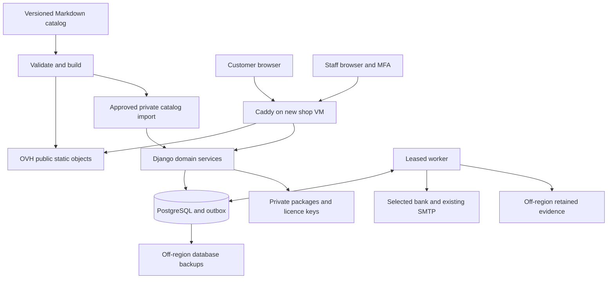

# SLL xSPI-MC Shop — Revised Proposal

**Revision:** 20 October 2026 · **Customer domain:** `shop.xspi.pro` · **Status:** implementation plan; commercial and production approvals are tracked separately.

## Recommended plan and readiness

Build the shop around the supplied **SLL xSPI-MC product definition**, with one configurable IP product and a separate non-expiring 10-hour support product. The customer hostname is **`shop.xspi.pro`** throughout this proposal, the API, DNS, certificate configuration and the accompanying Codex handoff. This revision supersedes earlier proposal and handoff versions for new implementation work.

| Area | Selected plan | Status and qualification |
|---|---|---|
| Product authority | `SLL_xSPI_MC_Product_Page.md`, reproduced exactly in the source appendix | Sole product-definition input; draft prices and unresolved rights remain pending. |
| Public frontend | Static Astro build with React islands, stored in OVH Object Storage | Public build output only; Caddy supplies HTTPS and website routing. |
| Customer origin and API | `https://shop.xspi.pro`, with relative `/api/v1/` requests | User-selected hostname; no separate public API subdomain is needed. |
| Staff origin | `https://shop-admin.xspi.pro` | Proposed hostname, distinct host-only sessions and enforced MFA. |
| DNS | AWS Route 53 public hosted zone for `xspi.pro` | Verify zone control, authoritative delegation and actual record scope. |
| TLS | New automatic ACME certificate/key for each application hostname | Standard Caddy with Let's Encrypt; default HTTP-01/TLS-ALPN-01 avoids DNS credentials on the VM. |
| Application | Django LTS, PostgreSQL and one PostgreSQL-backed worker | Custom licensing/support services; no mandatory commercial commerce edition. |
| Production VM | **B2-7, GRA11, legacy monthly billing** | Chosen planning fit; obtain actual quote and qualify workload/image before committing billing. |
| Production OVH budget | **£27.20/month ex VAT** at the modeled allocation | Plus Route 53 and excluded business/operating costs; **£29.24** with 100 hours of temporary staging. |
| Resilience | Separate data volume, off-region database backups, retained business evidence and private artifact copies | One VM is still a single application failure domain; full recovery includes financial and licence reconciliation. |

**Codex can start authorized local/repository implementation without waiting for every commercial decision.** Implement the schemas, UI, transaction model, synthetic bank, privacy controls and deployment artifacts with unresolved live values explicitly disabled. The decision register identifies the later operation each missing fact actually blocks. Real sales need approved prices, rights, host profiles, terms, tax and merchant inputs; production activation also needs the concrete cloud/DNS/mail scope and operating owners.

A certificate that covers only the existing `synaptic-labs.com` website or `*.synaptic-labs.com` does not cover `shop.xspi.pro`. Even if the existing certificate has additional matching SANs, a new certificate and key avoid coupling the shop to the main website's private-key and renewal process. See the dedicated DNS/TLS section for coverage, ACM exportability and alternatives. [Certificate wildcard rules](https://docs.aws.amazon.com/acm/latest/userguide/acm-certificate-characteristics.html) · [Caddy automatic HTTPS](https://caddyserver.com/docs/automatic-https)

The compute recommendation follows a screen of all currently published Public Cloud families and a priced comparison of twelve relevant small CPU options. It is a workload-fit judgment, not a measured speed claim. The estimate explicitly includes the IPv4 charge introduced across VM ranges and separately billed Gen3 local storage, where applicable. [OVH catalogue](https://www.ovhcloud.com/en-gb/public-cloud/prices/) · [October billing changes](https://blog.ovhcloud.com/en/posts/public-cloud-pricing-model-update-2026/)

## How to hand this plan to Codex

Give Codex **this proposal and [SLL-xSPI-MC-Shop-Codex-Handoff-2026-10-20.md](SLL-xSPI-MC-Shop-Codex-Handoff-2026-10-20.md) together**. The proposal contains the full specification, architecture, source evidence and decisions. The handoff turns that specification into ordered tasks, acceptance criteria and evidence requirements. It does not replace the specification with a shorter interpretation.

The exact original product file is embedded in [Product source snapshot](#product-source-snapshot), so the pair is self-contained. A separate copy of the original attachment is optional; if supplied, it must match the recorded hash or be treated as a new revision requiring review. Do not give Codex older proposal or handoff versions as simultaneous implementation authority. No resources were provisioned, DNS changed, certificate requested or application implemented by preparing these documents.

## Contents

- [Recommended plan and readiness](#recommended-plan-and-readiness)
- [How to hand this plan to Codex](#how-to-hand-this-plan-to-codex)
- [Product definition, configuration and commercial activation](#product-definition-configuration-and-commercial-activation)
- [Exact option inventory](#exact-option-inventory)
- [Exact field and control inventory](#exact-field-and-control-inventory)
- [Dependency, reset and validation rules](#dependency-reset-and-validation-rules)
- [Price structure and entitlement boundaries](#price-structure-and-entitlement-boundaries)
- [Cart rules for several configured licences](#cart-rules-for-several-configured-licences)
- [NIC / host information and private licensing records](#nic--host-information-and-private-licensing-records)
- [Ten-hour support entitlements](#ten-hour-support-entitlements)
- [Canonical Markdown and schema examples](#canonical-markdown-and-schema-examples)
- [Architecture and first-release boundaries](#architecture-and-first-release-boundaries)
- [Customer journeys and authoritative commerce](#customer-journeys-and-authoritative-commerce)
- [Backend model, API contracts and administration](#backend-model-api-contracts-and-administration)
- [Money, licensing, support and durable processing](#money-licensing-support-and-durable-processing)
- [Bank-adapter contract and selection evidence](#bank-adapter-contract-and-selection-evidence)
- [TLS, DNS and static delivery for shop.xspi.pro](#tls-dns-and-static-delivery-for-shopxspipro)
- [OVH Public Cloud: instance selection, regions and operating cost](#ovh-public-cloud-instance-selection-regions-and-operating-cost)
- [Deployment, security, backup and recovery](#deployment-security-backup-and-recovery)
- [Decisions and approval timing](#decisions-and-approval-timing)
- [Repository organization and implementation work plan](#repository-organization-and-implementation-work-plan)
- [Proposal review record and evidence limits](#proposal-review-record-and-evidence-limits)
- [Product source snapshot](#product-source-snapshot)


## Product definition, configuration and commercial activation

### Authority and status of this specification

The sole product-definition source for this proposal is [SLL_xSPI_MC_Product_Page.md](#product-source-snapshot). Its heading is **“SLL xSPI-MC IP — Configure Your Licence.”** The source explicitly describes itself as a working draft containing product copy, a form specification, commercial rules, placeholders and unresolved proposals. It is a specification document, not evidence of a running configurator or an approved price list.

The reviewed source contains **23,969 bytes**. Its SHA-256 byte hash is:

```text
562dc4015c62f165df5df3e9ae1aab26b8102385d9dc76a556d5965ddc1a0263
```

Keep this hash with the imported product profile and the proposal's evidence record. It identifies the exact reviewed bytes; it does not signify commercial or legal approval.

Use three evidence categories throughout implementation:

| Category | Meaning | Treatment |
|---|---|---|
| Specified by the source | A clear intended requirement, such as the vendor labels, term availability or non-expiring support hours | Model and test that intended behaviour. Publication and purchases still require the necessary approved offer, contract and operational details. |
| Explicitly provisional | An assumption or illustrative rule called out by the source, including the node allowance and €50 rate | Retain its provisional status in structured data. It must not become an active charge or granted entitlement merely because code implements the formula. |
| Unresolved | A placeholder, missing licence definition or unanswered commercial decision | Keep an explicit missing value and an activation blocker. Never substitute zero, unlimited rights, unrestricted access or an invented policy. |

This distinction also applies to apparently finished page copy: the source states the intended deliverables and support policy, but identifies the document as a working draft. The proposal can implement the data model and sandbox behaviour without pretending that SLL has already approved every saleable combination.

### Product scope and intended deliverables

The initial configurable product is **SLL xSPI-MC IP**, with stable product ID `sll-xspi-mc` and product profile `sll-xspi-mc-v1`. One configured licence selects one FPGA vendor, at least one family from that vendor, a permitted licence term, and the applicable production/access settings. Another vendor requires another configured licence in the cart. The source specifies encrypted RTL, a user manual, a reference design and a licence key for the purchased configuration. Exact IP releases, supported tool versions, reference-design targets, delivery method and delivery time remain to be completed. The purchase does not transfer SLL IP ownership or provide unencrypted RTL. [Source, sections 1–5 and commercial information](#product-source-snapshot)

The optional **10-Hour FPGA IP Technical Support Package** is a separate product, `sll-xspi-mc-support-10h`. It can be added during IP configuration or bought later as a support-only top-up. Its price is unresolved. Its specified credit is ten hours per purchased package, with no expiry; buying support does not extend an annual IP licence. Treat those as separate entitlements and separate order lines. [Source, section 6 and FAQ](#product-source-snapshot)

## Exact option inventory

The following labels and ordering come from the product source. Proposed stable IDs are implementation identifiers, not replacements for the displayed labels. There are **three vendor options and thirteen family options: eight, three and two respectively**. No additional vendor or family is inferred.

### FPGA vendors and families

| Vendor order | Exact vendor label | Proposed vendor ID | Family count |
|---|---|---|---|
| 1 | Altera / Intel FPGA | `altera` | 8 |
| 2 | AMD / Xilinx | `amd-xilinx` | 3 |
| 3 | Microchip | `microchip` | 2 |

| Vendor | Family order within vendor | Exact family label | Proposed family ID |
|---|---|---|---|
| Altera / Intel FPGA | 1 | Cyclone 10 LP (C10LP) | `altera-cyclone-10-lp-c10lp` |
| Altera / Intel FPGA | 2 | MAX 10 | `altera-max-10` |
| Altera / Intel FPGA | 3 | Cyclone 10 | `altera-cyclone-10` |
| Altera / Intel FPGA | 4 | Cyclone 10 GX | `altera-cyclone-10-gx` |
| Altera / Intel FPGA | 5 | Cyclone V | `altera-cyclone-v` |
| Altera / Intel FPGA | 6 | Stratix 10 | `altera-stratix-10` |
| Altera / Intel FPGA | 7 | Agilex 3 | `altera-agilex-3` |
| Altera / Intel FPGA | 8 | Agilex 5 | `altera-agilex-5` |
| AMD / Xilinx | 1 | Series 7 | `amd-series-7` |
| AMD / Xilinx | 2 | UltraScale | `amd-ultrascale` |
| AMD / Xilinx | 3 | UltraScale+ | `amd-ultrascale-plus` |
| Microchip | 1 | PolarFire | `microchip-polarfire` |
| Microchip | 2 | PolarFire SoC | `microchip-polarfire-soc` |

**Coverage decision:** preserve `Cyclone 10 LP (C10LP)`, `Cyclone 10` and `Cyclone 10 GX` as three distinct source options, while marking their coverage relationship unresolved. The source specifically asks whether `Cyclone 10` is a separate licensed option or an umbrella for LP/GX. A unique option ID does not prove unique billable coverage. Until SLL resolves that relationship, a configuration involving unresolved coverage must receive review rather than a guessed additional-family charge. Do not silently merge labels, sell overlapping coverage twice or grant umbrella coverage from a narrower selection. [Source, section 1 and implementation notes](#product-source-snapshot)

### Licence term and use

| Order | Exact option label | Proposed ID | Source availability | Specified scope and remaining boundary |
|---|---|---|---|---|
| 1 | R&D — annual | `rd-annual` | All three listed vendors | Annual research and development licence. Production rights are not included unless expressly granted in the licence agreement. |
| 2 | RDP — yearly | `rdp-yearly` | Altera / Intel FPGA only | Annual research, development and production within the purchased production band, subject to the licence agreement. The source still requires approval of the RDP expansion and precise permitted-use definitions. |
| 3 | Perpetual | `perpetual` | All three listed vendors | Non-expiring licensed rights as defined in the agreement. Production, maintenance, updates and support are not implicitly unlimited. |

Exactly one term is selected. The source's `annual` and `yearly` spellings are retained in their respective labels. Both are annual terms in the source's commercial model; neither establishes automatic renewal. The licence start trigger, end date calculation, renewal process, renewal pricing, and consequences for development access, new production and already deployed products are unresolved. Those consequences must be visible before payment. [Source, section 2, FAQ and annual/perpetual terms](#product-source-snapshot)

### Production bands

Show this selector only when `rdp-yearly` is active, which also requires `altera`.

| Order | Exact band label | Exact production-units label | Proposed ID | Commercial treatment |
|---|---|---|---|---|
| 1 | Band 1 | 1–100 | `units-1-100` | Adjustment is an unresolved price. |
| 2 | Band 2 | 101–1,000 | `units-101-1000` | Adjustment is an unresolved price. |
| 3 | Band 3 | 1,001–5,000 | `units-1001-5000` | Adjustment is an unresolved price. |
| 4 | Higher volume | More than 5,000 | `higher-volume` | Request a quotation; no automatic checkout price. |

The integer ranges avoid overlap at 1,000. The source does not offer a zero-unit RDP band. Do not add one without a commercial decision. These ranges also do not define what a production unit is, which events count it, how projects/products/families are aggregated, the measurement period, reporting obligations, upgrades or rights after expiry. The annual measurement period is explicitly proposed, not settled. Node counts and floating seats are development-access quantities and must remain separate from these production bands. [Source, sections 3–4 and implementation notes](#product-source-snapshot)

### Licence-access options

The source exposes exactly two access-mode choices for Altera / Intel FPGA:

| Order | Exact control label | Cardinality and source requirement |
|---|---|---|
| 1 | Fixed / node-locked licences | Boolean selection; can be combined with floating licences. |
| 2 | Floating licences | Boolean selection; can be combined with fixed licences. |

At least one mode is required for an Altera configuration. An enabled mode needs a positive integer count; an inactive mode has zero count and zero related charge. Fixed access requires one complete host-ID row for every selected fixed node. Floating access is drafted as concurrent seats bound to a licence server, with one server identifier rather than one client identifier for each seat. **The actual licence-manager mechanism, host-ID format, server requirements, redundancy and concurrent-seat semantics still require verification.** [Source, section 4 and selection rules 5–8](#product-source-snapshot)

AMD / Xilinx and Microchip remain first-class vendor options in the catalog. Their access mechanisms are unresolved: do not reuse Altera node charges, assume that their keys are unrestricted, collect speculative NIC fields, or remove them from the proposed product model. A complete configuration for either vendor remains `awaiting_review` until its actual access conditions and offer are approved. A later approved host requirement would be an explicit revision to that vendor's profile.

## Exact field and control inventory

This is an inventory of the written specification. The bracketed widgets illustrate intended controls; no live requiredness, browser validation or runtime behaviour was inspected. Where the source uses section headings instead of a single input label, the inventory identifies the control by its purpose. Counts below refer to logical definitions and source table rows, not a fixed number of rendered inputs: host rows repeat, addresses expand by country, and several source rows contain more than one value.

### Configuration controls

There are **thirteen logical configuration control definitions**, including the two fields repeated for each fixed host. Generated summaries, prices, row numbers and calculated support hours are outputs, not extra customer inputs.

| # | Source field or control | Proposed type | Visibility / required response | Source illustration or intended default |
|---|---|---|---|---|
| 1 | Select one vendor | Enum of the three vendor labels | Always; exactly one vendor before a configured licence is complete | No vendor selected. |
| 2 | FPGA families for the selected vendor | Array of distinct family IDs | Only the selected vendor's family list; at least one valid family | No families selected. |
| 3 | Licence term and use | Enum of the three term options | Always after vendor selection; one permitted option | No term selected. |
| 4 | Select one band | Enum of the four band options | Only `rdp-yearly`; exactly one band | No band selected. |
| 5 | Fixed / node-locked licences | Boolean | Altera only; at least one of controls 5 and 6 enabled | Unchecked. |
| 6 | Floating licences | Boolean | Altera only; can be enabled alongside control 5 | Unchecked. |
| 7 | Number of fixed nodes | Positive integer while enabled | Only fixed mode; count must match complete host rows | Widget illustrates 1; canonical disabled count is 0. |
| 8 | Workstation reference — optional | Text, repeated per fixed node | Only fixed mode; optional for each row | Empty placeholder; not a literal workstation name. |
| 9 | NIC / host ID — required | Licence-manager-specific text, repeated per fixed node | Only fixed mode; required for every selected node | Empty placeholder; actual format unresolved. |
| 10 | Number of floating nodes / concurrent seats | Positive integer while enabled | Only floating mode | Widget illustrates 1; canonical disabled count is 0. |
| 11 | Licence server reference — optional | Text | Only floating mode; optional | Empty placeholder. |
| 12 | Licence server NIC / host ID — required | Licence-manager-specific text | Only floating mode; required for the drafted single-server arrangement | Empty placeholder; actual format unresolved. |
| 13 | Number of support packages | Nonnegative integer in the product configurator | Optional; purchases separate support SKU quantities | 0; calculated hours are quantity × 10. |

The actual field IDs are direct typed values, such as `vendor_id`, `family_ids`, `licence_term_id`, `production_band_id`, `fixed_enabled`, `fixed_node_count`, `fixed_hosts`, `floating_enabled` and `floating_seat_count`. A fixed-host row contains an optional `workstation_reference` and required `host_id`. The two per-row values explain why rendered field count increases with node count. The support selector creates or updates the separate support cart line; it does not alter the IP licence's host entitlement.

### Business checkout

The source provides **nineteen business/billing field groups**. Preserve the distinctions between explicitly required, optional, conditional and unspecified requiredness. Implement the country-specific address/tax profile after the relevant business rules are approved; the source does not provide a universal tax-status enum or require a postcode everywhere.

| # | Exact source field label | Source requirement | Proposed control / handling |
|---|---|---|---|
| 1 | Legal business / organisation name | Required | Text; identify the purchasing business. |
| 2 | Trading name | Optional | Text. |
| 3 | Business registration number | Where applicable; allow sole traders or entities without one | Text with a country/entity-specific applicability rule; no universal mandatory number. |
| 4 | Country of registration / establishment | Required | Country selector; its maintained option set requires a separate operational definition because the source supplies no list. |
| 5 | Registered business address | Required | Structured address whose relevant parts depend on country. |
| 6 | Billing address | Required; offer “Same as registered address” | Structured address plus the separate copy/link helper described below. |
| 7 | City, region and postcode | As applicable to the selected country | Country-specific address subfields; do not impose every component on every address. |
| 8 | VAT / tax identification number | Where applicable | Text; format and tax treatment are separate validations. |
| 9 | VAT / tax registration status | Required selection appropriate to customer location | Enum supplied by an approved tax profile; options are not specified in the source. |
| 10 | Purchasing contact name | Required | Text. |
| 11 | Business email address | Required | Email input. The source does not prescribe a domain allowlist. |
| 12 | Telephone number | Optional unless needed for fulfilment | Telephone input with conditional requiredness defined by a real fulfilment need. |
| 13 | Purchase order reference | Optional | Text. |
| 14 | Accounts / invoice email | Optional; defaults to purchasing contact | Email input; default from the purchasing contact email, visibly editable. |
| 15 | Technical / licence administrator name and email | Required; offer “Same as purchasing contact” | Name and email inputs, with the separate helper described below. |
| 16 | Licensed legal entity | Defaults to purchasing business; differences require review | Confirmed purchasing-entity reference by default; an explicitly different entity enters review. |
| 17 | Deployment / end-use country | Required for order review | Country selector; no inference from IP address, registration country or billing address. |
| 18 | Intended application | Short description; do not request confidential design details | Short text. The source does not explicitly mark this row required; proposed checkout enforcement should require a concise description for review, subject to SLL's approval. |
| 19 | Additional order notes | Optional | Text; advise against submitting unnecessary confidential material or secrets. |

Two additional convenience controls are specified: **“Same as registered address”** and **“Same as purchasing contact.”** Propose a clear linked state while a helper is selected: edits to the source values update the corresponding destination. Turning the helper off materializes the current values into independently editable fields. Record final values with the order; do not retain an unresolved “same as” pointer that could later change historical invoices or contacts.

The source does not specify character limits for these text fields. Choose proportionate technical limits as a documented implementation decision, show them to customers, and apply the same limits in the backend. Do not present an invented limit as a source requirement. Extra end-user/export details are requested only when the review actually requires them.

### Order declarations and marketing control

The source lists the following **four declarations before placing an order**, followed by **one separate, optional, initially unticked marketing control**. Preserve the wording during the initial draft import; legal review may later supply versioned replacements.

| # | Exact source wording | Proposed handling |
|---|---|---|
| 1 | I am purchasing for business or professional purposes and am authorised to place this order for the named organisation. | Require an explicit declaration before placement; record person and named organization. |
| 2 | I have read and accept the Terms and Conditions and the xSPI-MC IP Licence Agreement applicable to this configuration. | Require acceptance of the identified versions; record both document hashes and the applicable configuration/offer. |
| 3 | I have read and accept the Refund and Cancellation Policy. | Require acceptance of the identified policy version. |
| 4 | I confirm that the selected FPGA families, licence term, production band where applicable, node counts and submitted NIC / host IDs are correct. | Require confirmation of the current configuration revision and private host-data revision. |
| 5 | Send me SLL product news and offers by email. I can unsubscribe at any time. | Optional and unticked; independent of order eligibility and service processing. |

The draft groups declarations 1–4 under “Before Placing Your Order”; making all four mandatory is the proposed enforcement of that intended flow, not an observed running implementation. Show the privacy notice separately. Do not convert necessary order processing into marketing consent. Store the exact accepted statement/document versions, accepting identity, time and relevant order/configuration; a checkbox boolean alone is insufficient for a reviewable transaction record. [Source, section 8](#product-source-snapshot)

## Dependency, reset and validation rules

### Canonical state rules

Use the same versioned definitions to validate the React controls, saved configuration and backend order. Typed selection IDs are authoritative; displayed labels may not be submitted as a substitute for IDs. Unknown IDs, cross-vendor families, disallowed terms, negative counts and fractional node/package quantities must be rejected.

The active configuration obeys these invariants:

- Exactly one vendor and at least one distinct valid family of that vendor.
- `rdp-yearly` requires `altera` and exactly one production band. A production band is absent outside RDP, and its adjustment is zero because the component is inapplicable—not because an unknown price was filled with zero.
- Altera requires fixed access, floating access or both. Enabled counts are positive integers; disabled counts are zero. Disabled host rows, server references and identifiers are absent.
- Fixed host rows exactly match the fixed count. Validate complete identifiers and detect unintended duplicates after manager-approved normalization.
- The drafted floating arrangement has one server identity for the selected seat count. Do not manufacture client rows from the floating count or claim redundant/multiple-server support before verification.
- Non-Altera configurations contain no Altera-specific access or host data. Missing vendor-specific access rules produce review, not an implied unrestricted entitlement.
- Support quantity is independent of annual licence duration, production band and host allowances. A cart support line has a positive integer quantity; zero packages means no support line.

Reject stale or contradictory hidden fields submitted by a client and return a canonical correction with clear errors. The browser clearing a control is not sufficient enforcement. Preserve private snapshots of already accepted orders; resets operate on the editable draft, not on historical entitlements.

### Change and invalidation matrix

| Customer change | Clear or recalculate | Preserve / next required action |
|---|---|---|
| Change vendor | Clear all selected families, selected term, production band, Altera mode settings, counts, workstation/server references and host IDs. Invalidate the priced IP offer and configuration confirmation. | Preserve unrelated business details and a separately selected support line. Require a valid term and families again. Show the effect of the change before applying it; do not restore hidden NIC data on a later switch back. |
| Change families within the same vendor | Re-evaluate coverage overlap, family charges, compatibility and offer eligibility. Invalidate the IP offer/configuration confirmation. | Retain access values only where the same approved manager/profile remains applicable; revalidate them. Unresolved overlap enters review. |
| Change term | Remove the prior production band and its adjustment. Re-evaluate permitted access rules, charge recurrence and the applicable agreement. Invalidate the offer and affected acceptances. | Retain same-vendor families. If the new term is RDP, require a fresh band; preserve host data only if still valid under the approved access profile. |
| Change RDP band | Reprice/reclassify the configuration. `higher-volume` becomes `requires_quote`; an unknown adjustment never becomes zero. | Preserve host counts and identifiers; production and development-access quantities remain independent. |
| Disable fixed mode | Set fixed count to zero; delete draft fixed-host rows/references; remove fixed-mode and fixed-node charges. | Preserve floating access. If neither mode remains, the Altera configuration is incomplete. |
| Enable fixed mode | Create count 1, following the source illustration, with a blank required host-ID row. | Validate this mode under the selected term; no additional unselected nodes are granted. |
| Increase fixed count | Append the required number of blank host rows with stable row IDs; recalculate charges. | Preserve existing valid rows. Every new required identifier must be supplied before fulfilment eligibility. |
| Reduce fixed count | Identify the rows being removed, let the customer choose/cancel before applying the reduction, then delete those draft values and recalculate charges. | Preserve the remaining row identities. Do not silently renumber one host into another entitlement. |
| Disable floating mode | Set floating count to zero; delete draft server reference/host ID; remove floating-mode and floating-node charges. | Preserve fixed access. Require at least one active mode. |
| Enable floating mode | Create seat count 1, following the source illustration, with a blank required server host ID. | Do not request one host ID per floating seat. |
| Change floating seat count | Recalculate seats and charges; invalidate the offer/configuration confirmation. | Retain the same valid server identity if the approved manager supports the new count. |
| Edit a NIC / host ID | Validate and normalize under the actual manager; rerun duplicate checks; invalidate the host-data confirmation and offer configuration digest. | Unchanged counts need not invent a new surcharge. A host change to a purchased licence is a rehosting workflow, not an edit of the original order. |
| Change purchasing entity, licensed entity or billing/tax facts | Recalculate tax/review status and invalidate the relevant order/contract acceptance. A different licensee requires review. | Preserve technical configuration unless the approved licence rules make it entity-specific. |
| Change support-package quantity | Update the independent support line and current payable total. | Preserve IP term, production band and node entitlements. Do not multiply support when another IP line is added. |

Any material change after transaction review requires a fresh review of the affected quote/configuration and current transaction declarations. Preserve optional marketing preference independently. An accepted, unexpired sales offer has its own immutable terms and expiry: do not overwrite it by mutating a catalog record. If the customer edits its configuration, create a new offer revision.

### Eligibility classification

| Classification | Meaning in this product model | Customer action |
|---|---|---|
| `draft` | Required selections/details are incomplete | Continue configuration. |
| `invalid` | Values contradict the schema or explicit rules, such as cross-vendor families, RDP for Microchip, or stale hidden host data | Correct the identified fields. |
| `requires_quote` | An otherwise meaningful request explicitly selects Higher volume, or SLL creates another approved quote-only policy | Request a quotation; no unknown component is submitted for payment. |
| `awaiting_review` | Selection is structurally valid, but an approved price, coverage definition, licence right, access mechanism or other necessary offer detail is missing | Request SLL review; retain the configuration without claiming a saleable entitlement. |
| `purchasable` | Required data, coverage, applicable pricing/recurrence, terms and operational fulfilment conditions are approved for the complete offer | Proceed with the separately enforced payment/checkout process. |

Return all material reasons as structured issues even when one classification is displayed. Invalid or incomplete inputs must be resolved first. A Higher volume request remains explicitly a quotation request; unresolved supplementary terms may be listed alongside that reason. At the current source revision, **no priced configuration is ready for live payment**, because price placeholders and relevant approvals remain unresolved. This is an activation state, not a reason to block development of the configurator, quote workflow or bank sandbox.

## Price structure and entitlement boundaries

### What is specified and what is provisional

| Item | Source treatment | Required implementation boundary |
|---|---|---|
| Currency and tax display | Euro-denominated draft prices, excluding applicable VAT; tax and total shown before placement | Preserve draft EUR presentation. Seller tax treatment, supported checkout/settlement currency and merchant activation still require verification. |
| Base price | Placeholder by vendor; calculation notes refine it to vendor and term | Model prices by vendor/term. A single vendor “from” value must derive from an actually approved attainable offer. |
| One family included | Stated in page copy, then identified as an assumption in the decision register | Record the proposed allowance explicitly; obtain approval before granting/charging against it. |
| Additional families | Placeholder; calculation uses a price for the vendor/term | Price distinct approved licensed coverage. Do not guess a global rate or charge overlapping coverage twice. |
| RDP band adjustments | Three placeholders; higher volume requires quotation | Missing adjustments remain missing. Recurrence must be approved. |
| Fixed/floating mode charges | Unresolved; show separately if applicable | “If applicable” does not authorize a default zero when mode pricing remains undecided. |
| Node allowances | Proposed first five fixed and first five floating separately, once per configured licence | Do not turn this into five combined seats, an allowance per family or a shared cart allowance. Nor does an allowance grant unselected nodes. |
| Extra-node rate | €50 expressly illustrative | Store as provisional evidence, not an active price. Confirm separate rates if needed and annual versus one-time treatment. |
| Support | Price placeholder; ten non-expiring hours per package | Separate one-time purchase; exclude from automatic IP renewal calculations. |

The source's proposed extra-node calculation can be represented as follows. Amounts are in euro cents and the figures below are **illustrative, not approved charges**:

```text
family_charge    = max(approved_billable_family_count - 1, 0) × additional_family_price
fixed_extra      = max(fixed_count - 5, 0) × 5000
floating_extra   = max(floating_seat_count - 5, 0) × 5000
support_charge   = support_package_quantity × approved_support_package_price
```

The same draft formula produces the source examples: 5 fixed/0 floating → €0 extra; 6/0 → €50; 3/3 → €0; 5/5 → €0; and 7/6 → €150. These examples exclude unresolved access-mode charges and other price components. An entitlement for three selected fixed nodes remains three nodes, even if a five-node no-surcharge allowance is later approved. [Source, additional-node pricing and proposed calculation](#product-source-snapshot)

### Separate annual and one-time amounts

Represent every approved component with its amount, currency, scope, recurrence, applicability and price-rule revision. Use fixed-precision minor units. A component's amount being known is not enough if its recurrence is still unknown.

| Component | Recurrence established by the draft | Decision still required |
|---|---|---|
| R&D / RDP base licence | Annual licence duration | Start trigger, annual amount, renewal method and renewal price/basis. |
| Perpetual base licence | One-time purchase of defined non-expiring rights | Actual price, permitted production and other scope. |
| Additional-family charge | Not settled for each term | Whether annual or one-time, including later family additions. |
| RDP production adjustment | Not settled as a billing component | Period, annual recurrence and upgrades. |
| Access-mode charge | Unresolved | Existence, amount, recurrence and term applicability. |
| Additional-node charges | Unresolved | Approved allowances/rates, recurrence and later node additions. |
| Ten-hour engineering support | Separate package purchase; not part of automatic annual renewal | Price, supported work scope and consumption/refund rules. |

The order review should show **annual licence components**, **one-time components**, **tax** and **amount payable now** separately. The amount payable now includes components actually due for the initial period plus one-time purchases; it must not be presented as a promise that the identical total recurs next year. A renewal quote includes only its approved recurring/new components and the applicable price basis. It does not repurchase support or recharge an already-paid one-time component by accident.

Recommend manual renewal offers for the first release while the renewal business terms are being finalized. Do not enable automatic debit/renewal without the separately approved agreement and customer authorization. An annual licence does not confer continued production rights after expiry merely because its configuration remains in a customer portal; a perpetual licence does not confer unspecified production or update rights merely because its end date is null.

## Cart rules for several configured licences

Each IP cart line has a unique line ID, configuration revision and `quantity: 1`. Its snapshot identifies vendor, family IDs and coverage, term, applicable production band, access profile, selected node/seat allocation, private host-data reference, price-rule version and applicable terms. The host values themselves are not public cart attributes.

1. **Another vendor means another configured IP line.** Keep the existing line unchanged while the customer creates the next configuration.
2. **Different configurations remain separate lines.** Do not merge them just because the product ID matches. If a customer needs a second identical entitlement, require an explicit second configured line and a reviewable host/licensee scope; avoid accidental duplicate additions.
3. **No generic IP quantity multiplier.** Multiplying a price must not silently duplicate host rights, production bands or family allowances. Additional fixed/floating access is expressed by its own validated counts.
4. **Allowances belong to one configured licence.** If the proposed five-plus-five rule is approved, apply it once to that line, independent of its family count and other lines. Do not share an allowance across vendors or multiply it per selected family.
5. **Support is a separate cart line.** Its quantity represents packages of ten hours. Adding or cloning an IP configuration does not implicitly copy a support quantity. The same SKU supports later support-only purchases.
6. **Review all payable items together.** A cart can contain annual and perpetual IP licences plus support, with annual and one-time breakdowns per line and in the total. They need not share an expiry date or grant.
7. **Do not silently split mixed eligibility.** If any included IP line requires quotation/review, the combined cart cannot be represented as fully payable. Offer an explicit combined quote request, or let the customer move that line to a separate saved request before paying for the remaining clearly identified items. The server receives the exact selected line IDs and revisions; unknown-price lines are never treated as free.
8. **Order snapshots are immutable.** Later catalog edits, host changes or family upgrades produce new offers/amendments, not silent rewrites of the original licence scope. Revalidate the selected line revisions at checkout to prevent stale or concurrently edited configurations from being purchased.

Show only masked host identifiers in ordinary summaries. Provide an authorized edit/review path for the relevant configuration. Support-only top-ups may use the purchasing/licensed entity and existing customer relationship, but possession of a matching email domain must not grant access to that organization's licences or support balance.

## NIC / host information and private licensing records

The source says NIC/host identifiers may be linked to a person or workstation and limits their purpose to licensing/security and the published retention policy. It also requires masking in ordinary cart summaries and prohibits host IDs or licence keys in URLs, analytics and public logs. Implement these as concrete data boundaries. [Source, section 7, privacy information and implementation notes](#product-source-snapshot)

- Keep host IDs, licence keys, optional workstation/server references and customer records out of product Markdown, static build artifacts, public manifests and browser URLs. Do not persist raw host IDs in ordinary browser local storage.
- Store required host values as restricted backend data with encryption at rest and tightly scoped access. Protect the corresponding backup and key-management paths. A masked display is not a substitute for authorization.
- Authorize every read/edit/download against the relevant order or configuration. Support an authenticated customer session or an appropriately scoped guest session; do not infer organizational membership from an email suffix.
- Validate and normalize according to the actual licence manager's documented format. Do not assume every host ID is a twelve-digit MAC address or change case/punctuation without a justified rule. The format profile and its revision belong with the entitlement.
- Detect unintended duplicate fixed-host entries within the configuration using the canonical identifier. Do not globally reject one workstation appearing in separately legitimate licences without an approved policy. Treat a hash/fingerprint used for matching as restricted metadata too.
- Use opaque references to private host records in cart/order APIs. Ordinary responses contain safe masks, validation status and row IDs; an explicitly authorized detail view can reveal the value where needed. Sanitize validation errors and logs as well as success payloads.
- Delete discarded draft host data through the draft-retention policy. Retain only the accepted order/licence history required by the approved policy. Vendor/mode changes must not revive discarded hidden values.
- Handle workstation/server replacement as a tracked rehosting request with the approved eligibility, charges and issuance process. Do not let an edit endpoint silently amend a purchased licence or bypass licence generation controls.

The legal controller, lawful basis by purpose, retention periods, recipients/transfers, customer rights and privacy contact remain supplier-specific decisions. The source expressly cautions against assuming a contract with the purchasing company is necessarily a contract with each employee whose details are entered. This proposal therefore specifies the data boundaries without claiming that the draft privacy language constitutes final compliance approval.

## Ten-hour support entitlements

Create a separate support grant for each accepted, paid support line. Each package grants **36,000 seconds** (ten hours). The grant's `expires_at` is `null`. Keep support accounting in integer seconds and format hours for the customer; approve a billing quantum/rounding policy before actual task debits. No billing increment is specified by the source.

A minimal durable record model is:

| Record | Required purpose |
|---|---|
| Support order line | Purchased package quantity, approved package price, applicable terms and intended customer/licensee relationship. |
| Support grant | Unique grant keyed to the accepted order line, quantity × 36,000 seconds, immutable origin and no expiry. |
| Support task | Requested/performed work, relevant customer/IP context, approved chargeable duration, staff responsibility and completion state. |
| Support ledger entry | Grant, debit, refund/reversal or correction, with integer seconds, actor, reason and unique event/task reference. |
| Notification outbox entry | The completed-task statement, its balance snapshot and delivery/retry status. |

Post a completed task's debit once, transactionally, using a unique task/event key. Concurrent postings must not silently overspend a balance. If the planned or actual work exceeds available hours, use an explicit top-up/approval process; do not create an unapproved automatic card charge. Corrections use auditable reversals/adjustments rather than deleting history. The refund/cancellation policy must define how purchased and consumed hours are treated; it must not silently introduce an expiry.

After each performed support task, email the task's used hours, total used to date and remaining balance, as the source requires. Persist the ledger event and notification before attempting delivery. The email uses the balance snapshot associated with that task event, so retries or delayed delivery cannot produce a contradictory statement. Expose notification failures and current balance in administration; an email outage does not undo or duplicate the support record.

Support hours survive the expiration of an annual IP licence. That preservation grants no new production rights, development access, update rights or extended annual term. A support task must fit the customer's applicable IP rights and the approved support scope. The source does not settle whether one balance is shared across licences, projects or organizations; retain grant-level provenance and obtain that policy before exposing a shared wallet. Recommend an explicit owning customer/licensee relationship with delegated contacts authorized per resource, not per email domain.

## Canonical Markdown and schema examples

Maintain one version-controlled catalog authority. Import the supplied source as an immutable reference snapshot identified by the hash above, then maintain the approved product content, labels, option sets, rule definitions and offer revisions in ordinary Markdown with readable YAML frontmatter. A source snapshot is provenance; it is not a second independently editable price catalog. Public and private manifests derive from the same catalog revision. Customer host IDs, licence keys, orders and support balances are runtime records and never belong in these files.

The following example shows the actual new product taxonomy and draft activation boundaries. It is a **proposal schema example**, not approved commercial data or a working cart. `offers: []` and missing rights/access details deliberately prevent direct purchase.

```yaml
schema_version: 1
id: sll-xspi-mc
profile_id: sll-xspi-mc-v1
title: SLL xSPI-MC IP
catalog_status: draft
source:
  filename: SLL_xSPI_MC_Product_Page.md
  sha256: 562dc4015c62f165df5df3e9ae1aab26b8102385d9dc76a556d5965ddc1a0263
currency: EUR
vendors:
  - {id: altera, label: "Altera / Intel FPGA"}
  - {id: amd-xilinx, label: "AMD / Xilinx"}
  - {id: microchip, label: "Microchip"}
families:
  - {id: altera-cyclone-10-lp-c10lp, vendor: altera, label: "Cyclone 10 LP (C10LP)", coverage_ref: null}
  - {id: altera-max-10, vendor: altera, label: "MAX 10", coverage_ref: null}
  - {id: altera-cyclone-10, vendor: altera, label: "Cyclone 10", coverage_ref: null}
  - {id: altera-cyclone-10-gx, vendor: altera, label: "Cyclone 10 GX", coverage_ref: null}
  - {id: altera-cyclone-v, vendor: altera, label: "Cyclone V", coverage_ref: null}
  - {id: altera-stratix-10, vendor: altera, label: "Stratix 10", coverage_ref: null}
  - {id: altera-agilex-3, vendor: altera, label: "Agilex 3", coverage_ref: null}
  - {id: altera-agilex-5, vendor: altera, label: "Agilex 5", coverage_ref: null}
  - {id: amd-series-7, vendor: amd-xilinx, label: "Series 7", coverage_ref: null}
  - {id: amd-ultrascale, vendor: amd-xilinx, label: "UltraScale", coverage_ref: null}
  - {id: amd-ultrascale-plus, vendor: amd-xilinx, label: "UltraScale+", coverage_ref: null}
  - {id: microchip-polarfire, vendor: microchip, label: "PolarFire", coverage_ref: null}
  - {id: microchip-polarfire-soc, vendor: microchip, label: "PolarFire SoC", coverage_ref: null}
terms:
  - id: rd-annual
    label: "R&D — annual"
    vendors: [altera, amd-xilinx, microchip]
    annual: true
    rights_ref: null
  - id: rdp-yearly
    label: "RDP — yearly"
    vendors: [altera]
    annual: true
    rights_ref: null
  - id: perpetual
    label: "Perpetual"
    vendors: [altera, amd-xilinx, microchip]
    annual: false
    rights_ref: null
production_bands:
  - {id: units-1-100, label: "Band 1", units_label: "1–100", min_units: 1, max_units: 100}
  - {id: units-101-1000, label: "Band 2", units_label: "101–1,000", min_units: 101, max_units: 1000}
  - {id: units-1001-5000, label: "Band 3", units_label: "1,001–5,000", min_units: 1001, max_units: 5000}
  - {id: higher-volume, label: "Higher volume", units_label: "More than 5,000", requires_quote: true}
production_accounting_ref: null
access_profiles:
  altera:
    status: awaiting_review
    proposed_modes: [fixed, floating]
    license_manager_ref: null
  amd-xilinx:
    status: awaiting_review
    license_manager_ref: null
  microchip:
    status: awaiting_review
    license_manager_ref: null
pricing_proposals:
  status: provisional
  included_families: 1
  included_fixed_nodes: 5
  included_floating_seats: 5
  allowance_scope: configured_licence
  illustrative_extra_node_amount_minor: 5000
  node_charge_recurrence: null
offers: []
terms_and_conditions_ref: null
license_agreement_ref: null
refund_policy_ref: null
release_ref: null
compatibility_ref: null
support_product_id: sll-xspi-mc-support-10h
```

Keeping `coverage_ref` null in this draft does not assert that every family is incompatible; it means approved offer coverage has not yet been imported. The three Cyclone 10 labels additionally require an explicit overlap resolution. An approved offer binds specific families/coverage, vendor, term, access profile, production accounting where applicable, price components and contract versions. The compiler must refuse to activate an offer whose referenced approvals are absent.

The matching typed profile can express visibility and bounded structural validation declaratively:

```yaml
schema_version: 1
id: sll-xspi-mc-v1
status: draft
fields:
  vendor_id: {type: enum, options_ref: vendors, required: true}
  family_ids: {type: enum_array, options_ref: families, min_items: 1, unique: true}
  licence_term_id: {type: enum, options_ref: terms, required: true}
  production_band_id: {type: nullable_enum, options_ref: production_bands}
  fixed_enabled: {type: boolean, default: false}
  fixed_node_count: {type: integer, minimum: 0, default: 0}
  fixed_hosts: {type: array, item_schema_ref: fixed_host, default: []}
  floating_enabled: {type: boolean, default: false}
  floating_seat_count: {type: integer, minimum: 0, default: 0}
  floating_server: {type: nullable_object, schema_ref: floating_server}
visibility:
  production_band_id:
    equals: {field: licence_term_id, value: rdp-yearly}
  altera_access:
    equals: {field: vendor_id, value: altera}
  fixed_hosts:
    all:
      - equals: {field: vendor_id, value: altera}
      - equals: {field: fixed_enabled, value: true}
  floating_server:
    all:
      - equals: {field: vendor_id, value: altera}
      - equals: {field: floating_enabled, value: true}
structural_validators:
  - families_belong_to_vendor
  - term_available_for_vendor
  - production_band_only_for_rdp
  - altera_requires_enabled_access_mode
  - enabled_access_has_positive_count
  - disabled_access_has_no_count_or_host_data
  - fixed_host_rows_match_count
  - fixed_host_ids_are_complete_and_distinct
  - floating_requires_server_identification
  - host_ids_match_approved_manager_profile
  - non_altera_has_no_altera_access_data
```

The named validators are a closed, reviewed set implemented by the shared profile evaluator; content does not contain arbitrary executable expressions. The referenced host-row schemas contain the exact optional reference and required host-ID fields from the inventory. An unavailable manager profile produces `awaiting_review`; it must not be disguised as a format error in a customer's otherwise plausible text. Additional server/redundancy fields require an approved profile revision.

The support SKU has its own Markdown frontmatter and description:

```yaml
schema_version: 1
id: sll-xspi-mc-support-10h
title: 10-Hour FPGA IP Technical Support Package
catalog_status: draft
quantity:
  type: integer
  minimum_when_in_cart: 1
grant:
  kind: engineering_support_time
  seconds_per_package: 36000
  expires_at: null
  extends_ip_licence: false
billing:
  currency: EUR
  amount_minor: null
  timing: one_time
  include_in_ip_renewal: false
scope_ref: null
terms_ref: null
offers: []
```

The build validates labels, unique IDs, references, vendor/family relationships, term availability, all applicable prices/recurrence and offer dependencies. It produces a versioned public manifest for static rendering and the same rule revision for backend validation. The public artifact contains no private host profile instance, internal commercial approval notes or customer data. A content editor can change approved labels/help/prices through Markdown review and publication; they cannot grant live rights by deleting an `awaiting_review` marker while its required references remain missing.

Commercial decisions and approval timing are consolidated in the proposal’s single P-01–P-12 register. Draft profile values do not become live offers until their required coverage, rate, rights, host-access and document approvals exist.

## Architecture and first-release boundaries

Use a static Astro storefront with build-time Content Collections and selectively hydrated React islands. A small Django application, PostgreSQL and one durable worker own the transactional state. Caddy on the new OVH Public Cloud VM supplies customer/staff HTTPS, routes application requests and retrieves the static build from OVH Object Storage through its HTTPS object API. AWS Route 53 remains authoritative DNS. The public customer hostname is **`shop.xspi.pro`**, as specified by SLL; the proposed staff hostname is **`shop-admin.xspi.pro`**.

The supplied `SLL_xSPI_MC_Product_Page.md` is the sole product-definition input. Its explicit draft assumptions and placeholders remain pending commercial data. This proposal supplies implementation structure, security and operational design; it does not convert a provisional €50 rate, unconfirmed licence rights or a blank price into an approved offer. All customer-facing product questions, choices and wording derive from that file and the subsequently approved versioned catalog.

The first release includes the configurable xSPI-MC licence, a separately priced 10-hour support package, multi-line carts, business checkout, quote requests and payment of approved quotes, hosted bank checkout, secure order/document/package access, manual licence issuance and rehosting review, manual annual-renewal ordering, staff support-time recording, and non-expiring support balances. Customers may buy another configured licence for another vendor and purchase more support packages later. Public approved configurations can be bought directly; an incomplete or unapproved commercial configuration cannot be paid for.

No request-time Astro endpoint or Node storefront runtime is required. No new proprietary commerce, content-management, authentication, analytics, email-delivery or hosting SaaS is introduced. The design uses OVH infrastructure, the eventual bank/gateway, existing Route 53 and SMTP, and a public certificate authority. Automated recurring charges, a general company-account portal, automatic proprietary licence-key generation, engineering build/synthesis services, broad marketing automation and website migration are outside the first-release scope. The optional marketing choice in the product file is retained as a separate consent record with withdrawal handling; operating a mailing campaign is a separate task.

### Why the small custom backend remains the recommendation

The catalog contains one IP product with specialized commerce: vendor-dependent rights, family coverage, annual/perpetual terms, production bands, fixed versus concurrent access, sensitive host bindings, controlled package/key release, and a support ledger. A retail engine would still need these domain services. Django supplies administration, authentication, authorization and transactional application primitives while keeping the runtime to one application, one worker and one database. This is an architectural judgment about SLL's scope, not a vendor benchmark.

| Approach | Useful existing capability | Work still specific to this product | Assessment |
|---|---|---|---|
| Django + PostgreSQL — selected | Framework admin, auth/permissions, migrations and transactions | Catalog compiler, configurator, offers/quotes, bank adapter, licence and support workflows | Smallest operational footprint and direct ownership of the actual business model. |
| Vendure Core — alternative | Commerce dashboard, cart/order primitives and a database-backed job queue | Markdown authority, vendor/term rules, host bindings, key release, support ledger and bank qualification | Reasonable if a large conventional retail catalog becomes dominant. Core is GPL-3.0-or-later with a plugin exception; commercial Platform governance features cannot be assumed free. |
| Medusa — alternative | Modular commerce and an extensible admin | Product-specific modules, licensing, support balances, bank integration and stricter administration boundaries | MIT applies to the core outside explicitly identified proprietary Enterprise Materials. Its packaged RBAC/SSO boundary adds a consideration under the free-software requirement. |

Sources: [Django download/support/licence](https://www.djangoproject.com/download/), [Django administration](https://docs.djangoproject.com/en/5.2/ref/contrib/admin/), [Vendure licence](https://github.com/vendurehq/vendure/blob/master/LICENSE.md), [Vendure database queue](https://docs.vendure.io/current/core/reference/typescript-api/job-queue/default-job-queue-plugin), [Vendure operations features](https://vendure.io/features/operations), [Medusa Enterprise boundary](https://github.com/medusajs/medusa/blob/develop/ENTERPRISE-LICENSE.md), [Medusa digital-product customization](https://docs.medusajs.com/resources/recipes/digital-products). Medusa's current authentication documentation includes MFA; the comparison does not assume it is absent.

### Software baseline and reproducibility

Use supported, pinned releases, with exact package artifacts, hashes and transitive licences verified by Codex during the reproducible-build task. **Django 5.2.18 LTS** and **PostgreSQL 18.6** are the researched stable baselines on 20 October 2026. Django 5.2 receives extended support through April 2028; PostgreSQL 18 through November 2030. Choose the current compatible Astro 7/React 19 releases and Node 24 LTS for builds, Python 3.13 for the backend, Caddy 2, pgBackRest, Gunicorn, Psycopg and the maintained Django OTP components. A major version number is a planning choice, not a substitute for a lockfile. Do not use prerelease database software merely because it is newer. [Django versions](https://www.djangoproject.com/download/) · [PostgreSQL version policy](https://www.postgresql.org/support/versioning/) · [Astro collections](https://docs.astro.build/en/guides/content-collections/) · [Astro islands](https://docs.astro.build/en/concepts/islands/)

The relevant upstream licence families are MIT for Astro/React and pgBackRest, BSD-3-Clause for Django, the PostgreSQL License, Apache-2.0 for Caddy, MIT for django-two-factor-auth, Unlicense for django-otp, and LGPL-3.0 for Psycopg; Python/Node distributions also carry incorporated notices. The release inventory must verify the exact files actually distributed and all additional packages. Required features must not depend on activating a commercial edition. [Astro licence](https://github.com/withastro/astro/blob/main/LICENSE) · [React licence](https://github.com/facebook/react/blob/main/LICENSE) · [Caddy licence](https://github.com/caddyserver/caddy/blob/master/LICENSE) · [pgBackRest licence](https://github.com/pgbackrest/pgbackrest/blob/main/LICENSE) · [Psycopg licence](https://www.psycopg.org/psycopg3/docs/basic/install.html)

Prefer **native hardened systemd services on a new NixOS VM**, with separate unprivileged identities for application, worker, publisher and backup. Select a supported stable NixOS release at deployment and pin the Nixpkgs revision; do not retain an obsolete research-era OS merely to reproduce a proposal. Qualify OVH image/import/bootstrap, disk naming, console and recovery before installing. Rootless Podman/Quadlet on another approved supported Linux distribution remains a fallback if the NixOS installation path is impractical; do not mix two service managers for one workload. Existing NixOS services, configurations, certificates and credentials are not deployment inputs.

### Component and trust-boundary diagram



Route 53 publishes the customer/staff addresses; it is not in the TLS termination or application-data path. Separate object buckets/credentials protect static output, paid files, mutable backups and retained evidence. A VM/Caddy outage affects both browsing and checkout. A Django-only failure can leave static browsing available if the proxy and storage remain healthy.

## Customer journeys and authoritative commerce

### From configuration to delivery

| Step | Customer experience | Backend responsibility |
|---|---|---|
| Discover | Read the xSPI-MC overview, encrypted-RTL deliverables, vendor/family coverage, term descriptions and support package. | Publish only reviewed customer copy and approved public price components. Keep author comments and unresolved internal placeholders out of production pages. |
| Configure | Select one vendor, its families, term, any RDP band, permitted access modes/counts and optional support packages. | Interpret the same immutable catalog revision as the browser; distinguish structurally valid selection from commercially approved coverage. |
| Complete private details | Verify an email to save/reopen private configuration details; enter required host identifiers through a protected editor, then see masked summaries. | Bind resource access to an explicit verified contact and draft. Do not disclose an organization's orders or support balance merely because email domains match. |
| Add and review | Keep each differently configured IP licence on its own line. Show annual and one-time components and a separate support quantity/price. | An IP line's generic quantity is fixed at one; node counts and production rights belong to that line's configuration. Support has a real integer package quantity. |
| Request quotation | Request a higher-volume or otherwise nonstandard offer without presenting an invented price. | Persist the request before notification; a salesperson issues an immutable offer revision covering exact lines, terms and conditions. |
| Business checkout | Confirm licensed entity, billing details, contacts, end use and tax information. IP-containing orders use the four source acknowledgements; support-only orders use the applicable support checkout profile. Marketing remains optional. | Country-aware requirements, approved tax treatment, contact authority, locked host-binding revision and exact accepted-document versions. |
| Pay | Review the total and follow the selected bank's hosted page. | Commit the order/payment intent, preserve recoverable evidence, then contact the bank. Verify payment independently of browser navigation. |
| Receive | See truthful acceptance/provisioning status and use authenticated downloads for entitled files. | Staff verify compatibility, accepted rights, host details, payment and release before recording one licence/package delivery. |
| Use support | Buy more 10-hour packages and see purchased, consumed and remaining hours; receive a usage email after each posted task. | One durable support ledger, approved resource access, replay-safe credits/debits and notification outbox. |
| Renew or rehost | Request a manually approved renewal, host change or production-band upgrade. | Link a new approval/order/revision to the original entitlement; retain history and never assume automatic renewal or arbitrary self-service rehosting. |

A mixed cart must have one payable currency, one confirmed purchasing/licensed entity arrangement and a complete approved scope for every line before it can become one payable order. If a line requires a quote or unresolved review, show which line and offer either a quote for the basket or an explicit customer edit. Do not silently omit lines, split a payment, merge equal-looking licences or drop attached support. A separately purchased support package can be a support-only order; its rights and balance access still need a verified owner.

An acknowledgement confirms receipt. Final commercial acceptance follows the published policy and a recorded SLL action where review is required. Prefer completing required compatibility/end-use/host review before asking for payment. If an approved direct offer permits payment before final manual acceptance, publish the decline/refund process and expected timescale; payment alone must not override a hold or release a key.

### Acceptance for IP, support-only and mixed orders

Preserve the source’s four declarations for an IP licence purchase. A **support-only top-up** must not require a new IP licence, vendor/family selection, production band, node count or host identifier. Its proposed checkout profile records purchasing authority, applicable general/support terms and refund policy, plus confirmation of package quantity and the support-account owner. Exact support wording needs the same policy approval as other live terms. For a mixed basket, disclose and accept the applicable IP and support document sets together; each purchased line points to its governing versions. Optional marketing remains independent in every profile. All profiles use the same guarded order/payment service, and support-only orders create no new IP entitlement.

### Configuration and purchase states

| State | Meaning | Customer action |
|---|---|---|
| `draft` | Required selections/details are incomplete. | Complete the highlighted steps; no payable total. |
| `invalid` | The data contradict the schema or allowed structure, such as RDP for a non-Altera vendor, duplicate family IDs, or inconsistent host-row counts. | Correct the specific fields. Do not disguise malformed data as a quote. |
| `requires_quote` | A defined quotation path applies, including the explicit RDP band above 5,000 units. | Request a quotation; public checkout stays disabled. |
| `awaiting_review` | Structurally valid choices lack approved coverage, price, access mechanism, terms, tax, host-format qualification or another required commercial fact. | Submit for review or wait for the requested information; do not show €0. |
| `purchasable` | Every relevant offer, field, price, scope, agreement and checkout prerequisite is approved and current. | Proceed through authoritative checkout. |

An explicit withdrawn or excluded offer returns an actionable unavailable reason; unknown engineering coverage is not a declared exclusion. Approval of one vendor/term or a particular family set need not wait for approval of unrelated combinations. New rate cards, licence texts and family coverage cannot silently change already accepted order snapshots.

### Accessible, static-first interface

Use native radio/checkbox/input semantics with labelled groups, keyboard operation, mobile layouts, linked help, an error summary and field-level errors. Announce changes to price and relevant controls without repeatedly interrupting assistive technology. Keep the configuration summary near the choices. The server enforces every rule even if JavaScript fails or the customer edits requests.

Static product/legal pages remain useful without JavaScript. Provide a **`/purchase/simple/`** Django-rendered route for the same configuration, quote and checkout logic using ordinary page submissions. This is an explicit backend route, not an Astro runtime. It must not bypass protected host-ID entry or show raw identifiers in error pages. When the backend is down, give a truthful retry/contact message and preserve non-sensitive in-memory selections where possible; do not claim a request or payment was saved.

Only non-sensitive option selections may be retained client-side under a documented policy. Do not place host IDs, licence keys, private quotes, full access URLs, business details or tax identifiers in local storage, public bundles, URLs or analytics. Request bodies and security events need explicit redaction rather than full payload logging.

## Backend model, API contracts and administration

### Data ownership and records

| Domain | Principal records and invariants |
|---|---|
| Catalog | `CatalogRevision`, `ProductRelease`, `AccessProfile`, `ApprovedOffer`, `PriceComponent`, `ApprovalRecord`. Human Markdown is authoritative; imported revisions are immutable, with no second editable admin price list. |
| Identity | `Organization`, `Contact`, `ResourceMembership`, `VerifiedSession`, `AccessGrant`. Role/resource membership is explicit; purchasing contact, invoice contact and technical administrator are distinct roles. |
| Configuration | `ConfiguredLicence`, `ConfigurationRevision`, `HostBindingSet`, `HostBinding`. Raw host values are protected; every submitted host set is bound to an immutable configuration revision. |
| Cart and quote | `Cart`, `CartLine`, `Quote`, `QuoteRevision`, `QuoteLine`. A licence line has quantity one; support quantity is separate. Quote revisions freeze scope, price breakdown, validity and included conditions. |
| Contract and order | `TermsDocument`, `AcceptanceRecord`, `Order`, `OrderLine`, `OrderAcceptance`, `TaxDecision`. Accepted legal texts, content hashes, signatory/authority declarations, scope and configuration/host-binding version are retained together. |
| Money | `PaymentAttempt`, `ProviderTransaction`, `PaymentEvent`, `Refund`, `Dispute`, `ReconciliationCase`. Immutable financial facts are not overwritten by a later callback. |
| Licensing | `LicenceEntitlement`, `LicenceTermPeriod`, `ProductionEntitlement`, `NodeAllocation`, `LicenceArtifact`, `FulfilmentTask`, `DeliveryManifest`, `DownloadGrant`, `RehostCase`, `RenewalCase`. Development access, production rights, download access, updates and support have separate lifetimes. |
| Support | `SupportAccount`, `SupportPurchase`, `SupportTask`, `SupportLedgerEntry`. Credits and consumption use exact integer seconds; 10 hours is 36,000 seconds. Purchase/grant/task identities prevent repeated financial or support effects. |
| Finance documents | `BillingDocument`, `DocumentNumberReservation`. Number reservations and issued immutable invoice/credit versions survive recovery; missing database rows never justify reusing an issued number. |
| Durable work | `OutboxJob`, `CallbackInbox`, `IdempotencyRecord`, `ArchiveEvidenceRef`, `AuditEvent`. Record work in the database transaction; outside effects occur under bounded leases and reproducible identities. |

A price revision is not an IP release; a changed technical package is not an accepted contract amendment. A licence key replacement is not a new purchase unless policy requires one. A support purchase does not extend annual IP rights. Model these relationships directly rather than encoding them as a single order-status string.

### Representative customer API

All JSON API routes are under **`https://shop.xspi.pro/api/v1/`**. Server sessions use host-only `Secure`, `HttpOnly` cookies and an appropriate SameSite policy, plus CSRF tokens and origin checks for state changes. The staff site uses distinct host-only cookies. Customer-host requests to staff/admin routes return 404. Do not permit broad credentialed CORS or share cookies with the existing main website. [Django CSRF](https://docs.djangoproject.com/en/5.2/ref/csrf/) · [Django security settings](https://docs.djangoproject.com/en/5.2/ref/settings/)

| Method and route | Contract |
|---|---|
| `POST /configurations/validate` | Stateless validation/estimate of non-sensitive vendor/family/term/band/count selections against a catalog revision. Return state, structured reasons and approved breakdown or null price. |
| `POST /access/request` and `POST /access/verify` | Rate-limited email verification; a scanner following a GET link must not automatically consume the credential. Exchange a short-lived single-use code/token through deliberate confirmation, then redirect to a clean URL. |
| `POST /configurations` | Save a resource owned by the verified session. Host identifiers are not accepted through public price-estimate endpoints. |
| `PUT /configurations/{id}/host-bindings` | Authorized private editor; optimistic revision check, documented identifier validation, protected storage, masked response. |
| `POST /carts` and `PUT /carts/{id}/lines` | Authoritative multi-line cart update; stable line IDs and version conflicts, no implicit merging of licence lines. |
| `POST /quotes` | Persist a quotation request with the minimum necessary business context and configuration snapshots. |
| `POST /quotes/{id}/accept` | Accept exactly one valid quote revision and its document set; create/reference one acceptance and one corresponding order under a transaction. |
| `POST /checkout/review` | Validate current cart, contact/host ownership, seller-approved entity/tax rules, documents and all price components; return a short-lived immutable review token and exact total. |
| `POST /checkout/accept` | Consume that review once with the required acknowledgements for its line types; create one acceptance/order. Quote acceptance uses the same domain service and does not create a second independent acceptance. |
| `POST /orders/{id}/payment-attempts` | Consume an existing authorized order/acceptance, not browser prices. Apply idempotency and order locks, archive prerequisites and the payment deadline. |
| `GET /orders/{id}` | Authorized minimal status, approved terms, masked configuration, line-level delivery and verified financial summary. |
| `POST /entitlements/{id}/download-grants` | Check current resource membership and artifact-specific entitlement; generate a short-lived bearer URL or an authorized streamed response. |
| `GET /support-accounts/{id}` | Authorized purchased/consumed/remaining balance and customer-visible task statements. |
| `POST /support-purchases` | Create a normal support-only cart/order for the existing authorized support account; credit only after the defined payment/acceptance prerequisites. |
| `POST /licences/{id}/rehost-requests` and `POST /licences/{id}/renewal-requests` | Create review cases; never directly issue a new key or charge a card. |
| `POST /privacy/marketing-preference` | Independently set/withdraw the optional marketing choice; no effect on paid entitlements or necessary service messages. |

The following is a synthetic validation request, not an approved or priced product:

```json
{
  "catalog_revision": "example-revision-001",
  "product_id": "sll-xspi-mc",
  "vendor_id": "altera",
  "family_ids": ["altera-agilex-5"],
  "licence_term_id": "rdp-yearly",
  "production_band_id": "units-101-1000",
  "fixed_enabled": true,
  "fixed_node_count": 7,
  "floating_enabled": true,
  "floating_seat_count": 6,
  "support_package_quantity": 2
}
```

```json
{
  "state": "awaiting_review",
  "currency": "EUR",
  "price_breakdown": null,
  "total_minor": null,
  "support_seconds_requested": 72000,
  "reasons": [
    {"code": "price_rules_unapproved", "field": "offer"},
    {"code": "licence_scope_unapproved", "field": "licence_term_id"}
  ],
  "required_private_step": "host_binding_validation"
}
```

Approved estimates can include exact integer-minor price components, their tax category, charging basis, term period and approval/revision IDs. An incomplete component has no payable total. JavaScript integer-range limits and parser bounds must be explicit and consistently checked; avoid binary floating-point currency arithmetic. A technical length/count bound protects the service but must not be presented as a new commercial seat entitlement or production limit.

Use ordinary HTTP outcomes consistently: 401/403 for missing authorization, 404 where resource concealment is intended, 409 for stale revision/idempotency-body conflict, 422 for invalid structure, 429 with a bounded retry indication, and 503 for unavailable dependent services. `requires_quote` and `awaiting_review` are domain results, not generic server errors. Private responses use `Cache-Control: private, no-store`; no service worker caches them.

### Staff workflows

Build browser workflows around Django admin and domain actions. Enforce MFA on the admin site **and every custom privileged endpoint** using supported integration such as `AdminSiteOTPRequired`; a changed login page alone is insufficient. Require recent verification for refunds, access recovery, key/host changes and release of sensitive artifacts. Proposed staff sessions expire after 15 minutes idle and eight hours absolute, adjusted once to the actual operator workflow. [Django two-factor enforcement](https://django-two-factor-auth.readthedocs.io/en/1.18.1/implementing.html)

| Role | Allowed routine work |
|---|---|
| Sales | Review quote requests, clarify missing information, draft versioned quotes and manage customer contacts within assigned scope. |
| Engineering/licensing | Approve coverage/tool versions and access profiles; inspect host details, generate/upload matching keys/packages and process rehosting. |
| Finance | Review totals/tax/documents, reconcile bank events, approve refunds and manage financial exceptions. |
| Support | Record scoped work, submit/approve chargeable time and view the relevant support ledger; no bank or private-key administration by default. |
| Operator | Deploy, monitor, back up and restore shop services; operational access is audited and separate from customer business roles. |

One person may hold several assigned roles in a small business; the permission boundaries still exist. Routine operators must not edit database rows, install secret-bearing browser plugins or modify source code to issue a quote, post support time, deliver a key or reconcile a payment. Privileged recovery and customer-contact changes require recorded identity/authority checks; changing an email address does not automatically transfer every organizational resource.

## Money, licensing, support and durable processing

### Price and acceptance authority

EUR is the **proposed customer-facing currency in the supplied product definition**. Infrastructure estimates in GBP do not change shop prices or establish the seller's settlement currency. Confirm that the eventual merchant setup supports the approved EUR collection flow. Display all recurring/annual and one-time components separately, show tax treatment and the exact amount being charged now, and record each component's charging basis. An annual licence is a fixed term bought through one hosted payment in this release; it is not permission for recurring debits.

Snapshots retain product/IP release, vendor and exact family IDs, approved coverage groups, term/use/period, production unit/aggregation rules, access profile and host-binding revision, quantities, support scope, price components and approval revision, currency, tax decision, quote expiry/payment deadline, required deliverables and exact documents/acknowledgements. Marketing consent is a separate mutable preference with its own evidence and cannot substitute for commercial acceptance.

Quotes are immutable revisions. Acceptance verifies the version and validity, records the person/organization/authority declaration and the acknowledgements required by the applicable checkout profile (the four source declarations for IP-containing orders), and converts once to one order. Set a distinct payment-start deadline on that order; bank-session expiry is another separate fact. Retry or a second browser session cannot create a second order from the same accepted quote revision. If a pending payment preparation waits for storage or a worker, recheck cancellation, deadline, approval holds and live activation immediately before claiming dispatch.

Stale carts receive a material-difference review. Do not silently reprice an accepted quote, remap a family to a broader umbrella, swap the licensed legal entity, reset an annual start date or carry an obsolete host binding into payment. Issued quotes follow their recorded expiry/withdrawal policy. A catalog rollback cannot rewrite old contracts or database migrations.

### Distinct state machines

Keep order receipt/acceptance/cancellation, bank authorization/capture/refund/dispute, line fulfilment, licence rights and support balances separate. Confirmed payment is necessary where the offer requires it, but it is not sufficient to lift a commercial, engineering or delivery hold. A failed email does not undo a purchase; a returned browser tab does not prove a bank capture.

Payment creation states include `preparing`, `created`, `uncertain`, `rejected` and final provider-specific outcomes. `preparing` means prerequisites have not completed and no bank call is known to have been dispatched. `uncertain` means a request may have reached the bank and must be reconciled. A timeout is not a documented rejection. Authorization is not capture. A later dispute/refund preserves historical captured amounts and produces new financial events.

### Durable boundary before external effects

1. Validate the accepted order and serialize mutations with an order lock. Commit the order/acceptance, stable payment-attempt ID, merchant reference and idempotency record in PostgreSQL.
2. Archive recoverable configuration, protected host-binding reference/data as necessary, acceptance and attempt snapshots off-instance in retained evidence storage. Verify the stored object version, content hash and required retention. A hash without the underlying snapshots does not permit reconstruction.
3. Recheck live activation, cancellation, approval holds and the applicable deadline after archiving. Claim the single dispatch atomically, release the transaction and call the bank using the stored identity.
4. Persist the provider response or explicit uncertainty. Accept callbacks into a bounded durable inbox and reconcile through authenticated provider observations before changing confirmed money facts.
5. Enqueue notifications/fulfilment work in the same transaction as their governing state change. Workers use short leases, retry budgets and deduplication. Network waits must not hold a long database transaction.

Idempotency binds actor, route, key and canonical body. Different keys do not bypass order/quote uniqueness. Callback event IDs may be absent; the financial and entitlement transitions must remain idempotent without them. SQL row locking/`SKIP LOCKED` is useful for a small database queue, and `transaction.on_commit()` alone is not a durable work queue. [PostgreSQL locking](https://www.postgresql.org/docs/18/sql-select.html) · [Django transactions](https://docs.djangoproject.com/en/5.2/topics/db/transactions/)

Persist and archive capture/refund intents before supported mutating bank calls as well. Two successful attempts against one order create an overpayment case and at most one licence entitlement per intended line, not two deliveries. A customer email can occasionally be duplicated after ambiguous SMTP acknowledgement; do not promise exactly-once mail. Use stable message/event IDs and preserve one business effect even when notification is retried.

### Licence delivery, renewal and host changes

Manual provisioning remains appropriate until SLL supplies the actual licence-manager format, key-generation procedure, supported tool versions and family coverage. Staff select a matching approved release; verify the final licensed entity, rights, term period, production band/aggregation and host bindings; create/upload the encrypted RTL package, user manual, reference design and licence key; record checksums/version and fulfilment approval; and back up the private artifact and delivery manifest off-region before activating its entitlement.

Neither the five-node allowance nor extra charges grant nodes the customer did not select. A fixed licence has one complete approved host row per selected workstation; a floating licence follows the approved server/seat mechanism, not an invented per-seat workstation MAC list. Do not collect Altera-specific host information for other vendors. No actual host-format profile means no automated claim that supplied identifiers are valid for key issuance.

Rehosting creates a case and approved binding revision linked to its prior key. Apply the agreed revocation, overlap/grace and fee policy; preserve both records. A downloaded old key may remain usable until its technical/licensing mechanism prevents use, so do not promise immediate physical revocation. Renewal and production upgrades create new approved periods/scope and any required order; do not mutate historical production entitlements. Define annual start/expiry and the effect on new development, new production and already deployed units in the approved terms before selling that offer. Perpetual rights, future versions, support and production permission are distinct.

Download authorization checks membership, entitlement status, artifact identity/version and the applicable access period on each request. Presigned object URLs are short-lived bearer credentials, not single-use guarantees. Start with an approximately 60-second validity subject to measured OVH behavior and file-size/resume requirements; ensure an authorized customer can retry. Revoking future downloads does not recall bytes already received. Mask raw host identifiers in ordinary order views and reserve full access for the protected editor and authorized licensing staff.

### Non-expiring support ledger

Treat **`sll-xspi-mc-support-10h`** as a real optional/support-only product, not a decorative checkout upsell. Each paid and accepted package grants exactly **36,000 integer seconds** to the approved support account; two packages grant 72,000 seconds. No expiry job removes these credits, and annual IP expiry does not expire them. The scope of sharing across projects/licences and the authorized contacts require an explicit policy; do not infer a company-wide pool from a shared email domain.

Record append-only ledger entries with account, signed seconds, reason, source order line/task, actor and time. Use unique source identities for purchase credits and approved task debits. Lock the balance/account when posting concurrent time; prevent accidental overspending. Support time rounding, minimum charge, preapproval and treatment of work exceeding the balance remain policy inputs. Store integer seconds for precision without pretending every second must be separately billed. Corrections use a reversal and replacement, not deletion of history.

After a support task is approved and posted, enqueue one usage statement showing that task's hours, total consumed to date and remaining balance, calculated from the committed ledger revision. A retried email cannot debit hours again. Refunds or chargebacks reverse available purchased credit under the approved policy and flag already consumed credit for review; they cannot erase performed work or silently create a negative usable balance. If new work needs an additional purchase, obtain that purchase through normal checkout.

Make support effects recoverable before they become externally effective. Archive a paid-purchase credit identity and its approved grant before making that balance spendable. Before starting chargeable work, retain an approved task identity and its agreed estimate/reservation or authorization boundary off-instance; this records authority, not fabricated actual hours. After work, record the measured approved consumption, archive its completion/ledger revision and verify acknowledgement before final balance/statement publication. Keep reservations and pending completion visible as pending and unavailable for competing spend. Work undertaken during an archival outage needs a separately recorded approved continuity procedure; do not silently assume it is recoverable.

Recovery reconciles retained task intentions with the operator’s completed-work evidence and archived ledger statements. Unresolved prepared work holds the affected support balance until reconciled; absence of a recent debit from the restored database must not restore consumed hours. Reapply the same deterministic credit/debit identity once, or hold it for review. A prepared record is not proof that work was performed or a grant completed. Licence issuance, support and invoice numbering share this recovery principle but have separate domain records.

### Refunds and disputes

Finance approval determines full/partial refund rules, cancellation timing, consequences for keys already issued or files downloaded, unused versus consumed support, annual periods already elapsed, late payment and duplicate capture. Only enable in-app operations supported and qualified for the actual bank. Record requested, uncertain, confirmed and failed operations separately. A refund request is not a refund confirmation; a payment dispute does not automatically prove a breach or determine licence rights.

Use the actual seller, customers, product classification, deliverables and approved policies to establish tax/invoice, privacy, retention and end-use requirements. This proposal defines the data and review boundaries, not a jurisdiction-specific legal conclusion. The supplied product definition identifies which disclosures are needed, while final terms and seller information remain commercial inputs. [User product definition](#product-source-snapshot)

## Bank-adapter contract and selection evidence

This is a proposed internal contract, not implemented bank code. Select no provider by default. The application owns orders, money calculations, approvals, acceptance, evidence archival and entitlements; the adapter translates already authorized operations into the eventual bank's documented protocol.

| Method | Input and result | Required behavior |
|---|---|---|
| `describe_capabilities()` | Reviewed, versioned capability record for one merchant configuration and environment | Explicitly distinguish supported, unsupported and unverified behavior; no optimistic defaults. |
| `create_hosted_payment(command)` | Stored `PaymentCreateCommand` → `PaymentCreateResult` below | Use the stored reference/key, authoritative total and approved endpoint identifiers. Return a hosted HTTPS URL only from the documented bank host set. |
| `receive_callback(raw_request)` | Bounded original bytes/headers → `CallbackResult` below | Perform the actual bank's authentication and parsing rules. This method alone grants no entitlement and trusts no browser redirect. |
| `get_payment_status(provider_ref)` | Stored provider reference → authenticated normalized observation | Call a fixed configured bank API; return financial evidence, not an inferred status from checkout navigation. |
| `find_by_merchant_reference(reference)` | Stored reference → zero, one, multiple or uncertain matches | Optional and only when documented. A merchant-reference field does not itself prove lookup support or idempotency. |
| `capture`, `void`, `refund` | Persisted operation ID/reference and applicable exact amount → confirmed, rejected or uncertain result | Expose only supported operations; preserve original financial history. Never blindly repeat an uncertain operation. |
| `reconcile_window(window, cursor)` | Complete bank transaction/statement window → normalized records and continuation/completeness evidence | API when available, otherwise an audited merchant-export import through a separate reconciliation service. It must discover payments/refunds absent from the shop database. |

The following type sketches define application semantics; provider payload field names are not assumed:

```text
Money = {currency, minor_unit_exponent, amount_minor: exact_integer}

PaymentCreateCommand = {
  attempt_id, order_id, merchant_config_id, environment,
  merchant_reference, total: Money, capture_mode,
  archived_evidence: {object_version, content_hash},
  bank_idempotency_key_if_supported,
  approved_return_route_id, approved_callback_route_id
}

PaymentCreateResult =
  Created {provider_ref, hosted_https_url, expires_at_if_known}
  | Rejected {safe_reason_code, provider_ref_if_known}
  | Uncertain {provider_ref_if_known, permitted_recovery_method}

CallbackResult =
  AuthenticatedEvent {
    provider_ref, provider_event_id_if_present,
    event_kind, normalized_observation, protected_evidence_ref
  }
  | NotificationOnly {provider_ref, authenticated_lookup_required: true}
  | Rejected {safe_reason_code}

PaymentObservation = {
  provider_ref, merchant_context, merchant_reference_if_returned,
  documented_state, authorizations, captures, refunds, disputes,
  currency, provider_time_if_present, checked_at, protected_evidence_ref
}
```

An optional field remains absent when the provider does not supply it. Unreported financial details mean unknown, not proof of zero capture or no refund. Merchant context can include the authenticated merchant credential/account used for retrieval; do not fabricate a bank-returned merchant field. Match all required context against the stored attempt before applying an observation. Store capture/refund amounts as financial facts, with duplicate provider references constrained in PostgreSQL. Callback event IDs are optional: deduplicating local receipt records or body hashes is useful but cannot replace idempotent financial/grant transitions.

`NotificationOnly` supports banks whose callback is a status-check hint rather than cryptographic proof of payment. It may trigger a rate-limited authenticated lookup for a known attempt; its contents cannot set paid state. Unknown hints do not justify arbitrary API fetches. Full-window reconciliation independently finds genuine orphan transactions. An authenticated event still follows the application's bank-specific status-verification and matching policy.

**Creation ordering:** commit order/existing-acceptance reference/attempt → archive the recoverable snapshot bundle and verify its version/hash/retention → recheck current payment eligibility and claim one dispatch under an order lock → call `create_hosted_payment` → persist the result. A queued preparation cannot bypass cancellation, the applicable payment deadline, an approval hold or disabled live activation. If preparation/archiving has not completed, the customer API can return `202` with **preparing payment**. Reserve **uncertain payment** for an operation that may already have reached the bank. Both provide a status endpoint, and neither opens a second attempt automatically. A `Rejected` result requires affirmative documented failure; a transport timeout is not rejection.

### Capability evidence required for selection and activation

| Capability/question | Required evidence and timing | If absent |
|---|---|---|
| Merchant and product eligibility | Before selecting the acquirer: actual seller entity, approved product category, merchant/customer countries and settlement arrangements | Do not infer eligibility from residence, a public API or supported card logos. |
| Hosted checkout and methods | Before adapter commitment: supported customer flow, currencies/exponents, payment methods, 3DS behavior and merchant fees | Restrict launch methods or select a suitable acquirer; no raw-card fallback. |
| Callback authentication | Before activating adapter: exact signature/authentication, raw-body/canonicalization, key source/rotation, acknowledgment/retry rules, sandbox fixtures | Do not invent a verifier; use only a documented authenticated status-lookup design if the bank supports it. |
| Payment state and matching | Before activation: status meanings, authorization/capture distinction, expected amount/currency and merchant-reference correlation | Do not mark confirmed-paid until the required evidence is obtainable. |
| Creation retry safety | Before activation: idempotency scope/key lifetime and payload behavior, or reliable reference lookup | Hold ambiguous attempts for documented manual reconciliation; never auto-retry with a new key. |
| Refund/capture/void recovery | Before enabling each operation: supported operation states, references, limits, idempotency/status lookup | Disable unsupported in-app operations and document any approved bank-portal process with shop audit records. |
| Complete-window reconciliation | Before live charging: transaction-list API or usable merchant statement/export, including refund/dispute identifiers and completeness/cutoff conventions | Live charging remains blocked until lost-local-record recovery has a credible route. |
| Sandbox/production controls | Before activation: distinct credentials/endpoints, approved domains, rate limits, credential rotation, acquirer PCI/ASV requirements and actual fees | Continue isolated fake-bank development; do not label it production readiness. |

Use bank-hosted payment entry; the shop must not receive or store raw card data. Keep redirect construction, payment-status verification and the merchant website itself within the security review. Hosted checkout reduces the shop’s card-data handling but does not prove that every PCI obligation disappears; the selected acquirer determines the applicable validation route and scanning requirements. [OWASP payment integration guidance](https://cheatsheetseries.owasp.org/cheatsheets/Third_Party_Payment_Gateway_Integration_Cheat_Sheet.html) · [PCI guidance for redirecting merchants](https://www.pcisecuritystandards.org/faqs/1439/) · [PCI scanning applicability](https://www.pcisecuritystandards.org/faqs/1604/)

## TLS, DNS and static delivery for shop.xspi.pro

**Proposed design, researched against primary documentation on 20 October 2026.** This section describes the new shop's delivery boundary. The application and commerce engine can change without changing this boundary. The examples are configuration requirements for implementation, not evidence that infrastructure or certificates have been provisioned.

### Recommended approach

Keep the Astro/React production build in **OVHcloud Object Storage**. Put **Caddy on the new shop VM** in front of it, serving **`https://shop.xspi.pro`**. Caddy terminates the customer's TLS connection, fetches public build objects from OVH's **HTTPS object API**, and routes explicitly designated dynamic requests to the application on the same VM. The separate staff hostname, **`shop-admin.xspi.pro`**, reaches only staff routes and their assets.

Use **new, independently managed certificates for the two application hostnames**, issued and renewed by Caddy through **Let's Encrypt**. Prefer the standard **HTTP-01 and TLS-ALPN-01 challenges**, with ports 80 and 443 reaching Caddy. This requires no AWS DNS credentials on the shop VM. Caddy supports automatic certificate management and these two challenges in its standard distribution. [Caddy automatic HTTPS](https://caddyserver.com/docs/automatic-https)

Use **AWS Route 53 for the public `xspi.pro` hosted zone** and point the two application names at the new VM. This preserves the requested DNS-provider choice; actual domain control, authoritative delegation and hosted-zone access remain to be confirmed. Route 53 answers DNS queries; it is not the HTTPS server, certificate store or TLS terminator for this arrangement. AWS itself describes Route 53 DNS hosting as management of DNS settings and queries. [Route 53 DNS hosting](https://docs.aws.amazon.com/Route53/latest/DeveloperGuide/dns-configuring.html)

This uses the requested OVH origin and selected DNS provider, with an open-source ingress and a free public certificate authority. It introduces no additional CDN or proprietary application service. Caddy's default CA configuration also includes ZeroSSL, so select **Let's Encrypt explicitly as the sole issuer** for this proposal. [Caddy issuer defaults](https://caddyserver.com/docs/automatic-https) · [Let's Encrypt](https://letsencrypt.org/docs/challenge-types/)

### Can the existing website certificate be reused?

**A certificate covering only `synaptic-labs.com` or `*.synaptic-labs.com` cannot cover `shop.xspi.pro`.** These are different domains. Reuse would be technically possible only if the existing certificate separately includes a **Subject Alternative Name (SAN)** for `shop.xspi.pro` or a suitable wildcard such as `*.xspi.pro`, and its validity, chain and private-key lifecycle are also suitable. That additional coverage has not been verified, and reuse is unnecessary for the recommended design.

The following are coverage examples, not findings about SLL's actual certificate:

| Names present in the certificate's SANs | Covers `shop.xspi.pro`? | Covers `shop-admin.xspi.pro`? |
|---|---|---|
| `synaptic-labs.com` only | No | No |
| `synaptic-labs.com` and `www.synaptic-labs.com` only | No | No |
| `*.synaptic-labs.com` only | No | No |
| `xspi.pro` only | No | No |
| `shop.xspi.pro` only | Yes | No |
| Both exact application hostnames | Yes | Yes |
| `*.xspi.pro` | Yes | Yes |
| `*.shop.xspi.pro` only | No | No |

A wildcard covers one label at its specified level; `*.xspi.pro` covers the two proposed application hostnames but not the apex `xspi.pro` or a deeper name such as `api.shop.xspi.pro`. Additional explicit SANs can cover those names. [AWS certificate name and wildcard rules](https://docs.aws.amazon.com/acm/latest/userguide/acm-certificate-characteristics.html)

Coverage is only one part of reuse. A separate TLS server would also need lawful operational access to the matching private key and certificate chain, plus a defined way to deploy renewals. Copying only the public certificate is insufficient. Loading a certificate and key into Caddy does not automatically transfer the original issuer's renewal workflow to it. [Caddy manually loaded certificates](https://caddyserver.com/docs/caddyfile/directives/tls)

**Recommendation:** create a new certificate and key for **each** application hostname, even if inspection later finds that the existing website certificate has additional SANs covering them. This keeps the main website's key and renewal process out of the new application deployment. Two separate leaf certificates are simple for Caddy to manage; a single certificate containing both application names would also work, but offers no useful simplification here. Both keys would still reside on the same new VM, so separate certificates do not make that VM two independent security boundaries.

The existing main website certificate's SANs were **not verified** in this research: an attempted public TLS inspection of `synaptic-labs.com` failed because the execution environment could not resolve that hostname. This is an observation about the research environment, not evidence of a public website outage or a test of the new shop domain. An operator can inspect the original website's public certificate in a browser's certificate viewer; that requires no website login or private-key access. Existing certificate details are not a prerequisite for choosing the new certificates.

#### If the existing certificate is in AWS Certificate Manager

Do not assume that every ACM public certificate is non-exportable. AWS now supports **exportable public certificates**, requested with export enabled. Its documentation states that ACM public certificates created **before 17 June 2025 cannot be exported**; a newer creation date alone is not proof that export was enabled. [ACM public certificate requests](https://docs.aws.amazon.com/acm/latest/userguide/acm-public-certificates.html) · [ACM export instructions](https://docs.aws.amazon.com/acm/latest/userguide/export-public-certificate.html)

An exportable ACM certificate can be used outside AWS. ACM can renew it, but the operator must deploy the renewed material to the external server; AWS recommends automating that deployment. That is a viable alternative if SLL deliberately standardizes certificate management in ACM, but adds a certificate-distribution workflow that Caddy's own ACME automation avoids. Route 53 usage does not require ACM usage. [ACM exportable certificate lifecycle](https://docs.aws.amazon.com/acm/latest/userguide/acm-exportable-certificates.html)

### Route 53 record plan

Use ordinary address records in the **`xspi.pro` public hosted zone in Route 53**, after confirming domain control, authoritative nameserver delegation and the correct hosted-zone ID. Do not assume the zone already exists or is accessible merely because Route 53 was selected. The IP addresses below remain placeholders until the new VM is provisioned and its network is tested.

| DNS name | Type | Proposed value and condition |
|---|---|---|
| `shop.xspi.pro` | `A` | The new Caddy VM's assigned, retained public IPv4 address. |
| `shop-admin.xspi.pro` | `A` | The same VM's public IPv4 address. |
| Either application hostname | `AAAA` | Add only when IPv6 routing, firewall rules, TLS and application responses have been verified end to end. Otherwise omit it. |
| Either application hostname | `CAA` | Review current and inherited CAA policy first. A possible per-host value is `0 issue "letsencrypt.org"` if needed and consistent with SLL's certificate policy. |
| `_acme-challenge.shop.xspi.pro` | `TXT` | Only for the conditional DNS-01 design; created and removed automatically by the ACME client. |
| `_acme-challenge.shop-admin.xspi.pro` | `TXT` | Likewise, only if DNS-01 is selected for that hostname. |

`A` records map names to IPv4 addresses; `AAAA` records map them to IPv6 addresses. An ordinary `CNAME` can target an external hostname, but it changes DNS resolution, not the hostname that the browser validates during TLS. AWS's special **Alias** record supports selected AWS resources and suitable records in the same hosted zone; an OVH bucket or arbitrary OVH external hostname is not a native AWS Alias target. The direct `A` plan avoids that issue. [Route 53 record types](https://docs.aws.amazon.com/Route53/latest/DeveloperGuide/ResourceRecordTypes.html) · [Alias and non-alias targets](https://docs.aws.amazon.com/Route53/latest/DeveloperGuide/resource-record-sets-choosing-alias-non-alias.html)

Start with a **300-second TTL** during qualification and cutover; raise it later if operationally useful. This is a proposed operating value, not a provider requirement. Inspect for an existing shop record before adding or replacing it. The application records are independent of any apex website address records.

CAA is optional when no applicable restriction exists. Inspect CAA at each application hostname and inherited policy at **`xspi.pro`**. Where CAA is present, the closest applicable record governs issuance; a subdomain can have its own policy rather than changing the apex policy. `issuewild` separately controls wildcard issuance when present. Verify existing policy and DNS health before issuance; preserve unrelated certificate permissions. [Let's Encrypt CAA rules](https://letsencrypt.org/docs/caa/)

### Certificate issuance and renewal

| Validation method | What must work | Credential/build consequence | Recommendation |
|---|---|---|---|
| **HTTP-01** | Public DNS leads to Caddy; inbound TCP 80 can reach its challenge handler. | Standard Caddy; no Route 53 API credentials. | Enable for the normal public shop deployment. Redirect ordinary HTTP requests to HTTPS. |
| **TLS-ALPN-01** | Public DNS leads to Caddy; inbound TCP 443 reaches Caddy with the ACME ALPN handshake intact. | Standard Caddy; no Route 53 API credentials. | Keep available with HTTP-01. Use it alone if port 80 is unavailable but Caddy owns public TLS on 443. |
| **DNS-01 with Route 53** | Automated TXT updates and public DNS propagation. Public inbound challenge ports are unnecessary. | Route 53 DNS module, a pinned custom Caddy build, scoped AWS permissions and protected renewal credentials. | Use only for a concrete need: wildcard issuance, a private endpoint, pre-issuance before a constrained cutover, or inability to satisfy both other challenges. |

HTTP-01 uses port 80; TLS-ALPN-01 uses port 443. Neither issues wildcard certificates through Let's Encrypt. DNS-01 supports wildcard issuance and can work without a publicly accessible web server. [Let's Encrypt challenge types](https://letsencrypt.org/docs/challenge-types/) Caddy enables the first two methods by default, selects between them and can fall back between available methods. [Caddy challenge handling](https://caddyserver.com/docs/automatic-https)

Keeping port 80 open for the ACME challenge and HTTPS redirects is the straightforward configuration. If SLL cannot open it, this is **not automatically a reason to add DNS credentials**: Caddy can use TLS-ALPN-01 on the same TCP 443 port used for normal HTTPS. An intervening TLS terminator that consumes the special ALPN handshake would change that conclusion. [Let's Encrypt port 80 guidance](https://letsencrypt.org/docs/allow-port-80/)

An illustrative Caddy certificate-policy snippet is:

```caddyfile
(shop_certificates) {
    tls {
        issuer acme https://acme-v02.api.letsencrypt.org/directory
    }
}

shop.xspi.pro {
    import shop_certificates
    # Generated public routes and explicit application routes go here.
}

shop-admin.xspi.pro {
    import shop_certificates
    # Staff routes only; no public-bucket fallback.
}
```

This is a **policy excerpt**, not a deployable complete ingress configuration. In a deliberate 443-only deployment, add `disable_http_challenge` inside the ACME issuer block. Keep the issuer's default secure TLS settings and validate the complete configuration with the pinned Caddy build. [Caddy ACME issuer configuration](https://caddyserver.com/docs/caddyfile/directives/tls)

Persist Caddy's ACME account, certificate and key state in a protected writable service directory across restarts and replacements. Keep keys out of Git, the public bucket, build artifacts and the Nix store. Include that state in protected recovery procedures, and monitor actual presented certificate expiry and renewal errors. Use the ACME staging endpoint for qualification before obtaining production certificates; keep certificate renewal automatic rather than scheduling manual replacement near expiry. Caddy documents both persistent certificate storage and a staging endpoint. [Caddy storage and testing](https://caddyserver.com/docs/automatic-https)

### Conditional DNS-01 design

If DNS-01 becomes necessary, use the **`caddy-dns/route53`** module, which is MIT licensed. Its documentation requires module version 1.6 or later for Caddy 2.10 or later, and explains building it with `xcaddy`. Lock the exact Caddy, module and transitive dependency versions and licences in the deployment build; a floating download is not a reproducible renewal service. [Route 53 module, compatibility and licence](https://github.com/caddy-dns/route53)

Create a dedicated AWS principal for this purpose. Restrict record mutations to **TXT records at the two exact challenge names** in the authorized **`xspi.pro`** hosted zone. Do not grant `route53:*`, authority over the apex challenge name, or the ability to change shop address records. AWS supports restrictions by normalized name, record type and change action. [Route 53 IAM conditions](https://docs.aws.amazon.com/Route53/latest/DeveloperGuide/specifying-conditions-route53.html)

The proposed write-policy fragment is:

```json
{
  "Version": "2012-10-17",
  "Statement": [{
    "Sid": "ChangeOnlyShopAcmeTxtRecords",
    "Effect": "Allow",
    "Action": "route53:ChangeResourceRecordSets",
    "Resource": "arn:aws:route53:::hostedzone/REPLACE_WITH_XSPI_PRO_ZONE_ID",
    "Condition": {
      "ForAllValues:StringEquals": {
        "route53:ChangeResourceRecordSetsNormalizedRecordNames": [
          "_acme-challenge.shop.xspi.pro",
          "_acme-challenge.shop-admin.xspi.pro"
        ],
        "route53:ChangeResourceRecordSetsRecordTypes": ["TXT"],
        "route53:ChangeResourceRecordSetsActions": ["CREATE", "UPSERT", "DELETE"]
      }
    }
  }]
}
```

This is **not the complete runtime policy**: add only the read permissions the pinned provider actually needs, normally zone-scoped `ListResourceRecordSets` and `GetChange` on change resources. Set its known `hosted_zone_id`; test whether this removes zone-discovery calls before omitting their read-only permissions. The module's published example includes `ListHostedZones` and `ListHostedZonesByName` on `*`. Keep any required broad discovery reads separate from narrowly restricted writes. [Module authentication and IAM examples](https://github.com/caddy-dns/route53)

Protect credentials as service secrets readable only by the renewing service, and test initial issuance, TXT cleanup and a complete renewal with that exact effective IAM policy. An OVH VM does not inherit an EC2 instance role merely because its DNS is in Route 53. If SLL already operates an approved short-lived AWS credential mechanism, reuse that mechanism; do not introduce a new credential broker solely for two certificates. Renewal permission must remain available to the automated service after launch. Manually changing TXT records on every renewal would remove the main benefit of ACME automation.

### Object Storage is the origin; Caddy supplies the website behavior

OVH documents two different endpoints:

| Endpoint family | Relevant behavior |
|---|---|
| `http://<bucket>.s3-website.gra.io.cloud.ovh.net` | Website mode, including configured index and error documents; HTTPS is not provided by this endpoint. |
| `https://<bucket>.s3.gra.io.cloud.ovh.net` | HTTPS object API, serving the requested object key. This is the proposed Caddy upstream. |

The website guide explicitly identifies the HTTPS limitation. The API endpoint matrix documents the HTTPS virtual-hosted endpoint and the `gra` region. [OVH static website endpoint](https://docs.ovhcloud.com/en/guides/storage-and-backup/object-storage/s3-website) · [OVH HTTPS object endpoints](https://docs.ovhcloud.com/en/guides/storage-and-backup/object-storage/s3-location)

A `CNAME` from `shop.xspi.pro` to either bucket endpoint does **not** install a certificate for the shop on that endpoint. Even if the DNS answer reaches the right infrastructure, the browser still requests and validates `shop.xspi.pro`. The proposed custom-domain TLS terminator is Caddy; the provider's certificate protects the separate Caddy-to-OVH connection.

Use a fixed approved origin name, such as `sll-xspi-shop-public-prod.s3.gra.io.cloud.ovh.net`, subject to bucket-name availability. Keep that name as upstream HTTP **Host** and TLS **SNI**, retain DNS resolution and enable certificate verification. This provider origin is distinct from the customer's `shop.xspi.pro` hostname. Do not hard-code an example origin IP or turn verification off. Caddy 2.11 and later automatically adjust Host for ordinary HTTPS upstreams; the important requirement is the correct resulting Host/SNI pair, not a claim that every version requires a manual override. [Caddy HTTPS upstream behavior](https://caddyserver.com/docs/caddyfile/directives/reverse_proxy)

#### Public build objects; private commercial objects

For this static public shop, keep the bucket ACL private and grant **public read only to approved build objects**. This avoids an S3 access key on the static proxy. OVH explicitly documents public object access while the bucket and its listing remain private. [OVH public objects](https://docs.ovhcloud.com/en/guides/storage-and-backup/object-storage/s3-share-object-externally)

These objects are public at the provider endpoint as well as through the shop. They may contain product pages, CSS, client JavaScript, images and public documents; they must contain no customer data, private licence payload, backend secrets or unpublished commercial material. Store private deliverables and customer documents in separate private buckets, reached through the application's authorized download workflow.

A **fully private static origin** is a different design: it needs a component that authenticates origin requests, normally by signing each request with S3 Signature Version 4. An ordinary unauthenticated proxy fetch cannot read a private object, and a constant copied Authorization header is not a signing implementation. OVH documents SigV4 endpoints; AWS's signing specification binds authorization to request content and credential scope. If origin privacy is required later, explicitly select and qualify a signer or authenticated backend proxy, its scoped read credential, maintenance and failure behavior. It is unnecessary for public brochure and shop build files. [OVH endpoint/signature matrix](https://docs.ovhcloud.com/en/guides/storage-and-backup/object-storage/s3-location) · [SigV4 request construction](https://docs.aws.amazon.com/IAM/latest/UserGuide/reference_sigv-create-signed-request.html)

The current OVH IAM guide says S3 bucket policies are not yet available and describes user-policy evaluation with ACL fallback. Use tested OVH user policies and ACLs for publisher and private-object access; do not copy an AWS bucket-policy or origin-access-control design and assume it applies. [OVH IAM limitations](https://docs.ovhcloud.com/en/guides/storage-and-backup/object-storage/s3-identity-and-access-management)

#### Static-origin request boundary

Send only GET/HEAD requests for objects in the generated public manifest. Strip customer cookies, Authorization, CSRF headers, Referer, client-IP/Forwarded headers and query parameters before requesting the static origin. Permit only the representation and conditional-request headers the implementation actually supports. Caddy normally forwards many incoming headers and adds forwarding metadata, so this boundary must be deliberately configured and tested at the outgoing request, including automatically generated headers. [Caddy proxy header controls](https://caddyserver.com/docs/caddyfile/directives/reverse_proxy)

Apply that policy **only to the object origin**. Application routes need their legitimate session and CSRF information, and trusted proxy metadata must be rebuilt by the ingress for the backend. Preserve same-origin browser requests to **`https://shop.xspi.pro/api/`**, preferably using relative `/api/` URLs. Set customer origin/CSRF allowlists, canonical links, e-mailed customer links and any payment-provider return/webhook registrations to the new **`https://shop.xspi.pro`** origin with their approved application paths. Do not send API traffic, authorization tokens or uploaded data through the public bucket. Staff sessions use secure host-only cookies on **`shop-admin.xspi.pro`**, with application authentication and MFA; a separate certificate does not replace those controls.

### Routing and publishing contract

Build Astro in static mode with the public `site` set to `https://shop.xspi.pro`, directory output and consistent trailing slashes. Astro's directory format produces nested `index.html` files. Its default adapter-free static redirects use HTML meta refresh rather than HTTP redirect statuses, so the ingress must implement the intended redirects. [Astro build and redirect behavior](https://docs.astro.build/en/reference/configuration-reference/)

Compile a small, exact route manifest from the completed build. The following is a proposed contract; `r42` and the product slug are illustrative:

| Incoming request | Required response |
|---|---|
| Ordinary HTTP request | `308` to the equivalent canonical HTTPS URL; Caddy still handles its ACME challenge. |
| `GET /` or `HEAD /` | Fetch `releases/r42/index.html`; `200`, with no body for HEAD. |
| `/products/xspi-mc` | `308` to `/products/xspi-mc/` because that route exists. |
| `/products/xspi-mc/` | Fetch `releases/r42/products/xspi-mc/index.html`; `200`. |
| A built page's `/index.html` alias | `308` to its canonical directory URL. |
| A recognized immutable asset URL | Fetch its exact content-addressed or release-specific object key. |
| `/api`, `/api/*` and other explicitly assigned application paths | Route to the application before static matching. Errors stay application errors. |
| Staff paths on the customer hostname | `404`; staff functions are served only on `shop-admin.xspi.pro`. |
| Unknown public page | Branded page with **HTTP `404`**, not a `200` SPA fallback. |
| A manifest-listed object unexpectedly missing or forbidden; origin unavailable | `502`/`503` and an operational alert, with a small local emergency response if the object origin cannot supply a page. |
| Unsupported static method or unsafe path | Reject with the applicable `405`/`400`; no bucket listing, upload route, path traversal or arbitrary proxy destination. |

Give HTML an explicit revalidation policy such as `Cache-Control: no-cache`. Give immutable hashed or release-specific assets a long public cache lifetime, for example one year. Set correct MIME types, and ensure compression, `Vary`, ETags, HEAD and conditional requests work together. All responses containing customer or staff information use the application's private/no-store policy and bypass public static handling. No proxy-cache module is needed initially.

Publication should have a single activation point:

1. Build and validate the public output, its route manifest and every asset reference. Obtain publication review before making confidential drafts public.
2. Upload a new immutable release and its assets. Verify required objects, checksums, MIME types and anonymous read behavior before activation.
3. Generate and validate one complete Caddy configuration containing the new route map. Load it as a whole; keep the administration endpoint private to the VM's deployment service.
4. Persist the selected release/configuration for consistent restart behavior, then smoke-test the public hostname, dynamic routes, redirects and error status codes.
5. Roll back by selecting the preceding validated configuration and manifest. Retain objects needed by either release; do not restore the database merely to roll back static HTML.

Caddy's load API restores the previous configuration if a new configuration cannot load. This protects the routing switch; it does not make a multi-object upload transactional or prove the referenced objects exist. [Caddy configuration-load semantics](https://caddyserver.com/docs/api)

**Do not prepend the currently active release to every asset request.** A browser can retain yesterday's HTML and load one of its lazy JavaScript chunks after today's deployment. Its asset URLs must still resolve to yesterday's bytes. Preserve all referenced JavaScript, CSS imports, fonts, images, JSON and island dependencies through their advertised cache lifetime and the rollback window. Content-addressed keys or release-specific asset URLs both satisfy this requirement. Never deploy by deleting and replacing the live bucket root. Publicly readable staging objects are already public; an obscure release prefix is not authentication.

### Availability trade-off and the managed alternative

This is **Object Storage as origin with a VM ingress**. It is not VM-independent static hosting. If the application process stops while Caddy and the VM remain healthy, static browsing can continue. If Caddy, the VM or its public network fails, new storefront requests and the API both fail. If the object origin fails, Caddy can return an emergency response but cannot retrieve uncached public pages. Browser caching does not change that availability contract.

OVH's documented managed alternative uses its **classic Load Balancer** as a TLS gateway, rewriting Host and forwarding to the **HTTP website endpoint on port 80**. This is a valid provider-supported pattern, but the documented upstream is not the encrypted object-origin design selected here. [OVH custom-domain HTTPS guide](https://docs.ovhcloud.com/en/guides/storage-and-backup/object-storage/s3-website-https)

Recommendation: use the new VM's Caddy initially because the shop already needs an application ingress, same-origin dynamic routing and release-aware HTTP behavior. If independent static availability is a business requirement, qualify a separate OVH ingress or a complete managed load-balancer design, including route splitting, certificate renewal, Host/SNI behavior, encrypted upstream if required, failure domains and its full cost. Putting another load balancer in front of the same single Caddy VM would not by itself remove the static dependency on that VM.

Before launch, qualification must demonstrate the exact DNS destinations, both hostname certificates, automatic renewal, 80/443 behavior, staff/public host separation, private-object denial, removal of sensitive origin headers, two-release asset survival, interrupted-upload safety and failed-config rollback. These are future acceptance checks; this research made no DNS changes, requested no certificate and accessed no existing host administration.

## OVH Public Cloud: instance selection, regions and operating cost

**Research date: 20 October 2026. Planning only; no instances, paid resources, benchmarks or changes to the existing dedicated server have been made.**

### Recommended starting point

Choose **one new Linux `b2-7` in GRA11, using OVH's legacy monthly billing option**, subject to the actual project's regional quote and a representative preproduction qualification. It provides two vCPUs, 7 GB RAM and an included 50 GB SSD root disk. Model a separate 50 GB High Speed PostgreSQL volume in the **same compute region**, one public IPv4 address, GRA Standard object storage for the website and private deliveries, and SBG Standard object storage for recovery and retained evidence. The estimated steady production footprint is **£27.20 per month excluding VAT**. With 100 hours of temporary staging it becomes **£29.24**; reserve **£30–40 per month** for this infrastructure at the modeled scale. These are estimates from published UK tariffs, not an authenticated GRA11 quotation. [UK Public Cloud tariffs](https://www.ovhcloud.com/en-gb/public-cloud/prices/) · [Monthly billing rules](https://docs.ovhcloud.com/en/guides/account-and-service-management/managing-billing-payments-and-services/changing-hourly-monthly-billing)

The new xSPI-MC product definition calls for configuration and price validation, carts, quotations, payments, licence delivery, renewals, private host bindings and a support-time ledger. Those are ordinary transactional web workloads. The shop is not being asked to run FPGA synthesis, EDA compilation, simulation or GPU inference. One small Django deployment, PostgreSQL, a bounded database-backed worker and an HTTPS proxy are a proportionate initial arrangement. The proxy serves **`shop.xspi.pro`** and the distinct staff host **`shop-admin.xspi.pro`**; DNS belongs in the **`xspi.pro` Route 53 zone**. Large package transfers should use authorized object-storage delivery rather than consume application-worker capacity.

The selection is a **workload-fit and cost judgment**, not a claim that B2 wins a measured CPU benchmark. B2-7 offers substantially more memory margin than a 4 GB instance and avoids Discovery's shared-resource tier for only a small monthly premium. OVH describes the ordinary VM families as having dedicated resources, with Discovery as the exception; these remain virtual machines on shared physical infrastructure, not ownership of physical cores or a whole server. The provider's advertised instance SLA also does not make a single-VM application highly available. [VM resource model](https://www.ovhcloud.com/en/public-cloud/virtual-instances/) · [Instance key concepts](https://docs.ovhcloud.com/en/guides/public-cloud/compute/key-concepts)

### Catalogue-wide family screen

The review covered the currently published Public Cloud VM catalogue, including older and newer generations, shared resources, storage-heavy instances, every listed GPU class and Public Cloud Metal. Hardware-family names, operating-system variants, billing options and deployment locations were considered separately. The table records the engineering decision for this shop; it does not reproduce every oversized SKU. [Current catalogue](https://www.ovhcloud.com/en-gb/public-cloud/prices/) · [Family definitions](https://docs.ovhcloud.com/en/guides/public-cloud/compute/key-concepts) · [Cloud GPU](https://www.ovhcloud.com/en-gb/public-cloud/gpu/) · [Public Cloud Metal](https://www.ovhcloud.com/en-gb/public-cloud/metal-instances/)

| Family or current class | Relevant distinction | Decision for this workload |
|---|---|---|
| **B2 — General Purpose** | Balanced CPU/RAM; older generation; included local SSD; actual monthly billing exists. | **Selected: B2-7 monthly.** The bill is attractive for a service that remains running all month. B2-15 is a possible CPU-and-memory upgrade. |
| **B3 — General Purpose** | Newer balanced generation; separately billed local NVMe; hourly compute or Savings Plan. | **Best non-shared hourly fallback: B3-8.** Consider it if B2's quote, availability or measured performance fails qualification. B3-16 is unnecessary initially. |
| **C2 — Compute Optimized** | Older CPU-oriented family with included local SSD and monthly billing. | Screened with C2-7. The current application has no demonstrated CPU-bound work that justifies its premium. |
| **C3 — Compute Optimized** | Higher CPU-to-memory ratio; separately billed NVMe. | C3-4 saves little versus B3-8 hourly while halving RAM. C3-8 is relevant only if CPU becomes the bottleneck. |
| **R2 — Memory Optimized** | Older RAM-oriented family; included root disk and monthly billing. | R2-15/R2-30 are useful future comparisons if database memory, rather than CPU, becomes limiting. |
| **R3 — Memory Optimized** | Newer RAM-oriented family; separately billed NVMe. | R3-16 is an hourly memory-upgrade candidate. Paying for it before measurement offers little benefit. |
| **D2 — Discovery / shared / sandbox use** | Shared resources; D2-2, D2-4 and D2-8 are the current small choices. “Sandbox” describes a use case, not an additional assumed SKU family. | D2-4 suits temporary staging and a carefully constrained budget deployment. **D2-8 monthly is the cheaper production runner-up**, with a contention risk. D2-2 leaves too little comfortable margin for the combined production stack. |
| **I1 — Storage Optimized** | I1-45/90/180 include large local NVMe capacity and many more resources than this data model needs. | Reject initially. A modest external database volume and retained object storage match the workload better. |
| **T1 / T1-le; T2 / T2-le GPU** | Legacy NVIDIA V100 and V100S accelerator classes and their variants. These T names must not be confused with unrelated dedicated-server ranges. | No accelerator workload exists in the product requirements. |
| **RTX 5000 and A10 GPU** | Graphics/workstation and accelerator configurations. | The extra GPU would sit unused by normal Django/PostgreSQL work. |
| **L4 and L40S GPU** | Graphics, inference and related accelerator configurations. | Reject for the transactional backend. |
| **A100, H100 and H200 GPU** | Larger AI/HPC accelerator configurations, including H200's published ephemeral variant. | Reject. Selling FPGA IP does not imply that its commerce server needs accelerator hardware. |
| **Public Cloud Metal: bm-s1 / bm-m1 / bm-l1** | Entire physical servers exposed through the cloud service; distinct from an ordinary virtual instance. | Excessive fixed capacity for the proposed shop. Reassess only if a later requirement needs physical isolation or sustained bare-metal work. |

B3/C3/R3 were introduced as AMD EPYC offerings. Their newer generation can be valuable, but the available official specifications do not establish a workload-specific speed ratio against B2. No CPU model, IPC advantage, database throughput or noisy-neighbour measurement has been invented. [OVH's generation announcement](https://corporate.ovhcloud.com/en/newsroom/news/ovhcloud-summit-2023/)

No B4/C4/R4 or other purchasable replacement CPU generation was found in the reviewed catalogue. **Flex is a disk-size variant, not “Gen4”.** GPU family names, Windows variants, Local Zones and 3-AZ placement do not establish a new general-purpose CPU generation. VPS, Advance/Scale dedicated servers, Hosted Private Cloud and Bare Metal Pod are separate product lines. Managed databases and AI services were also considered as different deployment models, rather than counted as interchangeable VM SKUs. The selected design does not require Kubernetes or a managed database.

### Regions and availability

Use **GRA11 for the VM and its attached block volume**, **`gra` for the S3 service location**, and **`sbg` for the separate recovery/evidence S3 location**. These are different service identifiers: a city label, an OpenStack compute region and an S3 location are not interchangeable. A volume must be quoted and provisioned in the selected VM's compatible region; an object bucket is accessed through its own endpoint. [Object Storage locations](https://docs.ovhcloud.com/en/guides/storage-and-backup/object-storage/s3-location) · [Attaching block storage](https://docs.ovhcloud.com/en/guides/public-cloud/compute/create-and-configure-an-additional-disk-on-an-instance)

| Location considered | Evidence and limitation | Planning choice |
|---|---|---|
| **GRA11, Gravelines, 1-AZ** | The official regional flavour matrix lists B2 across its regions and explicitly lists GRA11 for B3/C3/R3. OVH's own documentation also demonstrates B2-7 in GRA11. This is catalogue evidence, not live capacity. | Selected. It permits comparing generations in the same location and keeps primary objects in the same broad OVH site. |
| **DE1, Frankfurt, 1-AZ** | The same official matrix lists the newer CPU families in DE1 and the older families across its regions. | Credible alternative if its actual quote, available capacity or measured customer latency is better. No evidence here establishes a lower DE1 tariff or faster end-user path. |
| **Other European 1-AZ locations** | The product availability matrix lists the relevant broad VM categories in locations including Strasbourg, London and Warsaw. Exact generations and sizes vary. | Viable contingency locations after a project-specific check. Keep compute and block storage together. |
| **Paris/Milan, 3-AZ** | The broad general-purpose, compute and memory categories are listed; Discovery and several specialist categories are not. | No initial benefit from merely placing one VM in such a region. A genuinely redundant application requires additional app/database architecture and a separate budget. |
| **Local Zones** | A smaller service catalogue is listed. Their network and offer constraints differ from full regions. | No stated latency need justifies choosing a Local Zone for this shop. Do not assume the main-region SKU, billing or network bundle applies. |

Sources: [Regional product availability](https://www.ovhcloud.com/en-gb/public-cloud/regions-availability/) · [Regional flavour matrix](https://docs.ovhcloud.com/en/guides/public-cloud/containers-orchestration/managed-kubernetes/datacenters-nodes-storage-flavors) · [Official B2-7/GRA11 example](https://docs.ovhcloud.com/en/guides/public-cloud/cross-functional/compute-set-openstack-environment-variables)

The flavour matrix is maintained for managed Kubernetes, and expressly says that its workers are standard regional Public Cloud instances at standard prices. It is useful positive corroboration, but its omissions are not proof that a VM is unavailable through every other interface. GPU availability is particularly model-specific; a city-level GPU check mark does not mean every accelerator is stocked there. The final purchase check must establish the exact SKU, region, image compatibility, quota, billing mode, IPv4 line and attached-volume class. No account or stock probe was performed.

### Comparable small-instance costs

All figures below use **GBP excluding VAT**, Linux, **730 hours** for metered resources, one ordinary public IPv4, a 50 GB High Speed data volume and a combined 130 GiB of Standard 1-AZ object storage. OVH labels VM memory/local/block capacities in **GB**, but S3 capacity in **GiB**; the table preserves those units. Customer-facing EUR prices in the product definition do not determine the infrastructure's billing currency or the seller's legal domicile.

“Hourly full” is the modeled entire production footprint for a 730-hour month. “Legacy monthly full” uses the actual older-family monthly compute tariff, with the same metered ancillary resources. A dash means that this legacy monthly option is unavailable; it is not a zero charge. Gen3's standard local disks are included in the **cost calculation**, even though they are billed separately. [Published numerical tariffs](https://www.ovhcloud.com/en-gb/public-cloud/prices/)

| SKU | vCPU / RAM GB | Standard root GB | Compute £/hour | Compute × 730 | Hourly full £/month | Legacy monthly full £/month |
|---|---:|---:|---:|---:|---:|---:|
| D2-4 | 2 shared / 4 | 50 | 0.0178 | 12.9940 | **18.54** | **15.39** |
| D2-8 | 4 shared / 8 | 50 | 0.0320 | 23.3600 | **28.91** | **23.27** |
| **B2-7** | **2 / 7** | **50** | **0.0610** | **44.5300** | **50.08** | **27.20** |
| B2-15 | 4 / 15 | 100 | 0.1155 | 84.3150 | 89.87 | 46.88 |
| C2-7 | 2 / 7 | 50 | 0.0876 | 63.9480 | 69.50 | 37.04 |
| R2-15 | 2 / 15 | 50 | 0.0876 | 63.9480 | 69.50 | 37.04 |
| R2-30 | 2 / 30 | 50 | 0.1012 | 73.8760 | 79.43 | 41.96 |
| C3-4 | 2 / 4 | 50 | 0.0394 | 28.7620 | 38.89 | — |
| B3-8 | 2 / 8 | 50 | 0.0441 | 32.1930 | **42.32** | — |
| C3-8 | 4 / 8 | 100 | 0.0786 | 57.3780 | 72.08 | — |
| R3-16 | 2 / 16 | 50 | 0.0571 | 41.6830 | 51.81 | — |
| B3-16 | 4 / 16 | 100 | 0.0880 | 64.2400 | 78.94 | — |

For reproducibility, the common ancillary subtotal is **£5.550117**. Each Gen3 row adds local disk at **£0.0001254/GB/hour**: £4.5771 for 50 GB or £9.1542 for 100 GB. B2/C2/R2 and Discovery root disks are already included in their listed instance tariff. The older-family monthly compute inputs, in table order, are **£9.84, £17.72, £21.65, £41.33, £31.49, £31.49 and £36.41**. Calculations retain full precision until the final displayed total.

#### Why billing mode changes the winner

OVH's published guide explicitly distinguishes older-family hourly/monthly billing from Gen3 Savings Plans. An older-family VM can start hourly and later switch to monthly. The switch produces a prorated monthly charge; switching that same VM back to hourly is unavailable and requires recreation. A commenced monthly period is chargeable. This is a monthly billing commitment, **not a 12-month Savings Plan**. Qualify a disposable candidate first, then deliberately choose the production billing mode. Do not estimate short-lived staging using the monthly production discount. [Official billing guide](https://docs.ovhcloud.com/en/guides/account-and-service-management/managing-billing-payments-and-services/changing-hourly-monthly-billing)

At today's tariff, B3-8 with a new **12-month Savings Plan** is approximately **£37.49/month for the same complete footprint**; a **36-month plan** is approximately **£32.66**. These calculations discount compute by 15% and 30% respectively, leaving disk, IP and storage at full price. They remain above B2-7's monthly estimate. The new plans guarantee the discount percentage against the then-current catalogue, not an unchanged all-in bill. [October pricing model and commitment terms](https://blog.ovhcloud.com/en/posts/public-cloud-pricing-model-update-2026/)

**October 2026 correction:** the price page retains generic text saying IPv4 is included and referring to older Savings Plan durations. The dated change announcement explicitly charges IPv4 across **all Public Cloud VM ranges**, including unattached addresses, from 1 October. Accordingly this estimate charges B2 and D2 for IPv4 too. Gen3 local NVMe is an extra charge, while older-family local storage remains included. New Savings Plans offer 12 or 36 months. [Dated pricing rules](https://blog.ovhcloud.com/en/posts/public-cloud-pricing-model-update-2026/)

Flex keeps the local disk at 50 GB as CPU/RAM size changes. B3-8 already has 50 GB, so Flex yields no initial storage saving. At the same published compute rate, B3-16 Flex would reduce the modeled hourly footprint to **£74.37**, rather than £78.94 with its ordinary 100 GB disk; confirm the exact variant tariff in the project. Arbitrary smaller local disks and a Gen3 diskless pricing option remain described as future work, so this proposal does not remove their cost on the assumption that boot-from-volume makes it disappear. [Fixed disk sizes, Flex and the roadmap](https://blog.ovhcloud.com/en/posts/public-cloud-pricing-update-october-2026/)

### Selected production bill

The capacities below are planning allowances, not observed usage or hard spending caps. The 100 GiB recovery allowance includes retained PostgreSQL base backups and WAL, evidence versions and copies of private deliverables; their retention policy and actual growth determine the bill. Bucket versioning and retention may increase stored bytes.

| Line item | Quantity and calculation | Monthly estimate, ex VAT |
|---|---|---:|
| B2-7 production compute | One VM, legacy monthly tariff | **£21.6500** |
| Local operating-system disk | Included 50 GB SSD | **£0 additional** |
| Public IPv4 | 1 × 730 h × £0.00232/h | **£1.6936** |
| PostgreSQL High Speed block volume | 50 GB × 730 h × £0.000084/GB/h; same compute region | **£3.0660** |
| GRA public website objects | 10 GiB × 730 h × £0.00000833/GiB/h | **£0.060809** |
| GRA private delivery objects | 20 GiB at the same Standard 1-AZ tariff | **£0.121618** |
| SBG recovery/evidence storage | 100 GiB at the same Standard 1-AZ tariff | **£0.608090** |
| European instance public traffic | Included within the instance's network capacity | **£0 usage line** |
| Standard object requests, retrieval and transfer | Published Standard 1-AZ API/request/traffic charges are free | **£0 usage line** |
| HTTPS certificates and proxy licence | Self-hosted proxy and an automated free certificate issuer | **£0 licence line** |
| Managed load balancer / gateway / managed database | None selected for this one-VM design | **£0** |
| **Production total** | **21.65 + 1.6936 + 3.066 + 0.060809 + 0.121618 + 0.608090** | **£27.200117 ≈ £27.20** |

Numerical inputs: [UK compute, networking and storage tariff](https://www.ovhcloud.com/en-gb/public-cloud/prices/). Traffic inclusion does not remove the selected VM's bandwidth limit: B2-7 is listed with 250 Mbit/s public bandwidth, versus 500 Mbit/s for B3-8. This matters if large private files are streamed through the proxy. Use short-lived authorized object URLs where appropriate, and measure the delivery path before promising download throughput.

High Speed is an intentionally small resilience expense: its £3.066/month keeps the database on a separate persistent volume. Running PostgreSQL only on the included root disk would reduce the estimate but couple data recovery more tightly to replacement of the VM. A block volume's replicas are not an independent backup. The object's Standard class avoids archive-retrieval and minimum-retention billing assumptions in this initial recovery model. [Block Storage](https://www.ovhcloud.com/en-gb/public-cloud/block-storage/) · [Object Storage](https://www.ovhcloud.com/en-gb/public-cloud/object-storage/)

#### Staging and excluded expenditure

A temporary D2-4 staging environment with **100 billed compute hours**, one IPv4 for those hours and 5 GiB of retained object fixtures costs **£2.0424045/month**: £1.78 compute + £0.232 IP + £0.0304045 objects. Its included disk holds disposable test data; it does not need a production-sized persistent database volume. Real customer/host data and live payment credentials should not be copied into staging.

If a continuously available staging site is preferred, D2-4 legacy monthly billing produces **£11.5640045/month**, including one continuously retained IPv4 and those fixtures. Production plus permanent staging is therefore **£38.76/month** at current modeled usage. A stopped guest should not be assumed to end resource charges; temporary-resource cleanup must account for retained addresses, images, volumes and backups as well as compute.

This OVH subtotal excludes VAT, currency conversion, Route 53 hosted-zone/query charges, bank/acquirer charges, domain renewal, paid mail delivery, paid external monitoring, staff support and maintenance time. The DNS estimate belongs with the existing `xspi.pro` zone; no new hosted zone is assumed here. Existing mail or domain services have no assumed new charge, but their suitability must be confirmed. Public images are free; a retained private/custom image is an additional storage item, approximately **£0.0803/month for 10 GB** at the published hourly rate. Any second VM during qualification, migration or recovery adds temporary charges. The £30–40 reserve is not an invoice ceiling, especially with permanent staging or longer evidence retention. No promotion, free-credit allowance, annual discount on older-family pricing or unquoted VAT treatment is included.

### Qualification and upgrade triggers

Before committing production to monthly billing, qualify the selected image and VM with a synthetic dataset resembling the approved configuration model, a representative cart, quotation/checkout transactions, licence metadata, concurrent support postings and the expected worker tasks. Use a bank simulator/sandbox where permitted, and separate external-bank latency from application and database timing. Also exercise backup creation, recovery and a release while the normal workload runs. **These tests are future acceptance work and have not been executed.**

Start with a small, bounded application process count and one worker; keep expensive builds and FPGA tools elsewhere. Set a memory budget for PostgreSQL, application processes, the worker and the operating system, then revise it from measurements. A smaller database is not a reason to allocate all spare RAM to PostgreSQL or launch an unbounded worker pool. Retain disk headroom for WAL, logs, updates and temporary files.

The following are proposed operating triggers, not vendor guarantees:

| Observed condition | Response |
|---|---|
| Repeated memory pressure, OOM events, swap activity or less than roughly 20–25% memory headroom during normal peaks | Investigate leaks and concurrency first; compare R2-15 monthly or B2-15 if the workload really needs more memory. |
| Sustained CPU saturation, unacceptable application latency or growing runnable work after query/concurrency tuning | Re-run the same workload on B3-8 and an appropriate larger B/C candidate; choose from measured completed work and latency per total monthly cost. |
| Oldest ready worker job repeatedly exceeds the agreed service target | Distinguish slow external services from CPU limits; add bounded worker capacity only when the bottleneck supports it. |
| Database volume reaches around 70% used, or WAL growth threatens free space | Investigate growth/retention and expand the volume before it becomes an outage. Storage growth does not automatically require a larger VM. |
| Recovery duration or tolerated downtime exceeds the business's acceptable limits | Replan availability: a separate database/app arrangement or redundant deployment may be warranted. Merely buying a larger VM does not solve single-instance failure. |

The **budget runner-up is D2-8 monthly at £23.27**. Its £3.93/month saving is a reasonable option if the business prioritizes the lowest bill and accepts shared-resource variability after qualification. D2-4 is the lowest plausible 4 GB production candidate at £15.39/month with the same modeled ancillary footprint, but its reduced memory margin requires stricter limits and makes it a less comfortable default. If the actual quote cannot supply B2-7 on the published monthly terms, **B3-8 hourly at £42.32** is the pre-identified non-shared fallback. The final selection must follow that quote and workload evidence; the published family names alone cannot prove performance per pound.

### Route 53 and the complete budget boundary

Reuse the existing authoritative **`xspi.pro`** public hosted zone if SLL already controls it in Route 53; adding the two application records does not require a separate hosted zone for `shop.xspi.pro`. Actual zone existence, delegation and access remain unverified. If a new public zone is required, the published first-tier charge is **US$0.50 per hosted zone per month**. Standard public DNS queries cost **US$0.40 per million** at the initial tier; 100,000 additional queries are therefore approximately **US$0.04**. These are DNS queries, not storefront page views. Ordinary records pointing to an OVH IPv4 are chargeable queries, and no paid Route 53 health check or Resolver endpoint is required by this design. [AWS Route 53 pricing](https://aws.amazon.com/route53/pricing/)

Consequently the planning budget is **£27.20/month ex VAT for the modeled OVH production footprint, plus incremental Route 53 DNS charges**, or **£29.24 plus DNS** with the stated temporary staging allocation. Do not add GBP and USD as though they were the same currency. Domain registration/renewal, any changed SMTP or monitoring cost, bank acquiring/transaction fees, taxes and engineering labour are outside the OVH subtotal. Caddy and its selected public ACME issuance require no commercial software subscription; certificate operations still require maintenance. Actual billing subsidiary, currency, tax treatment, project quotation and retained object growth govern the final bill.

## Deployment, security, backup and recovery

### Isolated environments and credentials

Prepare separate local development, synthetic staging, bank sandbox and production configuration. Use fake bank, mail capture and compatible local storage for repeatable failure tests, with explicit limitations on what mocks prove. A local skeleton does not require provisioning. A deployed staging check needs its own authorized OVH resources, DNS name and test credentials. Production configurations default to live payment disabled until the relevant approved catalog, merchant, tax, terms and operational prerequisites are complete.

Build Astro and application artifacts outside the production VM and deploy immutable outputs. The production instance runs Caddy, the application, PostgreSQL, one worker and backup jobs; it does not run FPGA synthesis, engineering toolchains, frontend development servers or large package builds. Services use separate Unix identities, bounded memory/process resources, private/local database and application listeners, and runtime secret files. Do not put secrets in Git, Nix store derivations, image layers, public artifacts or logs. Restrict administrative SSH to the approved operator policy; the existing website/mail/monitoring host supplies no general administrator dependency.

Separate credentials for static publication, private package delivery, financial evidence, database backups, the bank and SMTP. A public-object publisher cannot read licence keys or customer records. A delivery identity cannot alter protected evidence. Use OVH's actual documented user-policy/ACL behavior and test effective access; do not assume AWS bucket-policy parity. Select bucket names without dots for predictable HTTPS virtual-host certificate matching. Keep private buckets and objects nonpublic and demonstrate anonymous denial. [OVH IAM behavior](https://docs.ovhcloud.com/en/guides/storage-and-backup/object-storage/s3-identity-and-access-management) · [OVH public-object sharing](https://docs.ovhcloud.com/en/guides/storage-and-backup/object-storage/s3-share-object-externally)

Protect host identifiers at rest using a maintained authenticated-encryption library and a versioned key envelope, with keys supplied as runtime secrets and separately recoverable. Do not invent cryptographic algorithms. Restrict decryption to the private editor and licensing actions, redact structured logs/error reports and record privileged viewing/changes. Equality/duplicate checks must use the approved normalization profile; do not disclose whether a host belongs to another customer. Full-volume and backup encryption are additional layers, not substitutes for application authorization.

Apply output escaping, strict request/object schemas, ORM parameterization, bounded payloads/uploads, safe attachment filenames and content types, and a restrictive content security policy tailored to the hosted bank flow. Markdown publishing allows a safe subset with executable MDX and raw HTML disabled unless explicitly reviewed. Rate-limit email verification, public estimates, quote requests, checkout attempts, downloads and bank-triggered lookups. Keep provider URLs fixed by configuration; never fetch a customer-supplied URL as a bank endpoint or private artifact.

### Email and support statements

Use existing Stalwart SMTP submission with supplied host/port, verified TLS, a shop-scoped credential, approved sender/reply-to, actual sales destination and monitored bounce handling. This is consumption of the existing service, not permission to reconfigure or restart it. Synthetic local mail can be tested before these values arrive.

Templates cover verified access, quote request/issue, order acknowledgement/acceptance, payment pending/confirmed/exception, delivery ready, renewal/rehosting case updates, support-purchase credit, posted support usage and refunds. Messages contain minimal business data and links to authorized views. Do not include raw host IDs, licence keys, private package attachments or long-lived download URLs. Invoice and technical contacts receive only messages/resources appropriate to their recorded role. Adding a technical administrator address is not proof that the addressee controls it or is authorized for all customer records; use explicit verified resource grants.

The support usage email must show the posted task's hours, total consumed to date and remaining balance. It uses a frozen committed ledger statement, so a delayed email is labelled with its statement time/revision instead of presenting an old balance as current. Necessary service notifications are independent of optional marketing consent. Marketing withdrawal is supported even if campaign sending is not part of this implementation.

### Database and artifact backups

Use pgBackRest for PostgreSQL-consistent base/differential backups and continuous WAL archiving to a separate encrypted SBG object repository. Proposed starting policy: weekly full, daily differential, 35-day database recovery window, `archive_timeout` five minutes and a **15-minute database RPO target**. Check outstanding WAL/archive health relative to activity; an idle database must not trigger a false alert simply because no fresh WAL was needed. Ordinary file copying or restic of live database files does not by itself establish a valid PostgreSQL backup. [pgBackRest guide](https://pgbackrest.org/user-guide.html) · [pgBackRest S3 configuration](https://pgbackrest.org/configuration.html) · [PostgreSQL continuous archiving](https://www.postgresql.org/docs/18/continuous-archiving.html)

Keep mutable backup repositories separate from retained payment/contract/support/delivery evidence. Create evidence buckets with versioning/Object Lock capability from the outset and qualify the selected SBG project/region behavior in staging. Proposed initial retention mode is **Governance**, with the retention duration approved from actual contractual/data needs and bypass administration outside runtime credentials. Compliance mode's stronger irreversibility requires a deliberate policy decision; do not turn it on as an incidental test. Retention must coexist with the approved host-data/privacy policy. [OVH Object Lock](https://docs.ovhcloud.com/en/guides/storage-and-backup/object-storage/s3-managing-object-lock)

Back up every private deliverable and its manifest off-region before enabling access. Retain protected configuration/acceptance snapshots, invoice/credit-number reservations, document versions, support ledger evidence, bank operation references and credential-recovery material. The only copy of the encryption/recovery keys must not be on the protected VM. Publish a key-custody/recovery procedure with named owners and test it without exposing keys in evidence. Object delete markers can hide retained versions: recovery must enumerate and verify versions rather than trusting a current-key listing.

### Restoration that preserves external business effects

Target **four hours from the moment an operator starts technical restoration**, measured in a drill. Full business recovery also includes outage detection, operator response and bank/financial clearance; coverage hours and safe reopening can make the actual outage longer. The database RPO and this staffed technical target are proposed acceptance objectives, not an uptime guarantee or a promise of zero financial-data loss.

The restore runbook must:

1. Enable recovery mode, stop side-effect workers and block mutating bank calls and SMTP **before exposing the restored database to any application or automatically starting service**.
2. Restore the selected base/differential backup and WAL into an isolated instance, using a separate rehearsal archive namespace. Restore the required private artifacts, secret references and keys through the approved custody route. Invalidate restored customer/staff sessions and email-verification challenges, then reconcile post-restore-point resource/access revocations. Recover consumed MFA recovery-code state or reset/re-enrol through the custodian procedure before privileged access resumes; restored credentials must not regain access merely because an older database contains them. Complete this cleanup before enabling application or privileged access.
3. Explicitly permit read-only bank reconciliation while continuing to block charges, captures, refunds and messages. Obtain a complete transaction/statement window, including transactions absent from the restored database and older unresolved operations.
4. Compare bank facts with retained attempt/capture/refund evidence and exact accepted order/configuration snapshots. Recover missing local records under their original identities or hold them for review; a payment without recoverable acceptance must not become an inferred contract.
5. Reconstruct document-number reservations and issued invoice/credit high-water marks before any new number is allocated. Preserve unused reservations until the documented policy resolves them.
6. Reconcile key/package delivery manifests, rehosting/renewal revisions and support purchase/consumption evidence. Ensure one intended licence entitlement and one support credit/debit per original operation identity. Prepared evidence proves intent, not completed payment, issue or customer delivery; recover the same operation or hold it, rather than inventing a second number/key/grant.
7. Review duplicates, overpayments, disputes, refunded support credits, already consumed support and any incomplete host-binding evidence. Hold affected downloads or commercial actions until their prerequisites are known.
8. Measure technical restoration and safe-reopening timestamps separately. Re-enable the relevant workers, order intake, financial actions and downloads only after the applicable reconciliation/approval conditions pass.

Rehearse before live payments and quarterly thereafter, and after material backup changes. Prove recovery with deliberately divergent records: an externally paid order absent from the restored database; a delivered key missing locally; a reserved invoice number; a posted support debit after the restore point, and credentials/resource grants revoked after that point. Include a support debit whose database commit precedes completion-archive acknowledgement; hold and reconcile its prepared task instead of restoring spendable hours. A restore that merely starts PostgreSQL does not satisfy this shop's recovery contract.

### Monitoring, sizing and operating ownership

Observe external customer/staff HTTPS, certificates and renewal failures, application latency/errors, process memory/CPU, database connections/locks, volume space, failed/lagging WAL, backup results, oldest outbox jobs, SMTP failures, uncertain bank operations, overdue fulfilment and support-statement failures. An independent uptime check must run outside the shop VM at an approved location; a dead VM cannot alert from its own local metrics. Existing monitoring integration is a separately scoped change, not a new hidden dependency.

Start with bounded worker concurrency and database connections. Stage representative simultaneous cart validation, host editing, checkout acceptance, support posting and backup activity. A reasonable initial qualification workload is ten interactive customers plus two staff sessions, with a short higher-load burst; the business expectation remains an assumption. Set and measure an application latency target, excluding customer bank authentication and explicitly waiting external operations. Size changes follow measured CPU, memory, storage, queue and latency pressure, not an assumed benchmark advantage from a larger advertised vCPU count.

Assign daily finance/fulfilment/support exception owners, security-update responsibility, a recovery operator and a separate recovery-key custodian. Plan roughly **0.5–1.5 engineer-days per month** for ordinary maintenance as an estimate, with major changes/incidents and customer engineering support additional. Customer-purchased support hours are a separate commercial ledger; they are not the infrastructure maintenance budget. No staffed 24-hour service is implied.

## Decisions and approval timing

The product definition provides the intended structure and identifies unresolved commercial details. Codex can build the catalog/compiler, UI, database, synthetic bank, private-data controls, support ledger and deployment configuration while these values remain explicitly pending. Ask once at the phase that needs a decision, record the owner and affected scope, and continue unaffected work.

| ID | Decision or supplied fact | Recommended handling | Phase actually blocked |
|---|---|---|---|
| P-01 | Distinct Cyclone 10 coverage and approved FPGA/tool/reference-design combinations | Preserve all 13 requested labels; approve nonoverlapping licensed coverage and any reviewed restrictions. | Sale/release of affected combinations; generic configurator work continues. |
| P-02 | Base/family/band/access/support rates, the five-plus-five allowance, €50 rate and each charge's annual/one-time basis | Keep placeholders/null live prices; independently approve component rate cards and tax categories. EUR is the draft display currency. | Payable offers and real quotes. |
| P-03 | R&D/RDP/perpetual permitted use, RDP expansion, annual start/expiry/renewal, perpetual production and production accounting | Specify unit, period, aggregation, reporting/upgrade rules and effects on existing deployments. | Sale of each affected licence term/production offer. |
| P-04 | Licence-manager host formats, fixed/floating server mechanism, non-Altera access, redundant servers and rehosting | Version a documented access profile per vendor/term; define host/family/node changes, fees and amended-key behavior; no universal MAC rule. | Host validation, payable licensed scope and key issuance. |
| P-05 | Support price/scope, sharing, time rounding/authorization, refund handling and response commitment | Preserve non-expiring 10-hour packages; use exact ledger units and explicitly assigned resource access. | Real support sales and chargeable time policy. |
| P-06 | Actual IP release, package/key production procedure, approved tool versions, delivery time and included update/maintenance/warranty rights | Manual tracked provisioning and protected downloads; archive artifacts before release. | Actual delivery and customer promises. |
| P-07 | Contracting seller/merchant, customer markets, bank, methods and collection/settlement capabilities | Qualify one hosted bank flow; EUR collection is intended, settlement remains a merchant fact. | Bank-specific integration proof and live acquiring. |
| P-08 | Approved IP/support/T&C/refund/privacy texts, seller and customer tax/invoice rules, purchaser/licensee differences, acceptance authority/timing and relevant end-use review | Version exact documents and line-type-aware checkout profiles, country-aware requirements and required declarations; define decline/refund/payment timing. Keep marketing optional. | Real collection/acceptance, tax documents and financial policies as applicable. |
| P-09 | Data/evidence retention, Object Lock mode/duration and key custody | Governance proposed; qualify storage behavior; protect host IDs and evidence under an approved lifecycle. | Production retained evidence and recovery readiness. |
| P-10 | OVH project/account quotation, B2 monthly availability/quota/image path, exact volume placement and budget | B2-7 monthly is the chosen planning fit subject to these checks and measured qualification; B3-8 hourly is a documented fallback. | Provisioned tests and monthly-billing conversion. |
| P-11 | Route 53 hosted-zone authority and exact approved customer/staff records; ACME reachability/CAA | Customer hostname is fixed at shop.xspi.pro; dedicated certificates proposed; staff name still to be confirmed. | DNS/certificate activation; local config generation continues. |
| P-12 | SMTP settings/credential, sender/sales mailbox, staff roles, support/fulfilment owners and recovery coverage | Use supplied addresses and narrowly scoped credentials; synthetic notifications first. | Real mail, staff production access and operating readiness. |

**Implementation authorization and production activation are different scopes.** This request authorizes a revised proposal and handoff. An implementation instruction can authorize isolated local/repository work without answering every commercial question. Cloud spending, monthly-billing conversion, DNS/certificate issuance, mail to real recipients, real bank transactions/refunds and production cutover require the concrete scope actually authorized by SLL. Prepare their reviewed configuration, impact and rollback before asking for any authorization still missing; do not create repeated permission gates for already authorized reversible work.

## Repository organization and implementation work plan

Inspect and respect the actual repository and its applicable instructions first. For a new isolated shop project, the following organization keeps public content, protected domain logic and infrastructure reviewable. If a repository already exists, map these responsibilities into its conventions and record that mapping instead of creating a parallel system.

| Proposed path | Responsibility |
|---|---|
| `catalog/products/` | Approved Markdown for `sll-xspi-mc` and `sll-xspi-mc-support-10h`. |
| `catalog/profiles/`, `catalog/offers/`, `catalog/legal/` | Declarative options/access/coverage, approved versioned rates and exact governing documents. |
| `docs/product-source/SLL_xSPI_MC_Product_Page.md` | Immutable original source snapshot, matched to the recorded SHA-256. |
| `schemas/` and `catalog/compiler/` | Strict schemas, cross-file checks, public/private manifest generation and shared conformance fixtures. |
| `frontend/` | Static Astro pages and React islands; no request-time server. |
| `backend/` | Django domain services, staff workflows, private customer routes, API, migrations and durable worker. |
| `tests/fixtures/` and focused domain/integration suites | Synthetic configurations, fake bank/mail/storage and failure/recovery evidence. |
| `ops/nixos/`, `ops/caddy/`, `ops/deploy/`, `ops/recovery/` | Pinned services, generated ingress routes, immutable publication, backup and restoration procedures. |
| `docs/decisions.md`, `docs/implementation-evidence.md`, `docs/runbooks/` | One decision register, measured task outcomes and routine operator procedures. |

The initial planning estimate is **46–74 engineer-days** for the scoped implementation and qualification work below. It includes software, deployment preparation and meaningful failure/recovery checks. It excludes time waiting for bank onboarding, legal/commercial review, credentials or cloud capacity, and is not a forecast of Codex wall-clock time or a fixed-price quotation. Existing reusable implementation may reduce effort only after review. Routine ongoing maintenance is estimated separately in operations.

| Task | Scope | Dependencies | Engineer-days |
|---|---|---|---|
| T01 | Product authority, repository review and decision register | An implementation instruction | 1–2 |
| T02 | Reproducible application and deployment skeleton | T01 | 3–5 |
| T03 | Markdown catalog, schemas and approved price calculations | T01–T02 | 4–6 |
| T04 | Static product, configurator, support page and accessible fallback | T03 | 4–6 |
| T05 | Transactional records, durable work and private evidence primitives | T02–T03 | 3–5 |
| T06 | Verified customer access, staff MFA and private host editing | T04–T05 | 3–5 |
| T07 | Multi-line cart, quotations, business checkout and acceptance | T03,T05–T06 | 4–6 |
| T08 | Payment domain and fault-injectable fake bank | T05,T07 | 4–6 |
| T09 | Selected-bank sandbox integration and complete reconciliation | T08 plus supplied bank/merchant inputs | 4–7 |
| T10 | Licence delivery, renewal/rehosting and support-hours workflows | T05–T08; actual access/rights profiles for real fulfilment | 5–8 |
| T11 | OVH deployment, Route 53, dedicated TLS and static publication | T02–T04; cloud/DNS authorization for deployed proof | 3–5 |
| T12 | Backups, operating alerts and financial/licensing restore rehearsal | T08,T10–T11; T09 for actual-bank proof | 3–5 |
| T13 | Integrated product, access, payment and deployment acceptance | T04,T06–T12, with conditional external evidence | 3–5 |
| T14 | Release handover and separately scoped live activation | All applicable tasks plus affected commercial/operating decisions | 2–3 |
| **Total** | **Complete scoped implementation and qualification** | **External evidence remains conditional on its actual inputs/authorization** | **46–74** |

Detailed outputs, acceptance and evidence for every task are in the accompanying handoff and derive from this same task set. Task numbers in earlier documents do not establish completion of this revision. Work on the UI, catalog and deployment skeleton can proceed while commercial policies are reviewed. The real bank task depends on a selected eligible merchant setup; deployed OVH and live DNS proof depend on authorized resources and domain access.

### Release acceptance and reporting

Use a focused requirement matrix to trace the actual product source to fields, domain rules, customer/staff workflows and appropriate evidence. Verify source option order, dependency resets, price/rights gating, private host bindings, multi-line cart ownership, support-only and mixed acceptance, bank uncertainty, duplicate money events, key/artifact release and restoration after externally completed work. Test the complete static HTTP behavior, two-release asset survival, actual OVH ACL/endpoint semantics, certificate renewal and measured workload/resource margins when those environments are available.

Prove commercial effects and access boundaries with meaningful concurrency and failure cases; do not add tests that simply restate a static implementation. Report local/synthetic, bank-sandbox, OVH-staging and production evidence separately. An unexecuted cloud/bank test remains an explicit pending gate, not a passed test inferred from a mock. Stop optional repeated testing once the concrete remaining risks and required gates are covered.

The final implementation report must identify the code/catalog/configuration revisions, completed tasks and exact evidence; unresolved P decisions and their affected operations; actual external changes and costs if any; rollback/recovery instructions; and the next concrete approval, if one is still necessary. Do all authorized preparation before requesting that approval, and continue unaffected implementation while waiting for a genuinely external input.

## Proposal review record and evidence limits

This revision was rebuilt from the supplied product document and independently reviewed for product/commerce, hosting and DNS/TLS consistency. The document review checks the exact source inventory and hash, compatible identifiers in the schema/API examples, line-type-aware acceptance, support purchase/usage durability, payment recovery, new-domain consistency, task dependencies and the cost arithmetic. It is documentation review, not evidence that the proposed application is implemented, secure in production or benchmarked.

Published product and infrastructure claims cite their original primary documentation near the relevant text. Tariffs and software baselines were researched on **20 October 2026**. The actual SLL merchant contract, tax/legal policy, Route 53 zone, existing website certificate SANs, OVH project quotation/capacity and production SMTP credentials were not verified. Assumptions and choices are labelled; the decision register records where each missing fact matters.

## Product source snapshot

**Source:** `SLL_xSPI_MC_Product_Page.md` · **Bytes:** 23,969 · **SHA-256:** `562dc4015c62f165df5df3e9ae1aab26b8102385d9dc76a556d5965ddc1a0263`.

The following fenced block reproduces the supplied UTF-8 file exactly, including its final newline, working-draft comments and placeholders. It is the evidence snapshot for Codex. Do not publish the block verbatim as production page content. Extract the content inside the outer four-backtick fence into the immutable source path above, preserve its bytes, and verify the SHA-256 before using it as the catalog source.

````markdown
# SLL xSPI-MC IP — Configure Your Licence

> Working draft: product-page copy, form specification and commercial rules. Values in square brackets require completion. Controls shown here are illustrative; this Markdown file does not implement a working cart. Proposed assumptions and unresolved decisions are listed at the end.

Configure your xSPI-MC IP licence for your FPGA platform, development team and production requirements.

**Included:** encrypted RTL, user manual, reference design and licence key for the purchased configuration.

**[ Configure Your Licence ]**

## 1. Select Your FPGA Vendor and Families

Choose **one FPGA vendor** per configured licence, then select **one or more FPGA families** from that vendor.

| Select one vendor | Base licence price |
| --- | --- |
| ( ) Altera / Intel FPGA | From €[ALTERA_BASE_PRICE] |
| ( ) AMD / Xilinx | From €[AMD_BASE_PRICE] |
| ( ) Microchip | From €[MICROCHIP_BASE_PRICE] |

Prices exclude applicable VAT. The final price depends on the selected licence term, FPGA families, production band where applicable, and node configuration.

The base price includes one selected FPGA family. Each additional family from the same vendor adds **€[ADDITIONAL_FAMILY_PRICE]**.

### Altera / Intel FPGA

Show these options only when Altera / Intel FPGA is selected:

- [ ] Cyclone 10 LP (C10LP)
- [ ] MAX 10
- [ ] Cyclone 10
- [ ] Cyclone 10 GX
- [ ] Cyclone V
- [ ] Stratix 10
- [ ] Agilex 3
- [ ] Agilex 5

### AMD / Xilinx

Show these options only when AMD / Xilinx is selected:

- [ ] Series 7
- [ ] UltraScale
- [ ] UltraScale+

### Microchip

Show these options only when Microchip is selected:

- [ ] PolarFire
- [ ] PolarFire SoC

**Selected families:** [FAMILY_LIST]  
**Additional-family charge:** €[FAMILY_CHARGE]

For another vendor, add a separately configured licence to your cart.

## 2. Select Your Licence Term and Use

Select one option:

| Option | Availability | Description |
| --- | --- | --- |
| ( ) R&D — annual | All listed vendors | Annual research and development licence. Production rights are not included unless expressly granted in the licence agreement. |
| ( ) RDP — yearly | Altera / Intel FPGA only | Annual licence covering research, development and production within the purchased production band, subject to the licence agreement. |
| ( ) Perpetual | All listed vendors | Non-expiring licensed rights as defined in the licence agreement. Maintenance, updates and support entitlements are stated separately. |

**Licence price for your selection:** €[LICENCE_PRICE] [per year / one-time]

The licence agreement and order confirmation identify the permitted use, covered families, licence start date, duration and applicable restrictions.

<!-- Confirm the RDP expansion and precise permitted-use definitions before publication. Do not assume perpetual automatically means unlimited production, updates or support. Display the final perpetual production rights and annual renewal/expiry behaviour here before checkout is enabled. -->

## 3. Select Your Production Volume

**Show this section only for RDP — yearly.**

Choose the production band required for your licence period:

| Select one band | Production units | Price adjustment |
| --- | --- | --- |
| ( ) Band 1 | 1–100 | €[BAND_1_ADJUSTMENT] |
| ( ) Band 2 | 101–1,000 | €[BAND_2_ADJUSTMENT] |
| ( ) Band 3 | 1,001–5,000 | €[BAND_3_ADJUSTMENT] |
| ( ) Higher volume | More than 5,000 | Request a quotation |

Select a band that covers your expected production. Contact SLL before exceeding the licensed limit.

**Production counting rule:** [DEFINE WHAT COUNTS AS ONE UNIT]  
**Measurement period:** [DEFINE LICENCE YEAR OR OTHER AGREED PERIOD]  
**Aggregation:** [DEFINE WHETHER UNITS ARE COMBINED ACROSS PRODUCTS, PROJECTS AND SELECTED FAMILIES]

<!-- Proposed: measure volume per annual licence period. Confirm this, the upgrade process, reporting obligations and production rights after expiry before launch. The bands intentionally avoid overlap at 1,000. Higher-volume selections use Request a Quotation instead of checkout with an unknown price. -->

## 4. Configure Licence Access

**Show this section only for Altera / Intel FPGA.**

Choose fixed nodes, floating nodes, or both. Node counts relate to development licence access and are separate from production volume.

- [ ] Fixed / node-locked licences
- [ ] Floating licences

### Fixed / Node-Locked Licences

**Number of fixed nodes:** [ − ] [1] [ + ]

Provide the NIC / host ID required for each licensed workstation.

| Fixed node | Workstation reference — optional | NIC / host ID — required |
| --- | --- | --- |
| 1 | [WORKSTATION_NAME] | [NIC_ID] |
| 2…N | [WORKSTATION_NAME] | [NIC_ID] |

One row appears for each fixed node selected. Enter the identifier for the workstation on which the licence will be used.

**Fixed-node surcharge:** €[FIXED_NODE_SURCHARGE]

### Floating Licences

**Number of floating nodes / concurrent seats:** [ − ] [1] [ + ]

**Licence server reference — optional:** [SERVER_NAME]  
**Licence server NIC / host ID — required:** [SERVER_NIC_ID]

Proposed configuration: the licence is bound to the licence server, with the selected number of concurrent seats. Do not enter a separate client workstation NIC ID for every floating seat.

<!-- Confirm the actual licence manager's host-ID format, server requirements, redundancy support and concurrent-seat semantics. If several servers are permitted, provide separate server rows with seat allocations whose sum equals the purchased floating seat count. -->

**Floating-node surcharge:** €[FLOATING_NODE_SURCHARGE]

### Additional-Node Pricing

Proposed rule based on the requested threshold:

- No extra-node surcharge for the first five fixed nodes.
- No extra-node surcharge for the first five floating nodes.
- Each fixed node above five adds **€50**.
- Each floating node above five adds **€50**.
- Fixed and floating nodes may be selected together.

| Fixed nodes | Floating nodes | Extra chargeable nodes | Extra-node charge |
| --- | --- | --- | --- |
| 5 | 0 | 0 | €0 |
| 6 | 0 | 1 | €50 |
| 3 | 3 | 0 | €0 |
| 5 | 5 | 0 | €0 |
| 7 | 6 | 3 | €150 |

The €50 rate is illustrative pending confirmation. Any separate charge for enabling fixed or floating access must be shown in the order summary.

<!-- The table assumes separate five-node allowances, not five combined seats. It does not grant unselected nodes. Confirm whether the allowance really permits five fixed plus five floating without an additional mode charge. Also confirm whether node surcharges recur annually or apply only once. -->

For AMD / Xilinx and Microchip, display the applicable licence-access conditions in the licence summary. Do not collect NIC IDs unless they are required by the actual licensing mechanism.

## 5. What You Will Receive

Your purchase includes:

- **Encrypted RTL** for the purchased xSPI-MC configuration and FPGA families.
- **User manual** covering the supplied IP.
- **Reference design** for the supported configuration identified in your order.
- **Licence key** matching the purchased entitlement and host configuration where applicable.

**Delivery method:** [SECURE DOWNLOAD / CUSTOMER PORTAL / EMAIL]  
**Expected delivery:** [DELIVERY TIMESCALE AFTER ORDER ACCEPTANCE AND REQUIRED DETAILS]

The purchase grants the rights specified in the licence agreement; it does not transfer ownership of SLL intellectual property or provide unencrypted RTL.

**Supported tool versions and reference-design targets:** [COMPATIBILITY_DETAILS]

## 6. Optional Engineering Support

Need help integrating or troubleshooting xSPI-MC?

**10-Hour FPGA IP Technical Support Package — €[SUPPORT_PRICE] + applicable VAT**

**Number of support packages:** [ − ] [0] [ + ]  
**Total support hours:** [QUANTITY × 10]

- Purchased support hours do not expire.
- Additional packages may be purchased later.
- After each performed support task, an email records hours used for that task, total hours used to date and the remaining balance.

**[ View Support Package Details ]**

IP maintenance, updates and any included support are governed by the selected licence terms. Separately purchased engineering support does not extend an annual IP licence.

## 7. Your Configuration and Price

Keep this summary visible as the customer makes selections.

| Item | Selection / amount |
| --- | --- |
| FPGA vendor | [VENDOR] |
| FPGA families | [FAMILY_LIST] |
| Licence term and use | [R&D ANNUAL / RDP YEARLY / PERPETUAL] |
| Production band — RDP only | [BAND AND PERIOD] |
| Fixed nodes — Altera only | [COUNT] |
| Floating seats — Altera only | [COUNT] |
| Base licence, including one family | €[BASE_PRICE] |
| Additional FPGA families | €[FAMILY_CHARGE] |
| Production-band adjustment — RDP only | €[VOLUME_CHARGE] |
| Licence-access mode charges, if applicable | €[MODE_CHARGE] |
| Additional fixed nodes | €[FIXED_NODE_CHARGE] |
| Additional floating seats | €[FLOATING_NODE_CHARGE] |
| Optional engineering support | €[SUPPORT_CHARGE] |
| Subtotal excluding VAT | €[SUBTOTAL] |
| VAT | [CALCULATED AT CHECKOUT] |
| Total payable | €[TOTAL] |

**Annual licence details:** [START DATE, END DATE, RENEWAL METHOD AND RENEWAL PRICE/BASIS]  
**Perpetual licence details:** [PERMITTED USE AND MAINTENANCE/UPDATE ENTITLEMENT]

**[ ADD CONFIGURED LICENCE TO CART ]**

NIC IDs should be masked in the ordinary cart summary, with an authenticated edit option.

## 8. Business Checkout

### Business and Billing Details

| Field | Requirement |
| --- | --- |
| Legal business / organisation name | Required |
| Trading name | Optional |
| Business registration number | Where applicable; allow sole traders or entities without one |
| Country of registration / establishment | Required |
| Registered business address | Required |
| Billing address | Required; offer “Same as registered address” |
| City, region and postcode | As applicable to the selected country |
| VAT / tax identification number | Where applicable |
| VAT / tax registration status | Required selection appropriate to customer location |
| Purchasing contact name | Required |
| Business email address | Required |
| Telephone number | Optional unless needed for fulfilment |
| Purchase order reference | Optional |
| Accounts / invoice email | Optional; defaults to purchasing contact |
| Technical / licence administrator name and email | Required; offer “Same as purchasing contact” |
| Licensed legal entity | Defaults to purchasing business; differences require review |
| Deployment / end-use country | Required for order review |
| Intended application | Short description; do not request confidential design details |
| Additional order notes | Optional |

Collect further end-user or export information only where needed for review. Do not request identity documents or sensitive technical material through a general notes field.

### Before Placing Your Order

- [ ] **I am purchasing for business or professional purposes and am authorised to place this order for the named organisation.**
- [ ] **I have read and accept the Terms and Conditions and the xSPI-MC IP Licence Agreement applicable to this configuration.**
- [ ] **I have read and accept the Refund and Cancellation Policy.**
- [ ] **I confirm that the selected FPGA families, licence term, production band where applicable, node counts and submitted NIC / host IDs are correct.**

**Privacy notice:** We process business contact, billing and licence-identification data to administer your order, issue and manage licences, communicate with you and meet applicable obligations. See our **[Privacy Policy]** for details.

Optional, unticked:

- [ ] **Send me SLL product news and offers by email. I can unsubscribe at any time.**

**Order total, including applicable taxes:** €[TOTAL]  
**[ PLACE ORDER AND PAY €TOTAL ]**

<!-- Do not make marketing consent a purchase condition. Do not use “I consent to GDPR” or bundle mandatory service processing into marketing consent. Link policies and show their versions before acceptance. If the store uses invoice or quotation workflows instead, adapt the final button and state when payment and acceptance occur. -->

## Frequently Asked Questions

### Can I select more than one FPGA vendor?

Each configured licence covers one vendor. You may select multiple families from that vendor. Add another configured licence to the cart for another vendor.

### How are additional FPGA families charged?

The base licence includes one selected family. Each additional family from the same vendor adds the displayed family charge.

### Which licence options are available?

R&D annual and perpetual licences are available for all listed vendors. Yearly RDP is available only for Altera / Intel FPGA.

### When do I select a production band?

A production band is required for yearly RDP. Other licence options have the production rights explicitly stated in their licence agreement.

### Can I combine fixed and floating licences?

Yes, for Altera / Intel FPGA. Select both access options and enter the required node counts and host information.

### Do development nodes count as production units?

No. Development nodes or floating seats define access to the development licence. Production volume defines the number of units covered by the production entitlement.

### Which NIC ID should I enter?

For fixed licences, provide the required NIC / host ID for each licensed workstation. For floating licences, provide the required licence-server ID. Follow the licensing instructions linked beside the field.

### What happens if I replace a workstation or licence server?

Contact SLL before changing the licensed host. Rehosting eligibility, charges and procedure are governed by the licence agreement.

### Does perpetual include unlimited support or updates?

Only the maintenance, update and support entitlements expressly included in your order apply. Engineering support may be purchased separately in non-expiring 10-hour bundles.

### What happens when an annual licence expires?

[INSERT APPROVED RULES FOR DEVELOPMENT ACCESS, RENEWAL, NEW PRODUCTION AND ALREADY DEPLOYED PRODUCTS.] These terms must be visible before purchase.

## Commercial and Legal Information

### Licence Scope and Intellectual Property

The order confirmation and applicable xSPI-MC licence agreement identify the licensed entity, vendor, FPGA families, permitted use, term, production entitlement and node allocation.

SLL retains ownership of its IP, RTL, documentation, reference designs and other supplied materials. Use and distribution are permitted only within the rights granted by the licence agreement. Customer materials remain the property of their respective owners.

### Order Acceptance and Delivery

An automated order acknowledgement confirms receipt of an order. Final acceptance and fulfilment follow the process stated in the Terms and Conditions, including payment, configuration and any necessary compliance checks.

Before purchase, state the delivery timescale, delivery method, cancellation/refund terms and how payments are returned if an order is declined.

### Annual and Perpetual Terms

Annual duration, start date, renewal method, renewal pricing and expiry consequences must be specified in the order and licence agreement. Do not enable automatic renewal unless its terms and customer authorisation have been established.

A perpetual licence grants the non-expiring rights stated in its agreement. It does not automatically grant unrestricted production, future versions or continuing engineering support.

### Taxes and Invoices

Product prices are displayed excluding VAT, with applicable tax and the total payable shown before the order is placed. Tax treatment depends on the supplier, customer location and status, and the applicable rules. Supplying a VAT number does not by itself guarantee a VAT exemption or reverse-charge treatment.

An invoice is issued using the confirmed legal entity and billing information.

### Privacy and Licence Identifiers

[SLL LEGAL ENTITY] uses order, business-contact and host-identification information for order administration, invoicing, licence generation and management, support, security and applicable legal obligations.

NIC / host IDs may identify or be linked to a person or workstation. Restrict their use to the documented licensing and security purposes, limit access, and retain them according to the published retention policy.

The Privacy Policy must identify the controller and contact details, processing purposes and legal bases, recipients, retention periods or criteria, relevant international transfers and safeguards, applicable rights and complaint routes. Explain required fields and the consequences of not providing them.

Choose the actual legal basis for each processing purpose. Where a company is the contracting customer, do not automatically assume that every employee's data is processed under a contract with that individual. Optional marketing consent is separate from processing needed to administer the business relationship.

### Confidentiality

Technical materials submitted for compatibility checks or support are handled under the applicable confidentiality terms and any NDA in force. Customers should submit only necessary information and must not enter passwords, private keys or unrelated personal information into the form.

### Customer Responsibilities

The customer remains responsible for its final design, verification, validation, implementation, production testing and applicable safety and regulatory requirements. Product-specific specifications, warranties, remedies and liability provisions are set out in the licence agreement and Terms and Conditions.

### Export Controls and Sanctions

SLL and the customer must comply with applicable export-control and sanctions obligations. SLL may request relevant end-use information or decline or suspend fulfilment where required by applicable law. Customer declarations do not replace SLL's own compliance obligations.

### Seller Information and Policy Links

Display the actual contracting supplier's:

- Legal name, registered address and contact email.
- Company registration and VAT numbers where applicable.
- Terms and Conditions.
- xSPI-MC IP Licence Agreement.
- Privacy Policy and privacy contact.
- Refund and Cancellation Policy.
- Cookie information and controls appropriate to the website's actual technologies.

Do not assume the seller's jurisdiction from the customer's or consultant's location.

---

## Implementation Notes — Not Customer-Facing Copy

### Selection and Validation Rules

1. Require exactly one vendor and at least one valid family from that vendor.
2. Use distinct family identifiers. Confirm whether “Cyclone 10” is a separate licensed option or an umbrella for LP/GX; prevent duplicate charging for overlapping coverage.
3. On a vendor change, clear incompatible families, node settings and NIC IDs, and require a valid licence option again. Preserve unrelated business details.
4. Offer yearly RDP only for Altera. Require exactly one volume band only while RDP is selected. Clear its price adjustment when another term is selected.
5. For Altera, require at least one enabled access mode. Enabled modes require a positive integer count; disabled modes have zero count and zero charge.
6. Fixed-node count must match the number of complete host-ID rows. Floating seat count must be a positive integer, with the required server identification.
7. Validate and normalise host IDs against the actual licence manager's documented format; do not assume every accepted host identifier is a 12-digit MAC address. Detect unintended duplicate fixed-host entries.
8. For non-Altera vendors, omit Altera node surcharges and host fields. Configure their actual access rules before those options can be sold.
9. Recalculate on every relevant change. Enforce the same eligibility, price and validation rules on the server before checkout and fulfilment.
10. Never treat a missing price as zero. Use “Request a Quotation” or block payment when the configuration lacks approved pricing or terms.
11. Keep each differently configured licence as a separate cart line. Do not multiply host entitlements through an ambiguous generic quantity box.
12. Version the price rules and licence terms. Store the purchased configuration, acceptance records and price breakdown with the order.
13. Use the payment provider's secure checkout. Confirm payment server-side and make fulfilment idempotent so retries cannot issue duplicate entitlements.
14. Treat licence keys and host identifiers as restricted order data; keep them out of URLs, analytics events and public logs.

### Proposed Price Calculation

Let:

- B = base price for the selected vendor and licence term, including one family.
- F = number of selected, distinct licensed families.
- A = additional-family price for that vendor and term.
- V = selected production-band adjustment, zero outside yearly RDP.
- M = explicitly configured access-mode charges, zero if none.
- Nf = fixed-node count; Nl = floating-seat count.
- E = extra-node rate, provisionally €50.
- Q = optional support-package quantity; S = price per 10-hour package.

Then:

```text
family_charge = max(F - 1, 0) × A
fixed_extra   = max(Nf - 5, 0) × E
floating_extra = max(Nl - 5, 0) × E

ip_subtotal = B + family_charge + V + M + fixed_extra + floating_extra
support_subtotal = Q × S
subtotal = ip_subtotal + support_subtotal
total_payable = subtotal + applicable_tax
```

For AMD / Xilinx and Microchip, Nf and Nl are zero in this formula unless separate rules are approved. This draft applies the node allowance once per configured licence, not once per FPGA family.

Display annual and one-time components separately. Support is purchased separately and must not be silently added to annual renewals. Confirm recurrence of family, volume, mode and node charges before implementing renewals.

### Commercial Decisions Required Before Launch

| Decision | Draft treatment / action |
| --- | --- |
| Base and additional-family prices | Placeholders; confirm by vendor and term |
| Family allowance | Assumes one family in the base price |
| Cyclone 10 overlap | Preserve requested options; confirm distinct coverage before charging |
| RDP production bands | 1–100, 101–1,000, 1,001–5,000; quote above 5,000 |
| Production accounting | Define unit, aggregation, period, reporting and upgrades |
| Perpetual production rights | Unresolved; do not silently treat as unlimited |
| Annual renewal / expiry | Define renewal and effects on development and production |
| Five-node allowance | Assumes five fixed plus five floating independently |
| Extra-node rate | €50 illustrative; confirm recurring versus one-time |
| Fixed/floating base charges | Unresolved; show separately if applicable |
| Floating licensing | Assumes concurrent seats bound to a server; verify mechanism |
| Non-Altera access | Define actual key, host and seat requirements |
| Rehosting | Define entitlement, procedure and charges |
| Updates, maintenance and warranty | Define inclusions, duration and remedies |
| Delivery | Define method, compatibility coverage and timeframe |
| Contracting supplier and policies | Insert verified entity details and final policy links |

The draft becomes publishable once these commercial terms and supplier-specific legal/privacy information are completed and reviewed.

### Privacy Drafting References

- [Irish Data Protection Commission — Guidance on legal bases for processing personal data](https://www.dataprotection.ie/en/dpc-guidance/guidance-legal-bases-processing-personal-data)
- [CNIL — Inform users](https://www.cnil.fr/fr/node/681)

These references inform the privacy structure; they do not certify this form or website as GDPR-compliant.

````
