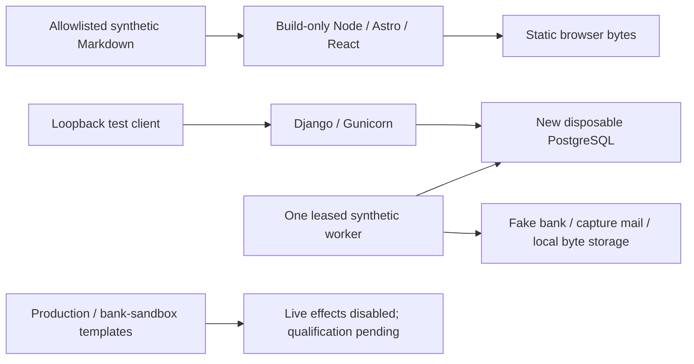

# Synthetic skeleton service boundaries

Local/synthetic evidence covers static generation, actual healthy HTTP/DB/worker paths, deterministic fake fixtures, safe startup/logging and public canary rejection. A mocked readiness exception is not actual outage proof. Off-host runtime interruption/exhaustion/recovery, selected-bank sandbox, actual OVH and production are separate evidence classes; none is inferred here.

Customer shop.xspi.pro and proposed staff shop-admin.xspi.pro remain hostname intent. No DNS/TLS, public privileged/MFA route, ingress authorization or provider activation occurs. Build/runtime secrets stay outside public allowlists, browser persistence and ordinary logs. Operator resource credentials may be read from repository .env only as needed for authorized operations; missing names are added blank and the user fills values there. Synthetic boundary tests never read real .env. Runtime _FILE contracts remain distinct.

Future T05/T08 must archive recoverable snapshots before effects, distinguish prepared from completed evidence and treat uncertain bank dispatch as uncertain without blind retry. This synthetic probe implements none of those financial/archive guarantees. It activates no provisional price, right or approval and creates no competing product catalog. Human source-fidelity review of this diagram/index remains pending.

Utility analogs: docs/product-source/verify_t01.py supplies bounded-check/hash evidence conventions; docs/implementation-evidence.md supplies attributable documentation scope conventions. Neither implements these schemas, authorization or logs.

A separate selected local prepared-byte command now binds existing durable authorization to an exact private root, claims one job, publishes/readbacks outside database transactions and records fenced technical verification. See [local command and uncertainty procedure](local-prepared-archive.md). Its results retain false retention/effect flags; the diagram above describes the earlier synthetic probe path. Independent qualification and the domain effect gates remain pending.
